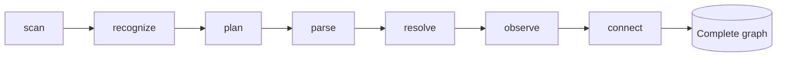

# Daodan

<p align="center">
  
</p>

<p align="center">
  <strong>Code Intelligence Platform</strong><br>
  A verifiable map of the code and a composed, evidence-bound review, for LLM coding agents.
</p>

Daodan gives a coding agent two things it cannot get from a prompt: a local,
refreshable understanding of the repository, and a review whose findings cite
source and survive independent verification. Sources remain the authority.

## How the graph is built

"Analysis" is the whole pipeline, from the static steps to the dynamic one and then the model. A gap is declared
and measured after the last step, never on the result of one step alone: what a step leaves open is the input of
the next one.

Seven steps, always in this order: each starts from what the ones before it established, and none finds out
again what another already knows. Each uses the official tool of what it reads, behind an adapter, and writes
what it could not do as a gap. The step names are those of the approved design; the last column says what the
code does today.



| Step | What it does | Runs project code | In the code today |
|---|---|---|---|
| 1. `scan` | Walks every folder and file, then asks the build tools for modules, build units and test commands | Only inside the container | Step `scan`; the file inventory is written before the pipeline (`snapshot.py write`) |
| 2. `recognize` | Names frameworks, libraries, tools and services | No | Step `stack` |
| 3. `plan` | Decides which adapter runs on which part, and what each needs | No | A function (`pipeline/plan.py`) with three callers, not a step |
| 4. `parse` | Reads the source files the plan gives it: symbols, imports, calls | No | Step `parse`; today the files are read before the pipeline, with the inventory (`snapshot.py write`), and the step finds them read |
| 5. `resolve` | Resolves each call to its target | Only inside the container | Step `analyze` |
| 6. `observe` | Runs the project's tests and records what they call; starts the app the project declares and presses its controls in a browser | Only inside the container | Step `dynamic` |
| 7. `connect` | Joins the graphs and lists what is missing | No | Step `union`: it lists, it does not join yet |

What each step leaves open, and who takes it:

| Step | Leaves open | Taken by |
|---|---|---|
| `parse` | Every call without a single lexical binding: dynamic receivers, computed members, type-only imports | `resolve` |
| `resolve` | The calls its index gives no target for, counted by class of hole (a receiver typed `any`, a value called) | `observe`, wherever a test or a pressed control executes the call |
| `observe` | The calls no test executes | `connect` lists them as holes of the complete graph; not measured after the model |
| `connect` | The links between modules that are not calls: routes, HTTP calls, events, tables | After the pipeline: link rules the model writes once and the machine applies and verifies |

After the pipeline the model writes semantic cards and link rules, and flows connect writers, readers and user
actions. The measures are in the benchmarks: [indexers](benchmarks/inference-audit/README.md),
[dynamic step](benchmarks/call-provenance/README.md),
[whole pipeline on the corpus](benchmarks/project-model/README.md).
[The process, its tools, example graphs and the measured figure of the dynamic step](docs/plugins/codebase-map.md#pipeline).

## How Daodan identifies the stack

The stack step matches each module's package declarations, available dependency evidence from its build tools,
container images and distinctive filenames against the shipped technology registry. It also reads Swift imports and
qualified ExUnit calls. Each match keeps its file and, when available, its line. A configured service is reported
separately from an SDK or a URL mention. For example, a Spring Boot starter in a Maven module identifies Spring Boot
in that module. A Telegram API URL in configuration is a mention.

Daodan maintains its extra rules in [registry-additions.json](daodan/data/registry-additions.json).
The [project-model benchmark](benchmarks/project-model/README.md) compares the shipped registry and upstream Specfy,
and includes an adapter that loads compatible Daodan rules into Specfy.

## Plugins

| Plugin | Responsibility | Entry |
|---|---|---|
| [Codebase Map](plugins/codebase-map/README.md) | Inventory, symbols, relationships, semantic descriptions with provenance, build units and modules, served to the agent on demand | `skills/map`, MCP tools `codebase_map_*` |
| [senior-review](plugins/senior-review/README.md) | Review of a change, branch, PR, plan or document: measured roster, focused auditors composed per review, evidenced findings, adversarial verification, coverage gaps | `skills/review-method` |

senior-review depends on Codebase Map; Codebase Map stands alone.

## How it works

1. **Map.** `daodan snapshot write` records files, symbols, imports, calls and
   manifests in a local SQLite snapshot, derives the module graph and starts the
   pipeline above; semantic cards and the interconnect map are produced by the map
   method and bound to the snapshot digest, so a stale description is detectable.
2. **Ask.** The agent queries the map through the MCP tools (`codebase_map_search`,
   `_outline`, `_read`, `_edit_impact`, `_modules`, …) or `daodan snapshot` instead of
   reading the tree; results carry `file:line` and status.
3. **Review.** The model reads the request and decides the rigor (`quick`,
   `standard`, `deep`); `daodan review-roster` adds a floor from risk signals and fixes
   the verification level. The coordinator understands the object and chooses the
   reviewers by reading their mandates; `daodan composition` binds the chosen reviewers
   into isolated jobs made of focused role files; each finding declares premise,
   provenance, trigger and evidence class; a verification panel scaled to the rigor
   tries to falsify it; the report lists findings, questions for the author and
   coverage gaps.

Roles cover one defect class each (authorization, transaction integrity,
temporal resilience, …) and are composed into larger reviewers in
`daodan/review/catalog.toml`; the light review and the quick and standard
automatic rosters use the `code-auditor` composition. Light binding folds
the required specialists into its single job. See [senior-review](plugins/senior-review/README.md#review-leggera).

## Install

Daodan is an application; the plugins are light skills that tell a harness how to
use it.

```text
uv tool install git+https://github.com/acaprino/daodan   # the application: `daodan app`, `daodan mcp`
claude plugin marketplace add acaprino/daodan            # optional: the skills for Claude Code
claude plugin install codebase-map@daodan
claude plugin install senior-review@daodan
```

`daodan app` starts the standalone app (a GitHub repository, an OpenAI-compatible
endpoint or a local command-line engine). From a checkout, `uv tool install <path>`
and `claude plugin marketplace add <path>` use the folder instead. The map entry is
the skill `/codebase-map:map <request>`; its `codebase-map` MCP server is
`daodan mcp`. `/reload-plugins` re-reads the plugin files but does not restart
that server.

Both packaged interfaces use Imago for controls, layouts and styles. Their sources are in `viewer/app/`
and `viewer/src/`. To rebuild the offline pages packaged with Python, run `npm ci`
and `npm run build` in `viewer/`. Run `npm test` for the explorer model and
`npm run test:ui` for the packaged pages after installing Playwright Chromium. `npx imago-check`
checks the viewer against Imago's design rules; the Viewer workflow runs it with the tests and the build.

## Requirements

- Python ≥ 3.12. The installation carries `mcp`, `tree-sitter`,
  `tree-sitter-language-pack`, `sqlglot`, `keyring` and `PyYAML`. Indexers and
  recorders are downloaded on first use, pinned and checksummed.
- A container engine for the steps that run project code: Docker or Podman, or on
  Windows Kiri in a WSL 2 distribution of Daodan. Without one those steps are
  declared gaps, never a run on the host.
- A host that can run shell commands and dispatch isolated agent contexts.
  Plugin content is host-generic; command and worker bindings come from the host.

## Documentation

- [Codebase Map reference](docs/plugins/codebase-map.md): the pipeline, what each step leaves open, the measures
- [Languages and tools](docs/plugins/codebase-map-linguaggi.md) · [What is supported, generated with its measures](docs/plugins/codebase-map-supporto.md)
- [Design: Codebase Map and semantic review](docs/specs/2026-11-03-semantic-review-foundation.md) · [Pipeline](docs/specs/2026-11-15-pipeline-di-analisi.md)
- [Research: context building](docs/research/context-building-research.md) · [Research: prompt design and brevity](docs/research/prompt-engineering-and-brevity.md)
- Flows, in three phases: [1, working run and review rules](docs/specs/2026-11-09-working-run-and-review-fixes.md) · [2, flows and units](docs/specs/2026-11-18-flussi-e-mappa-del-sistema.md) · [3, do they help review](docs/specs/2026-11-09-flows-in-review.md) · [literature](docs/research/2026-11-11-flow-reconstruction-detailed.md)
- Dynamic step, tests in a container: [spec](docs/specs/2026-11-12-passo-dinamico.md) · [program execution](docs/specs/2026-11-19-esecuzione-del-programma.md) · [UI recognition and web execution](docs/specs/2026-11-19-interfacce-del-progetto.md)
- [Roadmap](docs/roadmap.md)
- [Working rules for agents in this repository](AGENTS.md)

## License

[MIT](LICENSE)
