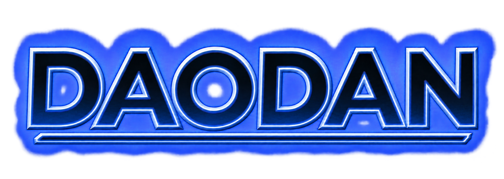

# Daodan

<p align="center">
  
</p>

Daodan is a development harness for projects built with AI. It augments your coding
agent with a coherent way to understand a project, make changes, verify their
consequences and preserve what was learned, alongside domain verticals, office
workflows, web research and specialized framework toolkits.

Understanding comes first, and it comes from the Codebase Map. `codebase-map`
analyzes the source statically and records the project as Meta-Code: an inventory
of files and symbols, their interfaces, effects and interconnections, persistent
semantic cards that stay fresh as the code changes, and evidence-backed leads on
risks. Review, design diagnosis, documentation, handover and the Senior Maintainer
campaign read that map instead of rediscovering the project on their own:
`senior-review`, `abstraction-architect`, `project-knowledge` and
`project-lifecycle` declare it as a mandatory dependency.

The map supplies evidence and leads, never verdicts. Correctness belongs to
senior-review, documentation to project-knowledge and tests to testing, and each
owner confirms a lead by reading source before acting on it. The map stays
static: runtime behavior counts only when the project's own tests or the user
supply it.

## Use the map with or without commands

An existing map is a reusable navigation layer, not only the output of
`/daodan:map-code`. During ordinary project questions, debugging, feature work,
refactoring, reviews and documentation, an LLM can load `codebase-map:map-method`
without the `daodan` entry plugin. It finds completed runs, locates symbols and
documentation through outlines, graphs, cards and artifacts, and inspects edit
impact before broad source exploration. Analyze and composed workflows use the
same navigation contract.

Consumption is read-only: it never implicitly creates, updates, deepens, migrates
or publishes an analysis. Verify material behavior against current source. If no
usable map exists or the relevant evidence is stale, disclose the gap and continue
with ordinary repository exploration. Loading the skill starts no analysis; the
first map requires an explicitly requested analysis, or `/daodan:map-code` when
the entry plugin is installed. Host activation and MCP registration are covered
in the [host reference](docs/hosts.md#standalone-codebase-map-consumption), and
the detailed contract in [shared and standalone model consumption](docs/plugins/codebase-map.md#shared-and-standalone-model-consumption).

Its job is to keep behavior, code, tests, instructions, documentation and artifacts
in agreement. It helps recover fragmented projects and avoid adding another layer
of duplication, dead code, misleading tests or forgotten experimental output.

One hand-authored source ships to Claude Code, GitHub Copilot, Codex, Pi and
OpenCode V2. Useful language, framework and domain specialists remain independent;
`skill-catalog` discovers every installed plugin's knowledge sidecars automatically
and selects the ones each run's evidenced stack and domain call for.

## One command per intention

Every command lives in the `daodan` plugin and takes no parameters: the only
argument is what you want, in your words, or a path, commit, branch or pull
request. Authorizations are asked when a step needs them, once. Each command
works alone and is also a step of the task cycle.

| Group | Command | Use it for |
|---|---|---|
| Project | `/daodan:init-project` | Bring a project into the cycle: map, decision index, verified commands, test baseline. Scaffolds an empty folder |
| | `/daodan:onboard-project` | Understand a project you take over; changes nothing |
| | `/daodan:check-health` | Diagnose debt in structure, tests, docs, workspace and each stack, with a plan |
| | `/daodan:run-maintenance` | The guided Senior Maintainer campaign, stage by stage |
| Thinking | `/daodan:brainstorm-idea` | Explore an idea against your code before building it |
| | `/daodan:investigate-problem` | Find the cause of an error or a strange behavior, with a reproduction test, without fixing it |
| | `/daodan:get-second-opinion` | Have another model challenge a file, or several deliberate a question |
| Working | `/daodan:new-feature` | New behavior through the task cycle |
| | `/daodan:fix-bug` | A defect, reproduction test first |
| | `/daodan:refactor-code` | Restructure with behavior unchanged, readability included |
| | `/daodan:continue-task` | Resume the branch's task from any session; your text answers pending questions |
| | `/daodan:show-status` | Open tasks, who holds them, pending questions, map and records |
| | `/daodan:finish-task` | Branch review, merge with your authorization, record verified when there is one, knowledge realigned |
| | `/daodan:sync-upstream` | Bring in others' commits: fetch, report, fast-forward only, realign |
| Review | `/daodan:review-changes` | Light review of your changes, a commit, a file or a document |
| | `/daodan:review-branch` | Complete review of a branch or a pull request |
| Tools | `/daodan:write-tests` | Tests for the code you name |
| | `/daodan:map-code` | Deepen the Codebase Map on an area, or map the project |
| | `/daodan:write-docs` | Realign the docs, or write a guide, the README or the instructions |
| | `/daodan:record-decision` | A decision record outside a task; turns records on for a project without them |
| | `/daodan:tidy-repo` | Junk files, dead code, redundant tests: preview, then one authorization |
| | `/daodan:humanize-text` | Make a text read naturally without inventing content |

When unsure which work command fits, use `new-feature`: the interview corrects
the course. On the other hosts the names follow the host: `/daodan-new-feature`
on Pi, the `new-feature-workflow` skill on Codex, the `new-feature` prompt on
Copilot; OpenCode V2 uses the Claude Code form.

## Work task by task

```text
/daodan:init-project                  once per project
/daodan:brainstorm-idea <idea>        when the idea is not clear yet
/daodan:investigate-problem <error>   when the cause is not known
/daodan:new-feature <what>            or fix-bug, refactor-code
    a light review before every commit
/daodan:finish-task                   branch review, merge, realignment
```

A work command asks whether to work in a worktree, a branch or in place, then
interviews you with real examples from your code, one question at a time, until
scope, examples, rejected alternatives and invariants are fixed. It writes them
as a proposed decision record under `docs/adr/` when the project keeps decision
records, a choice asked once at its first use, or into the task's run otherwise;
then it plans waves of micro-tasks of at most
four files, has the stack's specialist write each one test first, and commits each
with a line naming the task and wave. It stops only for your answers, the plan
approval and the merge authorization. How many reviewers each review gets is
computed by a script from the diff and the map, never chosen by the model. The
cycle is described phase by phase in
[project-delivery](docs/plugins/project-delivery.md#the-task-cycle).

Run records live in `.daodan/runs/<id>/` of the main checkout, with an agenda of
open tasks beside them. A task belongs to its branch and resumes from any session;
the agenda row is also the lock that stops two sessions working on one task. A
missing worker or an unexecuted check stays visible.

Preview is the default wherever something would change. Edits, commits, a merge,
a push and a permanent deletion are separate authorizations, each asked at the
step that needs it. Quarantine moves preserve data and do not count as deletion.

## Install

Register the repository marketplace on the corresponding host:

```bash
claude plugin marketplace add acaprino/daodan
copilot plugin marketplace add acaprino/daodan
codex plugin marketplace add acaprino/daodan
```

Install `daodan@daodan`: it brings the core development harness and language/stack
providers as mandatory local dependencies, and stops a command when one of them is
disabled. Domain verticals (`office`, `research`, `digital-marketing`, `trading-broker-integration`
and the others in the catalog) can be installed alongside it from the same
marketplace. External dependencies must also be available on the host (see the
[host reference](docs/hosts.md)).

The project-delivery plugin owns its task cycle and declares no upstream development method:
its interview, plan and execution are shaped by the Codebase Map, the decision
records under `docs/adr/` when the project keeps them, and the protocol's wave rules. Testing uses
mattpocock-skills@mattpocock and developer-essentials@claude-code-workflows.
The [dependency catalog](.claude-plugin/marketplace.json) records the exact declarations.
No upstream method is copied into a second local implementation.

Pi installs the tagged repository as one package:

```bash
pi install git:github.com/acaprino/daodan@v<metadata.version>
```

Select components through package globs in Pi settings. Isolated workers use
pi-subagents; MCP uses pi-mcp-adapter, as declared by the adapter.

OpenCode V2 installs the generated package through npm's repository-path selector:

```bash
opencode plugin add 'github:acaprino/daodan#v<metadata.version>::path:exports/opencode'
```

OpenCode Desktop uses its bundled V2 service. Loader options select plugins and
close mandatory local dependencies; exclusions cannot remove a required dependency.
Use an existing released tag in place of <metadata.version>.

See [host distribution and migration](docs/migration-from-claude-code-daodan.md)
and [the harness migration](docs/migration-to-coherent-harness.md).

The [complete plugin catalog](docs/catalog.md) lists every registered skill, role
and workflow through its plugin page, with mandatory direct and transitive
dependencies. The [host reference](docs/hosts.md) explains the corresponding
commands, paths, installation requirements and runtime limits on each host.

## Canonical owners

| Plugin | Responsibility |
|---|---|
| [daodan](docs/plugins/daodan.md) | The commands: one per intention, each an entry into its owner's method |
| [codebase-map](docs/plugins/codebase-map.md) | The core: the static Meta-Code map of structure, behavior and interconnections that the other owners read |
| [project-delivery](docs/plugins/project-delivery.md) | Analysis, ADR/FRD, specifications, adversarial plans, Deadly Brain execution, verified commits and merge |
| [project-lifecycle](docs/plugins/project-lifecycle.md) | Assessment, handover and Senior Maintainer coordination |
| [work-controller](docs/plugins/work-controller.md) | Run identity, snapshots, state, verification and recovery |
| [project-knowledge](docs/plugins/project-knowledge.md) | Durable instructions, guides, documentation and README |
| [senior-review](docs/plugins/senior-review.md) | Unified correctness review, automatic stack specialists and application subtraction |
| [testing](docs/plugins/testing.md) | Meaningful test authoring, suite diagnosis and protection-preserving remediation |
| [abstraction-architect](docs/plugins/abstraction-architect.md) | Concept ownership, duplication and design diagnosis |
| [repo-hygiene](docs/plugins/repo-hygiene.md) | Filesystem/Git hygiene and reversible workspace operations |
| [clean-code](docs/plugins/clean-code.md) | Readability with behavior preserved |
| [text-humanizer](docs/plugins/text-humanizer.md) | Natural prose without invented content |

Knowledge writes instructions, guides and the README. Project Delivery owns decision
and requirement records plus delivery coordination. Each distinguishes approved intent from
observed implementation and updates existing documents first.
Operational state never belongs in AGENTS.md or CLAUDE.md.

A failed test can expose a product bug, wrong oracle, environment problem or
flakiness. Testing classifies the cause before quarantine. Refactoring alone does
not retire behavioral protection; count and coverage do not prove equivalence.

The three cleanup owners have different evidence: senior-review understands
application source, testing understands protection, repo-hygiene understands
filesystem and Git. Consolidation manages a run's owned evidence and retention.
It does not grant arbitrary repository deletion.

## Specialist extras

| Area | Independent plugins |
|---|---|
| Languages | [python-development](docs/plugins/python-development.md), [typescript-development](docs/plugins/typescript-development.md), [kotlin-development](docs/plugins/kotlin-development.md) |
| UI, web and desktop frameworks | [react-development](docs/plugins/react-development.md), [platform-engineering](docs/plugins/platform-engineering.md), [frontend-review](docs/plugins/frontend-review.md), [pwa-expert](docs/plugins/pwa-expert.md), [browser-extensions](docs/plugins/browser-extensions.md), [tauri-development](docs/plugins/tauri-development.md), [xterm](docs/plugins/xterm.md), [obsidian-development](docs/plugins/obsidian-development.md), [libgdx-development](docs/plugins/libgdx-development.md) |
| AI, research and deliberation | [ai-tooling](docs/plugins/ai-tooling.md), [rag-development](docs/plugins/rag-development.md), [research](docs/plugins/research.md), [peer-review](docs/plugins/peer-review.md), [moe](docs/plugins/moe.md), [model-routing](docs/plugins/model-routing.md) |
| Office, business and marketing | [office](docs/plugins/office.md), [business](docs/plugins/business.md), [digital-marketing](docs/plugins/digital-marketing.md), [stripe](docs/plugins/stripe.md) |
| Domain and infrastructure verticals | [trading-broker-integration](docs/plugins/trading-broker-integration.md), [grabber-development](docs/plugins/grabber-development.md), [app-analyzer](docs/plugins/app-analyzer.md), [csp](docs/plugins/csp.md), [messaging](docs/plugins/messaging.md), [opentelemetry](docs/plugins/opentelemetry.md), [docker](docs/plugins/docker.md), [dependency-audit](docs/plugins/dependency-audit.md) |
| Shared capabilities and utilities | [skill-catalog](docs/plugins/skill-catalog.md), [report-rendering](docs/plugins/report-rendering.md), [learning](docs/plugins/learning.md), [system-utils](docs/plugins/system-utils.md), [marketplace-ops](docs/plugins/marketplace-ops.md) |

Reverse engineering of shipped applications and binaries is delegated to
[REA (Reverse Engineer Anything)](https://github.com/morluto/rea). Its upstream
`reverse-engineer-anything` skill works with the `rea-agents` CLI/MCP runtime.
Follow [REA setup](https://github.com/morluto/rea/blob/main/docs/installation.md)
to install the matching instructions and tools for your agent. Native analysis
also requires a supported analysis engine. Source-repository mapping remains
with Codebase Map.

## Presentations, spreadsheets and documents

The [Office plugin](docs/plugins/office.md) creates and revises editable `.pptx`,
works with native `.xlsx` cells, formulas, tables and charts, and reads, creates
or edits `.docx` paragraphs, styles, tables and sections. Existing-file edits
include preservation checks for content and features the task needs to retain.
Presentations combine creative designer/reviewer roles, SlidePoise generation,
DeckCraft editing and preview, and the active harness's image-generation tool.

On Claude Code or OpenCode V2, use `/office:presentation`,
`/office:workbook` or `/office:document`. The [host guide](docs/hosts.md#office-entry-points)
lists the corresponding Codex skills, Copilot prompts and Pi commands. A normal
request can describe the outcome, source files, language and template:

```text
Create an editable Italian PowerPoint from this workbook and Word report.
Preserve the source figures, use our brand assets and include a reviewed preview.
```

SlidePoise needs its separate runtime, image-generation tools and a compatible
presentation renderer. Excel and Word use an available engine that supports the
requested file features. The plugin's read-only inspectors provide structure and
preservation evidence; actual recalculation, field updates and visual page review
need the corresponding engines. See [Office setup and examples](docs/plugins/office.md#setup-and-first-use).

## What is verified

The compiler validates kernels, bindings, contracts and generated packages.
Atomic helpers mechanically protect their own records and retained artifacts.
Semantic truth, test oracles and permission provenance still require evidence and
the coordinator's judgment. Prompt obligations are identified as such.

Codebase Map is static: inventory, files read in depth and runtime-exercised paths are
reported separately. Since Map 7.0.0 / marketplace 35.0.0, snapshots default to
SQLite; `--format json` explicitly selects upstream compatibility. Source tools
send selected text with counts and truncation, while reports remain Markdown.
See [snapshot formats and source reading](docs/plugins/codebase-map.md#reading-source-from-a-snapshot)
and the [release verification record](docs/superpowers/reports/2026-10-16-codebase-map-binary-storage.md).
A generated package test is distinct from an installed-host
execution probe. External private app storage is not a supported run root until
its permission binding is demonstrated.

Tri-Tech Code can consume these OpenCode packages and run contracts as an external
application. The marketplace stays public and neutral.

## Upstream projects and inspiration

[agent-html-kit](https://github.com/leex279/agent-html-kit) inspired the separation
of agent-authored content from reusable HTML presentation. Daodan's
[report renderer](docs/plugins/report-rendering.md) is an original implementation
that preserves Markdown as the canonical report and adds optional offline HTML
views for analyses, brand naming and reviews.

[andrej-karpathy-skills](https://github.com/multica-ai/andrej-karpathy-skills)
is the MIT-licensed source of four working principles adopted by Daodan: Think
Before Coding, Simplicity First, Surgical Changes and Goal-Driven Execution.
[Project knowledge](docs/plugins/project-knowledge.md) adapts them for project
instruction creation and maintenance, preserving equivalent project guidance and
adding local rules for verification and shared ownership.

[blader/humanizer](https://github.com/blader/humanizer), by Siqi Chen (MIT), is an
upstream source for [text-humanizer](docs/plugins/text-humanizer.md). The local
derivative keeps local pattern numbering, fact-preservation safeguards,
registers, an Italian language profile and its own file-editing contract. Upstream
changes are reconciled selectively rather than replacing those local rules.

## Contributing

> [!WARNING]
> **Never repair generated exports by hand or equate registration with execution.**
> Correct kernels, adapters or compiler source, then review all five hosts through
> nested references and worker resources. Agents/coordinators execute and verify;
> harnesses own supported continuation and state; skills supply methods. A turn
> end or empty child is not task success. Real tools, identities, isolation,
> permissions, dependencies, capture controls and output contracts require the
> [operational checks](docs/hosts.md#operational-compatibility-review), separately
> from manifest parity and live workflow evidence.

Edit kernels under plugins/ and host mechanisms under adapters/. All exports and
root catalogs are generated. Runtime resources belong under skills/. The toolchain
is stdlib Python; OpenCode's fixed loader uses Node's standard library.

```bash
python scripts/daodan_build.py
python scripts/daodan_build.py --check --support
python -m unittest discover -s tests
python scripts/sync_codex_instructions.py --check
python scripts/sync_plugin_docs.py --check
```

Follow [CLAUDE.md](CLAUDE.md) for dependency, version and publication rules.
[Architecture](docs/superpowers/specs/2026-10-07-daodan-coherent-harness-design.md)
and [implementation plan](docs/superpowers/plans/2026-10-07-daodan-coherent-harness.md)
record this migration. [Behavioral evals](evals/) complement deterministic compiler
and helper tests.

MIT licensed. The Daodan is the symbiote that augments its host.


## Scope-aware knowledge selection

The shared [Skill Catalog](docs/plugins/skill-catalog.md) selects knowledge from
actual available host/project skills for each evidenced task scope. Senior Review
uses it across languages and frameworks with one preparation, delivery ledger,
verification panel and report. Skills declare their own SKILL.toml metadata; adding
a competence needs no new reviewer or central stack table. Selected inputs carry
content fingerprints and per-worker delivery accounting. External unclassified
skills and unavailable inventory remain explicit coverage gaps.
