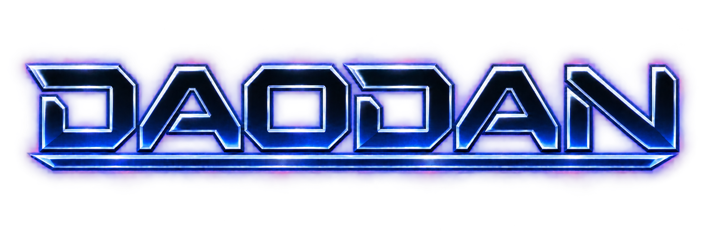
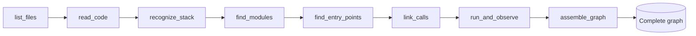

# Daodan

<p align="center">
  
</p>

<p align="center">
  <strong>Code Intelligence Platform</strong><br>
  A verifiable map of the code and a composed, evidence-bound review, for LLM coding agents.
</p>

Daodan gives a coding agent two things it cannot get from a prompt: a local,
refreshable understanding of the repository, and a review whose findings cite
source and survive independent verification. Sources remain the authority.

## How the graph is built

Eight steps, always in this order: each starts from what the ones before it established, and none finds out
again what another already knows. Each uses the official tool of what it reads, behind an adapter, and writes
what it could not do as a gap. The eight ids are the design ([`docs/specs/architettura.md`](docs/specs/architettura.md),
"La pipeline a otto step"); the code still runs six steps (`pipeline.STEPS` in `daodan/core/pipeline/__init__.py`:
`scan`, `stack`, `parse`, `analyze`, `dynamic`, `union`) until the plan's step T1.D renames them. The last column
says where each id is in the code today.



| Id | What it does | Runs project code | In the code today |
|---|---|---|---|
| 1. `list_files` | Walks every folder and file: path, size, hash, language | No | `file_inventory.write`, before the pipeline |
| 2. `read_code` | Reads each file: symbols, imports, references | No | `snapshot.read_project` (with `snapshot.write_reading`), before the pipeline |
| 3. `recognize_stack` | Names build tools, frameworks, libraries and services | No | Step `stack`, which runs after `scan` |
| 4. `find_modules` | Asks the build tools for modules, build units, packages and test commands | Only inside the container | Step `scan`, minus routes and events |
| 5. `find_entry_points` | Finds where a user or a request enters, each tied to its function | Only inside the container | The framework sources and Noir, now in `scan` (`premap.SOURCES`), plus `entries.py` and `binder.py`, which run after the pipeline |
| 6. `link_calls` | Resolves each call to its target | Only inside the container | Step `analyze` |
| 7. `run_and_observe` | Runs the project's tests and records what they call; starts the app the project declares and presses its controls in a browser | Only inside the container | Step `dynamic` |
| 8. `assemble_graph` | Joins the graphs and lists what is missing | No | Step `union`: it lists, it does not join yet |

The plan is not a step: it is the function `pipeline.plan` (`daodan/core/pipeline/plan.py`). The step `parse` has no
id: it only says that plan.

After the pipeline the model writes semantic cards and link rules, and flows connect writers, readers and user
actions. [The process as the code runs it today, what is left to reach the design, its tools and example graphs](docs/plugins/codebase-map.md#pipeline).

## How Daodan identifies the stack

Only [stack-analyser-daodan](https://github.com/acaprino/stack-analyser-daodan), a fork of Specfy's
stack-analyser, recognizes frameworks, libraries, tools and services, in the fast and the full scan alike. Daodan
runs a pinned release, checked by sha256, with its own Node: it reads files and executes nothing of the project.
It receives the packages and images Daodan already read, each with its source, and reads the project's files itself.
Each sign keeps its file, its line when known, its source and the scan it comes from; a scan keeps the signs of the
sources it did not run. A URL host in the sources is a mention. For example, a Spring Boot starter in a Maven module
identifies Spring Boot in that module.

The technology registry ([service-registry.json](daodan/data/service-registry.json)) only names: name, category,
type, site, mark. It is generated from the release's catalogue; [registry-additions.json](daodan/data/registry-additions.json)
adds names, sites, categories and marks, never rules. [How a scan goes, step by step](docs/plugins/codebase-map.md#lo-step-stack).

## Package registries of the preparation

Project code runs only in Daodan's container. Its preparation reaches the package registries through a proxy, and
nothing else; the tests run with no network. The registries are listed in
[package-managers.json](daodan/data/package-managers.json). The managers' names come from Wikipedia's
[List of software package management systems](https://en.wikipedia.org/w/index.php?title=List_of_software_package_management_systems&oldid=1379970373),
revision 1379970373 of 13 October 2026, read on 24 November 2026. Only the managers a Linux container restores
dependencies with are kept, plus Go modules; `toolchains` lists the downloads of the language toolchains that
Daodan's tools fetch. Wikipedia gives no hosts: they were written by hand and are probed by
[registry-hosts](benchmarks/registry-hosts/README.md). Hosts that take uploads beyond a package publish, such as
GitHub and container registries, stay out: like any other host, they open only once the user approves them in the
app, for the project or for one analysis.

## Plugins

| Plugin | Responsibility | Entry |
|---|---|---|
| [Codebase Map](plugins/codebase-map/README.md) | Inventory, symbols, relationships, semantic descriptions with provenance, build units and modules, served to the agent on demand | `skills/map`, MCP tools `codebase_map_*` |
| [senior-review](plugins/senior-review/README.md) | Review of a change, branch, PR, plan or document: measured roster, focused auditors composed per review, evidenced findings, adversarial verification, coverage gaps | `skills/review-method` |

senior-review depends on Codebase Map; Codebase Map stands alone.

## How it works

1. **Map.** `snapshot.py write` records files, symbols, imports, calls and
   manifests in a local SQLite snapshot and derives the module graph; semantic
   cards and the interconnect map are produced by the map method and bound to the
   snapshot digest, so a stale description is detectable.
2. **Ask.** The agent queries the map through the MCP tools (`codebase_map_search`,
   `_outline`, `_read`, `_edit_impact`, `_modules`, …) or `snapshot.py` instead of
   reading the tree; results carry `file:line` and status.
3. **Review.** The model reads the request and decides the rigor (`quick`,
   `standard`, `deep`); `review_roster.py` adds a floor from risk signals and fixes
   the verification level. The coordinator understands the object and chooses the
   reviewers by reading their mandates; `composition.py` binds the chosen reviewers
   into isolated jobs made of focused role files; each finding declares premise,
   provenance, trigger and evidence class; a verification panel scaled to the rigor
   tries to falsify it; the report lists findings, questions for the author and
   coverage gaps.

Roles cover one defect class each (authorization, transaction integrity,
temporal resilience, …) and are composed into larger reviewers in
`plugins/senior-review/plugin.toml`; the light review and the quick and standard
automatic rosters use the `code-auditor` composition. Light binding folds
the required specialists into its single job. See [senior-review](plugins/senior-review/README.md#review-leggera).

## Install

Daodan is an application; the plugins are light skills that tell a harness how to
use it.

```text
uv tool install git+https://github.com/acaprino/daodan   # the application: `daodan app`, `daodan mcp`
claude plugin marketplace add acaprino/daodan            # optional: the skills for Claude Code
claude plugin install codebase-map@daodan
claude plugin install senior-review@daodan
```

`daodan app` starts the standalone app (a GitHub repository, an OpenAI-compatible
endpoint or a local command-line engine). From a checkout, `uv tool install <path>`
and `claude plugin marketplace add <path>` use the folder instead. The map entry is
the skill `/codebase-map:map <request>`; its `codebase-map` MCP server is
`daodan mcp`. `/reload-plugins` re-reads the plugin files but does not restart
that server.

Both packaged interfaces are made of the components of [Sigrid](https://github.com/acaprino/sigrid), with no class and
no stylesheet of their own. Their sources are in `viewer/app/` and `viewer/src/`. To rebuild the offline pages packaged
with Python, run `npm ci` and `npm run build` in `viewer/`. Run `npm test` for the pages' models and
`npm run test:ui` for the packaged pages after installing Playwright Chromium. `npx --no sigrid-check src` and
`npx --no sigrid-check app` check the viewer against Sigrid's design rules; the Viewer workflow runs them with the tests
and the build.

## Requirements

- Python ≥ 3.12. The installation carries `mcp`, `tree-sitter` and `sqlglot`;
  `scip`/`jedi` are optional, for higher-fidelity resolution.
- No Node of your own: on first use Daodan downloads its pinned Node from nodejs.org and the stack-analyser
  release from github.com, into its shared folder. Offline, the stack step keeps its previous results and says why.
- A host that can run shell commands and dispatch isolated agent contexts.
  Plugin content is host-generic; command and worker bindings come from the host.

## Documentation

- [The architecture contract (the 8-step pipeline, tools, surfaces and plan)](docs/specs/architettura.md), [the active refactoring plan (T0–T3)](docs/plans/refactoring.md), and [the deferred backlog & retired approaches](docs/backlog.md); the specs and plans before them are in git's history, at commit `614c940`
- [Codebase Map reference](docs/plugins/codebase-map.md)
- [Research: context building](docs/research/context-building-research.md) · [Research: prompt design and brevity](docs/research/prompt-engineering-and-brevity.md)
- [Roadmap](docs/roadmap.md)
- [Working rules for agents in this repository](AGENTS.md)

## License

[MIT](LICENSE)
