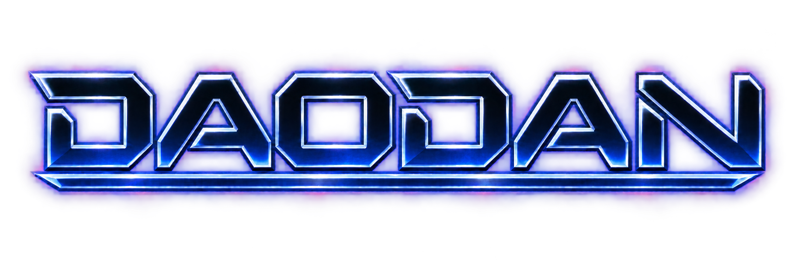
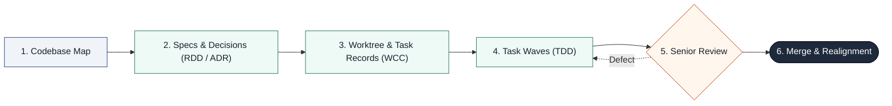

# Daodan

<p align="center">
  
</p>

<p align="center">
  <strong>Local code analysis and context optimization for development and research.</strong><br>
  A development harness with a broad library of specialist skills.
</p>

<p align="center">
  <a href="#install">Install</a> ·
  <a href="#work-task-by-task">Workflow</a> ·
  <a href="#one-command-per-intention">Commands</a> ·
  <a href="#plugin-skill-and-command-catalog">Plugins &amp; skills</a> ·
  <a href="#license">MIT License</a>
</p>

> [!NOTE]
> **TL;DR**
>
> Daodan gives coding agents a reusable understanding of your project and a task
> cycle for making verified changes. A local Codebase Map records the code;
> relevant skills supply context for analysis, development and research. Tasks keep
> decisions, changes, tests and documentation connected. Specialist plugins extend
> the same marketplace to Office, languages, frameworks, marketing and other domains.

| Plugins | Skills | Workflows | Agents |
|:---:|:---:|:---:|:---:|
| **48** | **95** | **65** | **141** |

## What sets Daodan apart

| Capability | What it gives your agent |
|---|---|
| A reusable local map | Files, symbols, interfaces, effects, connections and persistent semantic cards, with freshness tied to the code. |
| Context selected for the task | The Skill Catalog uses evidence of the stack and scope to choose relevant knowledge, with content fingerprints and delivery accounting. |
| Work that resumes | Task records, decisions and an agenda in the main checkout, so another session can continue the same work. |
| Explicit verification gates | Review and checks accompany changes; a missing worker delivery or required check keeps the task open. |
| One source, five hosts | Shared plugin content for Claude Code, GitHub Copilot, Codex, Pi and OpenCode V2, with host-specific bindings. |

The map supplies static evidence and leads. Each specialist verifies material
claims against source; runtime behavior needs the project's tests or user-supplied
evidence. See [what is verified](#what-is-verified) for the limits.

## Install

Choose your host. The `daodan` entry plugin provides the main commands and brings
its required local providers. Domain plugins can also be installed independently;
each plugin keeps its own dependency requirements.

<details>
<summary><strong>Claude Code</strong></summary>

```bash
claude plugin marketplace add acaprino/daodan
claude plugin install daodan@daodan
```

</details>

<details>
<summary><strong>Codex</strong></summary>

```bash
codex plugin marketplace add acaprino/daodan
codex plugin add daodan@daodan
```

</details>

<details>
<summary><strong>GitHub Copilot</strong></summary>

```bash
copilot plugin marketplace add acaprino/daodan
copilot plugin install daodan@daodan
```

</details>

<details>
<summary><strong>Pi</strong></summary>

Pi installs the tagged repository as one package:

```bash
pi install git:github.com/acaprino/daodan@v<metadata.version>
```

Select components through package globs in Pi settings. Isolated workers use
pi-subagents; MCP uses pi-mcp-adapter, as declared by the adapter.

</details>

<details>
<summary><strong>OpenCode V2</strong></summary>

OpenCode V2 installs the generated package through npm's repository-path selector:

```bash
opencode plugin add 'github:acaprino/daodan#v<metadata.version>::path:exports/opencode'
```

OpenCode Desktop uses its bundled V2 service. Loader options select plugins and
close mandatory local dependencies; exclusions cannot remove a required dependency.

</details>

For Pi and OpenCode, replace `<metadata.version>` with an existing released tag.
Required external providers must also be available on your host. A command stops
when a required provider is missing or disabled. Installing `office` does not
install its separate DeckCraft, WordCraft or GridCraft runtimes; the first
operation that needs one asks once, then installs the pinned official release
into `~/.daodan/engines`.

[Host setup and requirements](docs/hosts.md) ·
[Distribution and migration](docs/migration-from-claude-code-daodan.md)

<details>
<summary>Dependency and lifecycle details</summary>

The project-delivery plugin owns its task cycle and declares no upstream development method:
its interview, plan and execution are shaped by the Codebase Map, the decision
records under `docs/adr/` when the project keeps them, and the protocol's wave rules. Testing uses
mattpocock-skills@mattpocock and developer-essentials@claude-code-workflows.
The [dependency catalog](docs/catalog.md#mandatory-dependency-edges) records the exact declarations.
No upstream method is copied into a second local implementation.

The [complete plugin catalog](docs/catalog.md) records direct and transitive
requirements. The [harness migration](docs/migration-to-coherent-harness.md)
explains the lifecycle and ownership boundaries.

</details>

## Work task by task

```text
/daodan:init-project                  once per project
/daodan:brainstorm-idea <idea>        when the idea is not clear yet
/daodan:investigate-problem <error>   when the cause is not known
/daodan:new-feature <what>            or fix-bug, refactor-code
    a light review before every commit
/daodan:finish-task                   branch review, merge, realignment
```



Start with initialization, choose the command for the work, and finish with
review and realignment. Use the host-specific entry names below.

<details>
<summary>What the task cycle records and verifies</summary>

A work command asks whether to work in a worktree, a branch or in place, then
interviews you with real examples from your code, one question at a time, until
scope, examples, rejected alternatives and invariants are fixed. It reuses or
writes a project specification in `docs/specs/` and obtains approval of its exact
text before planning. When the project keeps decision records, every decision
the interview settles also becomes a `Proposed` record in `docs/adr/` that cites
the specification without duplicating it; the run links the specification and
its approval.
Then it plans waves of micro-tasks of at most
four files, has the stack's specialist write each one test first, and commits each
with a line naming the task and wave. It stops only for your answers, the plan
approval and the merge authorization. How many reviewers each review gets is
computed by a script from the diff and the map, never chosen by the model. The
cycle is described phase by phase in
[project-delivery](docs/plugins/project-delivery.md#the-task-cycle).

Run records live in `.daodan/runs/<id>/` of the main checkout, with an agenda of
open tasks beside them. A task belongs to its branch and resumes from any session;
the agenda row is also the lock that stops two sessions working on one task. A
missing worker or an unexecuted check stays visible.

Preview is the default wherever something would change. Edits, commits, a merge,
a push and a permanent deletion are separate authorizations, each asked at the
step that needs it. Quarantine moves preserve data and do not count as deletion.

</details>

## One command per intention

The core harness commands live in the `daodan` plugin and take no parameters: the only
argument is what you want, in your words, or a path, commit, branch or pull
request. Authorizations are asked when a step needs them, once. Each command
works alone and is also a step of the task cycle. Domain verticals keep their own
namespaces (`/office:*` is folded into `daodan` because its entries are general).

Claude Code's `/` menu also lists every installed skill, so a rulebook such as
`testing:test-hygiene` shows up there beside the commands. Such an entry loads
knowledge into the conversation and starts no workflow. The commands are the `/daodan:*` entries below and the domain
verticals' own workflows: to clean up a test suite, use `/daodan:maintain-tests`.

When unsure which work command fits, use `new-feature`: the interview corrects
the course. On the other hosts the names follow the host: `/daodan-new-feature`
on Pi, the `new-feature-workflow` skill on Codex, the `new-feature` prompt on
Copilot; OpenCode V2 uses the Claude Code form.

### Project

| Command | Use it for |
|---|---|
| `/daodan:init-project` | Bring a project into the cycle: map, decision index, verified commands, test baseline. Scaffolds an empty folder |
| `/daodan:onboard-project` | Understand a project you take over; changes nothing |
| `/daodan:check-health` | Diagnose debt in structure, tests, docs, workspace and each stack, with a plan |
| `/daodan:run-maintenance` | The guided Senior Maintainer campaign, stage by stage |

### Thinking

| Command | Use it for |
|---|---|
| `/daodan:brainstorm-idea` | Explore an idea against your code before building it |
| `/daodan:investigate-problem` | Find the cause of an error or a strange behavior, with a reproduction test, without fixing it |
| `/daodan:get-second-opinion` | Have another model challenge a file, or several deliberate a question |

### Working

| Command | Use it for |
|---|---|
| `/daodan:new-feature` | New behavior through the task cycle |
| `/daodan:fix-bug` | A defect, reproduction test first |
| `/daodan:refactor-code` | Restructure with behavior unchanged, readability included |
| `/daodan:continue-task` | Resume the branch's task from any session; your text answers pending questions |
| `/daodan:show-status` | Open tasks, who holds them, pending questions, map and records |
| `/daodan:worktrees` | List task workspaces, manage descriptions and tags, and create or resume a workspace |
| `/daodan:finish-task` | Branch review, merge with your authorization, record verified when there is one, knowledge realigned |
| `/daodan:sync-upstream` | Bring in others' commits: fetch, report, fast-forward only, realign |

### Review and tools

| Command | Use it for |
|---|---|
| `/daodan:review-changes` | Light review of your changes, a commit, a file or a document |
| `/daodan:review-branch` | Complete review of a branch or a pull request |
| `/daodan:write-tests` | Tests for the code you name |
| `/daodan:maintain-tests` | Audit, clean up, reorganize or consolidate an existing test suite with verified protection. Removals are proposed per test, and an unanswered one stays |
| `/daodan:map-code` | Deepen the Codebase Map on an area, or map the project |
| `/daodan:write-docs` | Realign the docs, or write a guide, the README or the instructions |
| `/daodan:humanize-text` | Make a text or file read naturally without inventing content |
| `/daodan:record-decision` | A decision record outside a task; turns records on for a project without them |
| `/daodan:tidy-repo` | Junk files, dead code and redundant tests in one pass, the tests through the same method as `maintain-tests`: preview, then one authorization |

### Office

| Command | Use it for |
|---|---|
| `/daodan:start` | Route files, notes or a mixed Office request to the right methods |
| `/daodan:presentation` | Create, revise or review an editable PowerPoint deck |
| `/daodan:document` | Create, revise or review an editable Word document |
| `/daodan:workbook` | Create, edit or analyze an Excel workbook |
| `/daodan:verify` | Inspect a Word, PowerPoint or Excel file for integrity defects |
| `/daodan:fix` | Repair Office integrity defects in a separate candidate |
| `/daodan:theme` | Create or inherit reusable PowerPoint and Word themes and templates |

<details>
<summary>Office methods and separate runtimes</summary>

Office keeps its methods, helpers and specialist roles in `office`; all seven
entries live in `daodan`. Its shared intake routes the requested operation, its
design method connects editable Word documents and PowerPoint decks, and its
format methods preserve supplied files and verify saved candidates. Native
construction and rendering use separately available DeckCraft, WordCraft and
GridCraft runtimes; installing the plugin does not install those engines, the
first operation that needs one asks once and installs it. See
[Office](docs/plugins/office.md) for the format and runtime contracts.

</details>

## Plugin, skill and command catalog

All **48 local plugins**, **95 registered skills**, **65 commands/workflows** and
**141 agents/roles**, grouped below. Open a category, then a plugin to see its
complete component list and source links.

Skills supply methods and knowledge; agents are dispatched roles. Names are
canonical kernel IDs. Commands use `/plugin:workflow`; other hosts map the same
entries through their adapters. Composed roles link to their manifest declaration.
Registration describes available content, not proof of installed-host execution.
See the [dependency catalog](docs/catalog.md) and [host reference](docs/hosts.md).

<details>
<summary><strong>Development harness and project knowledge</strong> · 13 plugins</summary>

<details>
<summary><code>daodan</code> · Enter the project task cycle and Office workflows.</summary>

[Plugin guide](docs/plugins/daodan.md) · [Manifest](plugins/daodan/plugin.toml)

| Components | Registered names |
|---|---|
| Skills | None |
| Commands / workflows | [/daodan:init-project](plugins/daodan/workflows/init-project.md), [/daodan:onboard-project](plugins/daodan/workflows/onboard-project.md), [/daodan:check-health](plugins/daodan/workflows/check-health.md), [/daodan:run-maintenance](plugins/daodan/workflows/run-maintenance.md), [/daodan:brainstorm-idea](plugins/daodan/workflows/brainstorm-idea.md), [/daodan:investigate-problem](plugins/daodan/workflows/investigate-problem.md), [/daodan:get-second-opinion](plugins/daodan/workflows/get-second-opinion.md), [/daodan:new-feature](plugins/daodan/workflows/new-feature.md), [/daodan:fix-bug](plugins/daodan/workflows/fix-bug.md), [/daodan:refactor-code](plugins/daodan/workflows/refactor-code.md), [/daodan:continue-task](plugins/daodan/workflows/continue-task.md), [/daodan:show-status](plugins/daodan/workflows/show-status.md), [/daodan:worktrees](plugins/daodan/workflows/worktrees.md), [/daodan:finish-task](plugins/daodan/workflows/finish-task.md), [/daodan:sync-upstream](plugins/daodan/workflows/sync-upstream.md), [/daodan:review-changes](plugins/daodan/workflows/review-changes.md), [/daodan:review-branch](plugins/daodan/workflows/review-branch.md), [/daodan:write-tests](plugins/daodan/workflows/write-tests.md), [/daodan:maintain-tests](plugins/daodan/workflows/maintain-tests.md), [/daodan:map-code](plugins/daodan/workflows/map-code.md), [/daodan:write-docs](plugins/daodan/workflows/write-docs.md), [/daodan:record-decision](plugins/daodan/workflows/record-decision.md), [/daodan:tidy-repo](plugins/daodan/workflows/tidy-repo.md), [/daodan:start](plugins/daodan/workflows/start.md), [/daodan:presentation](plugins/daodan/workflows/presentation.md), [/daodan:document](plugins/daodan/workflows/document.md), [/daodan:workbook](plugins/daodan/workflows/workbook.md), [/daodan:verify](plugins/daodan/workflows/verify.md), [/daodan:fix](plugins/daodan/workflows/fix.md), [/daodan:theme](plugins/daodan/workflows/theme.md), [/daodan:humanize-text](plugins/daodan/workflows/humanize-text.md) |
| Agents / roles | None |

</details>

<details>
<summary><code>codebase-map</code> · Map static architecture, behavior and semantic interconnections.</summary>

[Plugin guide](docs/plugins/codebase-map.md) · [Manifest](plugins/codebase-map/plugin.toml)

| Components | Registered names |
|---|---|
| Skills | [map-method](plugins/codebase-map/skills/map-method/SKILL.md) |
| Commands / workflows | None |
| Agents / roles | [map-analyst](plugins/codebase-map/roles/map-analyst.md), [partition-behavior-worker](plugins/codebase-map/roles/partition-behavior-worker.md), [partition-quality-worker](plugins/codebase-map/roles/partition-quality-worker.md), [partition-structure-worker](plugins/codebase-map/roles/partition-structure-worker.md), [partition-synthesizer](plugins/codebase-map/roles/partition-synthesizer.md), [semantic-interconnect-mapper](plugins/codebase-map/roles/semantic-interconnect-mapper.md) |

</details>

<details>
<summary><code>project-delivery</code> · Coordinate grounded requirements, implementation and verified delivery.</summary>

[Plugin guide](docs/plugins/project-delivery.md) · [Manifest](plugins/project-delivery/plugin.toml)

| Components | Registered names |
|---|---|
| Skills | [delivery-method](plugins/project-delivery/skills/delivery-method/SKILL.md), [adr-method](plugins/project-delivery/skills/adr-method/SKILL.md), [frd-method](plugins/project-delivery/skills/frd-method/SKILL.md), [project-bootstrap](plugins/project-delivery/skills/project-bootstrap/SKILL.md) |
| Commands / workflows | None |
| Agents / roles | None |

</details>

<details>
<summary><code>project-knowledge</code> · Maintain instructions, guides, documentation and README files.</summary>

[Plugin guide](docs/plugins/project-knowledge.md) · [Manifest](plugins/project-knowledge/plugin.toml)

| Components | Registered names |
|---|---|
| Skills | [project-knowledge](plugins/project-knowledge/skills/project-knowledge/SKILL.md), [instructions-method](plugins/project-knowledge/skills/instructions-method/SKILL.md), [readme-craft](plugins/project-knowledge/skills/readme-craft/SKILL.md) |
| Commands / workflows | None |
| Agents / roles | [codebase-explorer](plugins/project-knowledge/roles/codebase-explorer.md), [doc-humanizer](plugins/project-knowledge/roles/doc-humanizer.md), [documentation-engineer](plugins/project-knowledge/roles/documentation-engineer.md), [documentation-organizer](plugins/project-knowledge/roles/documentation-organizer.md), [flow-writer](plugins/project-knowledge/roles/flow-writer.md), [guide-reviewer](plugins/project-knowledge/roles/guide-reviewer.md), [instructions-auditor](plugins/project-knowledge/roles/instructions-auditor.md), [onboarding-writer](plugins/project-knowledge/roles/onboarding-writer.md), [ops-writer](plugins/project-knowledge/roles/ops-writer.md), [overview-writer](plugins/project-knowledge/roles/overview-writer.md), [tech-writer](plugins/project-knowledge/roles/tech-writer.md) |

</details>

<details>
<summary><code>project-lifecycle</code> · Assess projects, prepare handovers and guide maintenance campaigns.</summary>

[Plugin guide](docs/plugins/project-lifecycle.md) · [Manifest](plugins/project-lifecycle/plugin.toml)

| Components | Registered names |
|---|---|
| Skills | [assess-method](plugins/project-lifecycle/skills/assess-method/SKILL.md), [maintainer-method](plugins/project-lifecycle/skills/maintainer-method/SKILL.md), [handover-method](plugins/project-lifecycle/skills/handover-method/SKILL.md) |
| Commands / workflows | None |
| Agents / roles | None |

</details>

<details>
<summary><code>work-controller</code> · Coordinate durable process graphs, records, gates and recovery.</summary>

[Plugin guide](docs/plugins/work-controller.md) · [Manifest](plugins/work-controller/plugin.toml)

| Components | Registered names |
|---|---|
| Skills | [work-record](plugins/work-controller/skills/work-record/SKILL.md) |
| Commands / workflows | None |
| Agents / roles | [isolated-worker](plugins/work-controller/roles/isolated-worker.md) |

</details>

<details>
<summary><code>worktree-manager</code> · Manage task workspaces through the Worktrunk CLI.</summary>

[Plugin guide](docs/plugins/worktree-manager.md) · [Manifest](plugins/worktree-manager/plugin.toml)

| Components | Registered names |
|---|---|
| Skills | [worktree-method](plugins/worktree-manager/skills/worktree-method/SKILL.md) |
| Commands / workflows | None |
| Agents / roles | None |

</details>

<details>
<summary><code>skill-catalog</code> · Discover available knowledge and select scope-relevant skills.</summary>

[Plugin guide](docs/plugins/skill-catalog.md) · [Manifest](plugins/skill-catalog/plugin.toml)

| Components | Registered names |
|---|---|
| Skills | [skill-catalog](plugins/skill-catalog/skills/skill-catalog/SKILL.md) |
| Commands / workflows | None |
| Agents / roles | None |

</details>

<details>
<summary><code>model-routing</code> · Select models and effort using host inventories.</summary>

[Plugin guide](docs/plugins/model-routing.md) · [Manifest](plugins/model-routing/plugin.toml)

| Components | Registered names |
|---|---|
| Skills | [model-routing](plugins/model-routing/skills/model-routing/SKILL.md) |
| Commands / workflows | None |
| Agents / roles | None |

</details>

<details>
<summary><code>abstraction-architect</code> · Audit duplicated concepts, ownership and abstraction fitness.</summary>

[Plugin guide](docs/plugins/abstraction-architect.md) · [Manifest](plugins/abstraction-architect/plugin.toml)

| Components | Registered names |
|---|---|
| Skills | [abstraction-architect](plugins/abstraction-architect/skills/abstraction-architect/SKILL.md) |
| Commands / workflows | None |
| Agents / roles | [abstraction-architect-agent](plugins/abstraction-architect/plugin.toml), [concept-ownership-auditor](plugins/abstraction-architect/roles/concept-ownership-auditor.md), [abstraction-fit-auditor](plugins/abstraction-architect/roles/abstraction-fit-auditor.md) |

</details>

<details>
<summary><code>senior-review</code> · Review correctness, risks, tests and application subtraction.</summary>

[Plugin guide](docs/plugins/senior-review.md) · [Manifest](plugins/senior-review/plugin.toml)

| Components | Registered names |
|---|---|
| Skills | [defect-taxonomy](plugins/senior-review/skills/defect-taxonomy/SKILL.md), [review-quality-gates](plugins/senior-review/skills/review-quality-gates/SKILL.md), [review-method](plugins/senior-review/skills/review-method/SKILL.md), [review-preparation](plugins/senior-review/skills/review-preparation/SKILL.md), [review-consolidation](plugins/senior-review/skills/review-consolidation/SKILL.md), [application-cleanup-method](plugins/senior-review/skills/application-cleanup-method/SKILL.md), [investigation-method](plugins/senior-review/skills/investigation-method/SKILL.md) |
| Commands / workflows | None |
| Agents / roles | [accessibility-auditor](plugins/senior-review/plugin.toml), [api-contract-auditor](plugins/senior-review/roles/api-contract-auditor.md), [chicken-egg-detector](plugins/senior-review/roles/chicken-egg-detector.md), [cleanup-auditor](plugins/senior-review/plugin.toml), [code-auditor](plugins/senior-review/plugin.toml), [data-integrity-auditor](plugins/senior-review/plugin.toml), [distributed-flow-auditor](plugins/senior-review/plugin.toml), [logic-integrity-auditor](plugins/senior-review/roles/logic-integrity-auditor.md), [operability-auditor](plugins/senior-review/plugin.toml), [performance-auditor](plugins/senior-review/plugin.toml), [premise-auditor](plugins/senior-review/roles/premise-auditor.md), [resource-lifecycle-auditor](plugins/senior-review/roles/resource-lifecycle-auditor.md), [security-auditor](plugins/senior-review/plugin.toml), [temporal-resilience-auditor](plugins/senior-review/roles/temporal-resilience-auditor.md), [ui-race-auditor](plugins/senior-review/roles/ui-race-auditor.md), [authorization-auditor](plugins/senior-review/roles/authorization-auditor.md), [session-delegation-auditor](plugins/senior-review/roles/session-delegation-auditor.md), [secret-exposure-auditor](plugins/senior-review/roles/secret-exposure-auditor.md), [input-validation-auditor](plugins/senior-review/roles/input-validation-auditor.md), [untrusted-resource-auditor](plugins/senior-review/roles/untrusted-resource-auditor.md), [browser-security-auditor](plugins/senior-review/roles/browser-security-auditor.md), [callback-authenticity-auditor](plugins/senior-review/roles/callback-authenticity-auditor.md), [ai-boundary-auditor](plugins/senior-review/roles/ai-boundary-auditor.md), [audit-trail-auditor](plugins/senior-review/roles/audit-trail-auditor.md), [transaction-integrity-auditor](plugins/senior-review/roles/transaction-integrity-auditor.md), [schema-coherence-auditor](plugins/senior-review/roles/schema-coherence-auditor.md), [cache-consistency-auditor](plugins/senior-review/roles/cache-consistency-auditor.md), [data-representation-auditor](plugins/senior-review/roles/data-representation-auditor.md), [data-retention-auditor](plugins/senior-review/roles/data-retention-auditor.md), [message-delivery-auditor](plugins/senior-review/roles/message-delivery-auditor.md), [remote-effect-auditor](plugins/senior-review/roles/remote-effect-auditor.md), [service-resilience-auditor](plugins/senior-review/roles/service-resilience-auditor.md), [sql-efficiency-auditor](plugins/senior-review/roles/sql-efficiency-auditor.md), [algorithmic-cost-auditor](plugins/senior-review/roles/algorithmic-cost-auditor.md), [asset-delivery-auditor](plugins/senior-review/roles/asset-delivery-auditor.md), [capacity-quota-auditor](plugins/senior-review/roles/capacity-quota-auditor.md), [runtime-cost-auditor](plugins/senior-review/roles/runtime-cost-auditor.md), [observability-auditor](plugins/senior-review/roles/observability-auditor.md), [service-health-auditor](plugins/senior-review/roles/service-health-auditor.md), [release-compatibility-auditor](plugins/senior-review/roles/release-compatibility-auditor.md), [environment-binding-auditor](plugins/senior-review/roles/environment-binding-auditor.md), [feature-flag-auditor](plugins/senior-review/roles/feature-flag-auditor.md), [recovery-auditor](plugins/senior-review/roles/recovery-auditor.md), [accessible-navigation-auditor](plugins/senior-review/roles/accessible-navigation-auditor.md), [accessible-perception-auditor](plugins/senior-review/roles/accessible-perception-auditor.md), [local-correctness-auditor](plugins/senior-review/roles/local-correctness-auditor.md), [local-concurrency-auditor](plugins/senior-review/roles/local-concurrency-auditor.md), [application-reachability-auditor](plugins/senior-review/roles/application-reachability-auditor.md), [dependency-usage-auditor](plugins/senior-review/roles/dependency-usage-auditor.md), [artifact-lifecycle-auditor](plugins/senior-review/roles/artifact-lifecycle-auditor.md) |

</details>

<details>
<summary><code>peer-review</code> · Challenge plans and decisions through cross-model review.</summary>

[Plugin guide](docs/plugins/peer-review.md) · [Manifest](plugins/peer-review/plugin.toml)

| Components | Registered names |
|---|---|
| Skills | [cross-model-peer-review](plugins/peer-review/skills/cross-model-peer-review/SKILL.md) |
| Commands / workflows | None |
| Agents / roles | [brief-builder](plugins/peer-review/roles/brief-builder.md), [packet-builder](plugins/peer-review/roles/packet-builder.md), [respondent](plugins/peer-review/roles/respondent.md) |

</details>

<details>
<summary><code>moe</code> · Deliberate difficult questions across models on explicit request.</summary>

[Plugin guide](docs/plugins/moe.md) · [Manifest](plugins/moe/plugin.toml)

| Components | Registered names |
|---|---|
| Skills | [multi-model-deliberation](plugins/moe/skills/multi-model-deliberation/SKILL.md) |
| Commands / workflows | None |
| Agents / roles | None |

</details>

</details>

<details>
<summary><strong>Code quality, languages and platforms</strong> · 10 plugins</summary>

<details>
<summary><code>testing</code> · Author meaningful tests and audit suite reliability.</summary>

[Plugin guide](docs/plugins/testing.md) · [Manifest](plugins/testing/plugin.toml)

| Components | Registered names |
|---|---|
| Skills | [test-hygiene](plugins/testing/skills/test-hygiene/SKILL.md), [test-preparation](plugins/testing/skills/test-preparation/SKILL.md), [test-remediation-method](plugins/testing/skills/test-remediation-method/SKILL.md) |
| Commands / workflows | None |
| Agents / roles | [test-suite-auditor](plugins/testing/plugin.toml), [test-writer](plugins/testing/roles/test-writer.md), [test-suite-structure-auditor](plugins/testing/roles/test-suite-structure-auditor.md), [test-oracle-auditor](plugins/testing/roles/test-oracle-auditor.md), [test-reliability-auditor](plugins/testing/roles/test-reliability-auditor.md), [journey-protection-auditor](plugins/testing/roles/journey-protection-auditor.md), [contract-test-auditor](plugins/testing/roles/contract-test-auditor.md), [capacity-test-auditor](plugins/testing/roles/capacity-test-auditor.md), [ai-evaluation-auditor](plugins/testing/roles/ai-evaluation-auditor.md) |

</details>

<details>
<summary><code>clean-code</code> · Improve source readability while preserving behavior.</summary>

[Plugin guide](docs/plugins/clean-code.md) · [Manifest](plugins/clean-code/plugin.toml)

| Components | Registered names |
|---|---|
| Skills | [readability-method](plugins/clean-code/skills/readability-method/SKILL.md) |
| Commands / workflows | None |
| Agents / roles | [clean-code-agent](plugins/clean-code/roles/clean-code-agent.md) |

</details>

<details>
<summary><code>repo-hygiene</code> · Inspect filesystem and Git hygiene with authorized cleanup.</summary>

[Plugin guide](docs/plugins/repo-hygiene.md) · [Manifest](plugins/repo-hygiene/plugin.toml)

| Components | Registered names |
|---|---|
| Skills | [repo-hygiene](plugins/repo-hygiene/skills/repo-hygiene/SKILL.md) |
| Commands / workflows | None |
| Agents / roles | [workspace-auditor](plugins/repo-hygiene/roles/workspace-auditor.md) |

</details>

<details>
<summary><code>dependency-audit</code> · Audit dependency vulnerabilities, freshness, licenses and supply chains.</summary>

[Plugin guide](docs/plugins/dependency-audit.md) · [Manifest](plugins/dependency-audit/plugin.toml)

| Components | Registered names |
|---|---|
| Skills | [dependency-audit](plugins/dependency-audit/skills/dependency-audit/SKILL.md) |
| Commands / workflows | None |
| Agents / roles | None |

</details>

<details>
<summary><code>platform-engineering</code> · Apply cross-platform security, architecture and engineering rules.</summary>

[Plugin guide](docs/plugins/platform-engineering.md) · [Manifest](plugins/platform-engineering/plugin.toml)

| Components | Registered names |
|---|---|
| Skills | [platform-engineering](plugins/platform-engineering/skills/platform-engineering/SKILL.md) |
| Commands / workflows | None |
| Agents / roles | [platform-reviewer](plugins/platform-engineering/plugin.toml), [browser-compatibility-auditor](plugins/platform-engineering/roles/browser-compatibility-auditor.md), [offline-lifecycle-auditor](plugins/platform-engineering/roles/offline-lifecycle-auditor.md), [native-lifecycle-auditor](plugins/platform-engineering/roles/native-lifecycle-auditor.md), [desktop-bridge-auditor](plugins/platform-engineering/roles/desktop-bridge-auditor.md), [app-distribution-auditor](plugins/platform-engineering/roles/app-distribution-auditor.md) |

</details>

<details>
<summary><code>python-development</code> · Develop, profile, refactor and audit Python code.</summary>

[Plugin guide](docs/plugins/python-development.md) · [Manifest](plugins/python-development/plugin.toml)

| Components | Registered names |
|---|---|
| Skills | [async-python-patterns](plugins/python-development/skills/async-python-patterns/SKILL.md), [pydantic-v2](plugins/python-development/skills/pydantic-v2/SKILL.md), [python-comments](plugins/python-development/skills/python-comments/SKILL.md), [python-dead-code](plugins/python-development/skills/python-dead-code/SKILL.md), [python-packaging](plugins/python-development/skills/python-packaging/SKILL.md), [python-performance-optimization](plugins/python-development/skills/python-performance-optimization/SKILL.md), [python-refactor-method](plugins/python-development/skills/python-refactor-method/SKILL.md), [pytest-patterns](plugins/python-development/skills/pytest-patterns/SKILL.md), [uv-package-manager](plugins/python-development/skills/uv-package-manager/SKILL.md), [python-audit-method](plugins/python-development/skills/python-audit-method/SKILL.md), [python-scaffold-method](plugins/python-development/skills/python-scaffold-method/SKILL.md) |
| Commands / workflows | None |
| Agents / roles | [python-engineer](plugins/python-development/roles/python-engineer.md), [python-refactor-agent](plugins/python-development/roles/python-refactor-agent.md), [python-semantics-auditor](plugins/python-development/roles/python-semantics-auditor.md) |

</details>

<details>
<summary><code>typescript-development</code> · Implement and audit TypeScript types, boundaries and tooling.</summary>

[Plugin guide](docs/plugins/typescript-development.md) · [Manifest](plugins/typescript-development/plugin.toml)

| Components | Registered names |
|---|---|
| Skills | [knip](plugins/typescript-development/skills/knip/SKILL.md), [mastering-typescript](plugins/typescript-development/skills/mastering-typescript/SKILL.md), [type-safety-rules](plugins/typescript-development/skills/type-safety-rules/SKILL.md), [typescript-write](plugins/typescript-development/skills/typescript-write/SKILL.md) |
| Commands / workflows | None |
| Agents / roles | [type-safety-auditor](plugins/typescript-development/plugin.toml), [typescript-engineer](plugins/typescript-development/roles/typescript-engineer.md), [type-soundness-auditor](plugins/typescript-development/roles/type-soundness-auditor.md), [typed-boundary-auditor](plugins/typescript-development/roles/typed-boundary-auditor.md) |

</details>

<details>
<summary><code>react-development</code> · Audit React performance, state management and modern APIs.</summary>

[Plugin guide](docs/plugins/react-development.md) · [Manifest](plugins/react-development/plugin.toml)

| Components | Registered names |
|---|---|
| Skills | [react-best-practices](plugins/react-development/skills/react-best-practices/SKILL.md) |
| Commands / workflows | None |
| Agents / roles | [react-performance-optimizer](plugins/react-development/plugin.toml), [react-effects-auditor](plugins/react-development/roles/react-effects-auditor.md), [react-render-cost-auditor](plugins/react-development/roles/react-render-cost-auditor.md), [react-bundle-auditor](plugins/react-development/roles/react-bundle-auditor.md), [react-dataflow-auditor](plugins/react-development/roles/react-dataflow-auditor.md) |

</details>

<details>
<summary><code>kotlin-development</code> · Develop Kotlin concurrency, multiplatform, Compose and Ktor applications.</summary>

[Plugin guide](docs/plugins/kotlin-development.md) · [Manifest](plugins/kotlin-development/plugin.toml)

| Components | Registered names |
|---|---|
| Skills | [kotlin-specialist](plugins/kotlin-development/skills/kotlin-specialist/SKILL.md) |
| Commands / workflows | None |
| Agents / roles | None |

</details>

<details>
<summary><code>docker</code> · Optimize Docker builds, caching, security and base images.</summary>

[Plugin guide](docs/plugins/docker.md) · [Manifest](plugins/docker/plugin.toml)

| Components | Registered names |
|---|---|
| Skills | [multi-stage-dockerfile](plugins/docker/skills/multi-stage-dockerfile/SKILL.md) |
| Commands / workflows | None |
| Agents / roles | None |

</details>

</details>

<details>
<summary><strong>Applications, infrastructure and integrations</strong> · 15 plugins</summary>

<details>
<summary><code>app-analyzer</code> · Analyze Android and web application flows and design.</summary>

[Plugin guide](docs/plugins/app-analyzer.md) · [Manifest](plugins/app-analyzer/plugin.toml)

| Components | Registered names |
|---|---|
| Skills | [app-analysis](plugins/app-analyzer/skills/app-analysis/SKILL.md) |
| Commands / workflows | None |
| Agents / roles | [app-analyzer](plugins/app-analyzer/roles/app-analyzer.md) |

</details>

<details>
<summary><code>browser-extensions</code> · Build, lint and publish Firefox browser extensions.</summary>

[Plugin guide](docs/plugins/browser-extensions.md) · [Manifest](plugins/browser-extensions/plugin.toml)

| Components | Registered names |
|---|---|
| Skills | [firefox-extension-dev](plugins/browser-extensions/skills/firefox-extension-dev/SKILL.md) |
| Commands / workflows | [/browser-extensions:firefox-lint](plugins/browser-extensions/workflows/firefox-lint.md), [/browser-extensions:firefox-publish](plugins/browser-extensions/workflows/firefox-publish.md), [/browser-extensions:firefox-scaffold](plugins/browser-extensions/workflows/firefox-scaffold.md) |
| Agents / roles | [firefox-extension-dev-agent](plugins/browser-extensions/roles/firefox-extension-dev-agent.md) |

</details>

<details>
<summary><code>csp</code> · Solve constraint satisfaction and combinatorial optimization problems.</summary>

[Plugin guide](docs/plugins/csp.md) · [Manifest](plugins/csp/plugin.toml)

| Components | Registered names |
|---|---|
| Skills | None |
| Commands / workflows | None |
| Agents / roles | [or-tools-expert](plugins/csp/roles/or-tools-expert.md) |

</details>

<details>
<summary><code>frontend-review</code> · Coordinate frontend design, usability and code reviews.</summary>

[Plugin guide](docs/plugins/frontend-review.md) · [Manifest](plugins/frontend-review/plugin.toml)

| Components | Registered names |
|---|---|
| Skills | None |
| Commands / workflows | [/frontend-review:review-frontend](plugins/frontend-review/workflows/review-frontend.md) |
| Agents / roles | None |

</details>

<details>
<summary><code>grabber-development</code> · Build Python crawlers with browser and HTTP specialists.</summary>

[Plugin guide](docs/plugins/grabber-development.md) · [Manifest](plugins/grabber-development/plugin.toml)

| Components | Registered names |
|---|---|
| Skills | [grabber-development](plugins/grabber-development/skills/grabber-development/SKILL.md) |
| Commands / workflows | [/grabber-development:instagram-grab](plugins/grabber-development/workflows/instagram-grab.md) |
| Agents / roles | [ai-scraping-expert](plugins/grabber-development/roles/ai-scraping-expert.md), [grabber-architect](plugins/grabber-development/roles/grabber-architect.md), [http-fingerprint-expert](plugins/grabber-development/roles/http-fingerprint-expert.md), [stealth-browser-expert](plugins/grabber-development/roles/stealth-browser-expert.md) |

</details>

<details>
<summary><code>libgdx-development</code> · Build and audit cross-platform libGDX games.</summary>

[Plugin guide](docs/plugins/libgdx-development.md) · [Manifest](plugins/libgdx-development/plugin.toml)

| Components | Registered names |
|---|---|
| Skills | [libgdx-development](plugins/libgdx-development/skills/libgdx-development/SKILL.md) |
| Commands / workflows | [/libgdx-development:libgdx-audit](plugins/libgdx-development/workflows/libgdx-audit.md) |
| Agents / roles | [libgdx-architect](plugins/libgdx-development/roles/libgdx-architect.md) |

</details>

<details>
<summary><code>messaging</code> · Design RabbitMQ routing, queues and resilient messaging.</summary>

[Plugin guide](docs/plugins/messaging.md) · [Manifest](plugins/messaging/plugin.toml)

| Components | Registered names |
|---|---|
| Skills | [rabbitmq-production](plugins/messaging/skills/rabbitmq-production/SKILL.md) |
| Commands / workflows | None |
| Agents / roles | [rabbitmq-expert](plugins/messaging/roles/rabbitmq-expert.md) |

</details>

<details>
<summary><code>obsidian-development</code> · Build Obsidian plugins with review compliance checks.</summary>

[Plugin guide](docs/plugins/obsidian-development.md) · [Manifest](plugins/obsidian-development/plugin.toml)

| Components | Registered names |
|---|---|
| Skills | [obsidian-check](plugins/obsidian-development/skills/obsidian-check/SKILL.md), [obsidian-plugin-development](plugins/obsidian-development/skills/obsidian-plugin-development/SKILL.md), [obsidian-scaffold](plugins/obsidian-development/skills/obsidian-scaffold/SKILL.md) |
| Commands / workflows | None |
| Agents / roles | None |

</details>

<details>
<summary><code>opentelemetry</code> · Instrument and audit Python tracing and observability.</summary>

[Plugin guide](docs/plugins/opentelemetry.md) · [Manifest](plugins/opentelemetry/plugin.toml)

| Components | Registered names |
|---|---|
| Skills | [opentelemetry](plugins/opentelemetry/skills/opentelemetry/SKILL.md) |
| Commands / workflows | [/opentelemetry:otel-audit](plugins/opentelemetry/workflows/otel-audit.md) |
| Agents / roles | [otel-architect](plugins/opentelemetry/roles/otel-architect.md) |

</details>

<details>
<summary><code>pwa-expert</code> · Build and audit installable, offline-capable web applications.</summary>

[Plugin guide](docs/plugins/pwa-expert.md) · [Manifest](plugins/pwa-expert/plugin.toml)

| Components | Registered names |
|---|---|
| Skills | [pwa-development](plugins/pwa-expert/skills/pwa-development/SKILL.md) |
| Commands / workflows | [/pwa-expert:pwa-audit](plugins/pwa-expert/workflows/pwa-audit.md), [/pwa-expert:pwa-checklist](plugins/pwa-expert/workflows/pwa-checklist.md), [/pwa-expert:pwa-scaffold](plugins/pwa-expert/workflows/pwa-scaffold.md) |
| Agents / roles | [pwa-architect](plugins/pwa-expert/roles/pwa-architect.md) |

</details>

<details>
<summary><code>rag-development</code> · Design, implement and audit retrieval-augmented generation systems.</summary>

[Plugin guide](docs/plugins/rag-development.md) · [Manifest](plugins/rag-development/plugin.toml)

| Components | Registered names |
|---|---|
| Skills | [rag-development](plugins/rag-development/skills/rag-development/SKILL.md) |
| Commands / workflows | [/rag-development:rag-audit](plugins/rag-development/workflows/rag-audit.md) |
| Agents / roles | [qdrant-expert](plugins/rag-development/roles/qdrant-expert.md), [rag-architect](plugins/rag-development/roles/rag-architect.md) |

</details>

<details>
<summary><code>stripe</code> · Integrate Stripe payments, subscriptions, marketplaces and webhooks.</summary>

[Plugin guide](docs/plugins/stripe.md) · [Manifest](plugins/stripe/plugin.toml)

| Components | Registered names |
|---|---|
| Skills | [stripe](plugins/stripe/skills/stripe/SKILL.md) |
| Commands / workflows | [/stripe:audit-webhooks](plugins/stripe/workflows/audit-webhooks.md) |
| Agents / roles | [revenue-optimizer](plugins/stripe/roles/revenue-optimizer.md), [stripe-integrator](plugins/stripe/roles/stripe-integrator.md), [stripe-webhooks-auditor](plugins/stripe/roles/stripe-webhooks-auditor.md) |

</details>

<details>
<summary><code>tauri-development</code> · Build Tauri desktop and mobile applications.</summary>

[Plugin guide](docs/plugins/tauri-development.md) · [Manifest](plugins/tauri-development/plugin.toml)

| Components | Registered names |
|---|---|
| Skills | [tauri](plugins/tauri-development/skills/tauri/SKILL.md) |
| Commands / workflows | None |
| Agents / roles | [rust-engineer](plugins/tauri-development/roles/rust-engineer.md), [tauri-desktop](plugins/tauri-development/roles/tauri-desktop.md), [tauri-mobile](plugins/tauri-development/roles/tauri-mobile.md) |

</details>

<details>
<summary><code>trading-broker-integration</code> · Integrate and audit Interactive Brokers and MetaTrader 5.</summary>

[Plugin guide](docs/plugins/trading-broker-integration.md) · [Manifest](plugins/trading-broker-integration/plugin.toml)

| Components | Registered names |
|---|---|
| Skills | [broker-vocabulary](plugins/trading-broker-integration/skills/broker-vocabulary/SKILL.md), [ibkr](plugins/trading-broker-integration/skills/ibkr/SKILL.md), [mt5](plugins/trading-broker-integration/skills/mt5/SKILL.md) |
| Commands / workflows | [/trading-broker-integration:ibkr-audit](plugins/trading-broker-integration/workflows/ibkr-audit.md), [/trading-broker-integration:ibkr-verify](plugins/trading-broker-integration/workflows/ibkr-verify.md), [/trading-broker-integration:mt5-audit](plugins/trading-broker-integration/workflows/mt5-audit.md) |
| Agents / roles | [ibkr-architect](plugins/trading-broker-integration/roles/ibkr-architect.md), [mt5-architect](plugins/trading-broker-integration/roles/mt5-architect.md) |

</details>

<details>
<summary><code>xterm</code> · Build, configure and debug xterm.js terminal integrations.</summary>

[Plugin guide](docs/plugins/xterm.md) · [Manifest](plugins/xterm/plugin.toml)

| Components | Registered names |
|---|---|
| Skills | [xtermjs-skill](plugins/xterm/skills/xtermjs-skill/SKILL.md) |
| Commands / workflows | [/xterm:xterm-debug](plugins/xterm/workflows/xterm-debug.md), [/xterm:xterm-implement](plugins/xterm/workflows/xterm-implement.md) |
| Agents / roles | None |

</details>

</details>

<details>
<summary><strong>Research, business and learning</strong> · 5 plugins</summary>

<details>
<summary><code>research</code> · Scientific research, revision history and deep web investigations.</summary>

[Plugin guide](docs/plugins/research.md) · [Manifest](plugins/research/plugin.toml)

| Components | Registered names |
|---|---|
| Skills | [web-search-techniques](plugins/research/skills/web-search-techniques/SKILL.md), [science-based-approach](plugins/research/skills/science-based-approach/SKILL.md) |
| Commands / workflows | [/research:team-research](plugins/research/workflows/team-research.md), [/research:science-research](plugins/research/workflows/science-research.md), [/research:update-research](plugins/research/workflows/update-research.md), [/research:science-mode](plugins/research/workflows/science-mode.md) |
| Agents / roles | [deep-researcher](plugins/research/roles/deep-researcher.md), [quick-searcher](plugins/research/roles/quick-searcher.md) |

</details>

<details>
<summary><code>business</code> · Plan SaaS businesses and prepare legal compliance documents.</summary>

[Plugin guide](docs/plugins/business.md) · [Manifest](plugins/business/plugin.toml)

| Components | Registered names |
|---|---|
| Skills | [saas-business-plan](plugins/business/skills/saas-business-plan/SKILL.md) |
| Commands / workflows | None |
| Agents / roles | [business-planner](plugins/business/roles/business-planner.md), [legal-advisor](plugins/business/roles/legal-advisor.md), [privacy-doc-generator](plugins/business/roles/privacy-doc-generator.md) |

</details>

<details>
<summary><code>digital-marketing</code> · Plan content, naming, search visibility and analytics.</summary>

[Plugin guide](docs/plugins/digital-marketing.md) · [Manifest](plugins/digital-marketing/plugin.toml)

| Components | Registered names |
|---|---|
| Skills | [brand-naming-method](plugins/digital-marketing/skills/brand-naming-method/SKILL.md), [domain-hunter](plugins/digital-marketing/skills/domain-hunter/SKILL.md), [ga4-implementation](plugins/digital-marketing/skills/ga4-implementation/SKILL.md), [review-reply-method](plugins/digital-marketing/skills/review-reply-method/SKILL.md) |
| Commands / workflows | [/digital-marketing:brand-naming](plugins/digital-marketing/workflows/brand-naming.md), [/digital-marketing:content-strategy](plugins/digital-marketing/workflows/content-strategy.md), [/digital-marketing:ga4-audit](plugins/digital-marketing/workflows/ga4-audit.md), [/digital-marketing:llm-seo-audit](plugins/digital-marketing/workflows/llm-seo-audit.md), [/digital-marketing:reply-to-customer-review](plugins/digital-marketing/workflows/reply-to-customer-review.md), [/digital-marketing:seo-audit](plugins/digital-marketing/workflows/seo-audit.md) |
| Agents / roles | [content-marketer](plugins/digital-marketing/roles/content-marketer.md), [ga4-implementation-expert](plugins/digital-marketing/roles/ga4-implementation-expert.md), [llm-seo-optimize](plugins/digital-marketing/roles/llm-seo-optimize.md), [seo-specialist](plugins/digital-marketing/roles/seo-specialist.md) |

</details>

<details>
<summary><code>ai-tooling</code> · Engineer prompts and integrate the Claude Agent SDK.</summary>

[Plugin guide](docs/plugins/ai-tooling.md) · [Manifest](plugins/ai-tooling/plugin.toml)

| Components | Registered names |
|---|---|
| Skills | [agent-sdk-builder](plugins/ai-tooling/skills/agent-sdk-builder/SKILL.md), [prompt-engineering](plugins/ai-tooling/skills/prompt-engineering/SKILL.md) |
| Commands / workflows | [/ai-tooling:prompt-optimize](plugins/ai-tooling/workflows/prompt-optimize.md) |
| Agents / roles | [prompt-engineer](plugins/ai-tooling/roles/prompt-engineer.md) |

</details>

<details>
<summary><code>learning</code> · Create mind maps and interactive knowledge visualizations.</summary>

[Plugin guide](docs/plugins/learning.md) · [Manifest](plugins/learning/plugin.toml)

| Components | Registered names |
|---|---|
| Skills | [forcegraph-exporter](plugins/learning/skills/forcegraph-exporter/SKILL.md), [generate-mindmap](plugins/learning/skills/generate-mindmap/SKILL.md), [markmind-exporter](plugins/learning/skills/markmind-exporter/SKILL.md) |
| Commands / workflows | [/learning:export-to-markmind](plugins/learning/workflows/export-to-markmind.md) |
| Agents / roles | None |

</details>

</details>

<details>
<summary><strong>Office, writing and file utilities</strong> · 5 plugins</summary>

<details>
<summary><code>office</code> · Create editable documents, presentations and spreadsheets.</summary>

[Plugin guide](docs/plugins/office.md) · [Manifest](plugins/office/plugin.toml)

| Components | Registered names |
|---|---|
| Skills | [intake](plugins/office/skills/intake/SKILL.md), [content](plugins/office/skills/content/SKILL.md), [design](plugins/office/skills/design/SKILL.md), [pptx](plugins/office/skills/pptx/SKILL.md), [deckcraft](plugins/office/skills/deckcraft/SKILL.md), [wordcraft](plugins/office/skills/wordcraft/SKILL.md), [gridcraft](plugins/office/skills/gridcraft/SKILL.md), [xlsx](plugins/office/skills/xlsx/SKILL.md), [docx](plugins/office/skills/docx/SKILL.md), [integrity](plugins/office/skills/integrity/SKILL.md) |
| Commands / workflows | None |
| Agents / roles | [content-strategist](plugins/office/roles/content-strategist.md), [presentation-designer](plugins/office/roles/presentation-designer.md), [presentation-reviewer](plugins/office/roles/presentation-reviewer.md), [document-designer](plugins/office/roles/document-designer.md), [document-reviewer](plugins/office/roles/document-reviewer.md) |

</details>

<details>
<summary><code>text-humanizer</code> · Edit prose naturally while preserving meaning and voice.</summary>

[Plugin guide](docs/plugins/text-humanizer.md) · [Manifest](plugins/text-humanizer/plugin.toml)

| Components | Registered names |
|---|---|
| Skills | [anti-ai-writing-patterns](plugins/text-humanizer/skills/anti-ai-writing-patterns/SKILL.md) |
| Commands / workflows | None |
| Agents / roles | [text-humanizer](plugins/text-humanizer/roles/text-humanizer.md) |

</details>

<details>
<summary><code>report-rendering</code> · Render Markdown reports as interactive local HTML.</summary>

[Plugin guide](docs/plugins/report-rendering.md) · [Manifest](plugins/report-rendering/plugin.toml)

| Components | Registered names |
|---|---|
| Skills | [report-renderer](plugins/report-rendering/skills/report-renderer/SKILL.md) |
| Commands / workflows | None |
| Agents / roles | None |

</details>

<details>
<summary><code>system-utils</code> · Organize folders, identify duplicates and restructure files.</summary>

[Plugin guide](docs/plugins/system-utils.md) · [Manifest](plugins/system-utils/plugin.toml)

| Components | Registered names |
|---|---|
| Skills | [file-organizer](plugins/system-utils/skills/file-organizer/SKILL.md) |
| Commands / workflows | [/system-utils:organize-files](plugins/system-utils/workflows/organize-files.md) |
| Agents / roles | None |

</details>

<details>
<summary><code>marketplace-ops</code> · Audit, review, scaffold and validate plugin marketplaces.</summary>

[Plugin guide](docs/plugins/marketplace-ops.md) · [Manifest](plugins/marketplace-ops/plugin.toml)

| Components | Registered names |
|---|---|
| Skills | [marketplace-audit](plugins/marketplace-ops/skills/marketplace-audit/SKILL.md), [skills-creator](plugins/marketplace-ops/skills/skills-creator/SKILL.md), [kernel-marketplace](plugins/marketplace-ops/skills/kernel-marketplace/SKILL.md) |
| Commands / workflows | [/marketplace-ops:marketplace-health](plugins/marketplace-ops/workflows/marketplace-health.md), [/marketplace-ops:marketplace-review](plugins/marketplace-ops/workflows/marketplace-review.md), [/marketplace-ops:marketplace-scaffold-plugin](plugins/marketplace-ops/workflows/marketplace-scaffold-plugin.md), [/marketplace-ops:skills-validate](plugins/marketplace-ops/workflows/skills-validate.md) |
| Agents / roles | [marketplace-manager](plugins/marketplace-ops/roles/marketplace-manager.md) |

</details>

</details>

## Use the map with or without commands

<details>
<summary>Static mapping, standalone use and evidence boundaries</summary>

Understanding comes first, and it comes from the Codebase Map. `codebase-map`
analyzes the source statically and records the project as Meta-Code: an inventory
of files and symbols, their interfaces, effects and interconnections, persistent
semantic cards that stay fresh as the code changes, and evidence-backed leads on
risks. Review, design diagnosis, documentation, handover and the Senior Maintainer
campaign read that map instead of rediscovering the project on their own:
`senior-review`, `abstraction-architect`, `project-knowledge` and
`project-lifecycle` declare it as a mandatory dependency.

The map supplies evidence and leads, never verdicts. Correctness belongs to
senior-review, documentation to project-knowledge and tests to testing, and each
owner confirms a lead by reading source before acting on it. The map stays
static: runtime behavior counts only when the project's own tests or the user
supply it.

An existing map is a reusable navigation layer, not only the output of
`/daodan:map-code`. During ordinary project questions, debugging, feature work,
refactoring, reviews and documentation, an LLM can load `codebase-map:map-method`
without the `daodan` entry plugin. It finds completed runs, locates symbols and
documentation through outlines, graphs, cards and artifacts, and inspects edit
impact before broad source exploration. Analyze and composed workflows use the
same navigation contract.

Consumption is read-only: it never implicitly creates, updates, deepens, migrates
or publishes an analysis. Verify material behavior against current source. If no
usable map exists or the relevant evidence is stale, disclose the gap and continue
with ordinary repository exploration. Loading the skill starts no analysis; the
first map requires an explicitly requested analysis, or `/daodan:map-code` when
the entry plugin is installed. Host activation and MCP registration are covered
in the [host reference](docs/hosts.md#standalone-codebase-map-consumption), and
the detailed contract in [shared and standalone model consumption](docs/plugins/codebase-map.md#shared-and-standalone-model-consumption).

Its job is to keep behavior, code, tests, instructions, documentation and artifacts
in agreement. It helps recover fragmented projects and avoid adding another layer
of duplication, dead code, misleading tests or forgotten experimental output.

One hand-authored source ships to Claude Code, GitHub Copilot, Codex, Pi and
OpenCode V2. Useful language, framework and domain specialists remain independent.

Daodan is one marketplace: the development harness, the language and stack
specialists, the Office methods, the domain verticals and web research all live
here. The 24 plugins extracted to `acaprino/shinatama` in marketplace 36.0.0
returned, so `skill-catalog` discovers every installed plugin's knowledge
sidecars and selects the ones each run's evidenced stack and domain call for. The
`daodan` commands are the primary entry points; a domain vertical's own command
is the direct route once the request is already specific to that domain.

</details>

## Scope-aware knowledge selection

<details>
<summary>How skills are selected and tracked</summary>

The shared [Skill Catalog](docs/plugins/skill-catalog.md) selects knowledge from
actual available host/project skills for each evidenced task scope. Senior Review
uses it across languages and frameworks with one preparation, delivery ledger,
verification panel and report. Skills declare their own SKILL.toml metadata; adding
a competence needs no new reviewer or central stack table. Selected inputs carry
content fingerprints and per-worker delivery accounting. External unclassified
skills and unavailable inventory remain explicit coverage gaps.

</details>

## Canonical owners

<details>
<summary>Core responsibilities and protection rules</summary>

| Plugin | Responsibility |
|---|---|
| [daodan](docs/plugins/daodan.md) | The commands: one per intention, each an entry into its owner's method |
| [codebase-map](docs/plugins/codebase-map.md) | The core: the static Meta-Code map of structure, behavior and interconnections that the other owners read |
| [project-delivery](docs/plugins/project-delivery.md) | Analysis, ADR/FRD, specifications, adversarial plans, Work Controller execution, verified commits and merge |
| [project-lifecycle](docs/plugins/project-lifecycle.md) | Assessment, handover and Senior Maintainer coordination |
| [work-controller](docs/plugins/work-controller.md) | Durable YAML graph execution, artifacts, decision tickets, console and MCP, run records and recovery |
| [project-knowledge](docs/plugins/project-knowledge.md) | Durable instructions, guides, documentation and README |
| [senior-review](docs/plugins/senior-review.md) | Unified correctness review, automatic stack specialists and application subtraction |
| [testing](docs/plugins/testing.md) | Meaningful test authoring, suite diagnosis and protection-preserving remediation |
| [abstraction-architect](docs/plugins/abstraction-architect.md) | Concept ownership, duplication and design diagnosis |
| [repo-hygiene](docs/plugins/repo-hygiene.md) | Filesystem/Git hygiene and reversible workspace operations |
| [clean-code](docs/plugins/clean-code.md) | Readability with behavior preserved |
| [office](docs/plugins/office.md) | Editable Word, PowerPoint and Excel methods, shared design, specialist roles and static integrity checks |

Knowledge writes instructions, guides and the README. Project Delivery owns decision
and requirement records plus delivery coordination. Each distinguishes approved intent from
observed implementation and updates existing documents first.
Operational state never belongs in AGENTS.md or CLAUDE.md.

A failed test can expose a product bug, wrong oracle, environment problem or
flakiness. Testing classifies the cause before quarantine. Refactoring alone does
not retire behavioral protection; count and coverage do not prove equivalence.

The three cleanup owners have different evidence: senior-review understands
application source, testing understands protection, repo-hygiene understands
filesystem and Git. Consolidation manages a run's owned evidence and retention.
It does not grant arbitrary repository deletion.

</details>

## Specialist extras

<details>
<summary>Specialist areas, knowledge sidecars and external reverse engineering</summary>

| Area | Independent plugins |
|---|---|
| Languages | [python-development](docs/plugins/python-development.md), [typescript-development](docs/plugins/typescript-development.md), [kotlin-development](docs/plugins/kotlin-development.md) |
| UI and stack | [react-development](docs/plugins/react-development.md), [platform-engineering](docs/plugins/platform-engineering.md) |
| Infrastructure and dependencies | [docker](docs/plugins/docker.md), [dependency-audit](docs/plugins/dependency-audit.md) |
| Shared capabilities | [skill-catalog](docs/plugins/skill-catalog.md), [report-rendering](docs/plugins/report-rendering.md) |
| Cross-model deliberation | [peer-review](docs/plugins/peer-review.md), [moe](docs/plugins/moe.md) |
| AI and research | [ai-tooling](docs/plugins/ai-tooling.md), [rag-development](docs/plugins/rag-development.md), [research](docs/plugins/research.md), [model-routing](docs/plugins/model-routing.md) |
| Office, business and marketing | [office](docs/plugins/office.md), [business](docs/plugins/business.md), [digital-marketing](docs/plugins/digital-marketing.md), [stripe](docs/plugins/stripe.md) |
| Writing | [text-humanizer](docs/plugins/text-humanizer.md) |
| Web, desktop and framework toolkits | [frontend-review](docs/plugins/frontend-review.md), [pwa-expert](docs/plugins/pwa-expert.md), [browser-extensions](docs/plugins/browser-extensions.md), [tauri-development](docs/plugins/tauri-development.md), [xterm](docs/plugins/xterm.md), [obsidian-development](docs/plugins/obsidian-development.md), [libgdx-development](docs/plugins/libgdx-development.md) |
| Domain verticals | [trading-broker-integration](docs/plugins/trading-broker-integration.md), [grabber-development](docs/plugins/grabber-development.md), [app-analyzer](docs/plugins/app-analyzer.md), [csp](docs/plugins/csp.md), [messaging](docs/plugins/messaging.md), [opentelemetry](docs/plugins/opentelemetry.md) |
| Supporting utilities | [learning](docs/plugins/learning.md), [system-utils](docs/plugins/system-utils.md), [marketplace-ops](docs/plugins/marketplace-ops.md) |

Domain verticals and research are local plugins of this marketplace, so their
`SKILL.toml` knowledge sidecars are discovered by `skill-catalog` with everything
else. `daodan` and `project-knowledge` require `text-humanizer`, whose editor
gives documentation its voice pass and whose `/daodan:humanize-text` makes any
text read naturally.

Reverse engineering of shipped applications and binaries is delegated to
[REA (Reverse Engineer Anything)](https://github.com/morluto/rea). Its upstream
`reverse-engineer-anything` skill works with the `rea-agents` CLI/MCP runtime.
Follow [REA setup](https://github.com/morluto/rea/blob/main/docs/installation.md)
to install the matching instructions and tools for your agent. Native analysis
also requires a supported analysis engine. Source-repository mapping remains
with Codebase Map.

</details>

## What is verified

The compiler validates kernels, bindings, contracts and generated packages.
Atomic helpers mechanically protect their own records and retained artifacts.
Semantic truth, test oracles and permission provenance still require evidence and
the coordinator's judgment. Prompt obligations are identified as such.

Codebase Map is static: inventory, files read in depth and runtime-exercised paths are
reported separately. Since Map 7.0.0 / marketplace 35.0.0, snapshots default to
SQLite; `--format json` explicitly selects upstream compatibility. Source tools
send selected text with counts and truncation, while reports remain Markdown.
See [snapshot formats and source reading](docs/plugins/codebase-map.md#reading-source-from-a-snapshot).
A generated package test is distinct from an installed-host
execution probe. External private app storage is not a supported run root until
its permission binding is demonstrated.

Tri-Tech Code can consume these OpenCode packages and run contracts as an external
application. The marketplace stays public and neutral.

## Upstream projects and inspiration

[agent-html-kit](https://github.com/leex279/agent-html-kit) inspired the separation
of agent-authored content from reusable HTML presentation. Daodan's
[report renderer](docs/plugins/report-rendering.md) is an original implementation
that preserves Markdown as the canonical report and adds optional offline HTML
views for analyses, brand naming and reviews.

[andrej-karpathy-skills](https://github.com/multica-ai/andrej-karpathy-skills)
is the MIT-licensed source of four working principles adopted by Daodan: Think
Before Coding, Simplicity First, Surgical Changes and Goal-Driven Execution.
[Project knowledge](docs/plugins/project-knowledge.md) adapts them for project
instruction creation and maintenance, preserving equivalent project guidance and
adding local rules for verification and shared ownership.

[blader/humanizer](https://github.com/blader/humanizer), by Siqi Chen (MIT), is an
upstream source for [text-humanizer](docs/plugins/text-humanizer.md). The local
derivative keeps local pattern numbering, fact-preservation safeguards,
registers, an Italian language profile and its own file-editing contract. Upstream
changes are reconciled selectively rather than replacing those local rules.

[huashu-design](https://github.com/alchaincyf/huashu-design), by 花叔 (MIT), is an
HTML-native design skill whose colour derivation protocol, temperature-tagged
style library and typography reasoning inspired the palette derivation, proposal
spread and extended font pairings of [office](docs/plugins/office.md)'s design
skill. Office adopts the ideas in its own words for native Word and PowerPoint
objects; the upstream HTML, PPTX conversion and animation pipelines are not used.

[diagram-design](https://github.com/cathrynlavery/diagram-design), by Cathryn
Lavery (MIT), draws editorial diagrams as HTML and SVG with one accent, hairline
strokes and a strict grid. Its role-based skin and node treatments inspired the
native-shape diagram style of [office](docs/plugins/office.md)'s design skill.
Office re-expresses them in points for editable shapes and connectors; the
upstream SVG pipeline, importers and exporters are not used.

[claude-seo](https://github.com/AgriciDaniel/claude-seo), by AgriciDaniel (MIT),
and [geo-optimizer-skill](https://github.com/Auriti-Labs/geo-optimizer-skill), by
Auriti-Labs (MIT), audit sites for AI search visibility. Their checks of CDN and
WAF bot blocking inspired the access probe of
[digital-marketing](docs/plugins/digital-marketing.md)'s answer-engine audit: the
probe runs only with authorization, compares a bot user agent with a browser, and
reports what the firewall does to unverified traffic. The audit states these ideas
in its own words; their code, scoring and paid integrations are not used.

## Contributing

> [!WARNING]
> **Never repair generated exports by hand or equate registration with execution.**
> Correct kernels, adapters or compiler source, then review all five hosts through
> nested references and worker resources. Agents/coordinators execute and verify;
> harnesses own supported continuation and state; skills supply methods. A turn
> end or empty child is not task success. Real tools, identities, isolation,
> permissions, dependencies, capture controls and output contracts require the
> [operational checks](docs/hosts.md#operational-compatibility-review), separately
> from manifest parity and live workflow evidence.

Edit kernels under plugins/ and host mechanisms under adapters/. All exports and
root catalogs are generated. Runtime resources belong under skills/. The toolchain
is stdlib Python; OpenCode's fixed loader uses Node's standard library.

```bash
python scripts/daodan_build.py
python scripts/daodan_build.py --check --support
python -m unittest discover -s tests
python scripts/sync_codex_instructions.py --check
python scripts/sync_plugin_docs.py --check
```

Follow [CLAUDE.md](CLAUDE.md) for dependency, version and publication rules.
[Lifecycle architecture](docs/migration-to-coherent-harness.md)
and [implementation plan](docs/superpowers/plans/2026-10-07-daodan-coherent-harness.md)
record this migration. [Behavioral evals](evals/) complement deterministic compiler
and helper tests.

## License

Copyright (c) 2025 Alfio.

Daodan's original source code, plugin kernels, skills, roles, workflows, adapters,
compiler, generated host packages and documentation are released under the
[MIT License](LICENSE). Every plugin manifest declares `license = "MIT"`.

Third-party and upstream-derived materials retain their original licenses and
attribution notices. External dependencies are not relicensed by Daodan.

<p align="center"><em>The Daodan is the symbiote that augments its host.</em></p>
