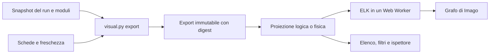

# ADR: esploratore visuale di Codebase Map

**Stato:** In uso. L'export e il server sono `daodan/core/visual.py`; i sorgenti delle due pagine (esploratore e app) sono in `viewer/`, le pagine costruite in `daodan/assets/viewer/` e `daodan/assets/app/`, dentro il pacchetto Python. **Requisiti:** [FRD](../frd/2026-11-07-codebase-explorer.md). **Aperto:** le prestazioni, in fondo.

## Decisioni

1. **Interfaccia propria, costruita con librerie.** Dalle capacità esplorative di Floorplan si riprendono solo idee generali: navigazione progressiva, nomi comprensibili, ispettore collegato al codice. Nessun codice, template, asset, schema o orchestratore di Floorplan.

2. **Codebase Map produce, il viewer proietta.** L'export nasce da snapshot, grafo dei moduli e schede attraverso le loro API; il viewer non rianalizza nulla, non ha un secondo database e non chiama un modello: cambi di prospettiva, espansioni e filtri sono zero chiamate.

3. **Disegno e controlli sono di Imago** (`@acaprino/imago`: `graph`, `ui`, `react`, `shell`), perché ogni app della suite ha un solo aspetto (`AGENTS.md`, «Un solo aspetto per tutta la suite»); il passaggio a Sigrid è in corso. ELK (`elkjs`, licenza EPL-2.0 OR GPL-3.0-or-later) calcola posizioni e percorsi in un Web Worker; le icone sono di Lucide. Node serve solo a sviluppo e build: le pagine costruite sono nel pacchetto, con le licenze in `LICENSES.txt`.
   - Scartato LikeC4: perde le appartenenze multiple di un file. Misura: [`benchmarks/codebase-explorer`](../../benchmarks/codebase-explorer/README.md).
   - Sostituiti da Imago: React Flow, Radix e react-resizable-panels, la prima scelta.
   - Cytoscape.js, Sigma.js e Dagre sono stati letti sulla documentazione, mai provati.

4. **Il contratto è `daodan/visual@1`.**

   | Campo | Contenuto |
   | --- | --- |
   | `meta` | progetto, run, target e i digest degli input letti: l'export è legato al run, non al mirror corrente |
   | `entities` | riferimento canonico `tipo:id`, nome, descrizione quando c'è, evidenze, stati originali; nessun sorgente completo |
   | `relations` | estremi canonici, tipo, stato, evidenze |
   | `memberships` | appartenenze logiche e fisiche esplicite: un file può stare in più gruppi |
   | `gaps` | lacune già dichiarate o introdotte dalla proiezione, con i riferimenti e la ragione |
   | `flows` | i flussi come riferimenti a entità e relazioni che esistono già; vuoto senza regole di collegamento |

   - Provenienza, stato e freschezza restano tre campi distinti, con i valori dei loro produttori: nessuna seconda tassonomia e nessuna promozione.
   - Un riferimento multiplo produce occorrenze visuali, non nuove entità: l'id dell'occorrenza è il riferimento più il contenitore e vive solo nel viewer; conteggi e ricerca deduplicano per riferimento. Un arco aggregato conserva i riferimenti delle relazioni sottostanti; gli archi interni a un gruppo chiuso diventano un conteggio, non false dipendenze esterne.

5. **L'export è immutabile**, in `.daodan/map/views/<run-id>/<digest>/visual.json`. Si valida prima di pubblicare e non si riscrive mai; uno snapshot con un altro parser, un riferimento sconosciuto o schede che cambiano durante la lettura lo fanno rifiutare, senza lasciare cartelle parziali.

6. **Il server è locale.** Solo `127.0.0.1`, porta libera, elenco chiuso di file calcolato all'avvio, nessun listing, controllo di `Host`, nessun CORS, `Content-Security-Policy` con `default-src 'self'`; nessuna risorsa remota. `visual.py serve` serve un export in sola lettura. L'esploratore che il server MCP avvia (`codebase_map_ui`) e l'app (`daodan app`) usano lo stesso server con rotte e azioni loro, dietro un token: elencano i run, ne seguono gli eventi, creano run e registrano richieste per l'host. I confini dell'app: `docs/specs/2026-11-16-app-standalone.md`.

7. **Il testo resta testo**, mai HTML. Di un indirizzo esterno si esportano host, porta e percorso: via credenziali, query e frammento; una stringa riconosciuta come sensibile non si esporta.

8. **Il layout ha un limite.** 5 secondi per tentativo, poi il worker è terminato; la risposta a una richiesta superata si scarta.

## Prove

`tests/test_codebase_map_visual.py`, `tests/test_codebase_map_visual_server.py`; nel viewer `viewer/test/` (proiezione, stato, client del layout, suite nel browser `browser.mjs`). Il workflow `Viewer` esegue i test del viewer, il build e `npx imago-check`.

## Aperto: da approfondire

- **Prestazioni.** Gli obiettivi del FRD (300 nodi visibili entro 2 s, selezione entro 100 ms al p95) non erano raggiunti nella sola misura fatta, sul viewer con React Flow e su export sintetici. Sul grafo di Imago e su un run reale non sono misurati.
