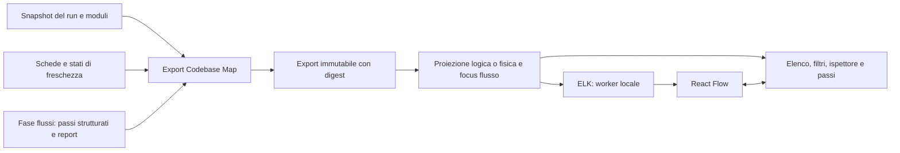

# ADR: visualizzazione originale per Codebase Map

**Stato:** proposta tecnica da approvare. **Data:** 7 novembre 2026.
**Requisiti:** [FRD](../frd/2026-11-07-codebase-explorer.md). **Proprietario:** `codebase-map`.

## 1. Contesto e decisione proposta

L'utente ha scelto una UI originale ispirata alle capacità esplorative di Floorplan, riusando librerie. Si riprendono idee generali: navigazione progressiva, nomi comprensibili, ispettore collegato al codice e percorsi evidenziati. Non si adottano codice, template, asset, schema `graph@1` o orchestratore Floorplan.

Il coordinatore ha già ispezionato Floorplan: «clean room» indica qui progettazione indipendente e assenza di copia, non un processo formalmente separato fra analista e implementatore mai esposti al sorgente. Questo documento è la base originale, ricavata dai requisiti Daodan e dalle API pubbliche delle librerie.

**Raccomandazione:** React + TypeScript, React Flow per rendering/interazione ed ELK in Web Worker per layout; Radix Primitives, Lucide e react-resizable-panels per i controlli circostanti. Vite compila asset locali. Node serve allo sviluppo/build del viewer, non diventa requisito del motore Python né dell'utilizzo degli asset precompilati.

Codebase Map produce l'export; il viewer lo consuma senza rianalizzare la codebase. Non si introduce un secondo database o un servizio AI. Il frontend ha stato di esplorazione locale, distinto dai dati canonici. React state/reducer e selettori memoizzati bastano inizialmente; nessuno state manager aggiuntivo è assunto.

Le viste di flusso sono proiezioni del medesimo dataset, non una seconda mappa indipendente.

## 2. Librerie, alternative e ricerca

Documentazione ufficiale consultata il 7 novembre 2026; nessun pacchetto installato o benchmark eseguito. Le versioni dei rami sorgenti non sono trattate come release compatibili: versioni distribuite, peer dependencies e licenze transitive saranno fissate nel lockfile dopo la prova di integrazione.

| Componente | Riuso previsto | Lavoro che resta Daodan | Licenza verificata |
| --- | --- | --- | --- |
| [React Flow / @xyflow/react](https://reactflow.dev/) | Nodi React, pan/zoom, selezione, archi, controlli e minimappa | Proiezioni, semantica espansione/aggregazione, evidenze e flussi; il layout non è incluso | MIT |
| [ELK / elkjs](https://github.com/kieler/elkjs) | Disposizione direzionata, porte, gerarchie e routing; worker browser | Preparazione dimensioni/porte, invocazione e gestione risultati | Manifest attuale: EPL-2.0 OR GPL-3.0-or-later; proposta opzione EPL-2.0, verificata sul pacchetto fissato |
| [Radix Primitives](https://www.radix-ui.com/primitives) | Tab, menu, dialoghi, tooltip e gestione del focus | Composizione, stile originale e accessibilità dell'esperienza complessiva | MIT ([repository](https://github.com/radix-ui/primitives)) |
| [react-resizable-panels](https://github.com/bvaughn/react-resizable-panels) | Pannelli ridimensionabili e collassabili, separatori da tastiera | Disposizione responsive e persistenza delle preferenze | MIT ([licenza](https://raw.githubusercontent.com/bvaughn/react-resizable-panels/main/LICENSE.md)) |
| [Lucide](https://lucide.dev/license) | Icone per tipo e azione | Associazione semantica e etichette accessibili | ISC, mantenendo anche notice MIT per le icone derivate da Feather |

CSS originale e font di sistema iniziali: nessun obbligo di Tailwind, shadcn o font remoti. Si importano i soli componenti necessari. Le funzioni avanzate mostrate negli esempi React Flow possono appartenere all'offerta Pro: non si presume che il loro codice sia incluso nella licenza core. Nessun acquisto è previsto; aggregazione, filtri e percorso sono logica originale Daodan.

| Alternativa | Vantaggio reale | Motivo della preferenza attuale / condizione di rivalutazione |
| --- | --- | --- |
| [LikeC4 React](https://likec4.dev/tooling/react/) | Renderer architetturale, navigazione, dettagli, viste dinamiche e walkthrough già disponibili; Model Builder programmatico, metadata e nodi personalizzati | Richiede un modello `Layouted` e stack/stili Mantine. L'adattamento di identità, membership e stati va misurato. Potrebbe ridurre il lavoro più di React Flow: resta la principale alternativa, non è escluso perché «solo DSL» |
| [Cytoscape.js](https://github.com/cytoscape/cytoscape.js) | Modello di grafo, algoritmi e renderer con compound nodes; MIT | Interessante per esplorazione di reti; nodi con controlli React e pannelli coordinati richiedono un diverso adattamento. Nessuna inferiorità prestazionale assunta |
| [Sigma.js](https://www.sigmajs.org/get-started/quickstart/) | Rendering WebGL e interazione con grafi Graphology; supporta anche layer custom | Candidato se emerge esigenza di reti molto dense. Non si aggiunge un secondo renderer preventivamente; nessuna capacità numerica dedotta dal solo uso di WebGL |
| [Dagre / D3](https://reactflow.dev/learn/layouting/layouting) | Dagre semplice per grafi diretti; D3 offre algoritmi e primitive | Dagre ha un limite documentato per subflow collegati all'esterno; D3 richiederebbe più composizione delle interazioni. Si preferisce ELK per gerarchie e routing |

LikeC4 dichiara MIT sia in [core/package.json](https://raw.githubusercontent.com/likec4/likec4/main/packages/core/package.json) sia in [diagram/package.json](https://raw.githubusercontent.com/likec4/likec4/main/packages/diagram/package.json). Le [viste dinamiche](https://likec4.dev/dsl/views/dynamic/) esistono: sono i blocchi di controllo del flusso a essere sperimentali; la variante sequence collega elementi foglia. Questi limiti non equivalgono a incompatibilità con Daodan.

Prima di fissare il renderer, la stessa piccola fixture del FRD verrà proiettata in React Flow + ELK e in LikeC4 Model Builder, senza costruire due prodotti. Si confrontano fedeltà delle membership/stati, focus e ripristino filtri, gerarchie e flussi, estensioni necessarie e costo di adattamento misurato. LikeC4 può sostituire la scelta proposta se soddisfa gli stessi requisiti con un adattamento più semplice e sostenibile. Il minor numero di righe, da solo, non decide; nessuna soglia temporale o prestazione è già provata.

## 3. Contratto dati e integrazione

**Stato attuale:** Daodan ha snapshot, moduli e schede; la fase 3 prescrive flussi in `03-flows.md`. Non è verificata l'esistenza di un dataset di flussi adatto alla UI. Non si interpreta Mermaid per ricostruire fatti o ordine di esecuzione.

**Intervento proposto:** la stessa fase 3 produce anche `03-flows.json`, con passi e transizioni strutturati sostenuti dalle medesime evidenze. Il report Markdown viene prodotto dagli stessi dati più la spiegazione narrativa, evitando due raccolte indipendenti. Un run storico privo del JSON conserva navigazione architetturale e report, ma non riceve percorsi sintetizzati silenziosamente. Il nuovo artefatto resta run-local; nessuna modifica automatica al mirror o al registro dei run.

L'exporter Python usa le API interne di snapshot/moduli/schede, senza leggere direttamente tabelle SQLite sparse nel frontend e senza richiedere un server MCP. Percorsi proposti: `plugins/codebase-map/skills/map-method/scripts/visual.py` per export/serve; `plugins/codebase-map/viewer/` per sorgenti frontend; asset distribuiti sotto `plugins/codebase-map/assets/viewer/`. Non sono file già implementati.

Envelope proposto `daodan/visual@1`:

| Campo | Contenuto minimo e regola |
| --- | --- |
| `meta` | Identità progetto/run, versione export e digest degli input consumati; export legato al run, non al mirror corrente |
| `entities` | Riferimenti canonici tipizzati ai record originari, nome/tipo, descrizione quando presente, evidenze e stati originali; nessun source code completo incorporato |
| `relations` | Estremi canonici, tipo/direzione, evidenze e stato; ID originale se esiste, altrimenti derivato deterministicamente dall'identità della relazione e della sorgente |
| `memberships` | Appartenenze fisiche/logiche esplicite; non costringere le responsabilità in un singolo albero |
| `flows` | ID/nome/categoria, passi con ID locale, etichetta, riferimenti canonici, evidenze/stato; transizioni fra passi con condizione o dati descritti quando supportati e riferimenti alle relazioni note |
| `gaps` | Lacune già dichiarate o introdotte dalla proiezione, con riferimenti interessati e ragione; nessuna lacuna sostituita da un arco certo |

Non si crea una seconda tassonomia degli stati: i nomi e significati di provenienza, stato e freschezza sono quelli dei produttori Daodan, distinti fra loro. I riferimenti canonici riusano gli ID originari con namespace del tipo; la validità è nel run. Le sorgenti usano percorso relativo, righe e digest ove già disponibili. Una citazione senza digest non viene promossa a lettura verificata.

`03-flows.json` contiene identità del run/digest dello snapshot e la stessa collezione `flows` dell'envelope, senza un modello di grafo indipendente. I passi possono riferire più entità; una transizione può esistere come inferenza o lacuna senza un arco statico risolto. I rami sono transizioni alternative esplicite, i ritorni/cicli riferiscono ID di passi esistenti. Evidenze non allineate allo snapshot rendono il flusso obsoleto/non utilizzabile come percorso confermato, non fresco per il solo timestamp.

I riferimenti multipli producono occorrenze visuali, non nuove entità. ID dell'occorrenza = funzione del riferimento canonico e del contenitore della vista; esiste solo nella UI. Counts e risultati di ricerca deduplicano per identità canonica. I parent React Flow organizzano le occorrenze, non definiscono i proprietari del codice. Gli archi aggregati conservano l'elenco dei riferimenti alle relazioni sottostanti; gli archi interni a un gruppo collassato diventano un conteggio consultabile, non false dipendenze esterne.

L'export viene scritto in una directory derivata per run/digest, esterna agli input immutabili: destinazione proposta `.codebase-map/views/<run-id>/<export-digest>/`. Si valida prima di pubblicare la directory completa; errori non sovrascrivono l'export precedente. Il digest include anche le schede effettivamente lette: il loro store è aggiornabile separatamente, perciò la lettura deve acquisire una vista coerente o rifiutare un cambiamento concorrente.

## 4. Esecuzione, UI e failure mode

Il comando Python di apertura serve soltanto il singolo export selezionato e gli asset precompilati su `127.0.0.1`, porta libera, senza installazioni o download a runtime. Allowlist di file, nessun directory listing, controllo Host/origine per i dati, nessun CORS permissivo; collegamenti simbolici/traversal non possono uscire dalle radici consentite. Nessuna API per leggere percorsi arbitrari, eseguire comandi o avviare agenti. L'esportazione è una cache derivata; il viewer è sola lettura rispetto alle sorgenti e agli store.

«Apri altro export» usa un file locale scelto dall'utente o un nuovo URL locale prodotto dal comando: non richiede un servizio di discovery dei progetti. Il caricamento verifica schema e riferimenti prima di sostituire il dataset. L'interfaccia non promette di rilevare da sola nuovi run; espone identità/data del run caricato. La generazione di un nuovo run resta il workflow Codebase Map esistente.

Testo mostrato come testo, mai HTML grezzo. Indirizzi esterni sono attributi informativi: si rimuovono userinfo, query e frammenti, si preservano host/porta/path utili; stringhe riconosciute sensibili non si esportano. Niente immagini, font o worker da CDN. Link editor opzionali con integrazione host esplicita, senza concatenare comandi shell. Nessun codice Pro di esempi o asset Floorplan nella distribuzione; includere notice delle librerie effettivamente fissate.

React Flow opera in modalità esplorazione: creazione/eliminazione/riconnessione degli archi disabilitate. Un eventuale trascinamento cambia soltanto la posizione locale. Stato per progetto/run: vista, selezione canonica, filtri, gruppi aperti, flusso/passo e viewport. Si possono memorizzare preferenze UI; dati del progetto e sorgenti non vengono duplicati in localStorage.

ELK riceve solo il grafo visibile con dimensioni e porte. Il worker è incluso negli asset e serve da URL locale. Ogni richiesta porta la generazione della proiezione; risultati superati vengono scartati. Le richieste ravvicinate si accorpano. Fallimento/timeout mantiene la vista precedente se riferita agli stessi dati; per un nuovo dataset offre vista elenco e riprova, senza presentare un vecchio grafo come nuovo. Budget iniziale del tentativo layout: 5 s, proposto e configurabile; terminazione del worker a scadenza.

Selezione, hover e focus di un flusso non rilanciano il layout salvo espansioni necessarie. Apertura/chiusura di gruppi preserva per quanto possibile il punto osservato; «Riordina» e «Adatta» sono espliciti. Rendering progressivo e memoizzazione seguono le [raccomandazioni React Flow](https://reactflow.dev/learn/advanced-use/performance). Una vista troppo densa richiede restringimento del perimetro, con contatori e vista elenco: niente troncamenti silenziosi.

## 5. Evidenze locali, verifiche e approvazione

Fonti consultate: [README](../../README.md), [moduli](../../plugins/codebase-map/skills/map-method/references/modules.md), [run](../../plugins/codebase-map/skills/map-method/references/run.md), [fasi flussi](../../plugins/codebase-map/skills/map-method/references/phases-3-4.md), [schede](../../plugins/codebase-map/skills/map-method/scripts/card_store.py), [freschezza](../../plugins/codebase-map/skills/map-method/scripts/semantic_store.py), [MCP](../../plugins/codebase-map/skills/map-method/scripts/mcp_server.py). Non è stato trovato un `package.json` nel progetto durante questa ricognizione; il frontend aggiunge quindi una toolchain di sviluppo isolata.

Test futuri: unitari del mapping/aggregazione e delle transizioni di stato; fixture export e flussi con digest discordanti; browser desktop e viewport stretta, tastiera e reduced motion; server confinato; caricamento offline senza richieste esterne; compatibilità della distribuzione precompilata e licenze del lock. I benchmark e i criteri osservabili sono nel FRD. Una libreria accessibile non rende automaticamente accessibile il grafo finito.

**Da approvare:** questo design e i target provvisori del FRD, prima del piano di implementazione. **Da verificare durante la prima prova:** fedeltà/costo React Flow contro LikeC4, compatibilità delle versioni, effettiva disponibilità degli input e prestazioni. La proposta non dichiara integrazione completata né attribuisce i precedenti test di Floorplan a Daodan.
