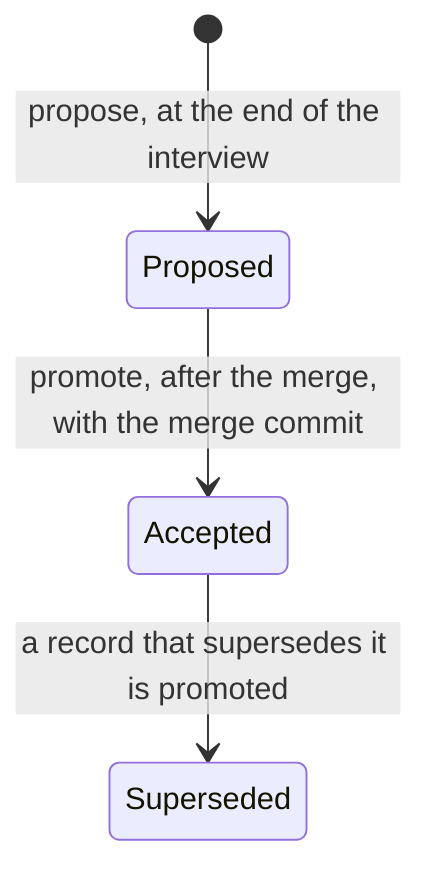

# Decision records

Code shows what a project does. It does not show why it is shaped that way,
which designs were tried and turned down, or which rule must never break. A
decision record keeps those three things next to the code, in `docs/adr/`, and
the Daodan task cycle reads it at every step where they matter.

This guide explains what a record contains, how it moves from proposal to
acceptance, and where the cycle uses it. The method behind it is
`project-knowledge:adr-method`; its helper, `adr_tool.py`, writes the records
and checks them.

## A project's choice

Decision records are optional. A project keeps them exactly when
`docs/adr/README.md` exists, and Daodan asks once, at the project's first use,
together with whether to analyze the project now (no, lite or deep). A yes
creates the index and commits it alone, so task worktrees start with it. Without
records the task cycle works the same: the interview's examples, rejected
alternatives and invariants go into the task's run as `intent.md`, and no
command mentions records. `/daodan:record-decision` turns them on later by
creating the index. No command turns them off.

The rest of this guide describes a project that keeps them.

## The short version

1. A task's interview ends with a record in state `Proposed`.
2. Its examples become the tests the plan has to make pass. Its invariants are
   checked in every review of the task. Its rejected alternatives stop a worker
   from bringing back a design the user already turned down.
3. Merging the task promotes the record to `Accepted` and stamps it with the
   merge commit.
4. From then on, every task that touches the record's paths, modules, domains
   or symbols receives it as a constraint.
5. A later decision replaces it by superseding it. The old record stays in the
   directory, marked `Superseded`, so its reasoning can still be read.

## Life of a record



| State | Meaning | Binds |
|---|---|---|
| `Proposed` | Decided in an interview, not yet merged into the base branch | Only the task that proposed it |
| `Accepted` | Implemented and merged; `accepted_at_sha` is the merge commit | Every task touching its scope |
| `Superseded` | Replaced; `superseded_by` names the record that replaced it | Nothing; kept for its reasoning |

A record is never deleted. A task that is abandoned leaves its record
`Proposed`, with the task identity in `created_from_task`, so the reason it was
considered stays on file. The helper cannot supersede it: only an `Accepted`
record can be superseded.

Promotion happens at the merge and never before. A decision that exists only on
a branch would otherwise constrain work on the base branch, where its code is
not there yet. When the promoted record supersedes another, the old one is
marked `Superseded` in the same transaction: the helper builds the whole future
state, validates it, and only then writes every file and the index. The
directory never shows two active records for one decision.

## What a record contains

### Front matter

The helper writes it. Nobody edits it by hand.

| Field | Holds |
|---|---|
| `adr_id`, `title` | The identity `ADR-NNNN`, allocated by the helper, and a short title |
| `status` | `Proposed`, `Accepted` or `Superseded` |
| `scope` | `paths` (shell globs; `dir/**` matches everything below `dir`), `modules` and `domains`, with at least one entry |
| `governs_symbols` | Codebase Map symbol identities, such as `py:src/orders/validator.py#validate_order` |
| `created_from_task` | The run or task that proposed it |
| `proposed_at_sha` | The base commit when it was proposed |
| `accepted_at_sha`, `last_verified_sha` | The merge commit that accepted it, and the commit it was last verified at |
| `supersedes`, `superseded_by` | The records this one replaces, and the record that replaced this one |

### Body

Three sections are mandatory, each with numbered items. The helper refuses a
record that lacks one of them or leaves a template placeholder in place.

- **Verified Interview Examples** (`EX-*`): a concrete input and its expected
  output, agreed with the user during the interview. At least one nominal case,
  one boundary case and one rejection case.
- **Rejected Alternatives** (`RA-*`): each design the user turned down, with
  the reason.
- **Enforceable Invariants** (`INV-*`): what must hold on every path, written
  so that a test or a reviewer can check it.

One item of each kind, from the record template:

```markdown
- **EX-002** (boundary): Input: `validate_order(OrderInput(symbol="AAPL", qty=0))` -> Expected: raises `InvalidQuantityError(code="QTY_NON_POSITIVE")`
- **RA-001**: a boolean `allow_zero_qty` on `validate_order()`; rejected because it weakens the invariant on the execution path and every caller would have to know the flag.
- **INV-001**: `validate_order()` never accepts `qty <= 0` on any caller path.
```

The remaining sections (`Context and Problem Statement`, `Decision Drivers`,
`Decision`, `Consequences`, `Confirmation`) are expected in every record. A
reviewer judges them; the helper does not check them.

The numbered items are the point of the format. Each has an identity that the
plan, the worker briefs and the reviews cite, so nobody paraphrases the decision
again at every step, and a cheap model receives the exact sentence the user
agreed to.

## Where the task cycle uses records

| Moment | Command | What happens |
|---|---|---|
| First use of a project | the first command that writes Daodan state | Asks whether the project keeps records; yes runs `init-index`. An existing directory is validated, never rewritten |
| Exploring an idea | `/daodan:brainstorm-idea` | `resolve` on the area, read only. No record is written |
| Interview | `/daodan:new-feature`; `/daodan:fix-bug` only when the fix changes a contract | `resolve` the scope and inherit the one to three active records as constraints. The interview either respects them or names the ones it supersedes |
| End of the interview | same | `propose` writes the record `Proposed`. A light review of kind `spec` checks it, and the premise auditor checks every claim it makes about the code |
| Plan | same | Each micro-task names the `EX-*` it makes pass and the `INV-*` it enforces |
| Each worker | same | The brief carries the examples, the invariants and the rejected alternatives that touch its task |
| Each wave review | same | The reviewer receives the `EX-*`, the `INV-*` and the wave's rulings as the intent of the change |
| Verification | same | Every `EX-*` needs a test that fails on the base and passes on the candidate. Every `INV-*` needs a test or a review finding confirming it holds |
| Finish | `/daodan:finish-task` | After the merge, `promote` with the merge commit. Then the map, the documentation and the instruction loop block are realigned; the loop block lists the active records per domain |
| Outside a task | `/daodan:record-decision` | The same grounded interview and `propose`. The record stays `Proposed` until a task implements it. On a project without records it creates the index first |
| Status | `/daodan:show-status` | `validate`, and the number of records in each state |

On request, `/daodan:get-second-opinion` has another model challenge a record
before the plan is written. It never runs by default.

## How `resolve` picks the records

Before an interview, the cycle passes the helper what the task touches: paths,
modules, domains and symbols. `resolve` returns only `Accepted` records that
nothing has superseded.

- A path matches a scope pattern ending in `/**` when it lies below that
  directory, and any other pattern as a shell glob.
- A module, domain or symbol matches when the record lists it exactly.
- Each match carries its reasons, such as
  `path src/orders/api.py matches src/orders/**`.
- Records with more reasons come first, so the most specific decision leads.

The cycle loads the first one to three into the interview and the briefs, never
the whole directory: every extra record costs tokens and buries the one that
matters. `Proposed` records are never returned, because a decision not yet
merged binds only the task that proposed it.

## Changing a decision

An `Accepted` record is not edited to change what it decided. A new record
supersedes it: `propose --supersedes ADR-NNNN`, named at proposal time so the
reviewers can compare the two while the task runs. The promotion at merge then
retires the old one. The new record restates the whole decision, not only the
part that changed, so a reader always needs one record.

## The helper

`adr_tool.py` lives in the method's `scripts/` directory. Every command prints
JSON. A refusal exits 1, names the missing section, item or field, and writes
nothing.

| Command | Does | Refuses |
|---|---|---|
| `template` | Prints the body skeleton to fill after the interview | |
| `init-index --project ROOT` | Creates the index when it is missing | |
| `propose --project ROOT --title T --slug S --task TASK --sha SHA --body FILE` plus scope lists and `--supersedes` | Allocates the next identity, writes the record `Proposed`, rewrites the index | A missing section or item, a template placeholder, an empty scope, a `supersedes` target that is not `Accepted` |
| `validate --project ROOT [--adr ADR-NNNN]` | Checks one record, or every record and the index | An inconsistent status, a supersede chain that loops or ends in a `Proposed` record, a stale index |
| `resolve --project ROOT --paths ... --modules ... --domains ... --symbols ...` | Lists the governing records with their reasons | |
| `promote --project ROOT --adr ADR-NNNN --sha SHA` | Marks the record `Accepted`, supersedes its targets and rewrites the index, as one transaction | A record that is not `Proposed`, a value that is not a commit SHA, a target that is not `Accepted` |
| `index --project ROOT` | Rewrites the generated block of `docs/adr/README.md` from the records | |

The block between `adr-index:start` and its end marker in `docs/adr/README.md`
is generated. Edit a record, then run `index`; never edit the block by hand.

## What is mechanical and what is judgment

The helper guarantees the shape: front matter fields and their order, status
consistency, supersede chains, mandatory sections with numbered items, no
leftover placeholders, a current index and atomic writes.

People and reviewers judge the content: whether the examples are the right
ones, whether the decision follows from its drivers, the sections the helper
does not check, and whether the code actually keeps each invariant. The wave
reviews, the candidate review and the tests that verification requires carry
that last part.

Two things are checked by nothing:

- **Drift of governed symbols.** `last_verified_sha` is set at promotion and no
  command refreshes it, and `validate` does not compare `governs_symbols` with
  the code. When a status or a sync lists records whose symbols changed, the
  list comes from the agent's own comparison, not from the helper.
- **A partial change.** The only relation between records is `supersedes`, so
  changing one invariant means a new record that restates the whole decision.
