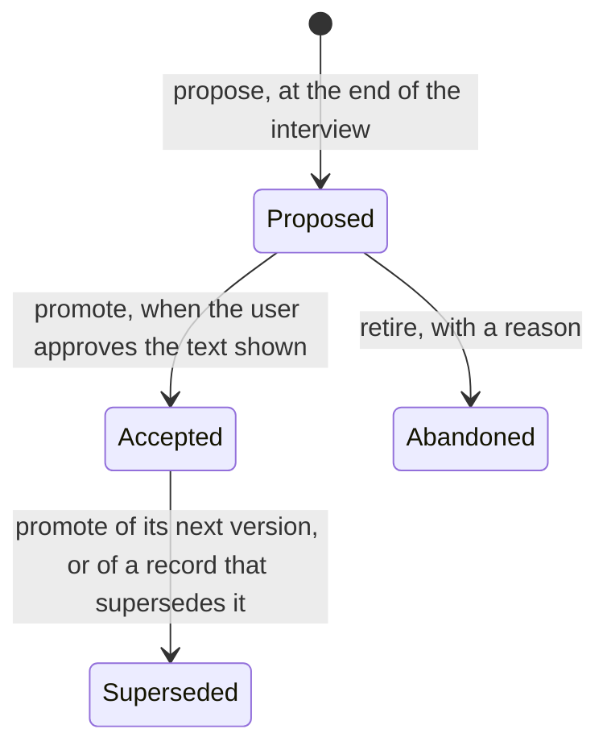

# Decision records

Code shows what a project does. It does not show why it is shaped that way,
which designs were tried and turned down, or which rule must never break. A
decision record keeps those three things next to the code, in `docs/adr/`, and
the Daodan task cycle reads it at every step where they matter.

This guide explains what a record contains, how it moves from proposal to
acceptance, and where the cycle uses it. The method behind it is
`project-delivery:adr-method`; its helper, `adr_tool.py`, writes the records
and checks them.

## A project's choice

Decision records are optional. A project keeps them exactly when
`docs/adr/README.md` exists, and Daodan asks once, at the project's first use,
together with whether to analyze the project now (no, lite or deep). A yes
creates the index and commits it alone, so task worktrees start with it. Without
records the task cycle still writes and approves its project specification in
`docs/specs/`; the run's `intent.md` links that document and its approval. ADRs
capture separate technical decisions when enabled, without duplicating the
specification. `/daodan:record-decision` turns them on later by
creating the index. No command turns them off.

The rest of this guide describes a project that keeps them.

## The short version

1. A task's interview ends with a record in state `Proposed`.
2. A light review checks it. Then you are shown the record with its digest and
   asked to approve that exact text. Your approval makes it `Accepted`, whether
   its code is absent, in progress or present. Approval starts no work and
   authorizes no edit, commit or merge.
3. Its examples become the tests the plan has to make pass. Its invariants are
   checked in every review of the task. Its rejected alternatives stop a worker
   from bringing back a design you already turned down.
4. Merging the task promotes nothing. Once the branch review has confirmed that
   the code conforms, `verify` stamps the record with the merge commit.
5. From then on, every task that touches the record's paths, modules, domains
   or symbols receives it as a constraint, and a status lists it as drifted when
   its governed files change after that verification.
6. Changing the decision later writes its next version under the same number.
   A different decision replaces it by superseding it. Either way the old text
   stays in the directory, marked `Superseded`, so its reasoning can still be
   read.

## Life of a record



| State | Meaning | Binds |
|---|---|---|
| `Proposed` | Written, waiting for the user's approval | Only the task that proposed it |
| `Accepted` | The user approved this exact text; `accepted_at_sha` is the commit at approval, never evidence that the code exists | Every task touching its scope |
| `Superseded` | Replaced by its next version or by another decision; `superseded_by` names the replacement | Nothing; kept for its reasoning |
| `Abandoned` | Retired without approval, with a reason; nothing leaves this state | Nothing; kept for its reasoning |

Versions: at most one `Accepted` and one `Proposed` version per decision.

A record is never deleted. A decision you do not approve stays `Proposed`, with
the task identity in `created_from_task`, until it is approved or retired.
`retire` moves it to `Abandoned` with the reason you give; `resolve` never
returns it and a later `promote` of it is refused.

Approval and implementation are separate facts. A decision may be recorded
before, during or after its code, so a merge never approves a record and an
approval never verifies one. When a promotion supersedes a version or another
record, the old one is marked `Superseded` in the same transaction: the helper
builds the whole future state, validates it, and only then writes every file
and the index. The directory never shows two active versions of one decision.

## Approval and the digest

`validate --adr ADR-NNNN` and `resolve` print each record's `digest`, the
SHA-256 of its file. The record you approve is the record with that digest.
Every command that rewrites an existing record (`promote`, `verify`, `retire`)
takes it as `--expect-digest`, holds an exclusive lock under `docs/adr/` and
refuses, writing nothing, when the file changed since it was read. A refusal
means someone edited the record after you saw it: it is shown to you again,
and only the text you then approve is promoted. The index is regenerated from
the records under the same lock, so it needs no check of its own.

## What a record contains

### Front matter

The helper writes it. Nobody edits it by hand.

| Field | Holds |
|---|---|
| `adr_id`, `title` | The identity `ADR-NNNN`, allocated by the helper, and a short title |
| `version` | An integer from 1; a revision keeps the identity and takes the next number |
| `status` | `Proposed`, `Accepted`, `Superseded` or `Abandoned` |
| `scope` | `paths` (shell globs; `dir/**` matches everything below `dir`), `modules` and `domains`, with at least one entry |
| `governs_symbols` | Codebase Map symbol identities, such as `py:src/orders/validator.py#validate_order` |
| `created_from_task` | The run or task that proposed it |
| `proposed_at_sha` | The base commit when it was proposed |
| `accepted_at_sha` | The commit at the user's approval |
| `last_verified_sha` | The commit at which a reviewer last confirmed the code conforms; empty until the first `verify` |
| `changes` | On a revision, the items whose text differs from the `Accepted` version |
| `depends_on` | The `Accepted` decisions this one builds on |
| `retired_on` | When an abandoned record was retired |
| `supersedes`, `superseded_by` | The records this one replaces, and the record that replaced this one |

Under the title the helper renders the version, the status, the date and the
author (the Git identity at `propose`), and rewrites that header on every
write. Version 1 lives in `ADR-NNNN-<slug>.md`, a later version in
`ADR-NNNN-v<N>-<slug>.md`. The method's record template,
`references/adr-template.md`, is the canonical list.

### Body

Three sections are mandatory, each with numbered items. The helper refuses a
record that lacks one of them or leaves a template placeholder in place.

- **Verified Interview Examples** (`EX-*`): a concrete input and its expected
  output, agreed with the user during the interview. At least one nominal case,
  one boundary case and one rejection case.
- **Rejected Alternatives** (`RA-*`): each design the user turned down, with
  the reason.
- **Enforceable Invariants** (`INV-*`): what must hold on every path, written
  so that a test or a reviewer can check it.

One item of each kind, from the record template:

```markdown
- **EX-002** (boundary): Input: `validate_order(OrderInput(symbol="AAPL", qty=0))` -> Expected: raises `InvalidQuantityError(code="QTY_NON_POSITIVE")`
- **RA-001**: a boolean `allow_zero_qty` on `validate_order()`; rejected because it weakens the invariant on the execution path and every caller would have to know the flag.
- **INV-001**: `validate_order()` never accepts `qty <= 0` on any caller path.
```

The remaining sections (`Context and Problem Statement`, `Decision Drivers`,
`Decision`, `Consequences`, `Confirmation`) are expected in every record. A
reviewer judges them; the helper does not check them.

The numbered items are the point of the format. Each has an identity that the
plan, the worker briefs and the reviews cite, so nobody paraphrases the decision
again at every step, and a cheap model receives the exact sentence the user
agreed to.

## Where the task cycle uses records

| Moment | Command | What happens |
|---|---|---|
| First use of a project | the first command that writes Daodan state | Asks whether the project keeps records; yes runs `init-index`. An existing directory is validated, never rewritten |
| Exploring an idea | `/daodan:brainstorm-idea` | `resolve` on the area, read only. No record is written |
| Interview | `/daodan:new-feature`; `/daodan:fix-bug` only when the fix changes a contract | `resolve` the scope and inherit the one to three active records as constraints. The interview respects them, revises them or names the ones it supersedes |
| End of the interview | same | `propose` writes the record `Proposed`. A light review of kind `spec` checks it, and the premise auditor checks every claim it makes about the code |
| Approval | same | You see the record with its digest. On your approval `promote` makes it `Accepted` at the current commit, and each record that depends on a decision it supersedes becomes an open question of the run. Without approval it stays `Proposed` |
| Plan | same | Each micro-task names the `EX-*` it makes pass and the `INV-*` it enforces |
| Each worker | same | The brief carries the examples, the invariants and the rejected alternatives that touch its task |
| Each wave review | same | The reviewer receives the `EX-*`, the `INV-*` and the wave's rulings as the intent of the change |
| Verification | same | Every `EX-*` needs a test that fails on the base and passes on the candidate. Every `INV-*` needs a test or a review finding confirming it holds. The branch review receives the records governing the changed files (`resolve --paths`) |
| Finish | `/daodan:finish-task` | Nothing is promoted. After the merge, `verify` records the merge commit on each record the branch review confirmed. Then the map, the documentation and the instruction loop block are realigned; the loop block lists the active records per domain, and the drifted records are reported |
| Sync | `/daodan:sync-upstream` | Nothing is promoted. The realignment reports the drifted records, among them those whose governed files the incoming commits changed |
| Outside a task | `/daodan:record-decision` | The same grounded interview and `propose`, then your approval promotes the record without waiting for code. The approval creates no task. On a project without records it creates the index first |
| Status | `/daodan:show-status` | `validate --sha HEAD_SHA`: the number of records in each state, and the drifted ones with their files |

On request, `/daodan:get-second-opinion` has another model challenge a record
before you approve it. It never runs by default.

## How `resolve` picks the records

Before an interview, the cycle passes the helper what the task touches: paths,
modules, domains and symbols. `resolve` returns only the `Accepted` version of
each decision, with its digest.

- A path matches a scope pattern ending in `/**` when it lies below that
  directory, and any other pattern as a shell glob.
- A module, domain or symbol matches when the record lists it exactly.
- Each match carries its reasons, such as
  `path src/orders/api.py matches src/orders/**`.
- Records with more reasons come first, so the most specific decision leads.

The cycle loads the first one to three into the interview and the briefs, never
the whole directory: every extra record costs tokens and buries the one that
matters. `Proposed`, `Superseded` and `Abandoned` records are never returned,
because a decision the user has not approved binds only the task that proposed
it.

## Changing a decision

An `Accepted` record is never edited in place, because the approved text would
disappear. To change one item of it, `propose --revise ADR-NNNN --body FILE`
writes its next version as `Proposed` under the same number, with the whole
decision restated, so a reader always needs one record. The helper numbers the
version and lists in `changes` the items whose text differs. A decision has at
most one `Proposed` version. When you approve it, its `promote` marks the
previous version `Superseded` in the same transaction.

A citation `ADR-NNNN` means the active version; `ADR-NNNN v1` pins one. So the
identities cited in code, in the loop block and in other records survive a
change of the decision.

`supersedes` stays for a different decision that replaces this one:
`propose --supersedes ADR-NNNN`, named at proposal time so the reviewers can
compare the two. A version never supersedes its own decision.

## Dependencies between decisions

`propose --depends-on ADR-NNNN` records in `depends_on` the `Accepted`
decisions a record builds on. When a promotion supersedes a decision or a
version that others depend on, its output lists them as `dependents_to_review`,
and the cycle records each as an open question of the run, so the change
reaches whoever re-reads them. The helper never rewrites a dependent.

## Drift

`validate --sha SHA` adds `drifted`: each `Accepted` record whose `scope.paths`
or `governs_symbols` files changed since its `last_verified_sha`, with those
files, or with `files: null` when it was never verified. The list comes from
`git diff --name-only` alone, and the commit at approval is never used as a
baseline. A record leaves the list when a reviewer confirms its code conforms
and `verify` records the reviewed commit. Status and realignment show the list.

## The helper

`adr_tool.py` lives in the method's `scripts/` directory. Every command prints
JSON. A refusal exits 1, names the missing section, item or field, and writes
nothing.

| Command | Does | Refuses |
|---|---|---|
| `template` | Prints the body skeleton to fill after the interview | |
| `init-index --project ROOT` | Creates the index when it is missing | |
| `propose --project ROOT --title T --slug S --task TASK --sha SHA --body FILE` plus scope lists, `--supersedes` and `--depends-on` | Allocates the next identity, writes the record `Proposed`, rewrites the index | A missing section or item, a template placeholder, an empty scope, a `supersedes` or `depends_on` target that is not `Accepted` |
| `propose --revise ADR-NNNN --task TASK --sha SHA --body FILE`, optional `--title` and scope lists, never `--slug` | Writes the next version of an `Accepted` decision as `Proposed`, with its `changes` | A decision that already has a `Proposed` version, a version that supersedes its own decision |
| `validate --project ROOT [--adr ADR-NNNN] [--sha SHA]` | Checks one record, or every record and the index, and prints each digest; with `--sha`, lists the `drifted` records | An inconsistent status, a supersede chain that loops or ends in a `Proposed` record, a stale index |
| `resolve --project ROOT --paths ... --modules ... --domains ... --symbols ...` | Lists the governing `Accepted` versions with their reasons and digests | |
| `promote --project ROOT --adr ADR-NNNN --sha SHA --expect-digest D` | Marks the approved record `Accepted`, supersedes its previous version and its targets and rewrites the index, as one transaction; lists `dependents_to_review` | A record that is not `Proposed`, a value that is not a commit SHA, a target that is not `Accepted`, a digest that differs |
| `verify --project ROOT --adr ADR-NNNN --sha SHA --expect-digest D` | Sets `last_verified_sha` after a reviewer confirmed the code conforms | A digest that differs |
| `retire --project ROOT --adr ADR-NNNN --reason TEXT --expect-digest D` | Moves a `Proposed` record to `Abandoned` | A record that is not `Proposed`, a digest that differs |
| `index --project ROOT` | Rewrites the generated block of `docs/adr/README.md` from the records | |

The block between `adr-index:start` and its end marker in `docs/adr/README.md`
is generated. Edit a record, then run `index`; never edit the block by hand.

## What is mechanical and what is judgment

The helper guarantees the shape: front matter fields and their order, status
consistency, versions and supersede chains, mandatory sections with numbered
items, no leftover placeholders, the digest check, a current index and atomic
writes.

People and reviewers judge the content: whether the examples are the right
ones, whether the decision follows from its drivers, the sections the helper
does not check, and whether the code actually keeps each invariant. The wave
reviews, the candidate review and the tests that verification requires carry
that last part.

The helper never judges conformance. `drifted` says only that governed files
changed since a reviewer last looked, and `verify` records that reviewer's
confirmation. It never judges a dependent either: it names the records to
re-read and leaves them byte-identical.
