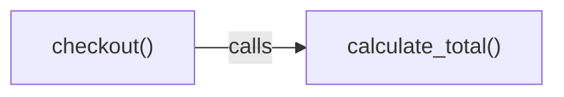
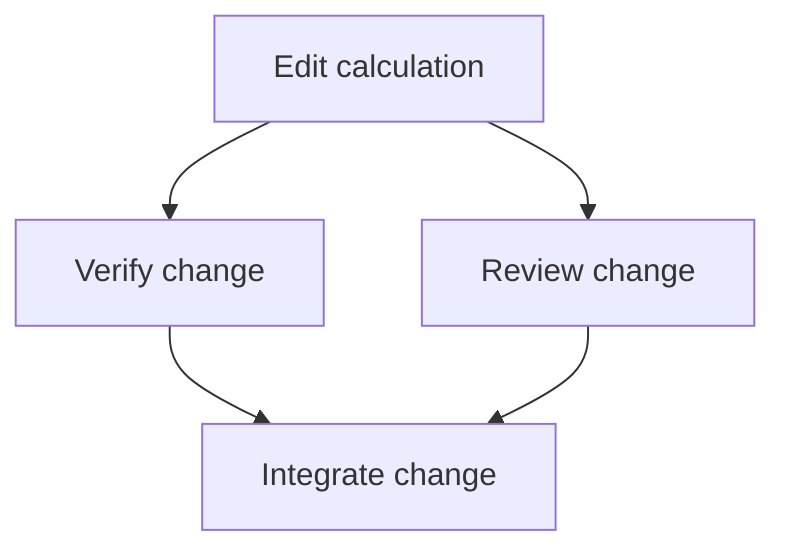

# Understand Daodan's graphs and experiments

Start here to understand what each graph represents, why the experiments exist,
and what their results let us conclude. The two graphs answer different questions:

- **Code graph:** what exists in the project, and what depends on what?
- **Work graph:** what activities does a change need, and what must happen first?

The Codebase Map already builds the code graph. The work graph described here is
an isolated prototype: it simulates a plan and its execution records. It does not
run real workers. Each experiment below investigates a particular part of these
two views.

The selected next implementation starts with an LLM prompt that proposes the work
graph, followed by mechanical validation. A fully offline execution path is the
later target. [ADR-0001](../adr/ADR-0001-work-graph-step0-llm.md) records this
direction, its cost controls and acceptance criteria; implementation remains open.

[Understand the two graphs](#the-two-graphs) ·
[Find an answer](#documentation-map) ·
[Choose an experiment](#choose-an-experiment) ·
[Understand the evidence](#how-to-read-the-results) ·
[Technical reference](#technical-comparison)

## The two graphs

Imagine changing how a checkout calculates its total. The following example is
conceptual; it is not an executed run or a claim about a particular application.

### Code graph: follow an existing relationship

A box represents a function. The arrow means **calls**: `checkout()` calls
`calculate_total()`. This helps a reader find code that may need inspection when
the calculation changes.

The actual code graph contains files, symbols and evidence for relationships such
as calls and imports. It is recorded by static analysis: reading and parsing
source, without executing the application. A call relationship is evidence to
inspect; it does not by itself prove a bug or dictate a development plan.

### Work graph: follow dependencies between activities

A box represents an activity. An arrow means **must finish before**. In this
illustrative plan, verification and review must both finish before integration.
The branches express dependencies; they do not claim that the prototype executes
workers in parallel.

The work graph is a directed acyclic graph (DAG): activities have a direction and
cannot form a dependency loop. Its controller records which activity is reserved,
started or finished, its outputs, and the remaining budget. In the prototype,
outputs and check results are simulated. A simulated completion is evidence about
the controller's rules, not about the quality of a real code change.

The code graph can supply evidence for planning. In the
[composition design, §1.3, interface I2](../superpowers/specs/2026-10-20-system1-work-graph-composition-design.md),
declared contracts supply the dependencies between work activities; the writer
does not automatically derive them from code-graph arrows. The earlier
[routing design, §1.1](../superpowers/specs/2026-10-19-graph-grounded-economy-routing-design.md)
introduces the two graphs, but also proposes inverting some call relationships
into task order. The example here follows the later composition rule.

## Documentation map

Choose a question before choosing a script or schema.

| What do you want to understand? | Start here |
|---|---|
| How a change is represented, ordered and recorded | [Work graph](work-graph-prototype.md) |
| How the first graph proposer will work, and what offline execution means | [Step 0 decision (ADR-0001)](../adr/ADR-0001-work-graph-step0-llm.md) |
| When a graph needs user clarification, and how conversations and Wayfinder connect to execution | [Conversational decisions and work graphs](../superpowers/specs/2026-10-24-conversational-decisions-and-work-graphs-design.md) |
| How reviewer selection is evaluated, and how it relates to the wider routing design | [Choicer evaluation](choicer-eval-prototype.md) |
| What happens when a reviewer-selection answer is missing, malformed or uncertain | [Mock Nomination](mock-nomination-prototype.md) |
| Whether extra analysis engines can recover missing call relationships | [Resolver spike](code-graph-resolver-spike.md) |
| Which local embedding model finds the code a request needs | [Embedding benchmark](../research/context-building-benchmarks.md#embedding-benchmark) |
| Which Python parser fits the map, including files being edited | [Python parser comparison](code-graph-python-parser.md) |
| Whether SQL and PL/SQL grammars preserve known behaviours and gaps | [Grammar parity](code-graph-grammar-parity.md) |
| What a result actually demonstrates, and what remains untested | Each card's introduction, then its **Verified** and **Not verified** sections |
| Which interface a component uses, and who owns it | [Boundary interfaces](#the-four-boundary-interfaces), then §1.3 of the composition specification |
| How routing rules constrain cost, model choice and reviewers | [Shipped components](#shipped-components), then the work graph card's policy-ownership limit |
| Why the local classifier remains outside the active cycle | [Choicer evaluation](choicer-eval-prototype.md), then §8 and §12 of the linked specifications |
| What the Codebase Map itself guarantees | [Codebase Map reference](../plugins/codebase-map.md) |

## Choose an experiment

A **prototype** explores a possible implementation. A **measurement harness** runs
a comparison. A **mechanical gate** checks named expectations. Their results answer
different questions, so a green test count is not a shared score of maturity.

| Experiment | Question | Practical reading of the recorded result |
|---|---|---|
| [Work graph](work-graph-prototype.md) | Can a supplied plan be tracked through reservations, attempts, checks and a budget? | The simulated controller exercises these rules. Real worker execution and whole-plan composition remain outside the demonstrated result. |
| [Choicer evaluation](choicer-eval-prototype.md) | Can a prompt or local classifier make useful routing decisions? | The offline results expose limits in both the input corpus and the classifier. They do not promote a local model into the active cycle. |
| [Mock Nomination](mock-nomination-prototype.md) | Does selection policy handle uncertain answers and preserve required reviewers? | Scripted answers test the contract and its bridge to the simulated work graph. They provide no new model-quality evidence. |
| [Resolver spike](code-graph-resolver-spike.md) | Can a type checker or language server identify calls the lexical resolver leaves unresolved? | Additional relationships can be recovered, with engine, language and grading limits. The recorded sample is not a guarantee for all projects. |
| [Embedding benchmark](../research/context-building-benchmarks.md#embedding-benchmark) | Which local embedder delivers the most of the code a request needs, at what cost? | EmbeddingGemma 2 (q4) beat CodeRankEmbed in all three projects and replaced it; the cost moved from tokens to indexing time. |
| [Python parser comparison](code-graph-python-parser.md) | Does switching parser improve the map enough to justify its cost? | The recorded decision keeps Python's standard-library parser; extraction and recovery policy are separate parts of the problem. |
| [Grammar parity](code-graph-grammar-parity.md) | Can we detect known SQL and PL/SQL parsing behaviours changing? | Named checks expose both working constructs and known gaps. Hand-written cases do not establish accuracy on real production code. |

## How to read the results

Each card starts with the problem and an example, then keeps the detailed
reference and evidence below. Use four distinctions when reading it:

1. **An example explains the flow.** A diagram labelled illustrative is not a new
   measured result. Its arrows are defined beside it.
2. **A recorded result has a scope.** The original README and results document own
   its date, inputs, measurements and limitations. These cards guide you to them.
3. **A mock is a scripted stand-in.** It lets an experiment test a boundary before
   connecting a real producer. A mock passing a contract does not verify that
   producer, a real reviewer or an installed host.
4. **Recorded, installed and exercised are different facts.** A committed file
   exists in a clone. A packaged component is distributed. A runtime test is
   needed to establish that a particular execution path works.

The proposed promotion path is offline evaluation, then shadow mode (recording
answers without affecting execution), then an explicitly bound active decision.
See [open points](#open-points-across-the-prototypes) for the limits of the
integration evidence recorded by these documents.

## Technical comparison

The table below gives the implementation vocabulary after the conceptual view.
A **symbol** is a named code element, such as a function or class. A **digest** is
a content fingerprint used to detect change. A **gate** is a condition that must
be satisfied before work can proceed. An **operator** is a typed work activity.

| | Code graph | Work graph |
|---|---|---|
| Question it answers | What does this project contain and what depends on it | What will this change do, in which order, at which cost |
| Producer | Codebase Map static analysis (`codebase-map`) | Graph plan writer (`project-lifecycle` is the intended owner) |
| Artifact | `.codebase-map/` snapshot, manifest and semantic cards | `work.json` record with plan, reservations, attempts, budget, outcomes |
| Node | A file or a symbol with body, interface and effects digests | An operator (`SPEC_ADR`, `PLAN`, `CODE_WRITE`, `REVIEW_LENS`, `VERIFY_FINDING`, `MAP_SLICE`, `CONTRACT_CHECK`, `WAVE_BARRIER`, `INTEGRATE`) |
| Edge | `call`, `import`, `contract`, with an evidence reference | A declared dependency between operators, from `contracts` and never inverted from the map |
| Mutability | Refreshed by analysis, never by a decision | Mutated only by its executor, with a revision and a terminal-preserving resume |
| Status today | Shipped and used by reviewers, cleanup and documentation owners | Prototype only; nothing installed imports it |

## The four boundary interfaces

These are the four kinds of information the proposed work system exchanges:
project evidence (I1), an approved specification (I2), a selection of reviewers
(I3), and a model/effort routing decision (I4). The identifiers below are exact
contract names for implementers. The table distinguishes real implementations
from the prototype's scripted stand-ins; it does not claim end-to-end integration.

Section 1.3 of
[`2026-10-20-system1-work-graph-composition-design.md`](../superpowers/specs/2026-10-20-system1-work-graph-composition-design.md)
specifies the interfaces before the implementations, so a mock, a prompt, a local
classifier or the Codebase Map can be substituted without touching the writer or the
executor.

| Interface | Schema | Producer to consumer | Real implementation today | Prototype stand-in |
|---|---|---|---|---|
| I1 | `daodan/map-slice/v1` | Codebase Map to writer | None. The map ships an MCP API, not this envelope | Validator plus `mock_context.py` |
| I2 | `daodan/approved-spec/v1` | Specs writer to writer | None | Validator plus `mock_context.py` |
| I3 | `daodan/selection/v1` | Selector to writer | `tier_router.py prepare-choice` and `resolve`, reviewer snodo | `writer.apply_selection` plus `mock_selector.py` |
| I4 | `daodan/routing/v1` | Router to executor | `tier_router.py resolve`, task and retry snodi | `routing.py` plus `mock_router.py` |

Three supporting contracts are already shipped and feed those interfaces:

1. `daodan/review-roster/v1` from
   [`review_roster.py`](../../plugins/senior-review/skills/review-preparation/scripts/review_roster.py),
   the floor an I3 answer can never lower.
2. `daodan/tier-router-proposal/v1` from `tier_router.py discover`, the screened tier
   proposal that becomes a binding only when a human confirms it.
3. `daodan/model-fact-registry/v1` from
   [`registry_fetch.py`](../../plugins/model-routing/skills/model-routing/scripts/registry_fetch.py),
   a harvested fallback for facts a harness leaves absent, never a correction.

## Prototypes and harnesses

Repository locations and recorded version-control state follow. These are storage
facts, separate from the execution evidence explained above.

| Artifact | Graph | Kind | VCS state | Card |
|---|---|---|---|---|
| [`evals/project-lifecycle/work-graph/`](../../evals/project-lifecycle/work-graph/) | Work graph | Writer and executor prototype, mocked I1 to I4 | Working tree only, 0 tracked files | [work-graph-prototype.md](work-graph-prototype.md) |
| [`evals/senior-review/choicer-eval/`](../../evals/senior-review/choicer-eval/) | Decisions of both graphs | Offline benchmark line and diagnostic probes | Working tree only, 0 tracked files | [choicer-eval-prototype.md](choicer-eval-prototype.md) |
| [`evals/senior-review/choicer-eval/mock-nomination/`](../../evals/senior-review/choicer-eval/mock-nomination/) | Work graph selection | Scripted contract/policy evaluation and simulated bridge | Working tree only | [Mock Nomination](mock-nomination-prototype.md) |
| [`evals/codebase-map/resolver-spike/`](../../evals/codebase-map/resolver-spike/) | Code graph | Measurement harness for unresolved call edges | Committed | [code-graph-resolver-spike.md](code-graph-resolver-spike.md) |
| [`evals/codebase-map/python-parser/`](../../evals/codebase-map/python-parser/) | Code graph | Parser prototype for the symbol layer | Committed | [code-graph-python-parser.md](code-graph-python-parser.md) |
| [`evals/codebase-map/grammar-parity/`](../../evals/codebase-map/grammar-parity/) | Code graph | Grammar parity evaluation across languages | Committed | [code-graph-grammar-parity.md](code-graph-grammar-parity.md) |

Two related assets are deliberately not carded here. `evals/codebase-map/cases/`
with `evals/codebase-map/RESULTS.md` holds the behavioural-invariant cases of the
shipped Codebase Map pipeline, and `evals/senior-review/cases/` holds the review
recall cases: both evaluate shipped behavior rather than prototyping new behavior,
and their own documents own their numbers.

## Shipped components

1. [`docs/plugins/codebase-map.md`](../plugins/codebase-map.md): the code graph
   producer, its snapshot, cards, cascade scan and perimeter rules.
2. [`docs/plugins/work-controller.md`](../plugins/work-controller.md): the owner of
   `tier_router.py`, `review_roster.py`, `registry_fetch.py` and `run_state.py`.
3. [`tier_router.py`](../../plugins/model-routing/skills/model-routing/scripts/tier_router.py):
   `discover` screens what a harness actually offers, `prepare-choice` freezes one
   snodo's request and prompt, `resolve` validates an answer and binds the host
   triple `(model_param, effort_applied, packet_policy)`.
4. [`docs/codebase-map-migration.md`](../codebase-map-migration.md): the relocation
   record from the retired archive root.

## Open points across the prototypes

1. **Policy has two owners.** The I3 and I4 rules (tier costs, operator floors,
   deterministic and judge operators, packet policy, the citation rule, the budget
   descent) exist both in `tier_router.py` and in the work graph prototype's
   `routing.py`, `writer.py`, `policy.py` and `mock_router.py`. The values agree
   today. One owner must be declared and the other must consume it, or they will
   drift, and the drift will be invisible because both copies look authoritative.
2. **Two prototypes and one specification are untracked.** The work graph prototype,
   the choicer asset and
   `docs/superpowers/specs/2026-10-20-system1-work-graph-composition-design.md` exist
   only in a working tree. A reader of the repository cannot reach them, and a card
   that links them is linking bytes that no clone contains.
3. **Nothing in the cycle calls the shipped router yet.** No skill or workflow body
   invokes `prepare-choice` or `resolve`, so the real I3 and I4 implementations are
   reachable only from a terminal. Wiring them is the next integration step, and it
   needs the packet-ownership wording of the mother specification aligned first.
4. **I1 and I2 have no real producer.** The writer consumes validated envelopes that
   only mocks produce. Whole-plan composition from I2 requirements and contracts plus
   I1 components is the prototype's own declared next gate.
5. **No shadow or active promotion has run.** §12 of the composition specification
   requires offline evaluation, then shadow with recorded outputs and no effect, then
   an active binding per snodo. Only the offline step has evidence.

## Maintaining this area

1. One card per prototype, and the card links the artifact's own README and results
   rather than restating them. When an artifact publishes a new number, the card
   points at the document that owns it.
2. Every card states the VCS state and separates "Verified" from "Not verified". A
   prototype that has never run on an installed host says so.
3. New prototypes get a card here and a row in the table above; a retired one keeps
   its card with a superseded note, because the evidence it produced is still cited
   by the specifications.
4. This area is hand-written. `docs/catalog.md` and the marked blocks of
   `docs/plugins/*.md` are generated by `python scripts/sync_plugin_docs.py` and must
   not be edited here.
