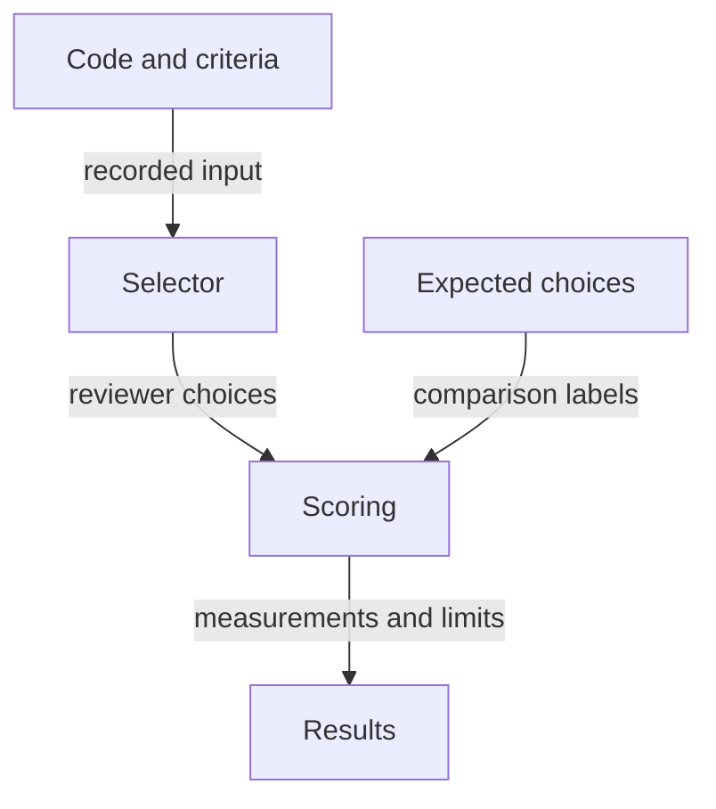

# Choicer evaluation prototype

## Can a selector choose the reviewers a change needs?

This experiment compares reviewer choices with expected answers on saved cases.
The selector decides which review perspectives to request; the scorer checks those
choices. It does not run the reviewers. The recorded evidence keeps the local
classifier experimental: selecting a reviewer reliably is still a separate
problem from executing a review.

Read the example for the measurement flow, then the [results](#verified) for the
findings and their limits. For selection rules exercised without a model, see the
[mock nomination experiment](mock-nomination-prototype.md). For the plan that can
consume reviewer choices in a simulation, see the
[work graph prototype](work-graph-prototype.md). The [graph guide](README.md) gives
the wider picture.

## A reviewer-selection example

Imagine a saved source excerpt and the question, "Does this change need a security
review?" This is an illustrative question, not an additional benchmark case. The
selector sees source and reviewer criteria. Expected answers stay with the scorer
so they cannot supply the selector's answer.



The arrows show information passed through an evaluation. They do not represent
code dependencies or worker dispatch. A missed expected reviewer lowers
**recall**, the share of expected choices the selector found. Missing or partial
answers need their own coverage accounting; they are not negative predictions.
The [pilot README](../../evals/senior-review/choicer-eval/README.md#metrics-and-threshold-protocol)
owns those scoring rules.

Before reading a score, also ask whether the source contains enough evidence to
answer the question. The external-corpus findings below show why that applicability
check matters: a routing score cannot establish knowledge the input never supplied.
This walkthrough adds no inference or new measurement.

## Detailed reference

An offline development asset that measures reviewer activation (S4) within the
broader work-graph routing design. That design also names task tier and effort
(S3) and retry action (S5); those names do not establish that this pilot measured
them. The README says the optional task-tier experiment is not implemented, and
its cost protocol does not claim actual reviewer or retry outcomes. It compares the frozen
`REVIEWER_CHOICER` prompt of the mother specification against local classifiers and
against a small local model, on senior-review cases and on an external corpus. Its
own README states the boundary up front: it does not change any plugin, installed
routing, task cycle or marketplace dependency.

### Identity

| Field | Value |
|---|---|
| Path | [`evals/senior-review/choicer-eval/`](../../evals/senior-review/choicer-eval/) |
| Kind | Benchmark line plus adaptive diagnostic probes, offline only |
| Decisions measured | S4 reviewer activation. S3 task-tier is not implemented; S5 retry outcomes are not established by the pilot (README, opening and "Metrics and threshold protocol") |
| Prompt under test | `REVIEWER_CHOICER` of §3.6, now frozen in `tier_router.py` as the `llm-tier1` backend |
| VCS state | Working tree only. `git ls-files` returns 0 tracked files, so a fresh clone does not contain it |
| Machine-local weight | A provisioned `uv` environment under `.cache/uv/environments-v2/` and the `runs/` evidence trees; raw results are not committed |
| Consumer | `senior-review` owns the review lenses; `project-protocol` owns the routing contract |

### Scope and boundary

1. Preparation and scoring never authorize new downloads, environments or paid calls
   (README, "Authorization gates").
2. The saved suite runner is not a certified offline-only replay tool, and the
   corrected report must be read before interpreting any score (README).
3. Runtime parity, lossless input binding and production thresholds are **not**
   established by the gutsy experiment (README).
4. The all-reviewer suite evaluates selector routing, not execution of the reviewer
   agents (README).
5. Grounded criteria were checked before inference; no threshold or label is tuned
   against predictions (README).
6. Corrections to the earlier V2 claims about automatic map grounding, calibrated
   scores, citations and memory are recorded in the Gutsy section of `RESULTS.md`
   and in `GUTSY_RESULTS.md`, which supersede the first report.

### Entry points

| File | Role |
|---|---|
| `run_eval.py` | The pilot runner: `extract-catalog`, `materialize-cases`, `run` with `--impl llm` or a local classifier, `--prepare-only` |
| `all_reviewers_eval.py` | The 22-lens suite: `prepare` and `report` on ordinary Python, `capacity` and `run` on the provisioned interpreter |
| `external_corpus.py` | The external corpus expansion: sampling, label protocol, staged gates |
| `gutsy_followup.py` | The CPU follow-up on the local model, with exact wire payloads and a sampled memory stop |
| `probe_gutsy.py`, `probe_gutsy_v2.py`, `probe_gutsy_cli.py`, `run_gutsy_benchmark.py`, `run_gutsy_eval.py`, `run_gutsy_v2_eval.py` | The local-model backends and their benchmark runners |
| `probe_static_router.py`, `diagnose_julia.py`, `probe_julia_facts.py`, `probe_julia_runtime.py` | Classifier and runtime probes |
| `metrics.py`, `dataset.py`, `summarize_runs.py`, `summarize_diagnosis.py`, `show_gutsy_details.py` | Scoring, fixtures and report regeneration |
| `adapt_reviewers_blind.py`, `prepare_adapted.py` | The separately authorized blind adaptation experiment |
| `test_*.py` | Nine test modules covering inputs, metrics, runtime, adaptation and the local-model server |

### Running it

Ordinary Python is enough for preparation and scoring, which is the reproducible part:

```powershell
python -B evals/senior-review/choicer-eval/run_eval.py extract-catalog --run-dir runs/20261020T100258Z
python -B evals/senior-review/choicer-eval/all_reviewers_eval.py report
python -B evals/senior-review/choicer-eval/summarize_diagnosis.py
```

The `capacity` and `run` actions of `all_reviewers_eval.py` require the previously
provisioned interpreter under `.cache/uv/environments-v2/`; they load cached files
offline and do not provision another environment. Python 3.11 or later is required,
and commands must run from the Daodan checkout.

### Verified

Each figure is quoted from the document that owns it.

| Result | Value | Source |
|---|---|---|
| Local model recall, first version | 13/23 (56.5%) | `RESULTS.md`, Gutsy table |
| Local model recall, second version | 18/23 (78.3%) | `RESULTS.md`, Gutsy table |
| Slot-restore speedup | 3.44x (580 s against 1,995 s) | `QUESTION_REFINEMENT.md` and `RESULTS.md` |
| Slot-restore fidelity | 495/496 identical letters; the flip was a near tie and left every recall figure unchanged | `QUESTION_REFINEMENT.md`, `RESULTS.md` |
| External corpus size | 1,312 planned jobs, and Stage 3 ran all 1,312 | `EXTERNAL_CORPUS.md` |
| Inter-reader agreement on the blind audit | 264/280 slots (94.3%) across 35 items and 8 lenses | `EXTERNAL_CORPUS.md` |
| Applicability of 32 external development-positive assignments | `code_supported` 9/32 (28.1%), `code_not_applicable` 17/32 (53.1%); 4/32 (12.5%) insufficient without external context and 2/32 (6.3%) disputed | `EXTERNAL_CORPUS.md`, blind applicability audit |
| Recall restricted to the code-supported positives | V2 2/9 (22.2%), Candidate 1/9 (11.1%) | `EXTERNAL_CORPUS.md` |
| All-reviewer suite shape | 22 registered lenses, 132 balanced applicability controls, 12 complete problems, all 44 registered roles inventoried with each inclusion or exclusion explained | `README.md`, `ALL_REVIEWERS_RESULTS.md` |

The applicability audit separates four outcomes within those 32 positive
assignments: 17 did not apply to the shown code, 4 lacked sufficient evidence
without external context, 2 were disputed and 9 were supported by code. These
are assignments in the development subset, not a claim about the entire corpus.
On the 9 supported positives, the frozen candidates found 2 and 1 respectively.
Both input applicability and low recall on supported positives therefore limit
the result; the local classifier remains offline and unpromoted.

### Not verified

1. No promotion decision follows from this asset. §12 of the composition
   specification requires a shadow run with recorded outputs and no effect, then an
   active binding per snodo with critical false negatives no worse than a matched
   baseline. Neither has run.
2. Runtime parity between the local model and the hosted backend, lossless input
   binding, and any production threshold: not established.
3. The benchmark measures a prompt and a classifier. It does not measure the shipped
   `tier_router.py resolve` path, its policy floors or its host bindings.
4. Model identity is a transport claim, not an attested one: see
   `MODEL_IDENTITIES.md`.
5. The optional task-tier experiment and the secondary laya inference named in the
   README are not implemented.

### Relations

1. Mother specification: §3.6 of
   [`2026-10-19-graph-grounded-economy-routing-design.md`](../superpowers/specs/2026-10-19-graph-grounded-economy-routing-design.md)
   defines three frozen prompts, including the `REVIEWER_CHOICER` measured by this
   pilot. Section 8 of the same document
   is the promotion path (offline evaluation, shadow mode on the Decision Log,
   promotion criteria).
2. Shipped implementation: the prompts are frozen verbatim in
   [`tier_router.py`](../../plugins/project-protocol/skills/project-protocol/scripts/tier_router.py)
   as the `llm-tier1` backend of `prepare-choice` and `resolve`. A local classifier
   would become a second `implementation` of the same `daodan/selection/v1` and
   `daodan/routing/v1` envelopes, which is why the contract and not the prompt is the
   plug-in point.
3. Interfaces: I3 and I4 of
   [`2026-10-20-system1-work-graph-composition-design.md`](../superpowers/specs/2026-10-20-system1-work-graph-composition-design.md)
   §1.3, whose conformance rules (a reference outside the request invalidates the
   whole answer, abstention takes the declared default) are the rules this asset's
   personas exercise.
4. Sibling prototype: the [work graph prototype](work-graph-prototype.md) consumes
   these decisions; the [index](README.md) lists the rest.

### Open points

1. The external corpus needs a rebuild around whole functions with `code_supported`
   labels before it can measure routing quality rather than applicability.
2. The local-model backend is shelved, not abandoned: it re-enters only as a second
   implementation of the frozen contract, through the §8 path.
3. Raw run evidence is machine-local. A reader of this repository cannot reproduce
   the numbers above from committed bytes, only re-derive the scored reports from the
   preserved `runs/` trees if they are present locally.
