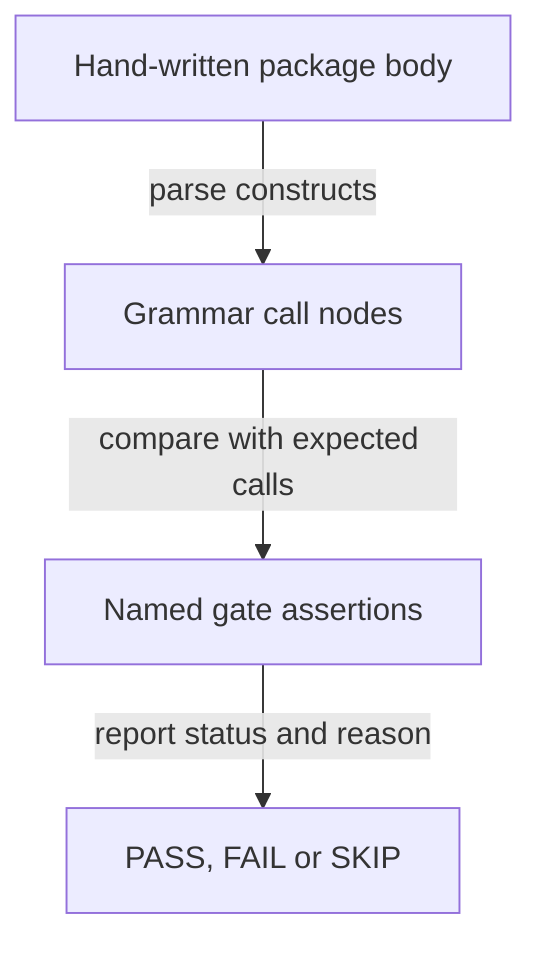

# Can the SQL grammars supply trustworthy code-graph facts?

[Back to graphs and experiments](README.md)

The Codebase Map needs to distinguish a routine call from text that only looks
like one. A **grammar** supplies a parser's rules for recognizing source code;
a **call edge** records a caller-to-callee relationship in the code graph.
This experiment checks the grammar candidates for Oracle PL/SQL, Oracle's
procedural SQL language, and SQL including PostgreSQL's PL/pgSQL routines.

`grammar-parity` is an automated regression gate. It checks named
**invariants**, assertions about behavior that must remain true, and reports
`PASS`, `FAIL` or `SKIP`. Some assertions deliberately preserve a known gap:
these **inverted pins** fail when the gap changes so the finding must be
re-measured. The [experiment README](../../evals/codebase-map/grammar-parity/README.md)
defines the checks, and its [recorded results](../../evals/codebase-map/grammar-parity/RESULTS.md)
explain the evidence.

## What the recorded result means

**The Oracle grammar can expose structured calls that the current regular-expression
adapter loses, but this gate does not prove performance on real projects.** Its
inputs are ten hand-written files, with no real Oracle or PostgreSQL corpus.
The recorded run supports treating Oracle PL/SQL as an optional engine whose
availability is checked, and retaining PostgreSQL procedural parsing as a
declared gap. In the recorded decision's implementation status, the Oracle
engine itself is **not attached** to the map yet (RESULTS.md, "Decision this
supports").

A green exit code also needs context: absent engines produce skips, and skips
do not establish coverage. The packaging experiment demonstrated an **abi3
wheel**, an installable package using Python's stable application binary
interface so its binary can work across Python minor versions,
but rejected bundling it. The measurements, skip policy and packaging limits
remain below in [Verified](#verified), [Not verified](#not-verified) and
[Open points](#open-points).

## Follow one call through the gate

This is an **illustrative walkthrough** of the recorded package-body case,
not a new parse or a claim about production PL/SQL. The arrows show how source
text becomes evidence for an assertion; they do not show a shipped engine
adding edges to the map.



1. **Input:** the recorded `02_pkg_body.pkb` fixture includes
   `logging_pkg.init('order_mgmt')`. Its expected cross-unit calls are counted
   by hand, rather than inferred from the parser's output.
2. **Processing:** the Oracle grammar represents that call as a `ref_call`
   node, a structured part of its parse tree, with separate identifiers for
   the package and routine. The gate compares such nodes with the expected
   calls; other assertions retain gaps such as collection subscripts appearing
   as calls.
3. **Output:** an assertion reports a status and supporting detail. A missing
   Oracle grammar yields `SKIP` for its cases, so exit 0 alone cannot tell the
   reader whether Oracle parsing was exercised.
4. **Meaning:** the gate makes specified regressions and known limitations
   visible. Finding all expected calls in this fixture does not establish
   **recall** (the share of real calls found) or **precision** (the share of
   reported calls that are real) on production code.

## Detailed reference

### grammar-parity

A mechanical parity eval over SQL and PL/SQL parsing, serving the Codebase
Map code graph. Unlike the agent-scored cases in `../cases/`, it runs as a
script and asserts named invariants, so it can be re-run on every change and
cannot drift silently (its README, first paragraph). It exists because the
Oracle PL/SQL grammar the resolver layer treats as an optional, probed engine
is third-party, publishes no tests of its own, ships no wheel, and sits close
to a state budget whose overflow "generates without errors but misparses at
runtime in layout-dependent ways" (README, "Why it exists"). The canonical
description is its own [README](../../evals/codebase-map/grammar-parity/README.md),
with results in
[RESULTS.md](../../evals/codebase-map/grammar-parity/RESULTS.md) and the
packaging experiment in
[abi3-packaging.md](../../evals/codebase-map/grammar-parity/abi3-packaging.md).

### Identity

| Field | Value |
|---|---|
| Repository path | `evals/codebase-map/grammar-parity/` |
| Kind | Parity eval and mechanical gate: parser-level invariants, no agent in the loop, scored by `eval_grammars.py` exit code (README, "Relationship to the other eval assets") |
| Contract touched | The probed `tree_sitter_plsql` grammar and `tree-sitter-sql` 0.3.11; the plugin adapters [`languages/plsql.py`](../../plugins/codebase-map/skills/map-method/scripts/languages/plsql.py) and [`languages/sql.py`](../../plugins/codebase-map/skills/map-method/scripts/languages/sql.py) through `ParseResult` fields (`external_calls`, `notes[0] == "parser=regex (plsql)"`) |
| VCS state | Committed harness: 6 tracked files, latest commit `25786e3d`. RESULTS.md has local changes in the 2026-10-23 editorial snapshot |
| Owning plugin | None. A development asset of this repository, never shipped (per [evals/codebase-map/README.md](../../evals/codebase-map/README.md)); the consumer is `codebase-map` |

### Scope and boundary

- It asserts parser-level invariants only. There is no real Oracle or
  PostgreSQL corpus behind any of it: every file in `corpus.py` is
  hand-written by the same person who wrote the assertions (RESULTS.md,
  "Evidence base, and what it bounds").
- It therefore cannot conclude any recall or precision figure on real code,
  any performance figure, or any estimate of how often the pinned gaps occur
  in production PL/SQL (RESULTS.md, same section).
- A `SKIP` is not a pass; skips are counted separately so a green run on a
  machine without the Oracle grammar cannot be mistaken for coverage (README,
  "Prerequisites").
- The README lists fourteen invariants, `G1` to `G14`. A default run scores
  thirteen: `G13` is compiler-gated and `eval_grammars.py` filters it out
  unless `--with-build` is passed.
- Inverted pins (`G5` to `G10`, `G12`, `G14`) assert that a known defect or
  gap still exists and fail loudly the day it is fixed; they must never be
  weakened or deleted to make a run green (README, "Inverted pins").

### Entry points

One line per script, from its own docstring.

| Script | Role |
|---|---|
| `eval_grammars.py` | Grammar-parity gate: named invariants over Oracle PL/SQL and PostgreSQL parsing; exit 1 on any MUST failure |
| `isolate_constructs.py` | Construct-level isolation tool, the diagnostic companion to `eval_grammars.py`; its section N holds the negative controls |
| `corpus.py` | Oracle PL/SQL and PostgreSQL corpus for the harness, including the hand-counted ground truth `EXPECTED_CALLS_IN_PACKAGE_BODY` |

### Running it

From the README, "Running":

```
python eval_grammars.py                       # the gate; exit 1 on any MUST failure
python eval_grammars.py --json <scratch>.json # machine-readable, write outside the repo
python isolate_constructs.py                  # the observations behind the invariants
python isolate_constructs.py --section B C    # one construct at a time
```

Prerequisites the README states: `tree-sitter>=0.25` and
`tree-sitter-sql==0.3.11` come from PyPI as wheels and need no compiler; the
Oracle grammar does, through
`pip install git+https://github.com/njank/tree-sitter-plsql`. Windows needs
MSVC Build Tools, Debian/Ubuntu needs `build-essential`. Engines are probed,
never assumed: absent engines report `SKIP` with the reason and the install
command, and the run still exits 0 if nothing else failed.

### Verified

Single run dated 2026-10-22, one machine, Windows; these are observations,
not a statistical measurement (RESULTS.md, preamble).

| Claim | Source |
|---|---|
| Versions under test: `tree_sitter_plsql` 0.1.0 built from `njank/tree-sitter-plsql` at `07c7acc` (2026-10-18), ABI 15, `STATE_COUNT` 45,888; `tree_sitter_sql` 0.3.11 released 2025-09-30, lagging upstream `main` by about twelve months; `tree_sitter` 0.26.0; CPython 3.12.10 | RESULTS.md, "Version under test" |
| Gate outcome: 13 pass, 0 fail, 0 skip, exit 0 with both grammars; 6 pass, 0 fail, 7 skip, exit 0 with the Oracle grammar absent | RESULTS.md, "Gate outcome" |
| Oracle construct matrix: the Oracle grammar parses 16 of 23 constructs clean, the generic SQL grammar 1 of 23; the generic grammar is not a candidate for Oracle | RESULTS.md, "Oracle construct matrix" |
| Package body `02_pkg_body.pkb` (66 lines): 8 of 8 hand-counted cross-unit calls recovered as dotted `ref_call` nodes; raw precision 9/11 (82%), the 2 false positives being collection subscripts, mechanically filterable and pinned by `G7` | RESULTS.md, "Call recall and precision inside a package body" |
| `G9` corrects an earlier wrong claim: the generic SQL grammar parses only a trivial dollar-quoted body clean; every realistic one errors inside the quotes | RESULTS.md, "PostgreSQL" |
| The repository's regex PL/SQL adapter recovers 0 of 6 cross-unit callees and 0 of 8 hand-counted calls, mangles escaped quoted identifiers (`G12`) and blanks dynamic SQL targets (`G14`) | RESULTS.md, "The repository's own adapters, measured" |
| The abi3 packaging route was measured and rejected: a 0.79 MB version-independent wheel verified across CPython 3.11.15 and 3.12.10, against 11.12 MB per installed extension, 222 MB across the five host packages versus about 30 MB for all of `exports/` today | abi3-packaging.md, "Measured outcome" and "Why it was still not adopted" |
| Decision this supports: Oracle PL/SQL becomes an optional, probed engine with `resolver` and `confidence` stamped on every edge; PostgreSQL procedural stays a declared gap with `G8` as the tripwire | RESULTS.md, "Decision this supports" |

### Not verified

The RESULTS.md "Not measured" list: no real corpus (ten hand-written files:
eight Oracle, two PostgreSQL); no performance figure; no incremental-parse
behaviour; `STATE_COUNT` headroom not stress-tested (45,888 against a
self-declared limit of about 48,000, i.e. 2,112 states); only `win_amd64`
compiled, the other platforms an inference; upstream `main` of
`derekstride/tree-sitter-sql` untested, so some findings may already be fixed
there; no Oracle version-specific probes. `G13` is omitted by default. With
`--with-build`, the current script reports it as SKIP and asks the reader to run
the abi3 recipe separately; it does not build or detect a wheel
([`g13_abi3_recipe` and `main`](../../evals/codebase-map/grammar-parity/eval_grammars.py)). This card documents
the gate; nothing here was executed to write it.

### Relations

- The compensating control for the spec
  [§3.2.2](../superpowers/specs/2026-10-19-graph-grounded-economy-routing-design.md)
  decision to depend on an untested third-party grammar as an optional, probed
  engine (RESULTS.md, "Decision this supports"; spec §3.2.2, "Perché serve un
  gate nostro"). The spec requires updating this gate at every engine version
  change.
- Supersedes `sql_parity_spike.py` in
  [resolver-spike](code-graph-resolver-spike.md) (that README's script table).
- Its skip policy follows the precedent of
  [`tests/test_xray_scripts.py`](../../tests/test_xray_scripts.py), which runs
  the tree-sitter path wherever it is installed and does not fail when it is
  not (README, "Relationship to the other eval assets").
- Measures the shipped adapters under
  `plugins/codebase-map/skills/map-method/scripts/languages/`, loaded through
  `_treesitter.py`; consumer plugin
  [`codebase-map`](../plugins/codebase-map.md), skill `codebase-map:map-method`
  (names per [docs/catalog.md](../catalog.md)).

### Open points

- PostgreSQL procedural has no engine; `G8` is the tripwire that says so the
  day there is (RESULTS.md, "Decision this supports"). The published field is
  two repositories, one without a licence and neither with any signal of use
  (RESULTS.md, "PostgreSQL").
- The inverted pins keep every known gap live: a fix upstream must be
  re-measured and the claim in RESULTS.md updated, not silently drifted past
  (README, "Inverted pins").
- Findings against `tree-sitter-sql` 0.3.11 may be stale against upstream
  `main`, which carries the same version string and at least two later scanner
  fixes (RESULTS.md, "Version under test" and "Not measured").
- The escalation path if a real Oracle corpus ever requires it is publishing
  an abi3 wheel under the repository's own distribution name, never bundling a
  binary; its precondition, a real corpus, does not exist today
  (abi3-packaging.md, "The escalation path").
