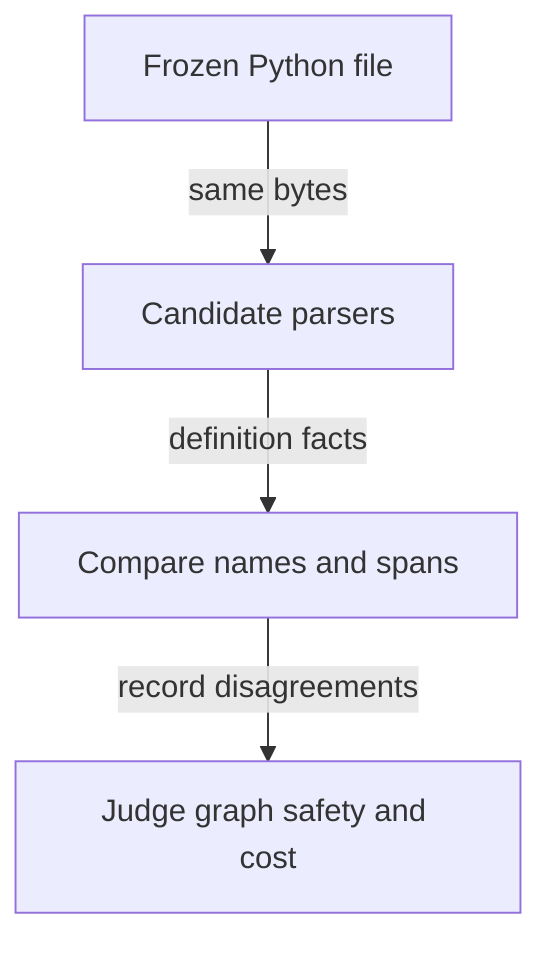

# Which parser should the Codebase Map use for Python?

[Back to graphs and experiments](README.md)

The Codebase Map needs a parser that records the right Python definitions,
including when a developer leaves a file unfinished. A **parser** reads source
text according to a language's syntax rules, or **grammar**. Its output helps
the map identify **symbols**, such as functions and classes, and the source
lines belonging to each one. Those symbols become part of the **code graph**,
the map's static record of a project's code and relationships.

The `python-parser` experiment compares Python's built-in `ast` parser, which
builds an abstract syntax tree (a structured representation of the source),
with alternatives. It asks whether a switch would improve correctness, accepted
syntax, recovery from broken files, speed or installation cost. A **corpus** is
a collection of input files; here, freezing each corpus ensures every candidate
reads the same bytes. The [experiment README](../../evals/codebase-map/python-parser/README.md)
defines the comparison, and its [recorded results](../../evals/codebase-map/python-parser/RESULTS.md)
own the measurements.

## What the recorded result means

**Keep Python on the standard-library `ast` parser.** The recorded Windows run
found no reason to replace it: LibCST reproduced its valid-code results at much
higher cost, while tree-sitter introduced definitions the reference parser did
not declare. The useful improvement was to recover only complete definitions
from a valid prefix of an unfinished file. This **closed-prefix recovery**
retains definitions that finish before the damaged part, while keeping the
file's parse-error status.

The minimum interpreter and closed-prefix recovery shipped on 2026-10-22.
Their measurement and delivery are different evidence: the recovery policy was
scored in this harness, but the shipped adapter was not re-scored on the same
mutated files. The detailed evidence and that limitation remain below in
[Verified](#verified) and [Not verified](#not-verified). This experiment measures
parsing; it does not establish whether the map resolves calls correctly.

## Follow one file through the comparison

This is an **illustrative example**, not a new fixture, measured result or
executed command. It shows why finding more names is useful only when their
source spans, the lines assigned to each definition, are also right.



Read the arrows from top to bottom: supply identical input, extract comparable
facts, then inspect differences before deciding what belongs in the graph.

1. **Input:** imagine a file with a complete `total` function followed by an
   unfinished `report` function. A frozen valid version provides the reference
   for a broken version made by a mutation, an injected syntax error.
2. **Processing:** each parser attempts the same file. Recovery policies decide
   which definitions to retain after a syntax error; the harness compares both
   their identities and their ending lines with the valid reference.
3. **Output:** retaining `total` with its complete span is useful. Reporting an
   incomplete `report` body as complete would be an unsafe emission, because
   the map hashes that body to detect change.
4. **Meaning:** name **recall** asks how many reference definitions were found;
   name **precision** asks how many reported definitions are real. Neither alone
   proves their spans are safe. The experiment therefore scores spans as well
   as names before choosing a recovery policy.

## Detailed reference

### python-parser

A measurement harness for the Codebase Map code graph. It measures which
parser the map should use for Python, on the axes that matter for a code
graph: whether the symbols are right on valid code, how far the accepted
syntax depends on the interpreter running it, what is recovered from a file
mid-edit and whether that recovery is safe to put into the graph, how fast it
is, and what it costs to install (its README, first paragraph). The canonical
description is its own [README](../../evals/codebase-map/python-parser/README.md)
and the recorded run is its
[RESULTS.md](../../evals/codebase-map/python-parser/RESULTS.md); this card
identifies the harness and separates what is verified from what is not.

### Identity

| Field | Value |
|---|---|
| Repository path | `evals/codebase-map/python-parser/` |
| Kind | Measurement harness, not an agent-scored case (README, second paragraph) |
| Contract touched | The Python adapter [`languages/python.py`](../../plugins/codebase-map/skills/map-method/scripts/languages/python.py), the snapshot parser fingerprint (Python minor), and the common worker fact schema: one JSON line per file with fields `q`, `k`, `l`, `e`, `c`, `d`, `b`, `a` (README, "Files") |
| VCS state | Committed, working tree clean; 16 tracked files, latest commit `9c07d2fd` |
| Owning plugin | None. A development asset of this repository, never shipped (per [evals/codebase-map/README.md](../../evals/codebase-map/README.md)); the consumer is `codebase-map` |

### Scope and boundary

- Candidates are stdlib `ast` (the current adapter), tree-sitter-python
  0.25.0, LibCST 1.9.0 and parso 0.8.7; parso was excluded on the feature
  probe (README, "Candidates").
- Every corpus is frozen once by `freeze.py` into a directory with a SHA-256
  manifest, and every parser reads the same bytes (README, "Corpora").
- Outputs are written outside the repository; every counted disagreement is
  written with file and line to `<dir>/examples/` (README, "Running").
- It measures parsing only. It draws no conclusion about the semantic layer
  (`python_semantics` scopes, bindings, references), which a tree-sitter switch
  would have required re-implementing but which was not needed to decide
  (RESULTS.md, "Not measured").
- It is not a runtime exercise of the map and not a shipped behaviour change.

### Entry points

One line per script, from its own docstring.

| Script | Role |
|---|---|
| `freeze.py` | Copies every corpus into a frozen directory before measuring it |
| `run_all.py` | Produces every raw measurement for the Python parser comparison |
| `ast_worker.py` | Parses files with the running interpreter's stdlib `ast` and emits canonical facts |
| `ts_worker.py` | Parses files with tree-sitter-python and emits the facts `ast_worker.py` emits |
| `libcst_worker.py` | Parses files with LibCST and emits the same facts |
| `features.py` | Syntax-feature corpus: one construct per case, with the definitions it must yield |
| `mutate.py` | Work-in-progress corpus: realistic syntax errors injected into valid real files |
| `analyze.py` | Turns the raw measurements into the comparison and its evidence |
| `analyze_cst.py` | Compares LibCST against the reference stdlib `ast` on the corpora |
| `salvage_eval.py` | Scores every recovery policy for broken files, on spans as well as on names |
| `gap_diagnosis.py` | Re-classifies the Python resolver measurement with the Codebase Map's perimeter |
| `probe_divergences.py`, `probe_libcst.py`, `probe_parso.py` | Isolate each divergence or candidate, one construct per parse |

### Running it

From the README, "Running":

```
python freeze.py --dest <frozen> --corpus "name=git|<repo>[|exclude-regex]" --corpus "name=dir|<folder>"
python run_all.py --out <dir> --interp 3.11=<python> ... --interp 3.14=<python> --reference 3.14 \
    --ts-python <venv with tree-sitter-python> --cst-python <venv with libcst> \
    --corpus "name=dir|<frozen>/name" ... --mutation-corpora a,b,c --mutations-per-corpus 120
python analyze.py --out <dir>
python analyze_cst.py --out <dir>
python salvage_eval.py --out <dir>        # with the reference interpreter
uv run --no-project --script gap_diagnosis.py --fix1 <jedi-edges-fix1.json> --manifest <manifest.sqlite> \
    --project <project root> --out <gap.json>
```

Prerequisites the README states: separate virtual environments for
tree-sitter-python and LibCST, one interpreter per measured CPython version,
`uv` for `gap_diagnosis.py`, and a `jedi_edges.py` Fix 1 result from
[resolver-spike](code-graph-resolver-spike.md) as its `--fix1` input. Write
outputs outside the repository.

### Verified

The recorded run is dated 2026-10-22, one machine, Windows; raw outputs are
machine-local, under the bench directory of the run (RESULTS.md, preamble).

| Claim | Source |
|---|---|
| Decision: Python stays on the stdlib `ast` parser | RESULTS.md, "Decision" |
| Corpora total 22,536 files, 394,996 definitions, 262,091 imports across three projects and two `site-packages` trees | RESULTS.md, "Corpora" |
| On valid code, tree-sitter matches all 394,996 definitions but emits 13 that `ast` does not declare (PEP 695 misreads of `type(x).__name__` assignments); LibCST matches exactly with 0 extra | RESULTS.md, "1. Valid code" |
| 614 end-line differences are a trailing-comment convention, not an error, but would change every affected body hash | RESULTS.md, "1. Valid code" |
| LibCST totals 4,594.5 s against 80.8 s for `ast` 3.14, about 57 times slower for an identical result | RESULTS.md, "4. Speed" |
| Under CPython 3.11 four measured files are rejected that 3.12 accepts; acceptance is monotonic, so a too-old interpreter fails loudly | RESULTS.md, "2. The grammar and the interpreter" |
| On 1,892 effective mutated files, the stdlib closed-prefix policy recovers 50.16% of names at 100% precision with 0 unsafe emissions; tree-sitter's before-first-error policy reaches 50.95% name recall but emits 869 partial spans, counted as unsafe in the results table | RESULTS.md, "3. Broken files", policy table and unsafe-emission definition |
| The resolver gap corrects from 374 to 140 (project 1) and 181 to 67 (project 2) once project membership means snapshot inventory; confirmed edges stay 505 and 324; zero cases have a parser cause | RESULTS.md, "6. The Code Graph prerequisite has no parser cause" |
| The extraction convention drops 4.8% to 7.2% of project definitions and 8.8% to 9.7% of library definitions, and that loss is the adapter's choice, not the parser's | RESULTS.md, section 6 |

### Not verified

The RESULTS.md "Not measured" list, verbatim in scope: other operating
systems (Windows only); Python 3.10 and older interpreters; incremental
parsing (tree-sitter edit-and-reparse was not exercised); semantic evidence
(the `python_semantics` layer); hand-written broken files (the six mutations
are realistic but synthetic). This card documents the harness; nothing
here was executed to write it.

The two changes the decision implies **shipped on 2026-10-22**, in
[`languages/python.py`](../../plugins/codebase-map/skills/map-method/scripts/languages/python.py)
and [`snapshot.py`](../../plugins/codebase-map/skills/map-method/scripts/snapshot.py):
the declared minimum interpreter, `MINIMUM_PYTHON = (3, 12)`, enforced by
`require_minimum_interpreter()` at the entry points and carried by a
`requires-python` header so `uv run --script` provisions a compliant one; and the
stdlib closed-prefix recovery, which keeps only the definitions the prefix closes and
reports `recovered prefix: line N, M closed definitions` while the file stays a parse
error. Not re-measured after shipping: the recovery rate through the adapter on the
same 1,892 mutated files. The policy is the measured one and six regression tests pin
it, but the shipped recall is inferred from `salvage_eval.py`, not re-scored.

### Relations

- Feeds the parser table of spec
  [§3.2.2](../superpowers/specs/2026-10-19-graph-grounded-economy-routing-design.md),
  which selects stdlib `ast` for Python on this measurement (22,536 files) and
  requires a declared minimum interpreter.
- `gap_diagnosis.py` consumes the Fix 1 output of
  [`jedi_edges.py`](../../evals/codebase-map/resolver-spike/jedi_edges.py) in
  [resolver-spike](code-graph-resolver-spike.md) and the manifest written by
  [`snapshot.py`](../../plugins/codebase-map/skills/map-method/scripts/snapshot.py).
- Measures the shipped adapter
  [`languages/python.py`](../../plugins/codebase-map/skills/map-method/scripts/languages/python.py);
  the shipped parsers also carry the CI unit suite
  [`tests/test_xray_scripts.py`](../../tests/test_xray_scripts.py).
- Related comparison: [embedding benchmark](embedding-benchmark.md);
  consumer plugin [`codebase-map`](../plugins/codebase-map.md), skill
  `codebase-map:map-method` (names per [docs/catalog.md](../catalog.md)).

### Open points

- The two follow-ups the decision recorded are delivered (see "Not verified" for
  what was not re-measured). What remains open on the interpreter is only whether
  3.12 stays the floor when 3.13-only or 3.14-only syntax becomes common enough in
  analysed projects to matter: the floor is one constant, and the parser fingerprint
  already carries the running minor.
- Spec §3.2.2 records the resolution rule (MRO to project bases, module
  attributes, project target only if in the inventory), the widened extraction
  convention, broken-file recovery and the declared minimum interpreter as
  the prerequisite of the resolver layer, to be satisfied before engines are
  attached. All four shipped on 2026-10-22 for Python: the extraction convention as
  `ParseResult.nested`, the resolution rule in
  [`resolution.py`](../../plugins/codebase-map/skills/map-method/scripts/resolution.py)
  shared by both owners of the source graph, and the engine behind them in
  [`resolve_edges.py`](../../plugins/codebase-map/skills/map-method/scripts/resolve_edges.py).
- The adapter's extraction loss (nested functions, definitions inside
  `if`/`try`/`with`, nested classes, `type` aliases) is corrected: those definitions
  are symbols now, under the qualified name their enclosing chain gives them. The
  measured 4.8% to 7.2% was a loss against `ast` on the same corpora; it was not
  re-measured against the shipped adapter, and PEP 695 `type_params` on a generic
  definition still do not enter its signature record, deliberately, because that
  field is part of every Python symbol's interface digest.
