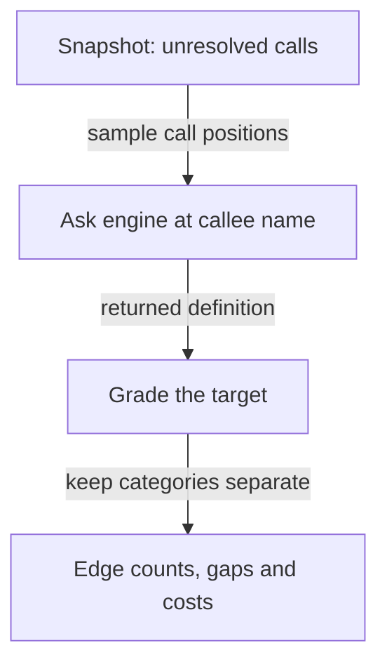

<a id="resolver-spike"></a>

# Can a language engine recover the call targets the map misses?

[Back to graphs and prototypes](README.md)

The Codebase Map can record a call without knowing which declaration it reaches.
`resolver-spike` asks whether an external language engine can recover that target,
how often its answer is a real call edge, and what the extra analysis costs. A
**call edge** connects a call site to its target declaration. A **resolver** is
the part of the analysis that tries to identify that target; the map's
**lexical resolver** uses the source information already in the map.

The recorded campaign shows why an engine's answer needs qualification. Python
recovered more edges with the project's real environments than without its
dependencies. Rust and Go have verified calls that the published grading rules
leave out, so their recorded counts are lower bounds. The practical question is
therefore which additional targets can be trusted at a declared cost. The evidence
and remaining grading decisions are retained in [Verified](#verified),
[Not verified](#not-verified) and [Open points](#open-points).

This is a development measurement harness. It queries recorded source information;
its results do not establish runtime behaviour. The harness was not executed to
prepare this page.

## Follow one unresolved call

The harness reads a **snapshot**, a recorded static view of a project. Its
`manifest.sqlite` is the SQLite database containing the file, symbol and reference
inventory. A language engine supplies definitions using knowledge of the
language; an **LSP** engine exposes that service through the Language Server
Protocol. Each returned definition receives a **grade** describing what the
engine reached. A definition is not automatically a call target.

This small flow is illustrative. The arrows show information moving through a
measurement, not a new campaign result or a runtime execution trace.



**Worked example (illustrative, not a measured record):**

1. **Input:** a snapshot records `broker.place_order(...)` as an unresolved call.
   Here `place_order` is the **callee**, the name being called, and `broker` is
   its receiver.
2. **Processing:** the harness asks the engine about `place_order`, then checks
   what kind of declaration the answer names. Asking about `broker` instead can
   return the receiver's declaration and over-count recovery.
3. **Output:** an answer naming a project method can receive `edge-call`; an
   answer naming a variable stays in a separate candidate category. The run also
   records unresolved answers and analysis cost.
4. **Implication:** an engine finding a definition is only the start of the
   measurement. The target and grade determine whether the answer adds a call
   edge. The engine's environment and the sample limit how far the result can be
   generalized.

## Detailed reference

### Experiment and sources

A measurement harness for the Codebase Map code graph. It measures whether an optional type-checker or language-server engine recovers the call references the map's lexical resolver leaves unresolved, at what cost and with what precision, per language. It reads a snapshot's `manifest.sqlite` rather than running the map. The decision it supports is recorded in [§3.2.2 of the graph-grounded economy routing design](../superpowers/specs/2026-10-19-graph-grounded-economy-routing-design.md); grading decisions still open are in [OPEN_POINTS.md](../../evals/codebase-map/OPEN_POINTS.md). The canonical description is its own [README](../../evals/codebase-map/resolver-spike/README.md); this card identifies the harness and separates what is verified from what is not.

### Identity

| Field | Value |
|---|---|
| Repository path | `evals/codebase-map/resolver-spike/` |
| Kind | Measurement harness, not an agent-scored case (its README, first paragraph) |
| Contract touched | Snapshot `sem_references` rows of kind `call`; the extended edge contract (`resolver` field, graded `confidence`) of spec §3.2.1 and §3.2.2 |
| VCS state | Committed harness: 11 tracked files, latest commit `849797ac`. The 2026-10-23 editorial snapshot also contains a modified README and an untracked RESULTS.md |
| Owning plugin | None. A development asset of this repository, never shipped (per [evals/codebase-map/README.md](../../evals/codebase-map/README.md)); the consumer is `codebase-map` |

### Scope and boundary

- The population is the snapshot's own unresolved `call` references, minus `unbound-name` builtins (README, "What an edge means here").
- It never writes to a snapshot and never runs a map; the read-only probes say so in their docstrings (`manifest_probe.py`, `lexical_baseline.py`).
- Engines are installed outside the repository and never into the project under measurement (README, "Running").
- `jedi_spike.py` and `lsp_spike.py` are stage 1, kept for provenance only: they over-count because a definition request at a receiver returns the receiver (README, script table).
- `sql_parity_spike.py` is superseded by [grammar-parity](code-graph-grammar-parity.md) (README, script table).
- It cannot conclude runtime behavior: every number is static analysis against recorded snapshots.

### Entry points

One line per script, from its own docstring or the README script table.

| Script | Role |
|---|---|
| `manifest_probe.py` | Full-population distribution of unresolved call references by language, reason and file; never writes |
| `lexical_baseline.py` | Share of call references the lexical resolver resolves on its own; never writes |
| `jedi_edges.py` | Stage 2 for Python with Jedi, against the project's own virtual environments |
| `lsp_edges.py` | Stage 2 for TypeScript, JavaScript, Java, Go and Rust through multilspy, counting real call edges, not declarations |
| `handcheck.py` | Renders sampled edges with source at both ends, so a verdict is reached by reading code |
| `probe_audit.py` | Measures how often the probed LSP character really lands on the callee name |
| `summarize_results.py` | Recomputes per-run figures from the raw result JSONs, with unweighted and reason-weighted extrapolation |

### Running it

From the README, "Running":

```
uv run --no-project --script manifest_probe.py --manifest <manifest.sqlite> --language python
uv run --no-project --script jedi_edges.py --manifest <manifest.sqlite> --project <root> \
    --environment <venv> [--environment <venv> ...] --out <result.json>
uv run --no-project --script lsp_edges.py --manifest <manifest.sqlite> --project <server workspace> \
    --language typescript --workspace-rel <manifest prefix> --server-binary <server> --out <result.json>
```

Prerequisites the README states: copy a project into a scratch directory before running an engine that builds (rust-analyzer writes a `target/` directory) and point build caches at scratch (`CARGO_HOME`, `CARGO_TARGET_DIR`, `GOPATH`, `GOMODCACHE`, `GOCACHE`); JDTLS writes `~/.m2` and multilspy writes `~/.multilspy`, and neither can be redirected through multilspy. On Windows, pass `--server-binary` pointing at the TypeScript server's `.cmd` file, because the extensionless npm shim fails with WinError 193; PowerShell drops an empty argument, so pass `--workspace-rel=` for a workspace that is the snapshot root.

### Verified

The campaign ran on 2026-10-22 (README, "What the campaign of 2026-10-22 found"). Raw results are machine-local and are not committed (README, same section; OPEN_POINTS.md, preamble).

In the latency figures, **mean** is the average response time and **p95** is the
95th percentile: 95% of measured responses are at or below it. A **lower bound**
here means a published count leaves out additional calls verified by reading
source; it does not estimate their frequency across other projects.

| Claim | Source |
|---|---|
| The lexical resolver resolves 7,439 of 76,366 call references (9.7%) on one real project and 10,726 of 82,227 (13.0%) on a second | Spec §3.2.2 |
| Jedi against the project's real environments confirms 505 edges (31.6%) of 1,600 sampled positions, residual unresolved 2.7%; the same engine without project dependencies produced 403 edges (25.2%) with 24.1% unresolved | Spec §3.2.2 |
| The Python reference sample of 1,600 positions costs 154 s single-thread, mean latency 99 ms, p95 307 ms | Spec §3.2.2 |
| Ten defects were found and fixed in `lsp_edges.py` before it could measure, two making it non-executable and two producing plausibly false numbers | README, final section; spec §3.2.2 |
| OP-1: all 17 Rust `EnumMember` records read at both ends are true positives; OP-2: all 174 Go interface-method candidates are true positives, so both published numbers are lower bounds | OPEN_POINTS.md |
| Go publishes 466 `edge-call` of 1,000 sampled positions (46.60%); option A would raise it to 64.00% | OPEN_POINTS.md, OP-2 |
| Go `edge-instantiation` (267 records) is one type-conversion idiom and is excluded; Rust `dynamic-callee` is 29% of the population and under 3% recoverable | OPEN_POINTS.md, "Not open points" |
| `jedi_edges.py` keeps a documented gap-bucket defect (`in_project` tests path containment, and virtual environments live under the project root) so published numbers stay reproducible | `jedi_edges.py` docstring; README |

### Not verified

| Item | Source |
|---|---|
| LSP campaign outcomes were published on 2026-10-22 in RESULTS.md and spec §3.2.2. The measurements remain static and sample-bound; JavaScript lacks a recorded precision audit and the failed TypeScript root-workspace probes are missing measurements, not zero recovery | [RESULTS.md](../../evals/codebase-map/resolver-spike/RESULTS.md), "Provenance and verification boundary"; spec §3.2.2, "Esiti per linguaggio pubblicati (2026-10-22)" |
| That gopls v0.24.0 nests interface members under hierarchical document symbols (OP-2 option B); unit-variant enum constructors are unmeasured either way (OP-1); the 25 Go `nested-inside-6:Method` candidates were not examined | OPEN_POINTS.md |
| The 17.4 pp Go effect is not a corpus-wide figure: 152 of 174 call sites come from generated `semconv` files | OPEN_POINTS.md, OP-2 |

This card documents the harness; nothing here was executed to write it.

### Relations

- Feeds the resolver layer of spec §3.2.2, which fixes the mandatory `resolver` field, resolver identity in the fingerprint and the graded confidence vocabulary from this measurement.
- Reads the manifest written by [`snapshot.py`](../../plugins/codebase-map/skills/map-method/scripts/snapshot.py) and baselines the lexical resolver of [`semantic_store.py`](../../plugins/codebase-map/skills/map-method/scripts/semantic_store.py).
- [`gap_diagnosis.py`](../../evals/codebase-map/python-parser/gap_diagnosis.py) in [python-parser](code-graph-python-parser.md) replays this harness's Python gap with the corrected project-membership test.
- [grammar-parity](code-graph-grammar-parity.md) supersedes `sql_parity_spike.py`; the [embedding benchmark](../plugins/codebase-map-research.md#embedding-benchmark) records the retrieval-quality comparison.
- Consumer plugin: [`codebase-map`](../plugins/codebase-map.md), skill `codebase-map:map-method`, entry `/daodan:map-code` (names per [docs/catalog.md](../catalog.md)).

### Open points

- OP-1 (Rust tuple-variant constructors) and OP-2 (Go interface method calls) are both "open, not blocking"; each lists options with their effect on the published numbers (OPEN_POINTS.md).
- A point leaves OPEN_POINTS.md only when its decision is recorded in spec §3.2.2, with the date and who took it (OPEN_POINTS.md, preamble).
- An edge to an interface method is a call to a contract, not to an implementation; any adopted option must mark the edge so `stale-callers` and `edit_impact` do not over-propagate (OPEN_POINTS.md, OP-2).
