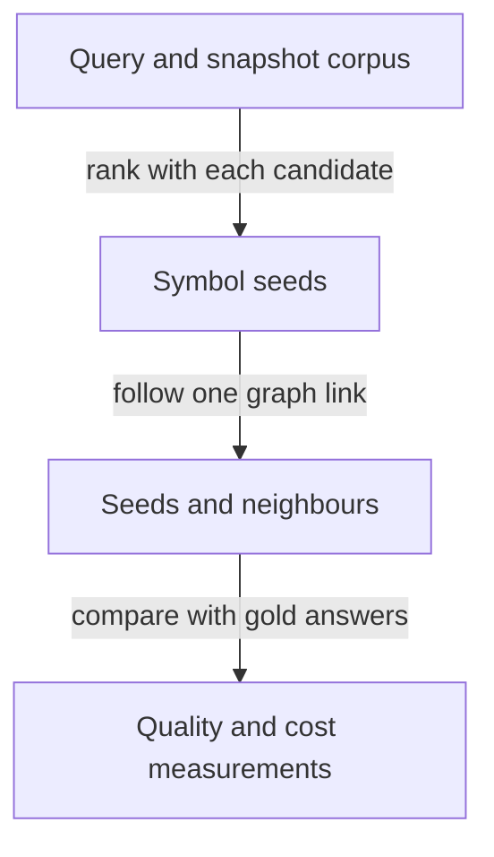

<a id="retrieval-benchmark"></a>

# Does a code embedder improve search enough to pay for its cost?

[Back to graphs and prototypes](README.md)

`retrieval-benchmark` asks whether Codebase Map finds better starting symbols for
a query when it adds a local code embedder to its existing search. A **seed** is
an initial symbol returned by that search. A **code embedder** represents code
and queries as numerical vectors so they can be ranked by similarity. Its extra
download, indexing time and query latency must buy useful retrieval gains.

The recorded decision is to keep the existing search as the default: exact
matches, code-aware text search and graph expansion. On the one recorded corpus,
Jina v2 and CodeRankEmbed did not improve overall retrieval enough to justify
their cost. CodeRankEmbed helped the English natural-language slice, while
Italian queries remained weak. EmbeddingGemma 2 (candidate D) has no recorded run.
This supports a bounded decision about the measured candidates and corpus, with
any future adoption requiring a larger gold set. See [Verified](#verified),
[Not verified](#not-verified) and [Open points](#open-points) for the evidence and
limits.

This is a development measurement harness. It measures retrieval quality and
cost, and does not change Codebase Map runtime behaviour. The harness was not
executed to prepare this page.

## Follow one search query

An **exact anchor** identifies a symbol directly, for example by its name or a
location in traceback text. **FTS5** is SQLite's full-text search facility; here
it searches code-aware symbol documents. **One-hop graph expansion** follows one
recorded graph link from a seed to a neighbour. A **gold set** records which
symbols a query is expected to find, so the candidates can be scored against
the same answers.

This flow is illustrative. The arrows carry a query, ranked seeds and their
neighbours into scoring; they do not show an agent completing a task.



**Worked example (illustrative, not a scored query):**

1. **Input:** suppose a reader searches for `parse_file`, and the gold set names
   that symbol as the expected answer. The **corpus** is the set of symbol
   documents extracted from one snapshot.
2. **Processing:** an exact anchor can place `parse_file` among the seeds. Each
   candidate keeps exact anchors first; its search ranking is then compared with
   the expected answer. Graph expansion also brings resolved neighbours into the
   dependency ranking.
3. **Output:** the run records ranked symbols, quality scores, query timings and
   index costs for each candidate.
4. **Implication:** success on an exact name does not demonstrate an embedder's
   value for a paraphrase. Query kinds need separate results, and any quality
   gain must be read beside the download, indexing and latency costs.

## Detailed reference

### Experiment and sources

A measurement harness for the Codebase Map code graph. It answers one narrow question: does a local code embedder improve symbol seed discovery enough to justify its download, index time and query latency, after exact anchors and the graph are already used (its README, first paragraph). It is a development eval under `evals/`, never shipped in a plugin package, and it does not change Codebase Map runtime behaviour. The canonical description is its own [README](../../evals/codebase-map/retrieval-benchmark/README.md) and the recorded run is its [RESULTS.md](../../evals/codebase-map/retrieval-benchmark/RESULTS.md); this card identifies the harness and separates what is verified from what is not.

### Identity

| Field | Value |
|---|---|
| Repository path | `evals/codebase-map/retrieval-benchmark/` |
| Kind | Measurement harness scored by numbers recorded in its RESULTS.md, not an agent-scored case (grammar-parity README, "Relationship to the other eval assets") |
| Contract touched | The symbol seed retrieval path: exact anchors, code-aware SQLite FTS5 (`bm25(fts,10,5,3,1)` over exact name, identifier subtokens, signature and document columns), one-hop graph expansion; outputs `corpus.jsonl`, `adjacency.json`, `rankings-*.json`, `results.json`; gold sets in `queries.json` and generated `version: 2` files |
| VCS state | Committed, working tree clean; 6 tracked files, latest commit `a8235bc3` |
| Owning plugin | None. A development asset of this repository, never shipped (README, second paragraph); the consumer is `codebase-map` |

### Scope and boundary

- It measures seed retrieval quality and cost only. It does not benchmark map runs, agent behaviour or documentation quality.
- Candidate A is stdlib-only; B, C and D need the ONNX sidecar dependencies through `uv` (README, "Run").
- The default corpus is this repository's `plugins/` tree, which excludes generated host exports by target choice (README, "Corpus and gold set").
- The generated gold set of `generate_queries.py` is biased toward identifier vocabulary and never replaces the hand-written set for quality claims (README, "Corpus and gold set").
- A Dependency Recall@15 of 1.000 for all candidates rests on five queries with declared dependencies; it is not evidence that the candidates differ there (RESULTS.md, "Reading").

### Entry points

One line per script, from its own docstring.

| Script | Role |
|---|---|
| `run_benchmark.py` | Retrieval benchmark for Codebase Map symbol search candidates |
| `generate_queries.py` | Generates a deterministic stratified gold set from one benchmark corpus, for projects without hand-written queries |
| `embed_rank.py` | Encodes a benchmark corpus with one pinned ONNX embedding model |

### Running it

From the README, "Run":

```text
python evals/codebase-map/retrieval-benchmark/run_benchmark.py --models A --out <output-dir>
python evals/codebase-map/retrieval-benchmark/run_benchmark.py --models A,B,C,D --out <output-dir>
```

For a project other than this repository, the README gives the generated gold-set pipeline: `run_benchmark.py --target <project> --out <dir>`, then `generate_queries.py --corpus <dir>/corpus.jsonl --adjacency <dir>/adjacency.json --out <dir>/queries-generated.json --per-kind 40 --seed daodan-retrieval-v2`, then a scoring run with `--queries <dir>/queries-generated.json`.

Prerequisites the README states: `uv` resolves the ONNX sidecar dependencies (`numpy`, `onnxruntime`, `tokenizers`, `huggingface_hub`); model files are downloaded into `<output-dir>/models` with their SHA-256 recorded and their document vectors cached there for reruns. Large corpora are slow on CPU: encoding 14,146 symbol documents took about 19 minutes for Jina v2 and about 14 minutes for CodeRankEmbed, and EmbeddingGemma 2 measures roughly one second per document on the recording machine, so candidate D needs hours, not minutes. Use `--manifest <manifest.sqlite>` to reuse a snapshot or `--target <tree>` to build one.

### Verified

The recorded run is dated 2026-10-21, on this repository's `plugins/` tree, one Windows workstation, CPU ONNX Runtime; its raw output is retained outside the repository (RESULTS.md, "Run").

Read the quality scores as follows. **Symbol Recall@20** is the share of expected
symbols found in the first 20 results. **MRR@10** averages the reciprocal rank of
the first expected symbol in the first 10 results. **nDCG@10** measures the order
of those first 10 results using relevance grades, with expected symbols graded
above declared dependencies. **Dependency Recall@15** is the share of declared
dependencies found in the first 15 expanded results. Higher is better for these
scores. **P95** latency is the 95th percentile of query times.

The embedding candidates use **ONNX**, a model format executed by ONNX Runtime.
**INT8** identifies their quantized 8-bit integer model exports. Their
**sidecar** is the separate process that runs the embedding dependencies.

| Claim | Source |
|---|---|
| Corpus of 1,079 symbols; 36 gold queries: 12 exact, 4 traceback, 8 natural-language English, 6 natural-language Italian, 6 code-to-code | RESULTS.md, "Run" |
| Candidate A: Symbol Recall@20 0.778, MRR@10 0.572, nDCG@10 0.580, Dependency Recall@15 1.000, mean latency 0.009 s, P95 0.011 s, index 1.13 s | RESULTS.md, "Overall" |
| Candidate B (Jina v2 code ONNX INT8): 0.722 / 0.551 / 0.546, 136.3 s total sidecar of which 124.8 s document encoding | RESULTS.md, "Overall" |
| Candidate C (CodeRankEmbed ONNX INT8): 0.778 / 0.560 / 0.560, 107.0 s total sidecar of which 93.1 s document encoding | RESULTS.md, "Overall" |
| Model files pinned by size and SHA-256: B 161,895,621 bytes, C 138,619,279 bytes; the official CodeRankEmbed repository ships no ONNX graph | RESULTS.md, "Overall" |
| Exact and traceback retrieval reaches Recall@20 1.000 for every candidate; Italian natural language is weak for all (A 0.333, B 0.000, C 0.167) | RESULTS.md, "By query kind" and "Reading" |
| Decision: do not add a default embedder; keep exact anchors, code-aware FTS5 and graph expansion | RESULTS.md, "Decision" |
| A missing gold symbol fails the run instead of silently scoring zero | README, "Corpus and gold set" |

### Not verified

| Item | Source |
|---|---|
| Candidate D (EmbeddingGemma 2 text tower, added in commit `de8267e3`) has no recorded run: the RESULTS.md tables cover A, B and C only | README, "Candidates", against RESULTS.md, "Overall" |
| Any corpus beyond the single 2026-10-21 `plugins/` snapshot; results are machine-local and single-run | RESULTS.md, "Run" |
| Italian paraphrase coverage by any embedder; neither model justifies treating them as covered | RESULTS.md, "Reading" |
| Behaviour of the generated gold set on large projects beyond its declared identifier-vocabulary bias | README, "Corpus and gold set" |

This card documents the harness; nothing here was executed to write it.

### Relations

- Feeds the retrieval path of the `codebase-map` code graph: exact anchors, FTS5 and one-hop graph expansion stay the seed discovery mechanism, per the recorded decision (RESULTS.md, "Decision").
- Reuses a snapshot manifest through `--manifest`, the artifact written by [`snapshot.py`](../../plugins/codebase-map/skills/map-method/scripts/snapshot.py).
- Sibling harnesses under the same code graph: [resolver-spike](code-graph-resolver-spike.md) (its README names this harness as the same shape) and [python-parser](code-graph-python-parser.md).
- Consumer plugin: [`codebase-map`](../plugins/codebase-map.md), skill `codebase-map:map-method`, entry `/daodan:map-code` (names per [docs/catalog.md](../catalog.md)).

### Open points

- Any future embedder adoption needs a larger gold set, especially Italian queries and queries whose answers share no identifier vocabulary with the target symbol (RESULTS.md, "Decision"). An embedder remains an optional experiment for English natural-language seed discovery only.
- Candidate D is defined and pinned in the README but awaits a recorded run before any claim about it (README, "Candidates"; RESULTS.md has none).
- Every run that uses the generated gold set must declare its bias in that run's RESULTS.md (README, "Corpus and gold set").
