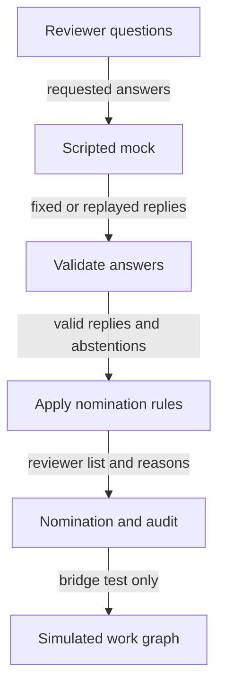

# Mock nomination prototype

## Can reviewer-selection rules be checked without calling a model?

Yes. This experiment supplies scripted answers and checks how the nomination
policy handles them. It can exercise required reviewers, score thresholds,
missing answers and evidence requirements without inference or network access.
It tests the selection contract and its rules; it supplies no new evidence about
the quality of a real model.

The canonical source is the
[mock nomination README](../../evals/senior-review/choicer-eval/mock-nomination/README.md).
This card explains the flow. The [Choicer evaluation](choicer-eval-prototype.md)
covers the model experiments, the [work graph prototype](work-graph-prototype.md)
covers the simulated plan, and the [graph guide](README.md) links the wider area.

## An example with a missing answer

Suppose the selector is asked about several reviewers and omits an answer. This is
an illustrative use of the rules in
[`nomination_policy.py`](../../evals/senior-review/choicer-eval/mock-nomination/nomination_policy.py),
not a new test result. **ABSTAIN** records that the answer is unknown. It does not
mean the reviewer is unnecessary.



The arrows show data passed between stages. The final arrow is a test bridge,
not real reviewer dispatch. A **lens** is a review perspective. The two mandatory
lenses in this frozen profile are `senior-review:code-auditor` and
`senior-review:security-auditor`; their inclusion rests on the policy even when
the tool fails or its answer abstains.

| Illustrative answer | Default nomination rule | Meaning for the reader |
|---|---|---|
| A mandatory lens has a low valid score | Keep the lens | A model vote cannot remove a mandatory reviewer |
| An optional lens meets the inclusive 0.5 threshold and has its required evidence binding | Nominate the lens, subject to the profile's margin rule | The answer meets the selection rules |
| An optional lens meets the score rule but lacks an evidence binding | Record ABSTAIN with `evidence_binding_missing` | No source reference is invented to complete the answer |
| An answer is missing, malformed, explicitly Z or failed | Record ABSTAIN; retain a mandatory lens by policy | Unknown remains visible in the audit |

An **evidence binding** is the caller's explicit association between an answer and
evidence or a changed-code section, called a hunk. The default policy requires it
for optional nominations that meet the score rule. The gate checks for a supplied
binding; this experiment does not establish that a real review verified the source.

## Detailed reference

### Identity and boundary

| Field | Value |
|---|---|
| Path | [`evals/senior-review/choicer-eval/mock-nomination/`](../../evals/senior-review/choicer-eval/mock-nomination/) |
| Kind | Offline development asset using a deterministic, scripted mock of Gutsy |
| VCS state | Working tree only; this asset has no tracked files |
| Policy | Standard-library code, no I/O; a frozen profile with mandatory lenses, thresholds, margin and evidence binding |
| Outputs | `decisions.json`, `scores.json` and `REPORT.md` in a new `mock-nomination/runs/<timestamp>/` directory |
| Integration boundary | No production selection change, inference, network access or model promotion |

The mock supports `gold-replay`, `oracle`, `threshold-edge`, `abstain` and `failure`
modes. Gold-replay reads saved probabilities; oracle uses a fixture of expected
answers; the other modes exercise threshold boundaries, invalid or absent answers,
and a scripted exception. Each recorded answer carries a `decision_id`, state
digest, question ID (`qid`) and `runtime_identity="mock-gutsy/v1"`. See the
[README contents table](../../evals/senior-review/choicer-eval/mock-nomination/README.md#contents)
for each mode and its exact source.

Two policy profiles answer different questions. The default nomination profile
retains mandatory lenses and requires evidence bindings. The threshold-only replay
profile removes those two constraints solely to reproduce the historical threshold
scores. Its reproduced numbers do not measure the default nomination profile.

### Entry points

| File | Role |
|---|---|
| [`mock_gutsy.py`](../../evals/senior-review/choicer-eval/mock-nomination/mock_gutsy.py) | Supplies deterministic answers through `decide(state, questions)` |
| [`nomination_policy.py`](../../evals/senior-review/choicer-eval/mock-nomination/nomination_policy.py) | Validates answers, applies the frozen profile and returns nominations with an audit |
| [`gold.py`](../../evals/senior-review/choicer-eval/mock-nomination/gold.py) | Loads frozen expected answers for scoring and keeps their labels out of model-visible inputs |
| [`score_mock.py`](../../evals/senior-review/choicer-eval/mock-nomination/score_mock.py) | Scores the mock and writes a new run without overwriting prior evidence |
| [`test_mock_nomination.py`](../../evals/senior-review/choicer-eval/mock-nomination/test_mock_nomination.py) | Covers contract, threshold, mandatory-lens, abstention, replay, CLI and optional graph-bridge behavior |

### Running it

From the repository root, the README gives these commands. They are reference
instructions, not commands executed for this documentation change:

```powershell
python -B -m unittest discover -s evals/senior-review/choicer-eval/mock-nomination -p 'test_*.py' -v
python -B evals/senior-review/choicer-eval/mock-nomination/score_mock.py --mode gold-replay --run-dir runs/<timestamp>
```

Replace `<timestamp>` with a new directory name. An existing target aborts instead
of being overwritten. Omitting `--run-dir` generates a UTC timestamp. The other
modes are `--mode oracle|threshold-edge|abstain|failure`.

### Verified

The [README's independent-verification record](../../evals/senior-review/choicer-eval/mock-nomination/README.md#corrections-independent-verification)
reports a gold-replay run with 462 decisions and 462 unique `decision_id` values,
using `teams.json`, and an abstention run that completed with 462 ABSTAIN records.
Those are recorded runs, not measurements repeated for this card. The README also
records the corrections for omitted answers, duplicate decision identifiers and
missing saved probabilities, with team-source provenance retained in `scores.json`.

The [bridge tests](../../evals/senior-review/choicer-eval/mock-nomination/test_mock_nomination.py)
materialize nominated reviewers as `REVIEW_LENS` nodes and drive them through
init/reserve/start/complete/finish with fixture gates in a temporary directory.
They include a `WAVE_BARRIER` rejecting a changed payload under the same delivery
event and a start packet with invented artifact digests. This demonstrates
materialization in the prototype graph only.

### Not verified

- Gold-replay reproduces saved probabilities and arithmetic. It makes no new
  claim about Gutsy's classification quality or promotion readiness.
- The bridge proves no real reviewer dispatch, real gate verification or host
  enforcement. See the [work graph limits](work-graph-prototype.md#not-verified).
- A case with ABSTAIN records has incomplete coverage. Its audit keeps each reason.
- Expected labels are partial benchmark labels: an absent role is a proxy negative,
  not proof that the role is irrelevant.

These limits come from the
[source README](../../evals/senior-review/choicer-eval/mock-nomination/README.md#limits).
