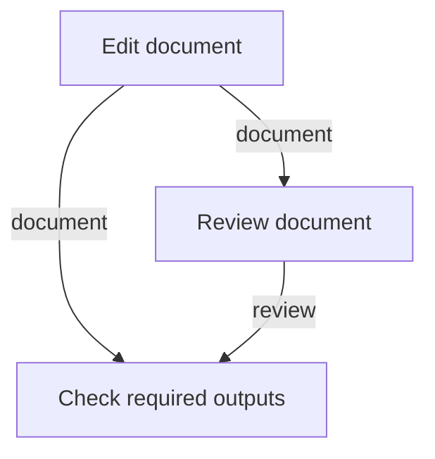

# Work graph prototype

## Can a plan track a change from editing to review?

This experiment checks the bookkeeping behind a task graph: which step may start,
which outputs it must receive, what it spends and how the run ends. A node is a
step in the plan; an arrow says that another step needs its output. The recorded
checks support a simulated editing and review sequence. Real worker execution
remains unverified.

Start here to understand the plan and its limits. Read the
[Choicer evaluation](choicer-eval-prototype.md) for the separate question of how
well a selector chooses reviewers, or the
[mock nomination experiment](mock-nomination-prototype.md) for scripted reviewer
choices materialized in this graph. Return to the [graph guide](README.md) to
compare the experiments.

## An editing example

The following illustration follows the plan in
[`demo.py`](../../evals/project-lifecycle/work-graph/demo.py). It is a conceptual
walkthrough, not a new run. Suppose a plan calls for editing `example.md`, reviewing
the resulting document and then checking that both outputs are present.



Each arrow carries a required output, not a call between functions in the code
graph. The last node is a **barrier**, a checkpoint for the preceding steps. In the
demo, the document, review and passing gate results are **fixtures**, supplied
values used to exercise the controller. No document editor or reviewer runs.

The controller records progress in `work.json`; `trace.json` records the simulated
scenario. A successful run therefore says that the supplied plan and fixture
results passed this experiment's checks. The [verified results](#verified) explain
what was exercised; [Not verified](#not-verified) lists the remaining boundaries.

## Detailed reference

A standard library reference experiment for the two components the Filone B
specification builds, the graph plan writer and the graph plan executor. It
compiles an explicitly supplied plan and persists reservations, attempts,
deliveries, versioned artifact digests, budgets and terminal outcomes in one JSON
record. Its schema is `work-graph-experiment/v1`, which is deliberately distinct
from the proposed `daodan/work/v2`: no installed workflow imports this code, and
nothing in `plugins/` depends on it.

### Identity

| Field | Value |
|---|---|
| Path | [`evals/project-lifecycle/work-graph/`](../../evals/project-lifecycle/work-graph/) |
| Kind | Isolated prototype of a writer and an executor, with mocked boundary interfaces |
| Schema | `work-graph-experiment/v1` (its own; not `daodan/work/v2`) |
| Interfaces | I1 map slice, I2 approved spec, I3 selection, I4 routing: validators plus deterministic mocks |
| VCS state | Working tree only. `git ls-files` returns 0 tracked files, so a fresh clone does not contain it |
| Future owner | `project-lifecycle` for the writer, `work-controller` for records and gates |
| Specification | [`2026-10-20-system1-work-graph-composition-design.md`](../superpowers/specs/2026-10-20-system1-work-graph-composition-design.md) |

### Scope and boundary

The prototype is an admission API and a simulated executor, not a runtime. Its own
README states the limits that a reader must not extend:

1. All execution is sequential. There is no parallel worktree or database isolation
   claim, so AC08 is answered by sequencing rather than by isolation.
2. Replan invalidates every node conservatively. Selective multi-output
   invalidation (AC05) is not implemented.
3. Node identity changes are refused rather than given an invented lineage.
4. Every output and verdict is a fixture. `VERIFIED_SUCCESS` means the simulated
   graph completed, not that a real document or application passed a review.
5. No shell command, model or worker is dispatched. `real_workers=false` and
   `real_gate_commands=false` are recorded in the run traces.
6. The API accepts fixture candidate identities and verdicts, so it must never be
   exposed as a production trust boundary.

### Entry points

| File | Role |
|---|---|
| `controller.py` | Executor: compiler, `work.json`, budget, gates, recovery, routed dispatch cost, escalation |
| `writer.py` | Writer, review zone only: I3 request, roster floor and citation rule, review expansion |
| `interfaces.py` | Validators of I1, I2, I3 and I4 |
| `routing.py` | Executor policy over I4: floor, ceiling, host binding, budget fit, judges never escalated |
| `policy.py` | Stand-in for the senior-review role catalog and the critical lenses |
| `mock_context.py`, `mock_selector.py`, `mock_router.py` | Deterministic mocks of mapper and specs writer, selector and light gate, router |
| `demo.py` | Three-node editing/review/barrier scenario; refuses an existing run directory |

### Running it

From the repository root, using the host-approved Python:

```powershell
python -B -m unittest discover -s evals/project-lifecycle/work-graph -p test_*.py -v
python -B evals/project-lifecycle/work-graph/demo.py evals/project-lifecycle/work-graph/runs/my-new-smoke
```

The demo writes `work.json` and `trace.json` for the simulated scenario and refuses
a directory that already exists, so prior evidence is never overwritten.

### Verified

All figures below come from the artifact's own
[README](../../evals/project-lifecycle/work-graph/README.md), sections "Observed
verification (2026-10-21)" and "Acceptance coverage and remaining gates".

1. **74 tests passed** in 1.1 seconds on 2026-10-21: 26 controller, 13 review zone,
   16 routing, 19 interface conformance. The controller candidate alone was 26
   tests in 0.818 seconds.
2. **Mutation check**: 18 policy rules were broken one at a time on a scratch copy
   (floor, ceiling, judge escalation, inherited cost, budget fit, tampered routing,
   free escalation call, uncited selection, droppable floor, request binding,
   unknown role, out-of-range tier, stale slice, open questions, gate) and the suite
   failed on all 18. The budget-fit mutant failed by a 60 second timeout rather than
   by an assertion, which is recorded as a weakness of that mutant, not of the suite.
3. **Two real defects** found by an independent source review and fixed with
   targeted regressions: serialized dictionary order could reject a valid replan, and
   resume could overwrite a budget-exhaustion outcome. Canonical ordering and
   terminal-preserving resume were added.
4. **One wrong test oracle** corrected: a stopped run rejects `finish` rather than
   returning false, and the assertion now checks that explicit rejection.
5. **Run traces**: `runs/20261021-smoke/` is the initial three-node simulation with
   six consumed units; `runs/20261021-verified-smoke/` is the final-candidate replay
   in a new directory, with the prior evidence retained.
6. Acceptance coverage is tabulated per criterion in the README, from AC01 to AC25.

### Not verified

The README states that its table is not full acceptance of AC01 to AC20, and that
verification is limited to the experiment's admission API and simulated evidence.
Explicitly missing:

1. AC05 selective invalidation, AC11 and AC12 sidecar, health, identity, restart and
   timeout adapters, AC18 shadow and active model policy: not implemented.
2. Crash durability under power loss, multi-process race behavior, adversarial
   filesystem confinement, real worker handle reconciliation, active-time clocks,
   the full set of runtime caps, authentic post-patch gate evidence: not proven.
3. Installed-host integration and classifier promotion were **not** approved. Two
   independent readers passed the amended design for an isolated prototype only.
4. The mother specification still needs its packet-ownership wording aligned before
   integration; `project-lifecycle` and `senior-review` remain the packet producers.
5. No hosted or local inference call was made anywhere in this evidence. Every
   selector, router, mapper and specs-writer answer is a mock.

### Relations

1. Specification: §1.3 names the six macro components and the four interfaces, §11
   lists AC01 to AC25, §12 fixes the delivery order (offline, then shadow, then
   active per snodo).
2. Real implementations of I3 and I4 now exist outside this prototype, in
   [`tier_router.py`](../../plugins/model-routing/skills/model-routing/scripts/tier_router.py)
   (`prepare-choice` and `resolve`, work-controller 1.7.0). The prototype's
   `routing.py` and `writer.py` still carry their own copy of the same policy
   constants and rules; see the open point below.
3. The roster floor the writer applies is produced in real life by
   [`review_roster.py`](../../plugins/senior-review/skills/review-preparation/scripts/review_roster.py)
   (`daodan/review-roster/v1`), which `policy.py` only stands in for.
4. Sibling prototypes are listed in the [graph documentation index](README.md).

### Open points

1. Next implementation gate, in the artifact's own words: whole-plan composition in
   the writer from I2 requirements and contracts plus I1 components, then typed gate
   evidence, selective invalidation and the missing admission policies, verified
   before writing an installed-host adapter.
2. Real implementations of I1 to I4 enter only after passing the same conformance
   suites that the mocks pass.
3. Policy ownership: the I3 and I4 rules now live both here and in the shipped
   `tier_router.py`. One owner has to be declared and the other has to consume it,
   otherwise the two will drift. This is tracked in the
   [index](README.md#open-points-across-the-prototypes).
4. Gutsy remains a separate offline experiment; a functioning graph controller does
   not validate its routing.
