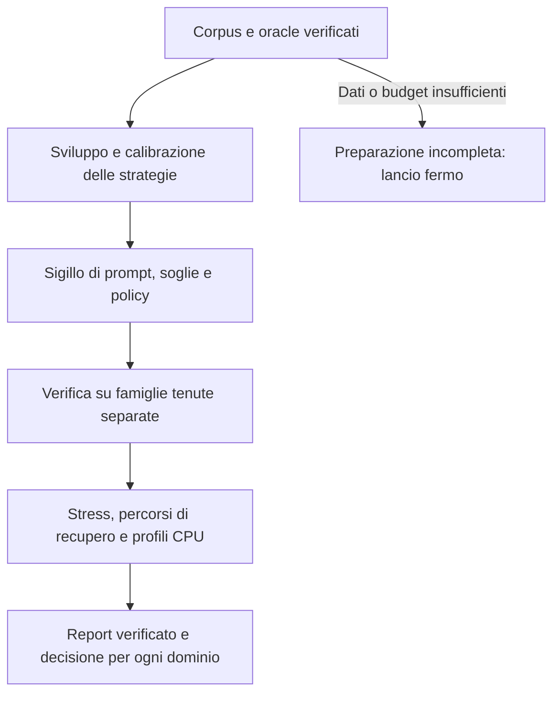

# Campagna Gutsy CPU: confrontare strategie e decidere il seguito

**Proposta: una campagna preregistrata, con un solo lancio Modal e un container CPU, che confronti strategie sugli stessi casi e produca un verdetto separato per routing, tool selection e compattazione.** Il numero di prove deve crescere insieme alla varietà degli scenari e alla qualità degli oracle.

Data: 26 ottobre 2026. Stato: disegno da materializzare e verificare prima del lancio. Nessun nuovo test o risorsa Modal avviato per questo documento. Il [pilot già eseguito](pilot-results-2026-10-26.md) resta diagnostica osservata, fuori dalla nuova verifica. L'obiettivo è capire come usare Gutsy congelato e dove proseguire, non addestrarlo.

## 1. Le domande alle quali deve rispondere

| Questione | Confronto che la isola |
|---|---|
| Il modello non comprende il caso, oppure manca informazione? | Stessa domanda con rappresentazioni diverse e verifica meccanica dei fatti presenti |
| La domanda induce la decisione sbagliata? | Stesso stato, opzioni e runtime; varia soltanto la formulazione |
| Il modello sa scegliere ma la soglia è sbagliata? | Probabilità congelate, policy scelte sul gruppo di calibrazione, verifica separata |
| Il risultato utile viene dalle regole o da Gutsy? | Baseline senza modello, output grezzo, regole e fallback riportati separatamente |
| Qualità sufficiente ma costo eccessivo? | Decisione completa, numero di domande, memoria e frequenza d'uso; poi profili CPU controllati |

Una grande media non deve nascondere una perdita critica. Tenere distinti qualità, copertura, recupero, efficienza e limiti d'ingresso. Il fatto che il run finisca non promuove una strategia.

## 2. Scala e unità da contare

Obiettivo di acquisizione: **600 scenari-base per dominio, 1.800 totali**, con quote ideali 120 sviluppo, 120 calibrazione, 360 verifica per ciascun dominio. Sono obiettivi di preparazione: il corpus non è già disponibile con questi volumi e queste etichette.

Registrare tre identità diverse: scenario-base; famiglia semantica; provenienza, come progetto/ticket/sessione/template. Traduzioni, parafrasi, stati successivi, finestre e commit collegati non diventano nuove famiglie indipendenti. Gli split rispettano interi gruppi anche quando questo impedisce di ottenere esattamente le quote numeriche.

Puntare a circa metà materiale controllato con oracle esatto e metà source-backed pubblico. La quota reale è un obiettivo da verificare; non riempirla rinominando esempi generati. Riportare separatamente:

1. Casi sintetici generati da regole esplicite e verificabili.
2. Scenari derivati da codice, issue o documentazione pubblica reale.
3. Replay costruiti da evidenza pubblica, che non sono sessioni utente osservate.
4. Eventuali tracce pubbliche realmente osservate, con provenienza e termini verificati.
5. Perturbazioni e repliche, che misurano robustezza o tempo e non aumentano il numero di famiglie.

Se la qualità del corpus non raggiunge il target, mostrare la quantità ottenuta e il limite delle conclusioni. Non aumentare artificialmente N con sostituzioni di nomi.

## 3. Corpus reale e risposte attese

Le fonti locali già esistenti non sono automaticamente gold per questi tre compiti. I 52 casi esterni trovati nell'area choicer riguardano soprattutto applicabilità dei revisori; contengono livelli gold/silver e fonti da verificare. I casi Jupiter hanno riferimenti a bug e revisioni, ma pubblicità e licenza non sono state accertate: non entrano automaticamente nell'upload.

Fonti candidate da curare, non ancora dataset adottati:

| Fonte | Uso possibile | Limite da preservare |
|---|---|---|
| Issue, commit e test di progetti pubblici con licenza verificata | Richieste real-source, cambi di candidato, errori e requisiti osservabili | Una patch non fornisce il gold del modello minimo sufficiente |
| [ToolRet](https://github.com/mangopy/tool-retrieval-benchmark) | Retrieval di strumenti e documentazione | Verificare revisione, licenza dei dati e mapping alle capability |
| [BFCL](https://github.com/ShishirPatil/gorilla/tree/main/berkeley-function-call-leaderboard) | Multi-tool, irrilevanza, stato e sequenze | Una chiamata gold non rende negativi tutti i tool non chiamati |
| [ToolBench](https://github.com/OpenBMB/ToolBench) | Cataloghi e distrattori derivati da API reali | Distinguere documentazione reale da istruzioni/tracce generate; nessuna API live necessaria |
| [LongMemEval](https://github.com/xiaowu0162/LongMemEval) | Eventuale benchmark separato di memoria | Non valida direttamente fast-jev, che conserva il testo user/assistant |

I link identificano candidati; diritti e disponibilità vanno chiusi per gli artefatti esatti prima dell'inclusione. Per il cloud usare un'allowlist di materiale pubblico fissato a revisione/hash. Il secret scan è un controllo ulteriore, non autorizza il caricamento di chat, email, repository privati o copie locali non pubblicate.

Due letture indipendenti propongono gli oracle senza vedere le risposte Gutsy; un passaggio di adjudication risolve il disaccordo con le fonti. Sono controlli agentici/autoriali, non etichette umane indipendenti certificate. Dove mancano fatti, conservare `unknown`, ambiguità o insiemi accettabili. Etichettare il minimo modello realmente sufficiente richiede esiti downstream di modelli diversi: questa campagna non li inventa.

Ogni record porta fonte, revisione, licenza verificata, hash, trasformazioni, famiglia, split, campi etichettati e motivo dell'etichetta. Titolo del bug, messaggio del fix e soluzione attesa rimangono fuori dall'input quando rivelano il seguito.

## 4. Routing: cosa confrontare

Baseline R0: fatti verificabili e fallback prudente, senza Gutsy. Il router canonico mantiene selezione, capability e minimi di rischio.

| Braccio | Input e domanda | Domande per scenario |
|---|---|---:|
| R1 | Dieci segnali del primo pilot, con lo stesso insieme di fatti degli altri bracci | 10 |
| R2 | Fatti verificabili più depth e ambiguity residue, formulazione neutra | 2 |
| R3 | Stessi due residui e stessi enum, domanda con confini positivi e negativi | 2 |
| R4 | R2/R3 con astensione e fallback selezionati sulla calibrazione | Replay delle probabilità, zero nuove inferenze di qualità |

La riduzione a due domande è applicabile soltanto quando gli altri segnali sono davvero determinati da informazioni disponibili al controller. Non usare le etichette nascoste come metadati. Separare i nodi strutturati del workflow dalle richieste libere iniziali: per queste ultime l'insufficienza di dati e l'escalation sono risultati da contare, non valori da inventare.

Sul sottoinsieme applicabile confrontare tutti i bracci. Dove R2/R3 non possono produrre un vettore completo senza supposizioni, registrare fallback e copertura. Un vantaggio ottenuto rinunciando a molti casi deve rimanere visibile.

Una variante gerarchica della profondità può entrare nel blocco di stress con un albero esplicito e conteggio delle domande lungo ciascun ramo. Non dichiarare che due bit codificano cinque classi più chiarimento. Un contratto che emette soltanto un tier è un'alternativa diversa e va valutato come tale.

Misurare segnali con oracle disponibile, floor mancati, capacità violate, over-routing, astensioni, assegnazione deterministica e costo completo. Un LLM di confronto e l'esecuzione dei lavori finali richiedono un blocco e un budget separati: non sono inclusi come chiamate a pagamento implicite.

## 5. Tool selection: procedure diverse e percorsi di recupero

T0 conserva tutti i tool eleggibili dopo gli stessi controlli di disponibilità e autorizzazione. È la baseline di sufficienza e costo degli schemi.

| Procedura | Scelta | Errore da isolare |
|---|---|---|
| T1 flat | Una noul per candidato eleggibile | Omissione o attivazione superflua del classificatore |
| T2 famiglie | Multi-label sulle famiglie, poi candidati ammessi dal gate | Tool necessario perso al primo livello |
| T3 retrieval | Retrieval deterministico congelato, poi valutazione dei candidati | Recall del retrieval separato dal reranking |
| T4 minimo del metodo | Tool obbligatori dichiarati dal metodo, modello sui dubbi e discovery recuperabile | Merito delle regole distinto dal contributo Gutsy |

Le procedure devono ricevere gli stessi fatti, descrizioni e permessi. Un minimo obbligatorio deve provenire da un metodo/contratto dichiarato prima del caso, non essere costruito dall'oracle dopo aver visto l'errore. Tool equivalenti formano gruppi OR; strumenti complementari gruppi AND.

Per risparmiare inferenze, il primo blocco può valutare offline T2/T3/T4 usando punteggi T1 già salvati, se input e singole domande sono identici. È una simulazione della qualità di selezione. La latenza della vera procedura gerarchica/retrieval richiede replay esecutivi: non sommare soltanto le chiamate che sarebbero sopravvissute. Verificare inoltre la stabilità dei punteggi fra batch completo e sottoinsieme di domande, senza assumere equivalenza numerica perfetta della cache.

Catalogo core: fino a tredici candidati classificabili, più discovery gestita dal contratto. Cataloghi 8/16/64/256, famiglie mai viste, alias e molte alternative appartengono allo stress dedicato. Non chiedere una scelta esclusiva quando servono più tool.

Misurare sufficienza prima e dopo fallback, costo di discovery e recupero, numero di schemi realmente inviati al modello principale, byte e token con tokenizer esplicito. Ordinare i tool senza ridurre gli schemi non dimostra risparmio di contesto. Le risposte delle vere API non devono essere invocate: si usano replay controllati.

## 6. Compattazione: fattoriale che separa le cause

Usare sempre la libreria fast-jev fissata per accoppiamento e ricostruzione. La baseline keep-all costa zero inferenze e preserva l'evidenza.

| Rappresentazione | Domande upstream Q0 | Domande corrette Q1 |
|---|---|---|
| C0: contenuto omesso | Procedura originale | Cambia soltanto la domanda |
| C1: risultato completo | Isola la visibilità dell'evidenza | Contenuto e domanda coerenti con il compito |
| C2: scheda meccanica breve | Isola la perdita della scheda | Candidata compatta, se conserva i fatti |

Sono **sei bracci**, ciascuno con keep-call e keep-result. Q1 deve distinguere fonte immutabile recuperabile, fonte mutabile, azione non ripetibile e informazione già conservata altrove. La scheda breve deve essere generata con una regola congelata senza guardare il gold: hash/provenienza, errore/esito, estratti predefiniti e riferimento di recupero. Se perde il fatto necessario, è un errore di rappresentazione prima di essere un errore del modello.

Il core conta una coppia candidata per scenario. Un blocco separato è obbligatorio per le dipendenze fra più coppie: **due risultati che contengono lo stesso fatto possono essere eliminabili singolarmente, ma non entrambi**. Qui l'oracle riguarda il set finale e la continuazione, non soltanto le decisioni isolate.

Conservazione prudente, soglie, pinning aggiuntivo e protezioni dei risultati irriproducibili si applicano come post-processing alle stesse risposte grezze. Mostrare entrambi gli esiti. Non correggere il gold se il modello elimina il contenuto richiesto.

Misurare fatti necessari persi, requisiti della continuazione soddisfatti, recuperi riusciti e loro costo, attribuzione al candidato corretto, pairing e ordine. La presenza di una parola sentinella è una misura di conservazione; aggiungere anche oracle di continuazione come “ultimo risultato valido per SHA B”, “nessuna duplicazione dell'invio” e “dato recuperato dallo stesso hash”.

## 7. Paths, branches e modalità da coprire

| Gruppo | Variazioni obbligatorie |
|---|---|
| Percorsi e codice | Windows/POSIX; spazi e Unicode; file rinominato/spostato; stesso nome in moduli diversi; generated escluso dalle modifiche; percorsi non disponibili |
| Git e provenienza | SHA A/B; branch o base differenti; merge-base e parent; test passato sul candidato precedente; fix prima/dopo senza leakage della soluzione |
| Workflow | Diagnosi, correzione, review, verifica e report; richiesta invariata con evidenza diversa; dubbio che richiede intervista; obiettivo cambiato |
| Tool e autorizzazioni | Permesso revocato, tool mancante, discovery disponibile/assente, alternative OR, più tool necessari, nessun tool richiesto |
| Ciclo di vita e fallimenti | Chiamata pending; risultato parziale; timeout di un batch; risposta invalida; retry; cancel; ripresa; fonte mutata; ricevuta irriproducibile |

Le revisioni Git si leggono con snapshot e diff fissati. Non cambiare il branch del checkout condiviso per costruire i casi. “Prima del fix” e “dopo il fix” possono richiedere gli stessi strumenti: non sono automaticamente etichette opposte.

Usare piccoli fattoriali completi per le interazioni critiche: fase × permesso × disponibilità; ripetibilità × unicità × posizione del fatto; rischio × completezza × scope. Per fattori secondari usare una covering array vincolata e pubblicare la copertura, non l'affermazione generica “provate tutte le combinazioni”. [Metodo combinatorio NIST](https://nvlpubs.nist.gov/nistpubs/Legacy/SP/nistspecialpublication800-142.pdf).

## 8. Quantità e budget del disegno raccomandato

Le cifre seguenti sono massimi del disegno, non prove già preparate. Il manifest materializzato deve ricalcolare tool eleggibili, casi applicabili, chiamate effettive e limiti d'ingresso.

| Blocco | Disegno | Domande massime |
|---|---|---:|
| Qualità core | Routing 600×14; tool 600×(13+5); compaction 600×6×2 | 26.400 |
| Robustezza | 120 scenari di verifica per dominio, quattro perturbazioni, bracci fissi R3/T1/C1-Q1 | 8.160 |
| Prestazioni | Sei workload, quattro profili, due modalità di batch, dieci repliche; 52 domande per giro | 4.160 |
| Dipendenze di compattazione | 24 episodi aggiuntivi, fino a quattro candidati, sei bracci, due domande | 1.152 |
| Stress e riserva | Cataloghi grandi, contesto lungo, albero routing, subset/batch parity e tentativi | Fino a 10.128 |

**Tetto complessivo proposto: 50.000 domande tentate**, includendo le retry. Il nucleo definito vale al massimo **39.872**; lo stress aggiuntivo deve essere espanso con un proprio conteggio prima del lancio. Non usare la riserva per aggiungere nuove strategie dopo aver visto la verifica.

Il blocco robustezza comprende lingua IT/EN, distrattori/posizione, ordine/alias e cambio di stato/recupero. Le quattro variazioni della famiglia non diventano quattro famiglie nuove. Le perturbazioni si applicano a bracci fissati ora, non al vincitore scelto dalla verifica.

Workload temporali: due routing da due domande, due tool da tredici e trentuno domande e due compaction da due domande. I primi sei workload devono entrare nel contesto minore secondo il tokenizer effettivo; altrimenti si registra il limite e si ricongela il disegno prima della verifica. Il massimo del blocco è 480 decisioni complete, 4.160 domande e 2.320 richieste HTTP. La vera latenza delle procedure T2/T3/T4, non coperta dal semplice replay dei punteggi, rientra nello stress e va dichiarata nel manifest prima di partire.

## 9. Un solo lancio sulla macchina Modal

Una Function, un container alla volta, quattro core CPU richiesti e massimi, nessuna GPU. Per diagnostica proporre un limite di 4 GiB per il container: non significa che un modello da 4 GiB sia considerato leggero. Misurare separatamente server, controller, RSS/PSS e intero container dove disponibili; il target locale rimane circa 1 GiB e la decisione ordinaria completa resta confrontata con 1 secondo.

L'esecuzione automatica comprende preparazione verificata, sviluppo, calibrazione, sigillo della policy, verifica, robustezza, profiling e report. Nessun intervento manuale sui prompt durante il run. Una griglia e una regola di scelta preregistrate possono calibrare soglie usando soltanto il relativo split; prima di aprire la verifica salvare l'hash della policy. Se nessuna policy è ammissibile, il risultato è “nessuna candidata”, non il meno peggio.

Profiling sulla stessa macchina: threads 2/4 e n_ctx 1.536/4.096; contesto 8k e threads 1 soltanto nello stress dedicato. Cambiare thread non simula una diversa quota fisica CPU. Controbilanciare l'ordine e riavviare il server fra profili. Se il container viene rischedulato su un host diverso, tenere separati i confronti temporali fra host.

Distinguere tre modalità cache: full re-encoding, snapshot intra-POST senza LRU inter-POST, snapshot più LRU. Il primo richiede un bootstrap sperimentale che passi `Engine(use_cache=False)`: non è un flag già esposto dal CLI. `cache_entries=0` elimina la cache fra richieste ma non lo snapshot fra domande dello stesso POST. Questo cambiamento deve avere un test di parità e non essere nascosto come configurazione standard. [Engine fissato](https://github.com/kouhxp/gutsy/blob/db5c2ec62fc81703938adbd714915b53a9fb0de1/gutsy-inference/gutsy_inference/engine.py).

Il runner del primo pilot non è ancora adeguato a questa durata. Deve scrivere checkpoint atomici su Volume, fare commit periodico, verificare hash a ogni ripresa e conservare contatori persistenti di richieste, tentativi e tempo globale. `retries=0` non impedisce a Modal di rischedulare un container dopo un crash. Una richiesta in corso al crash resta `unknown`: riconciliare i log, non attribuirle un esito inventato o cancellarne il costo. [Crash e retry](https://modal.com/docs/guide/retries), [Volumes](https://modal.com/docs/guide/volumes).

Modal consente fino a 24 ore per tentativo. Proporre una deadline globale persistente di **22 ore**, timeout del singolo tentativo 23 ore, un solo container e un budget operativo di circa **6 USD**. Il tetto monetario va confermato prima del lancio; è un limite del coordinatore basato su risorse e tempo, non una garanzia del sistema di fatturazione. [Timeout](https://modal.com/docs/guide/timeouts), [risorse](https://modal.com/docs/guide/resources).

Il pilot ha impiegato circa 1,08 secondi per domanda in media. Applicarlo aritmeticamente a 39.872 domande darebbe circa 11,9 ore; non è una previsione, perché contesti lunghi, molte richieste piccole e due thread possono costare di più. Finestra prudente di pianificazione: **12–20 ore**, da verificare su workload di sviluppo prima di aprire la verifica. Quattro core e fino a 4 GiB per 22 ore valgono circa 4,85 USD alle tariffe base, esclusi preparazione e persistenza. [Tariffe Modal](https://modal.com/pricing).

Prima di partire, il manifest deve stare nei budget e una stima dal workload di sviluppo deve lasciare margine per finirlo. Se non sta nel limite, non avviare un piano destinato a essere tagliato: ridimensionare e ricongelare il disegno oppure concordare un budget diverso. Durante il run interrompere soltanto per criteri preregistrati di tempo, costo, memoria, guasto o input incompatibile; non fermare un braccio perché perde i primi casi. Un'interruzione produce un report incompleto.

## 10. Statistica e decisioni già fissate

Confronti principali: R3 contro R1, T2 contro T1 e C1-Q1 contro C0-Q0. I confronti intermedi isolano domanda e rappresentazione e sono secondari. Usare differenze paired e intervalli bootstrap per cluster di famiglie/provenienza, con 10.000 ricampionamenti e seed fissato. Per i tre confronti principali usare intervalli al 98,33% ciascuno, con correzione Bonferroni della famiglia al 95%; il bootstrap rimane un'approssimazione, soprattutto con pochi cluster. Se il progetto domina la dipendenza, ricampionare progetti o riportare leave-one-project-out. Non trattare centinaia di varianti correlate come prove iid.

Il denominatore principale include tutti gli scenari di verifica preregistrati per quella metrica. L'inapplicabilità di R2/R3 non consente di eliminare il caso: riportare esito del fallback, copertura del modello e risultato dell'intera procedura. Un input fuori limite o una risposta assente non entrano come decisioni corrette. Mostrare anche qualità condizionata a risposta valida, sempre con il suo denominatore distinto. Oracle mancanti o ambigui escludono soltanto il relativo campo dallo scoring, con esclusione fissata prima dell'inferenza e ancora visibile nella copertura. I confronti paired usano gli stessi casi e gli stessi campi etichettati.

La griglia iniziale di calibrazione è finita e fissata ora: soglia tool `0,1…0,9` a passi di `0,1`; keep-call compaction `{0,3;0,5;0,7}` e keep-result `{0,1;0,2;0,3;0,4;0,5;0,7;0,9}`; routing reject massimo `{0,05;0,15;0,30}` e margin minimo `{0,05;0,15;0,30}`. Si valutano anche le baseline senza modello e keep-all. Una griglia non dimostra che quelle probabilità siano già calibrate.

Regola di scelta su calibrazione: separare le policy grezze da quelle protette; richiedere assenza di errori critici osservati per dichiarare una candidata ammissibile nel relativo regime, mantenendo esplicito il limite del campione. Fra le ammissibili, per routing massimizzare correttezza sui campi verificabili e poi copertura; per tool minimizzare byte/token degli schemi dopo eventuale recupero; per compaction minimizzare contesto conservato dopo il recupero. A parità scegliere meno fallback/recuperi e poi la policy più conservativa; l'ultimo tie-break è l'identificativo stabile. Risorse e qualità restano criteri distinti: una candidata di qualità può ancora fallire il profiling. Le baseline senza modello vincono a parità di utilità. La verifica finale non modifica né griglia né regola.

Per errori rari, con zero errori e N unità realmente indipendenti, il limite superiore unilaterale 95% è 1−0,05^(1/N). Con N=360 vale circa 0,83% per un dominio, ma circa 1,13% controllando simultaneamente tre domini con Bonferroni. Non usare N=360 se soltanto una parte dei casi è critica. I presupposti di indipendenza e rappresentatività non derivano dal numero di query. [Intervalli binomiali NIST](https://www.itl.nist.gov/div898/handbook/prc/section2/prc241.htm).

La campagna decide soprattutto il seguito. Gli esiti possibili sono:

| Risultato osservato | Prossima azione |
|---|---|
| API, parità, budget o copertura non verificati | Correggere il banco di prova e ripetere il blocco; nessun giudizio sul modello |
| Risultato buono soltanto con più evidenza o domanda corretta | Adottare quella rappresentazione/domanda come candidata e verificare su nuovi casi reali |
| Grezzo insufficiente, ma regole/recovery salvano tutto | Ridurre l'autorità del modello; misurare il suo contributo marginale e il costo del recupero |
| Qualità buona, CPU/RAM fuori obiettivo | Ridurre domande, contesto o frequenza; se non basta, non usarlo a ogni chiamata |
| Qualità e risorse adeguate su verifica distinta | Shadow mode su nuove sessioni; eventuale adozione limitata al dominio verificato |

Se tutte le strategie falliscono sui casi nuovi, considerare una diversa architettura o una futura specializzazione; non assumere che più training corregga un input privo dell'informazione necessaria. Errori critici e condizioni non coperte non si compensano con byte risparmiati. Il report finale deve poter concludere anche “evidenza insufficiente”.

## 11. Condizioni prima del lancio completo

Servono corpus materializzato e licenze chiuse, oracle verificati, split sigillati, manifest espanso entro budget, runner con checkpoint e ripresa testati, parità dei percorsi runtime e conferma del tetto di durata/spesa. Il disegno, i candidati e le fonti sono stati analizzati; questi prerequisiti non sono già soddisfatti dal pilot precedente.

Le note di preparazione sono raccolte nella documentazione del lab: [statistica](references/statistics.md), [strategie](references/strategies.md), [casi reali e provenienza](references/real-cases.md). La [revisione indipendente](references/review.md) ha verificato i conteggi e chiesto di esplicitare denominatori, griglia e confronti multipli; questi dettagli sono stati aggiunti sopra. I conteggi e i vincoli sono disponibili anche nello [schema della campagna](campaign-outline.json). Il disegno è consegnabile, ma i gate di lancio restano aperti.
