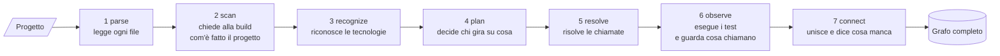
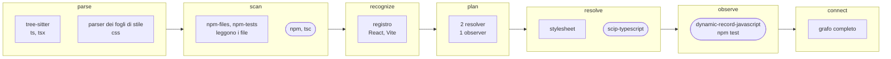
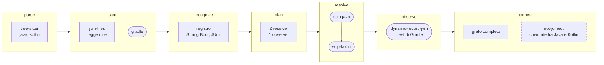
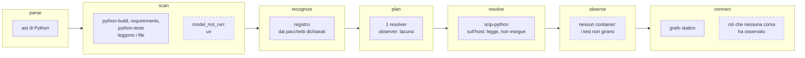

# Come Daodan costruisce il grafo

Daodan legge un progetto e ne scrive un grafo: file, simboli, chiamate, moduli e tecnologie, ognuno con la sua prova. Lo fa in sette step, sempre nello stesso ordine. Ogni step usa lo strumento ufficiale di ciò che legge, dietro un adattatore, e dice ciò che non è riuscito a fare.

I nomi di questa pagina sono quelli approvati il 22 novembre 2026; il codice ne usa ancora alcuni di prima («[Stato](#stato)»). Disegno e motivi: [spec della pipeline](specs/2026-11-15-pipeline-di-analisi.md), sezione 8.

## Il processo

| Step | Domanda a cui risponde | Adattatori | Strumento sotto | Esegue il progetto |
| --- | --- | --- | --- | --- |
| 1 `parse` | Che cosa c'è in ogni file? | parser | tree-sitter, `ast` di Python | No |
| 2 `scan` | Quali moduli, unità di build e comandi di test dichiara? | scanner | cargo, gradle, maven, npm, cmake, go, … | Solo nel container |
| 3 `recognize` | Quali framework, librerie, strumenti e servizi usa? | nessuno | il registro delle tecnologie | No |
| 4 `plan` | Quale adattatore gira su quale parte, e quale no? | nessuno | — | No |
| 5 `resolve` | Dove arriva ogni chiamata? | resolver | gli indicizzatori SCIP, uno per linguaggio | Solo nel container |
| 6 `observe` | Che cosa chiamano davvero i test? | observer | un registratore per linguaggio | Solo nel container |
| 7 `connect` | Qual è il grafo intero, e che cosa non contiene? | nessuno | — | No |

Dopo la pipeline, schede semantiche e flussi leggono il grafo completo.

## Le regole

- **Un orchestratore solo** (`pipeline/`) esegue gli step. Ogni step dichiara ciò che legge, ciò che scrive e che cosa succede se fallisce: o la corsa si ferma con causa e rimedio, o va avanti e lo dice.
- **Un adattatore per strumento.** Tutta la logica di uno strumento sta nel suo adattatore, che si dichiara con nome e versione. Daodan non riscrive parser né compilatori.
- **Il piano è un dato.** `plan` scrive, per ogni tecnologia trovata, l'adattatore, le sue unità e se chiede il container; oppure la lacuna con la causa. Gli step dopo eseguono quel piano.
- **Il codice del progetto gira solo nel container di Daodan.** Senza container lo step che ne ha bisogno è una lacuna, mai un'esecuzione sull'host.
- **Ogni arco dice chi l'ha prodotto e quanto vale:** provato da un resolver, incerto, osservato in una corsa dei test, campionato.
- **Una lacuna non è mai silenzio:** un linguaggio senza adattatore, un test non partito, un file che nessun indice copre sono scritti nel risultato.
- **Tutto si segue mentre accade:** ogni step e ogni adattatore emette eventi (inizio, avanzamento, lacuna, fine), salvati in un giornale accanto allo snapshot.

## Esempi

I tre grafi sono costruiti dalle dichiarazioni degli adattatori nel codice (linguaggi, unità, container), non registrati da una corsa. Il grafo vero di un progetto lo scriverà `plan`. Bordo arrotondato: gira nel container. Bordo tratteggiato: lacuna.

### Un'app web TypeScript con npm

### Un progetto Gradle con Java e Kotlin

I resolver girano dal più leggero al più pesante in memoria: scip-java prima di scip-kotlin. Ognuno carica solo il suo indice, quindi le chiamate fra Java e Kotlin restano senza arco, e `connect` lo scrive.

### Un progetto Python, senza motore di container

scip-python non chiede il container: su Linux e macOS gira sull'host, perché legge il progetto e non lo esegue. Senza container Daodan dà comunque snapshot e grafo statico: ciò che chiede di eseguire il progetto diventa una lacuna con la causa.

## Stato

| Step | Nel codice oggi | Che cosa manca |
| --- | --- | --- |
| `parse` | `snapshot.py write`, prima della pipeline; adattatori in `languages/` | Entrare nella pipeline; `parsers/` |
| `scan` | Step `scan`; adattatori in `premap/`, chiamati «fonti» | `scanners/`; «project model» al posto di «pre-mappa» |
| `recognize` | Step `stack` | Il nome |
| `plan` | Non c'è: lo decidono la pre-mappa, `engine_pass.pass_plan` e il `plan` di ogni osservatore | Lo step e il suo file |
| `resolve` | Step `analyze`; adattatori in `indexers/`, chiamati «analyzer» | `resolvers/`; i nomi con `engine` |
| `observe` | Step `dynamic`; adattatori in `dynamic/` | `observers/` |
| `connect` | Step `union`: scrive ciò che il grafo ha e non ha | Il nome; l'unione ai punti di connessione (rotte, chiamate HTTP, eventi, tabelle) |

Riferimento per step, container e build: [Codebase Map](plugins/codebase-map.md), sezione Pipeline. Strumenti e versioni per linguaggio: [linguaggi](plugins/codebase-map-linguaggi.md).
