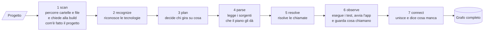
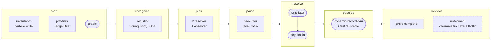

# Codebase Map: riferimento

**Stato:** In uso. La pipeline esegue sei dei sette step del disegno; che cosa manca è in «Nel codice oggi».

Codebase Map legge un repository e ne serve all'agente inventario, simboli, relazioni, moduli e descrizioni semantiche, con riferimenti verificabili alle sorgenti. Lo legge con una pipeline di step in ordine: gli step statici (parser e indicizzatori), lo step dinamico, che esegue i test e l'app del progetto e registra ciò che chiamano, e dopo la pipeline il modello, che scrive schede semantiche e regole di collegamento.

«Analisi» è l'intera pipeline: ciò che uno step lascia aperto lo prende il successivo, e un buco si dichiara e si misura dopo l'ultimo step, mai sul risultato di uno step solo (`AGENTS.md`). Un limite letto in questo documento o in un benchmark vale per lo step che lo dichiara: che cosa ne fa lo step dopo è nella tabella «Che cosa resta aperto, e chi lo prende» della sezione Pipeline.

Il codice del progetto (le build da cui gli analyzer prendono gli indici, i test e l'app che lo step dinamico osserva) gira solo nel container di Daodan, mai sull'host: è la regola invalicabile di `AGENTS.md`; come, nella sezione Pipeline. Le fasi del modello non eseguono nulla: la copertura a runtime del loro rapporto è ciò che lo step dinamico ha osservato (`snapshot.py runtime <run-dir>`), con l'evidenza che l'utente fornisce. Codebase Map non seleziona reviewer e non emette verdetti di correttezza: quello è senior-review, che ne usa i tool. Versione del plugin `1.0.1` (`plugins/codebase-map/plugin.toml`); nessuna dipendenza da altri plugin.

Percorsi. Il codice è in `daodan/core/`: un file di codice citato senza cartella è relativo a quella (`snapshot.py`, `indexers/go.py`), e ogni strumento parte anche come `daodan <nome>` (`daodan snapshot write`). `SKILL.md` e `references/` sono in `plugins/codebase-map/skills/map/`; `contracts/`, `policies/`, `hooks/` e `roles/` in `plugins/codebase-map/`. Il testo operativo che il modello esegue è `SKILL.md` con i suoi `references/`: questo documento lo descrive e non lo sostituisce.

## Perimetro

Sotto il target, la mappa non analizza ciò che Git ignora, le directory il cui nome inizia con un punto e le directory di dipendenze e build (`__pycache__`, `build`, `dist`, `node_modules`, `target`, `vendor`, `venv`). La regola ha un solo proprietario, `tree_scope.py`, e la applica ogni script che percorre l'albero: snapshot, scansione del cascade, ricerca degli usi, scansione dei commenti e revisione della documentazione.

Il target è analizzato com'è dato: `.github/` come target è il modo di mappare la CI, e un dot file accanto al codice (`.eslintrc.json`) non è una directory e resta. Un target che il suo repository ignora è analizzato intero come radice propria, senza prendere commit o branch dal repository che lo ignora. L'esclusione è dichiarata: `snapshot.py scope <target>` la stampa, il blocco `scope` del manifest la conserva (`git_ignore` vale `applied` o `unavailable`) e il rapporto finale la ripete. Un file tracciato da Git non è mai ignorato.

Riferimenti: `references/run.md` sezione Perimeter; docstring di `tree_scope.py`.

## Run e snapshot

Ogni analisi è un run isolato in `.daodan/map/runs/<run-id>/`, registrato in `.daodan/map/runs.json` (`schema` 2: `active` e `latest_completed`). Il run-id è lo slug del target più `-YYYYMMDD-HHMMSS`, oppure `--run-name` normalizzato a `[a-z0-9-]`, con suffisso `-2`, `-3` in caso di collisione. Più run possono procedere insieme senza condividere file.

Il run contiene `state.json`, `snapshot/manifest.sqlite` (o `manifest.json` con `--format json`), `changes.json` e `changes.md` per gli aggiornamenti, `knowledge/` della Phase 0 e i file di fase `01-structure.md` fino a `07-final-report.md`; in modalità team anche `partitions/<nome>/` e `08-interconnect-map.md`. La radice `.daodan/map/` è lo specchio dell'ultimo run pubblicato: lo sostituisce intero solo `snapshot.py publish`, dopo che `snapshot.py check` riporta `complete` e `may_publish`. Run parziali, a fase singola, solo documentazione o fermati non pubblicano mai. Chi consuma un run preciso conserva la sua directory; lo specchio serve a chi vuole l'ultimo stato.

Lo snapshot registra ogni file con dimensione, mtime e hash del contenuto, ogni simbolo con intervallo di righe e hash del corpo. L'inventario ha tre insiemi: sorgenti nei linguaggi analizzati, configurazione e documentazione, presentazione senza simboli (Pug, Jade e Stylus: `PRESENTATION_EXTENSIONS` in `source_files.py`). Un foglio di stile con una riga oltre 10.000 caratteri resta a livello di file (`MAX_STYLESHEET_LINE`). I file vietati (`.env`, credenziali, chiavi: lista in `references/evidence.md`) non entrano nel manifest nemmeno come hash. SQLite è il formato predefinito; `snapshot.py resolve <run-dir>` restituisce percorso e formato dichiarati dallo stato. `snapshot.py write` costruisce accanto al manifest anche l'indice lessicale `retrieval.sqlite` e il grafo dei moduli `modules.json` (`--no-index`, `--no-modules` li saltano).

Un secondo run sullo stesso target confronta lo snapshot del genitore con il worktree (`snapshot.py diff --verify`, che calcola gli hash di ogni file) senza spendere token del modello: file e simboli cambiati, raggio di impatto a un salto di import, affermazioni delle fasi che citano simboli cambiati. L'ingresso classico porta avanti le affermazioni non toccate riga per riga (`snapshot.py carry`) e ri-deriva solo quelle marcate stale; un gate meccanico rifiuta la pubblicazione finché una marca resta. L'ingresso team aggiorna a grana di partizione: una partizione senza file toccati è copiata intera, una con un file toccato è rianalizzata per intero. Oltre il 40% di file toccati (`--threshold`) la raccomandazione è un run completo. `--update` esige un genitore utilizzabile e si ferma senza; `--no-update` salta il rilevamento.

Riferimenti: `references/run.md`, `references/snapshot.md`, `references/update.md`.

## Ingressi

Il plugin non ha comandi propri: un entry point dell'host carica `codebase-map:map` e sceglie fra due ingressi.

**Analyze** (`references/entry-analyze.md`). Il coordinatore risolve scope e flag, scrive lo snapshot iniziale, prepara il run (`snapshot.py prepare`) e dispaccia un solo `codebase-map:map-analyst` isolato, che esegue le fasi dichiarate e scrive gli artefatti. Il coordinatore non legge le sorgenti; verifica la consegna con `snapshot.py check`, pubblica e per ultimo dispaccia `codebase-map:system-mapper` sull'intero sistema, come l'ingresso team. Controlli: `--critical` (priorità ad autenticazione, pagamenti e persistenza nelle fasi 3 e 4), `--format sqlite|json`, `--run-name`, `--update`, `--no-update`, `--comments` (audit dei commenti in fase 6), `--docs-only` (fasi 0 e 6), `--phase N` con N da 1 a 6 (fasi 0 e N; 0 e 7 rifiutate), `--stop-after N` e `--resume-from [N]` con `--run-name` esatto.

**Team** (`references/entry-team-analyze.md`), per monorepo, repository multilinguaggio e target oltre un contesto. Dopo la Phase 0 globale, rileva le partizioni: manifest di workspace (pnpm, npm, Lerna, Nx, Turbo, Cargo, uv), layout per convenzione (`apps/`, `packages/`, `services/`), divisione per layer (`backend`/`frontend`), divisione per linguaggio (almeno due linguaggi con almeno 20 file; i fogli di stile non formano mai una partizione), altrimenti una partizione `root`. Mostra l'anteprima dello scope con il conteggio reale di worker e procede se la scelta è già autorizzata. Onda 1: uno `partition-structure-worker` per partizione. Onda 2: `partition-behavior-worker` e `partition-quality-worker` per partizione, che leggono l'output dell'onda 1 di tutte le partizioni per citare i confini incrociati. Poi `partition-synthesizer` consolida in `01..07.md` e `semantic-interconnect-mapper` scrive `08-interconnect-map.md` sulla superficie fra partizioni. Controlli in più: `--depth=lite|full`, `--partition <path>` e `--partition-name`, `--skip-interconnect`, `--skip-synthesis`, `--yes`; `--phase` e `--docs-only` sono rifiutati.

**Fasi.** La Phase 0 legge le istruzioni del progetto (`CLAUDE.md`, `AGENTS.md`) e gli indici di documentazione e scrive `knowledge/navigation.md` e `knowledge/documentation-leads.md`: indizi `documented` o `unverified`, mai `verified`, perché non legge codice. Le fasi 1 a 7: struttura, interfacce, flussi, semantica, pattern e rischi, salute della documentazione, rapporto finale. I percorsi che danno accesso al prodotto (autenticazione, onboarding, consenso, primo avvio) sono percorsi critici obbligatori in fase 3 e una categoria `Usability-blocking` in fase 5; per il codice client la traccia include il cascade degli stili, con `cascade_scan.py` eseguito sull'intero target. La profondità `lite` esegue 0, 1, 2 e 5 e condensa 7; in team non dispaccia i worker di comportamento e il worker di qualità scrive solo `05-risks.md` (`SKILL.md`, sezione Depth). Ogni file di fase termina con il registro `## Source reading`: manifest, seed del grafo, file e intervalli letti, diagnostica dei parser, lacune. Il rapporto finale dichiara tre coperture distinte: file in inventario, file letti in profondità, file esercitati a runtime.

Il rapporto `07-final-report.md` è la vista per le persone: non esiste un renderer HTML.

## Ruoli

| Ruolo | Modello, strumenti | Chi lo dispaccia | Scrive |
|---|---|---|---|
| `map-analyst` | inherit; Read, Glob, Grep, Bash, Write | il coordinatore dell'ingresso analyze | gli artefatti del proprio run; in modalità `cards` le schede di un'area |
| `partition-structure-worker` | inherit; Read, Glob, Grep, Bash, Write | ingresso team, onda 1 | `partitions/<nome>/01-structure.md`, `02-interfaces.md` |
| `partition-behavior-worker` | inherit; Read, Glob, Grep, Bash, Write | ingresso team, onda 2 (non in lite) | `partitions/<nome>/03-flows.md`, `04-semantics.md` |
| `partition-quality-worker` | inherit; Read, Glob, Grep, Bash, Write | ingresso team, onda 2 | `partitions/<nome>/05-risks.md`, `06-documentation.md` (solo 05 in lite) |
| `partition-synthesizer` | inherit; Read, Glob, Grep, Write | ingresso team, dopo l'onda 2 | `01-structure.md` fino a `07-final-report.md` del run |
| `semantic-interconnect-mapper` | inherit; Read, Write, Glob, Grep, Bash | ingresso team dopo la sintesi, o un workflow di documentazione dell'host | `08-interconnect-map.md`, o il percorso che il prompt nomina |
| `system-mapper` | inherit; `codebase_map_flows`, `codebase_map_search`, `codebase_map_read`, `codebase_map_modules` | i due ingressi, per ultimo, su ogni run consegnato | le regole di collegamento, se il run non ne ha, e la mappa del sistema, registrate con `codebase_map_flows` |

Ogni ruolo dichiara una tabella `Method loads`: quali sezioni dei riferimenti legge e quando. I worker scrivono solo i file che possiedono e non toccano `state.json` né la radice `.daodan/map/`; l'analista non pubblica e non pone domande. Il mapper produce una mappa di contratti, invarianti, regole di dominio, assunzioni e punti di integrazione, ogni riga con `file:line` e uno stato (`verified`, `documented`, `unverified`, `disputed`), e si dichiara un indice di ipotesi fallibile. senior-review non lo dispaccia: la sua Phase 1 legge il run completo con i tool della mappa.

## Linguaggi e parser

Diciassette linguaggi e 63 estensioni (`SUPPORTED_LANGUAGES` e `SUPPORTED_EXTENSIONS` in `languages/__init__.py`). Estensioni, parser, analyzer e osservatore di ogni linguaggio: `docs/plugins/codebase-map-linguaggi.md`. Che cosa legge lo step `parse`:

- **Python:** `ast` della libreria standard.
- **Java, JavaScript, TypeScript, Rust, Go, Kotlin, C#, C e C++:** tree-sitter. TypeScript dà anche interfacce, enum e alias di tipo; Rust `impl Trait for Type` e `#[tauri::command]`; in Go i metodi sono funzioni `Receiver.Method`; un `.h` è C++ se il testo lo dice.
- **SQL e PL/SQL:** espressioni regolari. SQL: DDL e grafo di riferimento fra tabelle e viste, con `sqlglot`. PL/SQL: package, body, cursori, eccezioni, `%TYPE` e `%ROWTYPE`.
- **Vue e Svelte:** il blocco `<script>` passato agli adattatori JavaScript e TypeScript; il template letto con la grammatica del framework, le sue espressioni con quella dello script (`languages/sfc.py`).
- **Astro:** il frontmatter e i blocchi `<script>`, letti come un solo modulo TypeScript; il template non si legge, e le note del file lo dicono (`languages/sfc.py`).
- **CSS, SCSS, Sass, LESS, PostCSS:** un tokenizer; un simbolo per regola applicata; `@apply` di Tailwind espanso; il Sass indentato letto come SCSS (`languages/stylesheet.py`).
- **Markup (HTML e 16 estensioni di template):** le sole regole dei blocchi `<style>`, nel loro dialetto (`languages/markup.py`).

Un `.sql` con marcatori Oracle è PL/SQL. Python richiesto `>= 3.12`: gli script lo dichiarano nell'intestazione PEP 723 e si rifiutano sotto, perché la grammatica di `ast` è quella dell'interprete in esecuzione. Un file che quella grammatica rifiuta, in una cartella che dichiara un Python più nuovo (il `.python-version` più vicino, altrimenti `requires-python`), lo legge l'interprete che uv dà per quella versione, senza pacchetti, fuori dal progetto e solo per il parse (`languages/python_newer.py`), e la nota del file dice quale; senza quell'interprete la nota del buco nomina la versione dichiarata, quella di Daodan e la causa di uv. `tree-sitter` e `tree-sitter-language-pack` arrivano con l'installazione, alle versioni fissate (`pyproject.toml`, le stesse di `requirements.txt`). Una grammatica che non si carica rende il file una lacuna con la causa: nessun simbolo si legge con un'espressione regolare al suo posto (`languages/reading.py`, `unread`; `tests/test_language_tree_only.py`). Un file con un errore di sintassi si legge attorno all'errore: i fatti fuori dai nodi ERROR di tree-sitter restano, le righe di ciascuno sono una lacuna (`partial` nella copertura dello snapshot, con `lines` tra i file non letti per intero); Python, letto con `ast`, non ha un albero oltre l'errore e resta lessicale. La risoluzione lessicale dei riferimenti (`resolution.py`, `semantic_index.py`) lega solo funzioni e classi con binding unico e import interni diretti; ricevitori dinamici, proprietà calcolate e import solo di tipo restano non risolti da questo step, con la ragione, e li prende `resolve` (sezione Pipeline). Un elenco di chiamanti vuoto non prova che un simbolo sia inutilizzato.

## Pipeline

Daodan legge un progetto e ne scrive un grafo: file, simboli, chiamate, moduli e tecnologie, ognuno con la sua prova. Il disegno ha sette step, sempre nello stesso ordine. Ogni step usa lo strumento ufficiale di ciò che legge, dietro un adattatore, parte da ciò che gli step prima hanno stabilito e scrive come lacuna ciò che non è riuscito a fare: quella lacuna è l'ingresso dello step dopo.

Sette step e i loro nomi sono il disegno (`docs/specs/2026-11-15-pipeline-di-analisi.md`, sezione 8). Il codice ne esegue sei: `scan` e `stack` prima di `parse`, quattro con il nome di prima, e `plan` come funzione. Lo dice «Nel codice oggi».

### Il processo

| Step | Domanda a cui risponde | Adattatori | Strumento sotto | Esegue il progetto |
| --- | --- | --- | --- | --- |
| 1 `scan` | Quali cartelle e file ha il progetto, e quali moduli, unità di build e comandi di test dichiara? | scanner | il percorso dell'albero; cargo, gradle, maven, npm, cmake, go, … | Solo nel container |
| 2 `recognize` | Quali framework, librerie, strumenti e servizi usa? | recognizer | stack-analyser, il fork; oggi il registro delle tecnologie | No |
| 3 `plan` (oggi una funzione, non uno step) | Quale adattatore gira su quale parte, con che cosa gli serve, e quale no? | nessuno | — | No |
| 4 `parse` | Che cosa c'è in ogni sorgente che il piano gli dà: simboli, import, chiamate? | parser | tree-sitter, `ast` di Python; SQL e PL/SQL ancora con espressioni regolari | No |
| 5 `resolve` | Dove arriva ogni chiamata? | resolver | un indicizzatore SCIP per tecnologia; per i fogli di stile i loro parser | Solo nel container |
| 6 `observe` | Che cosa chiamano davvero i test, e che cosa fa girare ogni controllo dell'app? | observer | un registratore per linguaggio; per l'app, Chromium senza interfaccia di Playwright | Solo nel container |
| 7 `connect` | Qual è il grafo intero, e che cosa non contiene? | nessuno | — | No |

Dopo la pipeline il modello scrive le regole di collegamento e le schede semantiche; flussi e mappa del sistema leggono il grafo completo.

### Che cosa resta aperto, e chi lo prende

| Step | Che cosa lascia aperto | Chi lo prende | Dove è misurato |
| --- | --- | --- | --- |
| `scan` | Un comando di modello di un build tool che non gira (nessun motore di container, comando fallito): lacuna con la causa | Nessuno: gli step dopo lavorano senza quel fatto e lo dicono | `benchmarks/project-model/README.md` |
| `parse` | Ogni chiamata senza un binding lessicale unico: ricevitori dinamici, proprietà calcolate, import solo di tipo | `resolve` | Con `resolve` |
| `resolve` | Le chiamate a cui l'indice non dà un obiettivo, contate per classe di buco (sezione Copertura): un ricevente `any`, un valore chiamato, un nome non dichiarato | `observe`, dove un test o un controllo premuto esegue la chiamata | `benchmarks/inference-audit/README.md` |
| `observe` | Le chiamate che nessun test esegue; un linguaggio senza osservatore (Vue, Svelte); un progetto senza test dichiarati o senza container | `connect` le scrive come buchi del grafo completo; nessuno step dopo le risolve | `benchmarks/call-provenance/README.md` |
| `connect` | I legami fra moduli che non sono chiamate: rotte, chiamate HTTP, eventi, tabelle | Dopo la pipeline, le regole di collegamento: il modello le scrive una volta, la macchina le applica e le verifica (`docs/specs/2026-11-18-flussi-e-mappa-del-sistema.md`, «Principi», 4) | `benchmarks/system-map/README.md` |
| `connect` | Le chiamate fra i linguaggi di due analyzer | Nessuno: restano scritte come mancanti nel grafo completo | Non misurato |

**Misura dello step dinamico.** Su tududi JavaScript (commit `71da9d7b`, 12 novembre 2026, su Modal, 12 blocchi in container senza rete) il registro esatto risolve 13.677 delle 16.527 chiamate che lo step statico lascia senza risposta, l'82,8%. Parametri, ripartizione, costo e deviazioni: `benchmarks/call-provenance/README.md`, «Registro esatto su tududi: misura»; i file di ogni blocco sono sul volume `daodan-flow-results`, in `dynamic/exact-20261112/`. Il numero è scritto qui e in quel README: ogni altro documento rimanda a questa sezione.

- Lo step statico di quella misura è il passaggio dei motori per posizione, com'era il 12 novembre. **Aperta: da approfondire.** La stessa misura sopra l'indice di scip-typescript, lo step statico di oggi, non è nel README di `call-provenance`.
- Python: stesso README, «Registro esatto per Python su python-semver» (`results/dynamic-python-semver.json`).
- Sul corpus, dopo l'ultimo step: `docs/plugins/codebase-map-supporto.md`, «Analizzatori e passo dinamico, misurati» (la colonna «Copertura delle chiamate» conta anche gli archi osservati), da `benchmarks/project-model/README.md`, «Il grafo completo sul corpus».
- Dopo il modello i buchi delle chiamate non sono misurati.

### Regole

- **Un buco si misura dopo l'ultimo step.** Il verdetto di un benchmark su uno step dice che cosa quello step lascia allo step dopo, non che cosa Daodan non risolve.

- **Un orchestratore solo** (`pipeline/`) esegue gli step. Ogni step dichiara ciò che legge, ciò che scrive e che cosa succede se fallisce: o la corsa si ferma con causa e rimedio, o va avanti e lo dice.
- **Un adattatore per strumento.** Tutta la logica di uno strumento sta nel suo adattatore, che si dichiara con nome e versione. Daodan non riscrive parser né compilatori; fanno eccezione, oggi, SQL e PL/SQL, letti con espressioni regolari (`languages/sql.py`, `languages/plsql.py`).
- **Il piano è un dato.** `plan` dà, per ogni tecnologia trovata, l'adattatore, le sue unità e se chiede il container; oppure la lacuna con la causa. Gli step dopo eseguono quel piano. Oggi è una funzione (`pipeline/plan.py`) che tre chiamanti interrogano, non uno step.
- **Il codice del progetto gira solo nel container di Daodan.** Senza container lo step che ne ha bisogno è una lacuna, mai un'esecuzione sull'host.
- **Ogni arco dice chi l'ha prodotto e quanto vale:** provato da un resolver, incerto, osservato in una corsa dei test, campionato.
- **Una lacuna non è mai silenzio:** un linguaggio senza adattatore, un test non partito, un file che nessun indice copre sono scritti nel risultato.
- **Tutto si segue mentre accade:** ogni step e ogni adattatore emette eventi (inizio, avanzamento, lacuna, fine), salvati in un giornale accanto allo snapshot. Lo `step.finished` di uno step fallito che la pipeline tollera porta `failed` con la causa.
- **Ogni fatto ha un padrone solo.** Uno step non riscopre ciò che uno step prima ha stabilito: lo chiede a lui. Per questo `parse` viene dopo `scan`, `recognize` e `plan`: deve sapere quali file leggere, in che linguaggio e in quale modulo. Chi deve sapere che cosa, e da chi: spec, 8.2.
- **Un guasto resta dove nasce.** Un listener che fallisce, un giornale che non si può scrivere, una riga rotta del giornale, il programma di un adattatore che non parte: ognuno è detto con la causa e non ferma il resto. Un'analisi fermata, o morta senza una parola, non lascia step aperti nel giornale: chi sa che è finita ne scrive la fine. Che cosa resta aperto: spec, 8.9.

### Esempi

I tre grafi sono costruiti dalle dichiarazioni degli adattatori nel codice (linguaggi, unità, container), non registrati da una corsa. Il grafo vero di un progetto lo scriverà `plan`. Bordo arrotondato: gira nel container. Bordo tratteggiato: lacuna.

#### Un'app web TypeScript con npm

```mermaid
flowchart LR
  subgraph scan
    b0["inventario:<br>cartelle e file"]
    b1["npm-files, npm-tests<br>leggono i file"]
    b2([npm, tsc])
  end
  subgraph recognize
    c1[registro<br>React, Vite]
  end
  subgraph plan
    d1[2 resolver<br>1 observer]
  end
  subgraph parse
    a1[tree-sitter<br>ts, tsx]
    a2[parser dei fogli di stile<br>css]
  end
  subgraph resolve
    e1[stylesheet]
    e2([scip-typescript])
  end
  subgraph observe
    f1([dynamic-record-javascript<br>npm test])
    f2([l'app avviata ed esplorata<br>npm start, Chromium])
  end
  subgraph connect
    g1[grafo completo]
  end
  scan --> recognize --> plan --> parse --> resolve --> observe --> connect
```

#### Un progetto Gradle con Java e Kotlin

I resolver girano dal più leggero al più pesante in memoria: scip-java prima di scip-kotlin. Ognuno carica solo il suo indice, quindi le chiamate fra Java e Kotlin restano senza arco, e `connect` lo scrive.

#### Un progetto Python con uv, senza motore di container

```mermaid
flowchart LR
  subgraph scan
    b0["inventario:<br>cartelle e file"]
    b1["python-build, requirements,<br>python-tests<br>leggono i file"]
    b2["model_not_run:<br>uv"]:::gap
  end
  subgraph recognize
    c1[registro<br>dai pacchetti dichiarati]
  end
  subgraph plan
    d1["1 resolver<br>observer: lacuna"]
  end
  subgraph parse
    a1[ast di Python]
  end
  subgraph resolve
    e1["scip-python<br>sull'host: legge, non esegue"]
  end
  subgraph observe
    f1["nessun container:<br>i test non girano"]:::gap
  end
  subgraph connect
    g1[grafo statico]
    g2[ciò che nessuna corsa<br>ha osservato]:::gap
  end
  scan --> recognize --> plan --> parse --> resolve --> observe --> connect
  classDef gap stroke-dasharray: 5 5
```

scip-python non chiede il container: su Linux e macOS gira sull'host, perché legge il progetto e non lo esegue. Senza container Daodan dà comunque snapshot e grafo statico: ciò che chiede di eseguire il progetto diventa una lacuna con la causa.

### Nel codice oggi

Lo snapshot si scrive in due scritture sullo stesso store: l'inventario di cartelle e file (`file_inventory.py`: dimensione, data, hash e linguaggio di ogni file), che nel disegno è di `scan`, e la lettura dei sorgenti (`snapshot.write_reading`, adattatori di `languages/`), che è `parse` e prende file e linguaggio solo dall'inventario. `snapshot.write_snapshot` le chiama una dopo l'altra e pubblica una volta sola. Poi `snapshot.py write` e `codebase_map_create_run` eseguono gli step della pipeline (`pipeline/`, `STEPS`), ognuno con i suoi eventi nel giornale accanto al manifest:

1. `scan` (resta `scan`): legge solo l'inventario. Scrive il grafo dei moduli senza gli archi `imports` e `calls`, e la pre-mappa (`references/premap.md`): unità, toolchain, registri, comandi di test, servizi e passi della CI e build dei Dockerfile che il progetto dichiara. I comandi di modello dei build system girano nel container.
2. `stack` (diventa `recognize`) scrive `technologies.json` accanto al manifest. Assegna a ogni modulo le tecnologie dichiarate nei file di sua competenza. Le menzioni testuali restano disponibili come indizi. Il campo `configured_services` conserva nome e provenienza delle dichiarazioni Compose e CI, anche per servizi fuori catalogo. L'avvio effettivo si verifica nel passo dinamico. Un errore dello stack viene registrato e l'analisi prosegue in background (`resolve_edges.py --pass`).
3. `parse`: legge uno store che ha solo l'inventario; dopo `write_snapshot` è fresco. Dice il piano (`pipeline/plan.py`): quale adattatore gira su quali file.
4. `analyze` (diventa `resolve`): un analyzer per tecnologia della pre-mappa (`indexers/`), uno alla volta.
5. `dynamic` (diventa `observe`): i test del progetto sotto un registratore e l'app avviata ed esplorata in un browser (sezione Passo dinamico).
6. `union` (diventa `connect`): i grafi delle tecnologie come grafo completo, con ciò che la corsa ha osservato e ciò che il grafo non contiene: file che un indice ha lasciato fuori, linguaggi senza analyzer, chiamate fra i linguaggi di due analyzer.

Oggi inventario e lettura riscoprono ancora ciò che nel disegno chiedono a `scan`. L'inventario decide il linguaggio di un file con espressioni regolari sul contenuto, mentre `scan` lo chiede a go-enry. `parse` legge `tsconfig` a mano, mentre `scan` lo chiede a `tsc`, e legge anche i file che `scan` poi dichiara generati o di terze parti. Gli archi `imports` e `calls` fra moduli e il legame degli ingressi dei flussi ai simboli leggono ciò che `parse` produce. Li fanno il primo lettore del grafo intero (`modules.ensure_graph`, anche lo step `union`) e i collegamenti (`binder.bind`); nel disegno stanno in `connect` (spec, 8.2 e 8.3). Il piano non è uno step: `write_reading`, `engine_pass.pass_plan` e il passo dinamico chiamano la sua funzione con i fatti che hanno. Il riconoscimento usa ancora il registro (`service_registry.py`): il passaggio al fork di stack-analyser è approvato (`docs/specs/2026-11-21-stack-dal-fork.md`) e non applicato. Mancano anche le cartelle con i nomi nuovi (`parsers/`, `scanners/`, `resolvers/`, `observers/`) e, in `connect`, l'unione ai punti di connessione (rotte, chiamate HTTP, eventi, tabelle).

Spec: `docs/specs/2026-11-15-pipeline-di-analisi.md`.

**Container.** `container.py` esegue il codice del progetto su una copia dei file del perimetro e di quelli che Git traccia, senza mai montare o scrivere il progetto; un link che Git traccia è quel link nella copia se porta dentro il progetto, altrimenti resta fuori, con una lacuna `link_outside` che la corsa riporta. I file `.env` che Git traccia sono nella copia, come nel checkout della CI: Daodan non li legge sull'host, ne legge i valori solo in un suo container senza rete e li maschera (`[<file>:<nome>]`) ovunque stiano, anche dentro una parola più lunga, in ciò che la corsa conserva (log, output di testo, output JSON stringa per stringa, registro, cause); un valore sotto i quattro caratteri solo come parola intera, un booleano o un numero fino a cinque cifre mai, e una lacuna `mask_partial` nomina quelle variabili; un output che ne contiene ancora i byte (un indice, un file oggetto) non si corregge: si scarta, con una lacuna `output_withheld` che nomina l'output e le variabili; i valori di un file d'esempio (`.env.example`, `.env.sample`, `.env.template`, `.env.dist`, anche con un nome in mezzo come `.env.local.example`) sono pubblici: non si mascherano e non fanno scartare niente, salvo un valore che sta anche in un `.env` vero; nella pre-mappa ogni valore è il suo nome, così nessun fatto ne contiene uno. Ogni altro file che Daodan non legge resta fuori con una lacuna `file_withheld` che lo nomina con la regola. Il motore è Docker o Podman se l'utente li ha, altrimenti, su Windows, Kiri in una distribuzione WSL 2 di Daodan. Senza un motore di container la tecnologia è una lacuna con causa e rimedio, mai un'esecuzione sull'host. Un analyzer che deve costruire il progetto lo fa con il build tool del progetto, come la sua CI, in due fasi. La preparazione (`preparation.py`) installa con mise le toolchain dichiarate, alla versione dichiarata, e ripristina le dipendenze con il gestore del progetto; la sua rete passa da un proxy che apre solo i registri dello strumento, gli host da cui il progetto dichiara le dipendenze (i `registries` delle unità della pre-mappa, per gli analyzer e per gli osservatori) e quelli degli installatori; un ripristino fallito che non ha raggiunto un host dichiarato è una lacuna `host_unreachable` che lo nomina. L'esecuzione, che costruisce, indicizza o esegue i test, non ha rete. Python si indicizza senza eseguire codice del progetto, con le librerie che scarica Daodan. Go no: il comando `go` avvia ciò che il progetto nomina, quindi gira solo nel container (`indexers/go.py`). Rust nemmeno: `rust-analyzer scip` esegue i build script (`cargo check`) e costruisce e carica le macro procedurali qualunque cosa dica la sua configurazione, quindi gira solo nel container, sulla Rust che un file di rustup del progetto nomina, altrimenti su quella di Daodan, con la preparazione che scarica i crate e l'esecuzione senza rete; un build script che fallisce, o una macro che non si costruisce, è una lacuna che nomina il crate, letto poi come a build script spenti. Senza container Go e Rust sono `unavailable` con la causa, e sull'host non parte niente di Go né di Rust.

**Build.**
- C e C++: scip-clang legge il database di compilazione che la build dell'unità dà. CMake configura ogni unità `cmake-target`; Meson lo fa scrivere al backend Ninja (`meson setup --wrap-mode nodownload`); Make gira sotto Bear con i target della pre-mappa, dopo il `configure` del progetto dove accanto a un `Makefile.in` ce n'è uno non di Autotools (quello di zlib; `premap/make.py`), e così Autotools per il `configure.ac` più esterno (un'unità `autotools-project`), dopo `autoreconf -fi` e `configure` in una cartella sua; Bazel lo dà con `bazel aquery`, nella preparazione; cgo con `go build` sotto Bear. Una radice che dichiara vcpkg o Conan si ripristina nella preparazione. Una build che non scrive il database è una lacuna con l'errore dello strumento; un linguaggio senza file indicizzati per soli motivi in cui niente è fallito (nessun build lo compila, nessuna unità lo include) è `unavailable`, non `failed` (`nothing_failed` in `indexers/clang.py`). Prima di scip-clang, il comando di un compilatore che non è clang prende gli header builtin di clang al posto di quelli di GCC, che scip-clang sceglierebbe in silenzio (`clang_run.builtin_headers`). Ciò che un argomento di macro nomina, che scip-clang scrive al punto di espansione, torna all'argomento (`macro_arguments` in `indexers/clang.py`).
- C#: scip-dotnet per soluzione, e per progetto che nessuna soluzione elenca, sull'SDK di `global.json`, dopo `dotnet restore`; se la soluzione non si ripristina, si ripristina ogni progetto che `dotnet sln list` nomina, e un fallimento resta `restore_failed`. Un progetto nel formato di Visual Studio .NET 2002-2003 (`<VisualStudioProject>`), che MSBuild non legge, è `unavailable` e non si lancia.
- TypeScript e JavaScript: scip-typescript dopo il ripristino del gestore del lockfile, con i suoi script di installazione; ogni cartella con un lockfile proprio (npm, pnpm o Yarn) si ripristina da sola, a qualunque profondità, mentre una senza lockfile che nessun workspace nomina resta una lacuna `restore_failed`.
- Java e Kotlin: scip-java con Maven o Gradle, una build per cartella della pre-mappa, in un container con l'intero checkout e la build nella sua cartella, sul JDK che dichiarano i file della build o di una cartella sopra (`build_jdk` in `indexers/jvm.py`). Uno sopra il 17 dell'immagine si installa; Maven, che compila con il JDK che lo esegue, prende quello del livello più alto dei suoi pom, 8 il più vecchio; Gradle gira sul 17 e compila sulle toolchain che i suoi script chiedono, installate nella preparazione e date a Gradle senza scaricarne (`org.gradle.java.installations.paths`); se Gradle dice che una dipendenza vuole una JVM più nuova, pre-mappa e analisi ripartono sul JDK dichiarato a quel livello o sopra, altrimenti su quello che l'errore nomina (`jdk_from_build_error`); lo stesso fa l'analisi quando una build fallita chiede un JDK sopra quello su cui è girata (una toolchain, un release, la versione dei class file: `newer_jdk`), una sola volta: se anche la seconda corsa fallisce, la lacuna dice quale JDK ha provato. Con l'SDK Android della preparazione, Gradle compila anche la variante debug di ogni progetto, principale e test di unità; in Kotlin Multiplatform ogni progetto compila solo i task di compilazione che ha (`SCIP_GRADLE`). Il plugin di scip-java 0.14.2 gira solo su javac 17 o più nuovo: l'analyzer indicizza sul 17 dell'immagine una build Maven che dichiara un JDK più vecchio, e una toolchain Gradle più vecchia compila dove il plugin non si carica; entrambe portano la lacuna `jdk_unsupported`. Se la build com'è dichiarata non dà indice, un secondo tentativo dichiarato la cambia: con Maven compila con il javac del JDK, togliendo `compilerId`, `forceJavacCompilerUse` e `dependencies` dal plugin di compilazione del pom radice (Error Prone 2.3.1 gira solo su Java 8 e 9), e alza a 8 i livelli sotto l'8 dei pom; con Gradle, se uno script dichiara un Java sotto il 17, alza a 8 i livelli sotto l'8 e sostituisce una toolchain sotto il JDK della build con quel JDK (`RAISE_LEVELS`; l'osservatore alza solo i livelli). La lacuna `build_edited` dice che cosa ha cambiato e l'errore della build dichiarata; una build ferma su un file che il progetto tiene fuori dal repository (`google-services.json`) è `build_input_missing`.

**Dockerfile.** La pre-mappa legge ogni Dockerfile con il frontend di BuildKit v0.34.2 (fatto `docker_builds`), con contesto e argomenti da Compose dove un file Compose lo dichiara. Per i file che solo uno stadio di build porta in un'unità, `docker_build.py` riproduce nella preparazione quello stadio, e quelli da cui parte, fino al suo ultimo `RUN`, la build: l'immagine di base per il digest che il registro dà, la rete aperta anche agli host che i `RUN` nominano in un URL, l'esecuzione che parte da ciò che la preparazione ha scritto (`keep_root`: il suo container salvato come immagine con `commit` su Docker, Podman e il Kiri di Daodan, un motore che non lo salva una lacuna; sul driver di Modal lo snapshot del sandbox, `benchmarks/project-model/modal_pipeline.py`). Un'istruzione che non riproduce è una lacuna `not_reproduced` con la sua riga. Un argomento che nomina una variabile di un `.env` tracciato resta `${NOME}` nel fatto, e un Dockerfile o un contesto che una tale variabile nomina vale solo se dà un percorso tracciato, altrimenti è una lacuna che nomina la variabile (`premap/dockerfile.py`); i valori arrivano alla preparazione e all'esecuzione dello stadio solo nel container, come BuildKit dà un ARG a ogni `RUN` (`container.py`). La via la prendono Go, C e C++; un passo che fallisce è una lacuna con la riga d'errore dello strumento. Per Go, un file che nessun modulo contiene ma che uno stadio copia ha una corsa di scip-go dentro quello stadio, che registra Dockerfile, stadio e il `go.mod` e il `go.sum` che i passi hanno risolto. Per C e C++, una radice CMake che la via principale non indicizza si costruisce e si indicizza nello stadio che ne copia il `CMakeLists.txt`, con gli header builtin di clang al posto di quelli di GCC, ogni cartella di include nominata dal pacchetto apk o dpkg che ne possiede più file, o dal progetto che un'installazione CMake vi ha scritto, e le diagnostiche dello stadio nel risultato (`_docker` in `indexers/clang.py`). La JVM non ha la via: quando un build Gradle si ferma su nomi che darebbero i `.proto` e solo il Dockerfile li copia nella cartella, il motivo nomina la riga del Dockerfile (`indexers/jvm.py`).

Strumenti, versioni e licenze per linguaggio: `docs/plugins/codebase-map-linguaggi.md`. Cosa Daodan supporta, per tipo, con le misure: `docs/plugins/codebase-map-supporto.md`, generato.

## Passo dinamico

Lo step `dynamic` (`dynamic/`) esegue i test che il progetto dichiara (i `tests` della pre-mappa, mai una convenzione) nel container: le dipendenze ripristinate a modo del progetto nella preparazione, i test nell'esecuzione, senza rete. I servizi che la CI avvia accanto ai test (i service container di GitHub Actions, i `services:` di GitLab CI, i servizi che `docker compose up` avvia in un passo di GitHub Actions o in uno script di test npm, letti dal `config` di Compose senza motore: la faccetta `services`) partono accanto a ogni esecuzione, in un pod con `--network none`: i test li raggiungono a localhost o per nome, e nient'altro (`container.beside`). I passi di un job di GitHub Actions prima del suo passo di test, e le righe di `before_script` e `script` di un job di GitLab CI prima di quella che esegue i test (la faccetta `ci_steps`; un `!reference` si risolve come lo risolve GitLab, e uno che il file non ha è `reference_not_found`: `premap/renovate.py`), girano in ordine alla fine della preparazione, con i servizi accanto e le variabili del workflow, del job e del passo, come li esegue il runner; poi il pod lascia la rete della preparazione, e i test trovano i servizi con ciò che i passi vi hanno scritto e ricevono le variabili del loro passo. Un passo che Daodan non esegue (un'azione diversa dal checkout e dal setup di una toolchain, un `if:`, un'espressione `${{ }}`) è `ci_step_not_run`, uno che fallisce `ci_step_failed`, una variabile del passo di test che la CI o la shell calcola `ci_step_incomplete`, un servizio che non parte `service_unavailable`, un'esecuzione di test che nessun job esegue, dove la CI ne esegue altri, `tests_not_in_ci`. Un osservatore per tecnologia li fa girare sotto un registratore esatto, che dà ogni chiamata con chiamante, chiamato e sito, con le toolchain che il progetto dichiara. Le chiamate entrano nello store degli archi come archi osservati, con resolver `ENTRY@VERSION`, e chiudono i buchi dove sono avvenute. Un arco osservato prova che una chiamata può arrivare lì, non che arrivi solo lì; una chiamata che nessun test esegue resta come l'hanno lasciata gli step statici (quante ne chiude: sezione Pipeline, «Che cosa resta aperto, e chi lo prende»). Il profiler a campioni di una toolchain è una seconda fonte dichiarata, con confidenza `sampled`, mai contrapposta a un arco provato. Osservatori e registratori per linguaggio: `docs/plugins/codebase-map-linguaggi.md`.

Lo stesso step avvia l'app che il progetto dichiara (`dynamic/app.py`): lo script `start` del modulo, altrimenti `dev`, dai fatti `starts` e `builds` della pre-mappa, con il comando dichiarato e mai cambiato, nel container e senza rete nell'esecuzione. Un Chromium senza interfaccia di Playwright apre l'app, legge i controlli di ogni pagina dall'albero di accessibilità, ne preme ognuno una volta e tiene le funzioni del progetto che hanno girato (`explore.cjs`); un controllo premuto diventa un ingresso dei collegamenti quando il suo gestore è una funzione dello snapshot. Ciò che non accade è una lacuna con la causa: nessun avvio dichiarato, un avvio che chiede una build che nessuno dichiara, un runner che non è npm (`start_runner_not_supported`: pnpm, Yarn e Bun non sono ancora eseguiti), `build_failed`, `app_not_started`, `not_ready`, `port_not_declared`, `app_not_stopped`, `explore_failed`.

Ogni corsa dice come sono finiti i suoi test: `ran`, `timeout`, `killed`, `not_started`, `no_tests`. Sono lacune, mai silenzio: un linguaggio senza osservatore, un progetto senza comando di test dichiarato, una corsa senza motore di container, un risultato che rompe il contratto dell'osservatore (`observer-malformed`), una corsa in cui nessun test è partito (`not-run`) e una che non ha piazzato righe di un linguaggio (`not-observed`); di queste non si tiene nulla e l'analisi successiva riprova. `DAODAN_DYNAMIC=off` salta lo step. Disegno: `docs/specs/2026-11-12-passo-dinamico.md`; misure: `benchmarks/call-provenance/README.md`.

## Script

In `daodan/core/`; ognuno parte come `daodan <nome>` (`daodan/__main__.py`). Punti d'ingresso (`SKILL.md`, sezione Resources):

- `snapshot.py`: `scope`, `write`, `index`, `search`, `resolve`, `runtime`, `diff`, `carry`, `prepare`, `check`, `publish`, `register`, `unregister`, `meta-query`, `meta-upsert`, `edit-impact`, `symbols-at`, `stale-callers`, `context`, `technologies`, `files`, `refresh`, `hook`.
- `source_reader.py`: `outline` (metadati dei simboli), `graph` (chiamanti e chiamati dal manifest, 1-3 salti), `read` (blocchi di sorgente verificati per simbolo, intervallo o file intero).
- `modules.py`: `build`, `query`, `brief`, `propose`.
- `resolve_edges.py`: con `--pass` gli step `stack`, `analyze`, `dynamic` e `union` della pipeline in `engine-edges.sqlite`, come li avviano in background `snapshot.py write` e `codebase_map_create_run`; con `--engine <analyzer>` o `--engine scip` un solo stadio.
- `semantic_map.py`: vista `semantic-map.md` delle schede di un'area.
- `embedding_worker.py`: embedding locali opzionali, su richiesta esplicita.
- `analyze_file.py`, `ast_parser.py`, `classifier.py`, `usage_finder.py`: analisi di un file, estrazione grezza, criticità, usi di un simbolo.
- `cascade_scan.py`: regole di stile con portata globale che possono rompere una schermata (fase 5).
- `doc_review.py`, `rewrite_comments.py`, `comment_rewriter.py`: salute della documentazione e qualità dei commenti (fase 6); Codebase Map usa solo analisi e rapporto, mai la riscrittura, che non avvia formattatori e lo dice (`FORMAT_UNDONE`).
- `confinement.py`, `tree_scope.py`: binding al progetto con rifiuto dei link e lock per progetto; perimetro; i programmi dell'host, presi solo dalle voci assolute del PATH, mai per nome nudo né dalla cartella del progetto (`tree_scope.program`).
- `mcp_server.py` su `mcp_service.py`: il server MCP.

Gli altri moduli sono librerie: `snapshot_store.py` e `semantic_store.py` (storage SQLite e binding semantici), `retrieval.py` (indice FTS5), `edge_view.py` (vista unita di riferimenti lessicali e archi del motore), `scope_planner.py`, `context_packet.py` e `map_slice.py` (contesto delimitato), `card_store.py` (schede), `dependency_graph.py` e `store_graph*.py` (grafo di import e metriche), `languages/` (adattatori per linguaggio).

## Server MCP

`daodan mcp --project <radice>` (`.mcp.json`): il comando dell'applicazione installata, che gira sul proprio interprete e non importa nulla dalla cartella in cui parte. Così il progetto analizzato non sceglie interprete né pacchetti del proprio analizzatore; l'hook parte allo stesso modo e legge il progetto dal suo input. Il progetto è fissato all'avvio da `--project` o, se manca, da `CLAUDE_PROJECT_DIR`; senza nessuno dei due il server si ferma con la causa, perché la cartella in cui parte non è un progetto dichiarato. Ogni target è relativo, ogni run-id seleziona esattamente `.daodan/map/runs/<run-id>/`; percorsi esterni, traversal, symlink e junction sono rifiutati. `--store <percorso>` sposta l'intero store in una dot directory del progetto, marcata da `.daodan-map-store.json`. La mappa va costruita con lo stesso runtime che la serve: l'indice lessicale registra versione di SQLite e impronta dei parser, e una mappa scritta da un altro Python risulta `stale` (`codebase_map_index` ricostruisce l'indice).

Ventisette tool, tutti con risposta JSON, e la risorsa `daodan://project/live` con gli ultimi eventi dello store (`mcp_server.py`). `references/mcp.md` ha i parametri di ventisei: `codebase_map_stack` non vi compare.

| Gruppo | Tool |
|---|---|
| Run | `codebase_map_scope`, `codebase_map_create_run`, `codebase_map_runs`, `codebase_map_status`, `codebase_map_diff`, `codebase_map_artifact` |
| Navigazione | `codebase_map_search`, `codebase_map_index`, `codebase_map_outline`, `codebase_map_graph`, `codebase_map_read`, `codebase_map_modules`, `codebase_map_stack`, `codebase_map_flows` |
| Impatto | `codebase_map_edit_impact`, `codebase_map_symbols_at`, `codebase_map_stale_callers`, `codebase_map_meta_query`, `codebase_map_context` |
| Ciclo di vita | `codebase_map_checkpoint`, `codebase_map_events`, `codebase_map_resume`, `codebase_map_stop`, `codebase_map_publish` |
| Esploratore | `codebase_map_ui`, `codebase_map_ui_requests`, `codebase_map_ui_done` |

Limiti nel codice (`mcp_service.py`): una lettura oltre 4.000.000 caratteri è rifiutata e va divisa; un artefatto si ferma a 2.000.000 byte con `truncated: true`; il giornale `mcp-events.json` tiene al massimo 10.000 eventi. Il server non avvia modelli, non ha scheduler e non cancella analisi: l'host dispaccia i worker e, per fermare un run, ferma prima i propri worker e poi chiama `stop`. `MapService(project_root, store)` espone le stesse operazioni a un backend nativo senza SDK.

## Trovare il codice di una richiesta

Il ciclo misurato è in `references/locate.md`; la scelta del tool per domanda in `references/tools-guide.md`.

1. Estrarre dalla richiesta i nomi concreti: identificatori, file, testo di errore, frame di traceback, termini di dominio.
2. `codebase_map_search` per gruppo di nomi: simbolo esatto e frame di traceback prima, poi corrispondenze per sottotoken (`InvoiceTotal` trova `invoice_total`). Pesi BM25 0/10/5/3/1 su id, nome, percorso, firma e corpo (`retrieval.py`). La ricerca non rilegge l'albero: un indice mancante o stale è una voce `gaps` che nomina `codebase_map_index`, non un risultato vuoto.
3. `codebase_map_outline` sul file del risultato e `codebase_map_graph` a un salto per vicini, chiamanti e chiamati.
4. `codebase_map_read` sui simboli tenuti: verifica i byte contro lo snapshot e fallisce con «source changed; refresh the manifest» su un file modificato.
5. `codebase_map_edit_impact` sui simboli da cambiare; poi riprodurre con un test e correggere.

Budget: circa 6 ricerche e 10 letture per compito; una ricerca vuota si riformula una volta. Misura del 2026-10-27 su 23 compiti reali con test nascosti (`docs/research/context-building-benchmarks.md`): 21 risolti con ricerca lessicale, 19 con ricerca ibrida, 19 con pacchetto statico senza ricerca; per questo la ricerca lessicale è il percorso predefinito e gli embedding restano opzionali.

## Grafo, risoluzione e moduli

`source_reader.py graph` interroga i binding statici del manifest senza rianalizzare: gli archi risolti si espandono verso chiamanti e chiamati, le chiamate non risolte non guidano l'espansione. `dependency_graph.py` aggiunge cicli di import, importatori transitivi e PageRank (damping 0,85, tolleranza 1e-10, 100 iterazioni al massimo) come aiuto alla lettura, non come prova di propagazione a runtime. Il classificatore considera alta complessità un file oltre 300 righe e hub un file con almeno 8 importatori, critico con 15 (`classifier.py`).

Il risolutore lessicale (`resolution.py`) lega solo un binding unico e non inferisce tipi. Il resto lo risolve l'analyzer del linguaggio, nello step `analyze` della pipeline: l'indice SCIP di un indicizzatore (Go, TypeScript e JavaScript con Vue e Svelte, Rust, Python, Java e Kotlin, C#, C e C++) o il grafo dei fogli di stile; il passo dinamico aggiunge gli archi osservati. Il passaggio motore è uno store derivato dello snapshot come l'indice lessicale: `snapshot.py write` e `codebase_map_create_run` lo avviano in background (`--no-engine`, `engine=false` per saltarlo), `codebase_map_status` ne riporta lo stato (`running`, `fresh`, `stale`, `failed`, `unavailable`, `stopped`, `off`) e `codebase_map_index` lo riavvia se non è fresco. Ogni stadio gira con l'uv che Daodan scarica e fissa, mai quello del PATH (`engine_tools.uv_binary`), e con gli stessi pacchetti di parsing dello snapshot, così l'impronta del parser coincide; senza quell'uv gira sull'interprete di Daodan se ha i pacchetti dello stadio, altrimenti lo stato è `unavailable` con la causa. Per Python scip-python gira una volta per progetto Python: dalla radice, se dichiara i suoi pacchetti, altrimenti da ogni cartella più esterna che li dichiara; un file fuori da tutte non ha documento. Ogni esecuzione legge i pacchetti che Daodan installa dai manifest di quel progetto, solo wheel, in un ambiente senza ciò che il suo interprete eseguirebbe all'avvio (le righe di import dei `.pth`, i `sitecustomize`), con l'uv di Daodan, senza configurazioni (`--no-config`), con la sua cache e fuori dal progetto: un requisito senza una ruota pubblicata (uno con il solo sdist) è `restore_failed` con il pacchetto; l'ambiente del progetto (`.venv`, `venv`, `VIRTUAL_ENV`) e le cartelle che il progetto mette su `sys.path` a runtime non entrano. L'interprete è quello di Daodan, o, dove il progetto ne dichiara uno che quello non soddisfa (un file di versione, altrimenti `requires-python`, come li legge uv), quello che uv risolve per l'ambiente (`uv venv --python`); un rifiuto di uv è `restore_failed` con le sue parole, e la corsa dice con quale Python gira e da dove viene. Ogni arco nomina il proprio risolutore (`builtin-lexical` o `<engine>@<versione>`) e la confidenza (`confirmed`, `candidate`); `edge_view.py` unisce gli archi ai riferimenti lessicali tenendo questi ultimi come autorità e mostrando le divergenze in `conflicts`.

### Copertura

La copertura si legge per linguaggio: `files` (file dello snapshot, indicizzati, mancanti con il motivo, quando la fonte è un indice), `sites` (chiamate e letture dello snapshot), `answered` (siti con almeno una fine diversa da `dead-end`, per classe della fine; in `lexical` quelli con la sola risposta lessicale), `holes` per classe con fino a tre esempi, `uncertain` (siti con un arco incerto), `externals` (siti per pacchetto) e `state`: `complete` quando nessun file manca, nessun sito è un buco e nessuna chiamata finisce solo in un valore, altrimenti `lower-bound`. Vale sempre `sites` = `answered` + `holes`. La stessa voce sta nello store degli archi, in `edge_view.coverage.languages` e nello stato del motore di `codebase_map_status`; `edge_view.coverage.status` è `complete` solo se ogni linguaggio lo è. Uno stage che lascerebbe un sito senza righe nello store fallisce con l'elenco dei siti, e lo store non si scrive. Un nome assente dal progetto resta da risolvere: può essere un alias di una funzione interna. Il solo fatto che un valore provenga da una libreria non prova che la funzione chiamata sia esterna. Le misure per progetto degli indicizzatori stanno in `benchmarks/inference-audit/README.md`; che cosa ne chiude lo step dinamico, nella sezione Pipeline.

Una chiamata senza nome del chiamato si legge dalla sua espressione (`Snapshot.computed` in `code_graph.py`): una funzione chiamata dove è scritta (un'espressione di funzione o una freccia chiamata subito, in JavaScript e TypeScript; `func(){…}()`, `defer` e `go` in Go) è un arco certo al suo letterale, `super(…)` va al costruttore che l'indice nomina, il resto è un buco della sua classe (`call-result`, `element`, `dynamic-import`, `super-call`, `computed-callee`), che il passo dinamico chiude per posizione. Dove l'analyzer lo sa, un buco porta la sua causa: per TypeScript e JavaScript il checker di TypeScript, che dopo l'indice gira sullo stesso programma (`typescript_unbound.js`: ricevente `any`, firma a indice, membro creato dal checker, non dichiarato); per Python Pyright 1.1.414 sullo stesso ambiente (`python_unbound.py`: un valore che il checker tipizza `Unknown` o `Any`, un nome che il checker lega e scip-python non nomina), e i tipi dopo il primo di un `except A, B:` di Python 3.14, che il parser di scip-python non legge (`NEWER_SYNTAX` in `indexers/python.py`); per Rust un `cfg` falso nella configurazione in cui rust-analyzer ha letto il file (ogni feature accesa, Linux nel container di Daodan, i cfg che vi hanno impostato i build script), anche sul `mod` che carica un file; per C e C++ (`unanswered` in `indexers/clang.py`) il ramo `#if` che la build non compila, un argomento di macro che l'espansione scarta o il cui nome hanno due simboli della macro, un nome che una direttiva dentro un'espressione verifica, una conversione a un tipo predefinito, il membro di un valore di tipo dipendente in un template e, in C++, un nome dichiarato solo in un blocco `extern "C"`, che scip-clang v0.4.1 non nomina (issue #544 di scip-clang); per C# un membro di un blocco di estensione di C# 14 e i membri che scrivono un source generator o il compilatore.

Ogni analyzer si installa al primo uso nella cartella condivisa di Daodan; come gira la build da cui prende l'indice è nella sezione Pipeline.

`modules.py` deriva il grafo dei moduli accanto al manifest (`daodan/module-graph/v1`). Tre provenienze: `build`, letta dai manifest di build (`build_units.py`; quanti e di quali ecosistemi: `docs/plugins/codebase-map-supporto.md`, «Manifest di build»), stato `confirmed`; `declared`, da `codebase-modules.json` alla radice (`daodan/declared-modules/v1`), con `kind` `component` o `feature`, `location` `internal` o `external`, membri `path::Symbol`, file o directory ed evidenza, verificati sullo snapshot; `proposed`, da un modello attraverso `modules.py propose` o `codebase_map_modules(proposals=...)` dopo il `brief`, verificati allo stesso modo e mai oltre `inferred`. Nessuna directory diventa modulo per il nome. La query (`daodan/module-query/v1`) risponde `resolved`, `needs_clarification`, `incomplete` o `unknown` e non promuove mai un candidato. Contratto completo in `references/modules.md`.

## Digest, schede e impatto

Ogni simbolo di uno snapshot SQLite ha tre digest (`semantic_store.py`): `body_hash` sul testo dell'intervallo, `interface_hash` su genere, nome, esportazione, parametri e firme (prefisso `v2:`), `effects_hash` sulle chiamate e i riferimenti esterni risolti dentro l'intervallo, nominati per file e nome qualificato e non per posizione. Fra due refresh, `meta_changesets` registra i delta (`added`, `removed`, `body_only`, `effects_changed`, `interface_changed`) in un buffer di 16 changeset e 4 MB.

Una scheda è la lettura di un simbolo da parte di un modello: `purpose`, `preconditions`, `postconditions`, `invariants`, `side_effects`, `failure_modes`, `notes`, `confidence`. Le schede sopravvivono ai run e vivono in `.daodan/map/cards.sqlite`, con i digest del simbolo al momento della scrittura; la freschezza si calcola a ogni lettura: `fresh`, `stale_body`, `stale_interface`, `stale_callee`, `orphan`, e `uncovered` per un simbolo senza scheda. `snapshot.py meta-upsert` le scrive, `meta-query` e `codebase_map_meta_query` le leggono; il server MCP non scrive mai schede. Le scrive l'approfondimento di un'area (`references/deepen.md`): il coordinatore elenca i simboli senza scheda fresca con `semantic_map.py` e dispaccia `map-analyst` in modalità `cards`, a lotti di al massimo 100 simboli.

`snapshot.py edit-impact --target <simbolo o file>` e `codebase_map_edit_impact` (`daodan/edit-impact/v2`) rispondono a cosa sapere prima di modificare: digest, firme e scheda del target, chiamanti e chiamati a un salto con i siti di riferimento esatti, riferimenti non risolti, cambiamenti recenti, sorgente verificata. Livelli di `disclosure`: L0 sorgente del target, L1 vicini a un salto, L2 con `--hops 2`, L3 con `--slices` (slice Python all'indietro), L4 test correlati, obblighi e stato DO NOT TOUCH, che resta `unavailable` senza un confronto fra due snapshot. Default: 20 vicini, 5 cambiamenti, budget 120.000 caratteri; le omissioni per budget sono dichiarate. Un linguaggio senza fatti semantici (SQL, PL/SQL, file senza grammatica) non produce chiamanti.

`snapshot.py symbols-at` e `codebase_map_symbols_at` portano intervalli di righe, o un diff unificato con lo snapshot base, ai simboli che li contengono, separando l'identità stabile dall'ancora di revisione. `snapshot.py stale-callers <candidato> --base <base>` e `codebase_map_stale_callers` confrontano i digest di due snapshot e classificano i chiamanti dei simboli cambiati: `edit_impact` (RED, da ispezionare o modificare), `validation_impact` (GREEN, da rieseguire i test), `do_not_touch`; la classificazione non legge schede.

## Contesto delimitato

`scope_planner.py` seleziona l'evidenza di un intervento da snapshot, archi e indice (`daodan/scope-plan/v1`, stati `incomplete`, `needs_localization`, `needs_split`, `ready_for_attempt`); `context_packet.py` la impacchetta per un destinatario (`daodan/context-packet/v1`, stati `ready`, `incomplete`, `needs_split` con `status_reason` `missing_support`, `core_too_large`, `core_conflict`, `projection_limit`, `work_limit`, `not_localized`, `empty_core`); `map_slice.py` proietta la stessa evidenza per i pianificatori (`daodan/map-slice/v1`). Ingressi: `snapshot.py context` e `codebase_map_context`. Tutto è lavoro di macchina: nessuna chiamata a un modello, nessun refresh implicito di indici. Un pacchetto è evidenza per un tentativo: non autorizza scritture, non completa compiti, non supera gate. I quattro contratti sono in `contracts/context.toml`; il testo in `references/scope.md` e `references/context.md`. Nella misura del 2026-10-27 il pacchetto statico è stato il percorso più costoso e non è il default.

## Embedding opzionali

`embedding_worker.py` indicizza e interroga con EmbeddingGemma 2 in ONNX q4 (circa 206 MB, pesi condivisi per utente), in un interprete separato scelto esplicitamente, senza scaricare nulla durante una query. `retrieval.search` li fonde per rango reciproco (`exact-rrf75-25-k60-v1`: 0,75 denso, 0,25 lessicale, k 60), sempre sotto le ancore esatte. La misura del 2026-10-27 non ha trovato un compito in cui battessero l'indice lessicale, quindi restano disattivati per default (`references/embeddings.md`).

## Consumo della mappa

`references/standalone.md` è il contratto di lettura per ogni consumatore, ingressi inclusi: trovare un run completo (`codebase_map_runs`, `codebase_map_status`), navigare prima di leggere a tappeto, verificare l'impatto prima di modificare, dichiarare evidenza assente o alla deriva (`codebase_map_diff`) e proseguire con l'esplorazione ordinaria, senza avviare analisi, aggiornamenti o approfondimenti implicitamente. Senza MCP valgono i Markdown pubblicati e gli script.

senior-review esige una mappa completa dell'intero progetto prima di una review: la sua Phase 0 e la sua Phase 1 usano `search`, `outline`, `graph`, `read`, `edit_impact`, `symbols_at` e `modules` del run esistente, e nessuna fase della review analizza il progetto al suo posto (`plugins/senior-review/README.md`, sezione Prerequisito).

## Policy e contratti

`policies/write-confinement.toml`: ogni scrittore della mappa crea file solo nella directory del proprio run, più lo store delle schede; gli indici derivati (`retrieval.sqlite`, `engine-edges.sqlite` con `engine-report.json` e `engine-pass.log`, `embeddings.sqlite`) stanno accanto al manifest sotto `snapshot/`. Il processo di un passaggio in corso è registrato fuori dal progetto, nella cartella condivisa di Daodan (`passes/`): lo store sta nella cartella del progetto, dove un file può arrivare con il progetto, e quel processo è quello che un nuovo snapshot termina. Per la stessa ragione stanno lì le richieste dell'esploratore (`explorer/`), che sono ciò che la persona ha chiesto all'host; e il refresh, `diff` e `carry` prendono un run solo per nome dal registro, mai per percorso, e rifiutano un run che contiene un link. Uno store che arriva con il progetto, cioè di cui il repository traccia un percorso (`run_store.tracked`: git legge il suo indice e non esegue nulla), non è di Daodan: nessun suo file derivato è preso per fresco, a partire dal pre-map che porta i comandi del container, e nessun suo documento per evidenza. Ogni lettura lo rifiuta con la causa (`own_store`, anche in `open_snapshot`), come `refresh`, `carry` e la creazione di un run; l'hook non fa nulla. Daodan non ne sposta né modifica alcun file, perché è il checkout della persona: il rimedio è suo (`git rm -r --cached -- <store>`, e cancellare la cartella se lo store non è il proprio; oppure un altro `--store`). Limiti: uno store arrivato in un archivio, o in un progetto senza git o il cui git non risponde, è preso per quello di Daodan. Lo store di Daodan porta un `.gitignore`, così un `git add -A` non lo traccia. L'enforcement è a livello di prompt e di contratto di proprietà nei ruoli: un hook di plugin sarebbe globale alla sessione e un hook per agente non è provato funzionante da un plugin installato (`mechanical_wired = false`).

`contracts/context.toml` esporta i quattro record del contesto delimitato: richiesta, piano di scope, pacchetto e map slice.

## Limiti aperti su Windows

**Aperta: da approfondire.** Tre fatti dell'host non sono misurati: le suite girano su Linux, dove nessuno dei tre si riproduce. Ognuno resta aperto finché la sua prova non è fatta su Windows.

- **`daodan` per nome.** Le righe di avvio (`.mcp.json`, `hooks/hooks.json`, `plugin.toml`) nominano `daodan` senza percorso e lo risolve l'host, che parte nella cartella del progetto; su Windows la creazione di un processo cerca lì prima che nel `PATH`. Prova: in un progetto con `daodan.exe` e `daodan.cmd` nella radice che lasciano un segno, una sessione con il plugin attivo e una modifica a un file (l'hook) non lo lasciano, e `claude mcp list` dà il server connesso.
- **DLL dalla cartella di lavoro.** Un processo cerca le DLL che carica per nome anche nella sua cartella di lavoro: `daodan` la eredita dall'host, ed è quella del progetto. Prova: una traccia di Process Monitor su un avvio di sessione e una modifica, filtrata sui percorsi sotto la radice del progetto, senza caricamenti di immagine né ricerche di `.dll`.
- **`core.hooksPath=/dev/null`.** `tree_scope.GIT_OPTIONS` spegne così gli hook di Git a ogni comando; non è misurato come Git for Windows legge quel percorso: nessuna cartella, oppure `\dev\null` sul disco corrente. Prova: `git -c core.hooksPath=/dev/null rev-parse --git-path hooks` dice la cartella che Git usa; con un `post-index-change` che lascia un segno in `.git/hooks` e in quella cartella, i comandi di `tree_scope`, `source_files.git_info` e `run_store.tracked` non lo lasciano.

## Test

In `tests/` alla radice del repository: i file `test_codebase_map_*.py` e `test_xray_*.py`, più `daodan/core/tests/test_modules.py`. Le suite girano su Modal, in un container Linux sull'albero di lavoro, mai sul PC: `python tests/modal_pytest.py <argomenti di pytest>` dalla radice (`tests/modal_pytest.py`). La suite intera gira in 32 container insieme con `--shards 32 -q -n 2` (da circa 10 minuti a circa 1,5-2: gruppi di durata simile secondo `tests/.test_durations`, che `--store-durations` rinnova).
