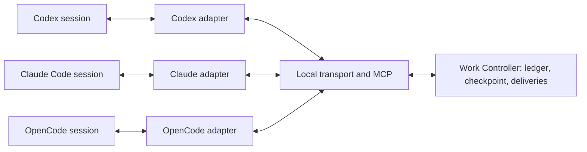

# Interoperability among local agents, sessions, and harness platforms

Research date: October 26, 2026. Deep search update: October 27, 2026.

**Conclusion:** Tools very close to the requirements already exist. Agent Deck covers session management and handoffs between several harness platforms; Agent Relay covers inter-agent communication. Daodan already possesses the persistent ledger upon which to integrate these capabilities. The genuinely valuable, original component is Work Controller's work continuity contract, backed by verified adapters, rather than an entirely new generic protocol.

Scope: Verify existing Daodan infrastructure for communication between agents across different sessions or harness platforms on the same machine, work continuity, pause, checkpoint, handover, and resumption. Then compare this baseline against external protocols and tools using primary sources.

This document is research. It introduces no new plugin, authorizes no executions, and attests no operational cross-harness trial. It distinguishes verified code read, in-repository tests, declared capabilities, and project requirements.

**Deep search update (October 27, 2026).** In-depth research expanded the external survey: orchestrators leveraging git worktrees and tmux, session managers with handoff audit logs, public ACP/MCP/A2A bridges exposing existing harnesses, the draft Agent Host Protocol (VS Code), and ANP for agent discovery. Newly surfaced tools and protocols are integrated below with cited primary sources and without execution proofs. No public source found to date demonstrates atomic migration of proprietary runtime state between distinct harness platforms: the core conclusions and boundaries of this document remain unchanged.

## Local verification results

Daodan already possesses a persistent work ledger reusable across sessions. It does not yet include a generic messaging bus between agents or executable live session migration between different harness platforms.

| Capability | Local evidence | Verified status |
|---|---|---|
| Shared project state | Main checkout `.daodan/`, shared across worktrees; SQLite process store and content-addressed artifacts | Implemented |
| Inter-session task ownership | Agenda with `session`, host, and timestamp; explicit holder claims task; explicit takeover | Implemented |
| Work resumption | Validates permissions, scope, and snapshot; returns pending phases, deliveries, and open questions | Implemented |
| Attempt recovery | Reservations revoked on restart; running work marked `unknown` requiring explicit reconciliation | Implemented |
| Addressed agent communication | Required in specification and ADR; no mailbox or dispatch API found in inspected runtime | Designed; not implemented in current runtime |
| Launch, observe, stop on other harnesses | Engine returns execution packet to coordinator for agent jobs | Host bindings yet to be built |
| Live session and transcript migration | No universal export/import format or cross-harness adapter found | Not demonstrated |
| Agent pause control | Console button toggles visual polling only | No demonstrated agent pause control |

### Persistent ledger and ownership

The canonical owner is `work-controller@daodan`. The
[work-record skill](../../plugins/work-controller/skills/work-record/SKILL.md),
lines 29 and 101, locates state in the shared project home and defines holder and
takeover mechanics. The implementation resolves the main checkout through the Git common directory in
[run_state.py](../../plugins/work-controller/skills/work-record/scripts/run_state.py),
line 83. The process resolver reuses this common home in
[cli.py](../../plugins/work-controller/skills/work-record/scripts/work_controller/cli.py),
line 27.

This control is not merely textual advice:
[plan_agenda](../../plugins/work-controller/skills/work-record/scripts/run_state.py),
line 1376, rejects a distinct holder without `--take-over`; the new holder
records session ID, host name, and date. This check protects records; it does not
prove two independent agents cannot concurrently alter product files via external
tools. The ledger writer lock begins at line 1410.

Resumption in
[run_state.py](../../plugins/work-controller/skills/work-record/scripts/run_state.py),
line 1555, requires identical authorizations, compatible scope, and identical
candidate; it reconciles interrupted commits and returns pending work and open
questions. This continuity preserves the task and its evidence. It does not
automatically transfer internal chat context or harness credentials.

### Runtime, artifacts, and handoff

The
[process runtime operational contract](../../plugins/work-controller/skills/work-record/references/process-runtime.md),
lines 18 and 44, details SQLite persistence, content-addressed artifacts, YAML
admission, attempts, and deliveries. The implementation in
[Engine.drive](../../plugins/work-controller/skills/work-record/scripts/work_controller/engine.py),
line 296, executes deterministic jobs but yields `waiting_for_agent` with an
execution packet upon encountering an agent job (line 320). The coordinator must
use the host's native mechanism and admit the delivery.

Task claiming is transactional in
[Store.claim](../../plugins/work-controller/skills/work-record/scripts/work_controller/store.py),
line 421. It rejects new assignments if an attempt in `reserved`, `running`, or
`completing` state already exists within the process (line 442). Consequently, the
runtime is sequential per process, even when the graph includes independent
nodes. A reservation has an expiration checked by `Store.start` (line 508). It is
not a universal live session lease with heartbeats and cross-tool fencing.

[Store.resume](../../plugins/work-controller/skills/work-record/scripts/work_controller/store.py),
line 833, revokes reservations and converts active attempts to `unknown`;
`resolve_unknown` (line 870) requires confirmation that they are halted. This
prevents blind duplication of unverified work. It does not autonomously terminate
the agent's OS process or recover a process handle on another harness.

The
[operational contract](../../plugins/work-controller/skills/work-record/references/process-runtime.md),
line 123, explicitly declares as separate and unbuilt: native host dispatch
adapters, observed model identity, parallel execution, dynamic loops, selective
replanning, and semantic memory.

### MCP and console

The plugin
[declares an MCP server](../../plugins/work-controller/plugin.toml), line 23,
usable as an observation point. The tool catalog in
[mcp.py](../../plugins/work-controller/skills/work-record/scripts/work_controller/mcp.py),
line 73, contains read-only operations: run, state, detail, frontier, events,
tickets, and supervision advice. It contains no `send`, `receive`, `pause`,
`stop`, `handover`, or `resume` actions.

The console is a read-only local loopback UI
([process-runtime.md](../../plugins/work-controller/skills/work-record/references/process-runtime.md),
line 115). The button in
[console.js](../../plugins/work-controller/skills/work-record/scripts/work_controller/assets/console.js),
line 590, toggles `Pause updates` and `Resume updates`: it suspends browser
polling. It does not suspend the agent or execution graph.

### Future contract and adapters

The specification
[conversational decisions and work graphs](../superpowers/specs/2026-10-24-conversational-decisions-and-work-graphs-design.md),
lines 603, 611, 618, and 624, assigns checkpoints, memory, session handover, and
addressed deduplicated messaging to Work Controller.
[ADR-0002](../adr/ADR-0002-work-controller.md), line 165, confirms this ownership.
These passages define target requirements; the current operational contract
delineates what the implementation currently delivers.

Marketplace adapters translate host mechanisms. They are not cross-host session
bridges. For example,
[Codex capabilities](../../adapters/codex/capabilities.toml), line 36, declares
`tasks.share` and `peers.message` unsupported in the compiled contract;
[OpenCode capabilities](../../adapters/opencode/capabilities.toml), line 45, does
likewise. Both declare provisional status relative to runtime probes (line 1). This
repository declaration does not limit what an individual host application may
expose natively.

The same [specification](../superpowers/specs/2026-10-24-conversational-decisions-and-work-graphs-design.md),
line 639, anchors execution in the coordinator session following the ledger. It
requires no autonomous daemon executing work after chat termination. Any
persistent transport or discovery broker must respect this decision without
introducing a second scheduler.

Workspace binding is strictly enforced:
[Engine._bind_workspace](../../plugins/work-controller/skills/work-record/scripts/work_controller/engine.py),
line 37, rejects paths differing from the registered process path. Resuming from a
different harness on the same machine is distinct from moving a process to
another checkout: the latter requires an explicit relocation procedure that the
current binding does not support.

## Test evidence and limits of local verification

Source code and unit tests were inspected; no live harnesses, servers, or worker
processes were launched for this audit.

Existing unit tests cover contracts relevant to a future bridge:

1. [Idempotent handoff and delivery](../../tests/test_work_controller_engine.py),
   line 106, with persistent artifact and single delivery event.
2. [Conservative resumption](../../tests/test_work_controller_engine.py), line 129,
   blocking unknown workers; [concurrent claim prevention](../../tests/test_work_controller_engine.py),
   line 158, admitting exactly one reservation.
3. [Read-only MCP](../../tests/test_work_controller_mcp.py), line 127, and
   [stdio in a subprocess](../../tests/test_work_controller_mcp.py), line 353.
   These do not prove compatibility across all installed harnesses.
4. [Ambiguous Git state recovery](../../tests/test_work_controller_regressions.py),
   lines 206 and 228, recovering via SHA or explicit reconciliation.
5. [Binding persistence during resumption under another declared host](../../tests/test_task_routing_binding.py),
   line 91. The test adjusts environment metadata; it does not migrate a live session.

## Implications for local architecture

A future implementation should extend Work Controller, reusing run IDs, delivery
ledgers, snapshots, grants, and candidate gates. The necessary addition is a
transport layer with an endpoint registry and adapters capable of contacting,
observing, interrupting, and resuming each harness.

Two promises must remain separate: resuming identical work on another harness via
checkpoints and artifacts is compatible with existing architecture; migrating a
full native session requires explicit API and format support on both hosts. A
portable summary provides input for a fresh session and does not demonstrate
lossless internal state migration.

## Three distinct meanings of transfer

| Operation | What remains identical | What is required |
|---|---|---|
| Switching interfaces | Backend and session identity | Connect to the same agent service from a different client |
| Resuming the same harness | Persistent transcript and compatible session ID | Native resume API plus workspace and side-effect reconciliation |
| Moving to a different harness | Goal, evidence, artifacts, and task ownership | Fresh session with portable checkpoint; declared loss of unexportable context |

None of the surveyed sources demonstrates universal migration of active OS
processes or in-memory model context from one harness to another. Chat transcript
and modified filesystem state remain distinct entities.

## Existing tools

### Agent Deck: closest candidate for requested switching

[Agent Deck](https://github.com/asheshgoplani/agent-deck) manages coding agents
via tmux, sessions, reopening, and forking. It supports multiple tools including
Claude Code, Codex, OpenCode, and Gemini. The documented Windows platform is WSL,
with WSL2 recommended. License is
[MIT](https://github.com/asheshgoplani/agent-deck/blob/v1.16.34/LICENSE).
[Release v1.16.34](https://github.com/asheshgoplani/agent-deck/releases/tag/v1.16.34)
was published on October 25, 2026, commit
`f36e77d6170b8d8b54f50c960c3f16e8a2c5df19`.

Code inspected **in the released tag**, not merely in `main`, distinguishes native
resume (Claude→Claude, Codex→Codex) from transcript-based handoffs between
Claude, Codex, and Pi. The
[session switch command](https://github.com/asheshgoplani/agent-deck/blob/v1.16.34/cmd/agent-deck/session_switch.go#L20)
requires explicit confirmation of context loss. The
[capabilities matrix](https://github.com/asheshgoplani/agent-deck/blob/v1.16.34/internal/session/switch_preview.go#L528)
explicitly details the applied mode and exclusions.

[Context export](https://github.com/asheshgoplani/agent-deck/blob/v1.16.34/internal/session/context_export.go#L548)
extracts human-readable user and assistant text, subject to a default budget of
32,000 bytes. It transfers neither process state, credentials, permissions,
native tool state, nor content exceeding that cap. The
[transfer mechanism](https://github.com/asheshgoplani/agent-deck/blob/v1.16.34/internal/session/cross_harness_switch.go)
creates a fresh destination and retains the source, archiving it reversibly only
after native verification of the destination. Semantic verification of context
remains separate from a successful technical launch.

**Assessment:** First candidate to test if WSL2 is acceptable. Demonstrates that
cross-harness switching exists as an operational handoff with acknowledged context
loss. Management under tmux does not prove it can take over arbitrary standalone
desktop app windows or sessions.

### Agent Relay: messaging infrastructure across harnesses

[Agent Relay](https://github.com/AgentWorkforce/relay) provides communication
infrastructure for coding agents. Declared license is Apache-2.0; the repository
recorded activity on October 26, 2026. The
[SDK](https://github.com/AgentWorkforce/relay/blob/main/packages/sdk/README.md)
separates messaging, delivery receipts, and optional runtime. Receipts distinguish
acceptance, delivery, deferral, and failure: a successful publication event does
not automatically guarantee that an agent processed the message.

The
[self-hosting guide](https://github.com/AgentWorkforce/relay/blob/main/docs/self-hosting/README.md)
details local Relaycast running on Node and SQLite without external data services.
Messaging and local launching are decoupled from cloud services.
[Harness adapters](https://github.com/AgentWorkforce/relay/blob/main/packages/harnesses/README.md)
document a Windows platform difference: native AI SDK runtime on macOS/Linux; PTY
on Windows. A
[win32-x64 broker](https://github.com/AgentWorkforce/relay/tree/main/packages/broker-win32-x64)
is available.

**Assessment:** Candidate for transport and delivery, worth testing on a concrete
pair of harnesses. Does not natively provide session state migration or Work
Controller gates.

### Happy and HAPI: session access continuity

[Happy](https://github.com/slopus/happy) and
[HAPI](https://github.com/tiann/hapi) are candidates for controlling sessions
from terminal, web, and mobile devices. Their primary value is persistent access
to the backend driving the work. Interface continuity does not demonstrate
converting a Claude session into a Codex session.

Happy declares an [MIT license](https://github.com/slopus/happy/blob/main/LICENSE);
HAPI uses [AGPL-3.0](https://github.com/tiann/hapi/blob/main/LICENSE). Both
recorded activity on October 26, 2026. Adopting HAPI would require licensing
review; no code adoption is proposed here.

### MCP Agent Mail: relevant mailbox model, license requires review

[MCP Agent Mail](https://github.com/Dicklesworthstone/mcp_agent_mail) implements a
persistent mailbox model for agent and file coordination. It is relevant for
inter-session communication; it is not a universal session transfer engine. The
repository recorded activity on October 23, 2026.

The [current license](https://github.com/Dicklesworthstone/mcp_agent_mail/blob/main/LICENSE)
is a modified MIT license with a rider concerning OpenAI and Anthropic. It must
not be classified as standard MIT or automatically approved as a permissive
dependency. No code or content from the project was copied. Native Windows support
and waking arbitrary dormant sessions were not demonstrated in this research.

**Deep search update (October 27, 2026):** Per repository notes, the project
transitioned from a Python implementation to a Rust rewrite, and the Python
version is no longer maintained. Current status and license must be re-evaluated
prior to any assessment
([repository](https://github.com/Dicklesworthstone/mcp_agent_mail)).

### Other tools surfaced by deep search (October 27, 2026)

Surfaced by deep research on October 27, 2026: linked sources only; no installation
or execution trials performed, capabilities as declared.

| Tool | License | Platforms | Declared capabilities | Source |
|---|---|---|---|---|
| Agent Orchestrator | Apache-2.0 | desktop macOS/Windows/Linux and CLI; requires tmux, git, gh | parallel agents in git worktrees via tmux sessions; plugin architecture (Runtime/Agent/Workspace/Tracker) | [repository](https://github.com/OrchestratorInc/agent-orchestrator), [documentation](https://composiohq-agent-orchestrator.mintlify.app) |
| Nimbalyst | MIT | macOS/Windows/Linux | desktop session manager with per-agent git worktrees; frequent releases in October 2026 | [changelog](https://nimbalyst.com/changelog), [releases](https://github.com/nimbalyst/nimbalyst/releases) |
| claude-sessions | unverified | local | Claude Code session management with rotation/handoff logging (`.cs/timeline.jsonl`) and handoff prompts | [repository](https://github.com/hex/claude-sessions) |
| opencode-sessions | unverified | OpenCode | session management plugin with multi-agent collaboration | [repository](https://github.com/malhashemi/opencode-sessions) |
| Useful directories | - | - | curated directories of harnesses and orchestrators for future research | [awesome-cli-coding-agents](https://github.com/bradagi/awesome-cli-coding-agents), [awesome-agent-orchestrators](https://github.com/andyrewlee/awesome-agent-orchestrators) |

For these projects, deep search identified no public evidence of atomic migration
of proprietary runtime state: they remain orchestrators and session managers,
operating via workspace isolation and session- or transcript-level resumption.

## Protocols: reusing existing standards

| Protocol | Useful role | Boundary / Limitation |
|---|---|---|
| MCP | Exposing Daodan tools to each harness | Does not manage client lifecycle automatically |
| ACP, Agent Client Protocol | Driving coding agents via a common interface | Session remains owned by backend; negotiated feature support |
| A2A, Agent2Agent | Exchanging requests, tasks, and results between independent agents | Does not define migration of native harness state |
| Agent Host Protocol | Decoupling agent sessions from IDE windows and reconnecting (JSON-RPC over WebSocket) | Draft VS Code/Microsoft; evidence based on secondary sources |
| ANP, Agent Network Protocol | Describing and discovering networked agents (DID-style identifiers) | Focused on description and discovery, not state transfer |

[ACP v1](https://agentclientprotocol.com/protocol/v1/session-setup) documents
session creation and loading, persistence, and consumption across different
Clients. `session/load` replays history; `session/resume` resumes without replay.
These capabilities depend on what the Agent declares. Changing Clients does not
mean changing backends.
[Transports](https://agentclientprotocol.com/protocol/v1/transports) distinguish
stdio from the proposed Streamable HTTP transport, still in draft.
[ACP v2](https://agentclientprotocol.com/protocol/v2/session-setup) is also draft.
[Cancellation](https://agentclientprotocol.com/protocol/v1/cancellation) is not a
universal execution checkpoint.

[A2A v1.0.1](https://a2a-protocol.org/v1.0.1/specification/) specifies Agent Cards,
messages, tasks, artifacts, streaming, and cancellation. `contextId` links
correlated interactions. It is well-suited for delegation between opaque agents
without requiring shared implementations. It does not define process import/export
or a universal agent memory representation. The legacy
[Agent Communication Protocol by IBM/BeeAI](https://github.com/i-am-bee/acp),
an ACP homonym, is archived and merged into A2A: it is not the editor protocol.

The [MCP Tasks extension](https://modelcontextprotocol.io/extensions/tasks/overview)
offers durable handles for long-running operations, disconnection recovery, input
requests, and cooperative cancellation. It is opt-in and requires client support.
A recoverable MCP task does not make harness chat history portable. A mailbox can
persist past client termination; processing new messages still requires an active
client or an adapter capable of launching one.

**Additional protocols (deep search, October 27, 2026).** Two protocols not
included in the initial trial. **Agent Host Protocol** (VS Code/Microsoft, draft)
decouples agent sessions from IDE windows: long-running sessions, reconnection,
and JSON-RPC over WebSocket, with public SDKs; available sources are secondary
([interview](https://daily.dev/posts/vs-code-s-agent-host-protocol-explained-with-connor-peet-qp0dy7v6l),
[analysis](https://rohitai.com/blog/vscode-agent-host-protocol-session-infrastructure)),
so official specifications must be verified prior to adoption. **ANP (Agent
Network Protocol)** describes and discovers agents across networks using DID-style
identifiers: it targets discovery, not runtime state
([specification](https://github.com/agent-network-protocol/AgentNetworkProtocol/blob/main/07-anp-agent-description-protocol-specification.md);
the [public protocol comparison](https://agent-network-protocol.com/blogs/posts/agent-communication-protocols-comparison)
is a landscape summary, not a primary source).

**Minimum recommendation:** MCP and native APIs for an initial local trial. ACP
reduces backend differences where supported. A2A is additive when interoperating
with external agent networks; it is not a prerequisite for linking two local
sessions. Agent Host Protocol and ANP remain out of scope for the initial trial:
the former is draft with secondary evidence, the latter targets discovery.

## Native APIs enable connectivity

1. **Codex:** The
   [App Server](https://learn.chatgpt.com/docs/app-server) exposes `thread/list`,
   `thread/read`, `thread/resume`, `thread/fork`, `turn/start`, `turn/steer`, and
   `turn/interrupt`. It provides a concrete foundation for an adapter with
   history, approvals, and events. Documentation distinguishes stable API surfaces
   from experimental methods; it notes the App Server command and WebSocket
   transport as experimental and unsupported in production.
   These APIs do not guarantee integration across all desktop builds. Resuming a
   thread preserves the Codex conversation, but neither converts external chat
   history nor automatically restores filesystem state. Windows/WSL note:
   a [repository issue](https://github.com/openai/codex/issues/23251) reports
   database migration errors when `CODEX_HOME` points to the Windows Codex App home
   from WSL; paths must be validated before sharing sessions across environments.
2. **Claude Code:** The
   [Agent SDK](https://code.claude.com/docs/en/agent-sdk/sessions) documents
   resumption, forking, and transcript persistence. Resuming on another host can
   reuse a transcript store or restore session files. Documentation explicitly
   decouples conversation history from the filesystem.
   [Remote Control](https://code.claude.com/docs/en/remote-control) connects
   external interfaces to work continuing locally.
3. **OpenCode V2:** The
   [HTTP APIs](https://opencode.ai/v2/docs/api) document import/export, forking,
   agent/model switching, session relocation, and interrupts. The HTTP surface is
   marked experimental. Operations belong to the OpenCode domain: import and switch
   mechanics do not imply conversion of Codex or Claude sessions. `session.move`
   changes project directory at delivery boundaries; it does not transfer sessions
   between servers or harnesses. The
   [CLI ACP interface](https://opencode.ai/v2/docs/cli/acp/) provides standard
   connectivity; the [shared server](https://opencode.ai/v2/docs/cli/web/) supports
   multiple clients, with Windows explicitly documented.
4. **Copilot CLI (deep search, October 27, 2026):** Documents `--continue` to
   resume the latest session, `--resume` with interactive picker or session ID,
   and local session data inspected via `/chronicle`
   ([documentation](https://docs.github.com/en/copilot/how-tos/copilot-cli/use-copilot-cli/chronicle));
   ACP mode is in public preview per
   [community discussion](https://github.com/orgs/community/discussions/185860).
   Requires verification on installed builds.
5. **Gemini CLI (deep search, October 27, 2026):** `--resume` resumes by index or
   UUID
   ([command reference](https://geminicli.com/docs/reference/commands)).

Upstream APIs do not prove that an active instance of Codex desktop, Claude Code,
Copilot, or Tri-Tech exposes identical endpoints and permissions. Installed builds
must be probed directly. Within this conversation, Codex tools exist to inspect
and contact other chats and perform in-app handoffs, but these represent host
capabilities rather than universal Daodan protocols; they were not invoked to
contact external sessions during this research.

### Public bridges between harnesses and protocols (to be verified)

The October 27, 2026 deep search identified projects exposing harnesses as ACP,
MCP, or A2A endpoints, mapping native sessions onto a common protocol interface:

- **ACP:** [acp-claude-code](https://github.com/Xuanwo/acp-claude-code)
  (maps ACP to Claude Code sessions),
  [claude-code-acp](https://github.com/szhongren/claude-code-acp),
  [acp-bridge](https://github.com/allvegetable/acp-bridge) (Codex, Claude, Gemini,
  OpenCode), [acp-adapter](https://github.com/beyond5959/acp-adapter) (Codex,
  Claude, Pi).
- **MCP:** [codex-as-mcp](https://github.com/kky42/codex-as-mcp),
  [codex-mcp-server](https://github.com/tuannvm/codex-mcp-server) (Codex exposed
  via an MCP server).
- **A2A:** [a2a-copilot](https://github.com/shashikanth-gs/a2a-copilot) (A2A
  wrapper for the Copilot SDK).

These projects represent the closest public evidence of cross-harness handoffs:
they transport session IDs, transcripts, or tasks across protocols, rather than
proprietary runtime state. Licenses, maintenance status, and limitations for each
bridge require independent verification; none were executed in this research.

## Proposal for Daodan, pending approval and implementation

The canonical owner remains **Work Controller**. An optional local persistent
process serves strictly as a transport and discovery broker. An autonomous
scheduler running after chat closure must not be introduced implicitly: the local
[specification](../superpowers/specs/2026-10-24-conversational-decisions-and-work-graphs-design.md),
lines 639–648, assigns execution strictly to the coordinator session.

The additional contract should be confined to five core responsibilities:

1. **Identity and discovery:** endpoint, harness, version, session ID, workspace,
   declared and verified capabilities. A discovered session is not automatically
   controllable.
2. **Message delivery:** sender/recipient, run/node/attempt, message ID,
   acknowledgement, and deduplication. Plan for idempotent redelivery; avoid
   guaranteeing exactly-once execution of external side-effects.
3. **Cooperative control:** pause/stop requests and verified observed confirmation.
   Persist process handles and reconcile active commands; timeouts do not prove
   processes have halted. Native resumption and reconstruction from checkpoint must
   yield distinct statuses.
4. **Verifiable handoff:** preparation, checkpoint, destination acceptance,
   exclusive ownership transfer, and failure recovery. On partial failure, retain
   uncertain outcomes and prevent duplicate execution.
5. **Context and authority:** objective, decisions, evidence, artifacts, Git state,
   and open work. Messages do not become human responses or new authorizations.
   Destination host permissions must be re-validated.

The portable checkpoint should reference files and artifacts with cryptographic
digests, base commit, uncommitted changes, relevant untracked files, verification
records, and indeterminate external operations. It requires no automatic Git
commit: commits and publication remain within the project workflow. A confirmation
of ownership transfer is not a Git commit.

## Recommended initial trial

**First evaluate and test Agent Deck and Relay on the two chosen harnesses; then
implement solely the remaining gaps within Work Controller.** No dependency is
adopted by this document. Any adoption will require formal review of contracts,
versions, transitive dependencies, licenses, and security boundaries.

The minimal viable trial on a single machine consists of:

1. Send a message between two sessions, verifying reception, reply, and offline
   recipient behavior.
2. Interrupt a session during an in-flight operation, terminate it, and resume,
   verifying side-effects prior to re-executing commands.
3. Hand off the same task from Claude Code to Codex, verifying workspace,
   artifacts, uncommitted changes, declared context loss, and single-holder
   integrity. Distinguish successful destination launch from the capacity to
   continue the work.
4. Connect an existing session to an ACP client via a public bridge (e.g.
   `acp-claude-code`), recording session IDs, events, and context omissions;
   verify the bridge's license beforehand.

This research inspects documentation and source code; the October 27, 2026 deep
search adds external findings marked in the text. It has not installed tools,
executed these four trials, or proven runtime compatibility between active local
instances.
