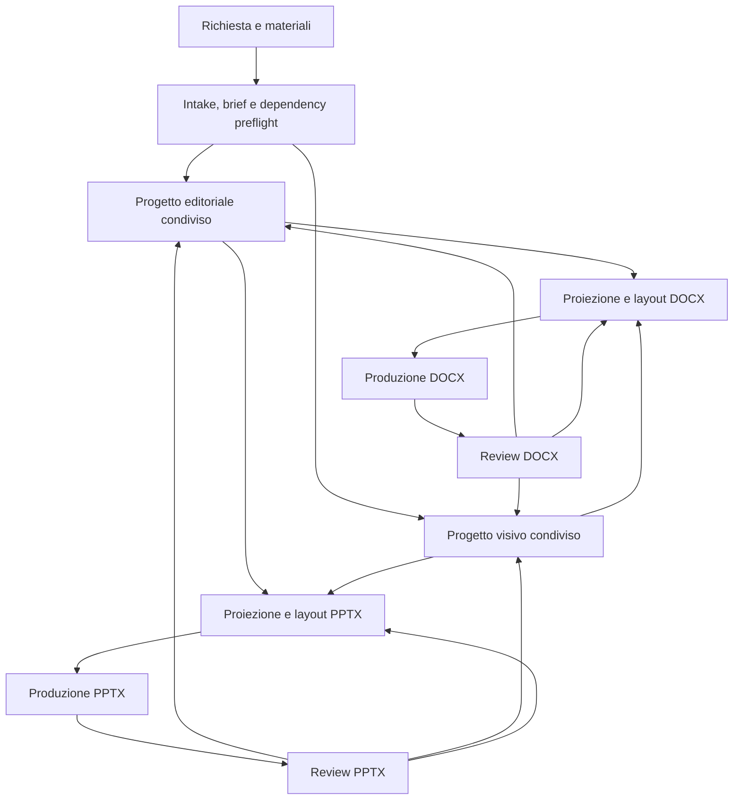

# Relazione sull’evoluzione di Office per contenuti, design e composizione DOCX e PPTX

**Data:** 26 ottobre 2026  
**Baseline verificata:** Daodan, plugin `office` 3.1.0  
**Natura del documento:** direzione di prodotto, architettura proposta e piano di evoluzione. La relazione non modifica da sola policy, dipendenze o workflow e non certifica capacità runtime non provate.

## Sintesi decisionale

Office deve diventare un sistema più capace senza trasformarsi in un generatore uniforme di documenti e slide. La direzione scelta è:

1. **Un solo ingresso** per richiesta, materiali, decisioni e verifica delle dipendenze.
2. **Un modulo editoriale condiviso, costruito internamente**, che decide che cosa comunicare in funzione di intento, pubblico, mercato, obiettivo, canale, formato e libertà di trasformazione.
3. **Una progettazione visiva condivisa e ad hoc**, con confronto HTML delle proposte e consegna di un `DESIGN.md` adattato a Office.
4. **Due skill di composizione separate**, DOCX e PPTX, con layout, regole di distribuzione, produzione e revisione propri.
5. **Nuovi contributi upstream selezionati dopo la prova verticale**, per risolvere lacune osservate e misurarne il beneficio senza perdere il metodo, le convenzioni e i confini locali.
6. **Licenze e provenienza esplicite**, nel rispetto delle condizioni upstream e senza rilicenziare materiali di terze parti.

“Content distribution” indica qui la distribuzione dei contenuti fra unità editoriali, formati, sezioni e slide. Non indica pubblicazione o distribuzione sui canali di marketing.

## 1 Obiettivo del prodotto

L’utente deve poter fornire appunti, testi approvati, documenti, slide, dati, logo, guide di brand, fotografie, link e riferimenti estetici. Office deve comprendere la funzione di ogni materiale e costruire risultati coerenti con ciò che il destinatario deve capire, ricordare o fare.

Il sistema deve rispondere a quattro domande distinte:

| Domanda | Responsabile |
|---|---|
| Che cosa serve comunicare, a chi, perché e con quale profondità? | Modulo editoriale condiviso |
| Quale identità visiva rende il lavoro appropriato? | Skill `design` condivisa |
| Come distribuire il contenuto in un documento Word? | Skill e designer DOCX |
| Come distribuirlo in una presentazione? | Skill e designer PPTX |

Produzione e revisione realizzano e verificano il progetto senza ridefinirne silenziosamente contenuto, tema o composizione.

Il valore atteso non deriva dal numero di agenti o di preset. Deriva dalla capacità di produrre contenuti appropriati, layout leggibili, file modificabili, decisioni tracciabili e aggiornamenti controllabili.

## 2 Principi non negoziabili

1. **Ingresso comune, non formato comune.** DOCX e PPTX conservano skill, layout, regole, motori e verifiche differenti.
2. **Un’unica autorità per decisione.** Contenuto, tema e composizione non si sovrascrivono a vicenda.
3. **Contenuti reali prima della composizione.** Nessun dato plausibile inventato per completare un layout.
4. **Un solo produttore per file.** Ogni candidato è separato dalla sorgente e la revisione si lega alla sua identità.
5. **Upstream come input governato.** Ogni contributo confluisce in poche istruzioni canoniche, chiare e coerenti nel plugin proprietario, secondo il gate della sezione 14.5. Restano preservati struttura portante, flow, policy, contratti, template, strumenti e personalizzazioni locali, insieme agli obblighi di licenza.

## 3 Base attuale verificata

Office 3.1.0 possiede già più elementi rispetto alla baseline Office 2.4.0 descritta nella prima versione di questa relazione.

| Area | Stato attuale verificato | Evoluzione richiesta |
|---|---|---|
| Manifest | Skill `intake`, `design`, `pptx`, `docx`, runtime bridge, integrità; ruolo `content-strategist` | Conservare l’architettura esistente e chiarire i contratti |
| Intake | Operazioni create, derive, expand, revise, restyle, edit, review/export; una sola tornata di domande | Aggiungere inventario delle dipendenze e dimensioni editoriali complete |
| Contenuto PPTX | `content-strategist`, claim ledger, budget, storyline, delta plan e plan JSON validato | Generalizzare il metodo editoriale senza creare uno schema PPTX concorrente |
| Contenuto DOCX | Tipo documentale, fonti e requisiti raccolti; progettazione affidata al brief e al document designer | Introdurre un piano editoriale condiviso e una proiezione DOCX |
| Design | Direzione, palette da fonti utente, font, template, riferimenti editoriali e tipografici | Progettare il sistema visivo sul brief, confrontare le proposte in HTML e consegnare `DESIGN.md` |
| Layout PPTX | `design-library.md`, `layout-patterns.md`, wireframe, specifica oggetti e preview | Mantenere il catalogo e separare scelta logica, pattern e geometria |
| Layout DOCX | `document-types.md`, `document-design.md`, pattern di pagina, blocchi e regole di crescita | Mantenere e ampliare il catalogo specifico Word |
| Produzione | WordCraft, DeckCraft e GridCraft esterni e sostituibili entro capacità provate | Conservare discovery, contratto per versione e nessuna installazione implicita |
| Revisione | Inspector, coverage, render, revisori indipendenti e controlli sul candidato | Aggiungere criteri editoriali e compositivi osservabili |
| Provenienza | Adattamenti Agentit, Theme Factory e PPT Visual con pin e licenze conservate | Centralizzare visibilità, intake e sync senza perdere i record esistenti |

### Incoerenze da eliminare

- `office:design` dichiara che il modo di argomentare appartiene al formato, mentre `office:pptx` gli attribuisce la proprietà dell’argument mode. Nel nuovo disegno il contenuto possiede strategia e sequenza logica; PPTX possiede la realizzazione espositiva.
- Il `content-strategist` attuale assegna anche i pattern PPTX. La proiezione PPTX può proporre pattern, ma la decisione compositiva finale e la geometria appartengono al presentation designer.
- La reading map in `design/references/editorial-design.md` mescola strategia, gerarchia visiva e composizione. Le tre parti vanno assegnate ai rispettivi proprietari.
- DOCX non dispone dello stesso livello di piano editoriale già presente per PPTX.

## 4 Architettura obiettivo



Contenuto e design possono partire in parallelo dopo il brief. Il design riceve inizialmente materiali visivi, formato e vincoli; viene rifinito quando densità, dati e gerarchie editoriali sono noti. La composizione è iterativa: un’eccedenza può richiedere redistribuzione oppure una proposta editoriale, non una riduzione arbitraria del corpo tipografico.

Le responsabilità non implicano automaticamente nuovi agenti. Il coordinatore attiva soltanto i passaggi richiesti dall’operazione e mantiene il brief e lo stato esistenti.

## 5 Contratti e artefatti condivisi

I nomi seguenti descrivono artefatti logici. Quando possibile devono essere sezioni dei brief e design report già esistenti, non una seconda reporting pipeline.

| Artefatto | Contenuto minimo | Proprietario |
|---|---|---|
| `BRIEF` | Operazione, pubblico, obiettivo, materiali, formati, vincoli, autonomia, decisioni ereditate e questioni aperte | Intake e coordinamento |
| `DEPENDENCIES` | Dipendenze richieste, versioni, disponibilità, licenze, capacità, probe e recovery | Coordinamento |
| `CONTENT.md` | Strategia, claim ledger, unità editoriali, priorità, fonti, sequenza logica e trasformazioni | Modulo editoriale |
| Plan di formato | Proiezione delle unità editoriali nel contratto già supportato da DOCX o PPTX | Modulo editoriale con il formato |
| Confronto HTML | Proposte visive motivate sullo stesso contenuto, con direzione, stile, tipografia e palette; scelta registrata nel brief | Skill `design` |
| `DESIGN.md` | Idea, principi, palette, tipografia, spaziatura, immagini, dati, componenti e adattamenti | Skill `design` |
| Layout DOCX | Wireframe, flusso, stili, blocchi, crescita e assegnazione dei contenuti | Document designer |
| Layout PPTX | Pattern, slot, geometrie, ritmo, oggetti e assegnazione dei contenuti | Presentation designer |
| Mappa trasformazioni | Origine, tipo di trasformazione, destinazione e motivazione | Contenuto e coordinamento |
| Review | Candidato, evidenze, criteri, difetti, severità, responsabile e limiti | Reviewer e coordinamento |

Ogni artefatto porta identità o revisione del progetto. Una modifica invalida soltanto i derivati interessati: un nuovo brand non invalida i fatti; una nuova audience può invalidare contenuto e layout senza richiedere un nuovo tema.

## 6 Intake della richiesta e delle dipendenze

### 6.1 Materiali e decisioni

Ogni materiale è classificato come fonte informativa, vincolo di identità, riferimento estetico, base da trasformare o risorsa utilizzabile. Un file può avere più ruoli, esplicitati nel brief.

L’intake conserva le regole attuali: legge prima i materiali, riusa ciò che è già noto, pone una sola tornata di domande e non chiede nuovamente decisioni ereditate. Un incarico autonomo autorizza le scelte ordinarie; una modifica locale attiva soltanto le fasi necessarie.

### 6.2 Classi di dipendenza

| Classe | Esempi | Controllo richiesto |
|---|---|---|
| Metodi e ruoli locali | `work-controller`, skill Office, designer e reviewer | Registrazione, dipendenze dichiarate e disponibilità effettiva |
| Runtime di produzione | WordCraft, DeckCraft, GridCraft, Word o renderer selezionato | Versione, percorso, comandi, capacità e limiti |
| Conoscenza upstream | Taste, Theme Factory, PPT Visual, PPT Design, fonti Word | Repository, path, revisione, licenza e modalità di adozione |
| Capacità host | Isolamento, dispatch, shell, rete, browser e strumenti immagine | Disponibilità reale sul host attivo |
| Font e asset | Famiglie, pesi, logo, fotografie, reference | Licenza, provenienza, installazione, embedding e sostituzioni |

### 6.3 Record e preflight

Per ogni dipendenza rilevante il run registra: identità, proprietario, tipo, obbligatorietà per la fase, fonte, versione o commit, licenza SPDX o stato incerto, capacità richieste, esito del probe, limitazioni e percorso di recovery.

Regole:

- nessuna installazione, pubblicazione o modifica esterna implicita;
- nessuna dipendenza obbligatoria trasformata in fallback silenzioso;
- una dipendenza mancante blocca soltanto le consegne che ne dipendono, mentre il lavoro indipendente continua;
- la presenza di un manifest non dimostra esecuzione o compatibilità;
- il runtime effettivo e il relativo schema comandi prevalgono sulla versione di riferimento documentata;
- font, asset e upstream con licenza incerta non vengono incorporati fino alla risoluzione del gate.

## 7 Modulo editoriale condiviso da costruire internamente

La ricerca approfondita non ha individuato, nelle fonti esaminate, un modulo completo che trasformi intento, pubblico, mercato e obiettivo in strategia, priorità, profondità, densità e sequenza logica per DOCX e PPTX. Ha invece trovato generatori, librerie, sistemi di authoring strutturato e framework di orchestrazione che coprono parti del problema.

La conclusione è **costruire il modello decisionale internamente**, riusando il `content-strategist` e il claim ledger già presenti. Non serve introdurre un nuovo orchestratore soltanto per questa funzione.

### 7.1 Dimensioni decisionali

| Dimensione | Che cosa determina |
|---|---|
| Intento e obiettivo | Decisione, apprendimento, consenso, azione, consultazione o aggiornamento |
| Pubblico | Conoscenze iniziali, ruolo, seniority, lingua, aspettative e contesto d’uso |
| Mercato e settore | Terminologia, prove attese, vincoli, convenzioni e sensibilità |
| Canale e fruizione | Relazione dal vivo, lettura autonoma, stampa, consultazione o uso misto |
| Ampiezza | Argomenti e casi coperti |
| Profondità | Ragioni, meccanismi, prove, limiti e conseguenze |
| Estensione | Spazio o tempo complessivo |
| Densità | Informazione per unità di lettura o slide |
| Taglio e tono | Punto di vista decisionale, operativo, didattico, commerciale o istituzionale |
| Formato | Proiezione DOCX, PPTX o entrambe, senza imporre strutture equivalenti |

Queste dimensioni restano indipendenti. Un contenuto breve può essere profondo; un documento lungo può restare superficiale; un principiante può richiedere più passaggi e minore densità.

### 7.2 Metodo

1. Costruire inventario e claim ledger con ID stabili, fatti, evidenze, locatori, peso, conflitti e lacune.
2. Definire il lavoro del destinatario e la promessa centrale del contenuto.
3. Stabilire priorità, inclusioni, esclusioni, ampiezza, profondità, densità e budget.
4. Creare unità editoriali con messaggio, funzione, fonti, relazioni, dettaglio e trasformazione autorizzata.
5. Proiettare le unità nei formati richiesti, conservando il contratto PPTX esistente e introducendo quello DOCX senza duplicarlo.

Le relazioni da rappresentare comprendono confronto, sequenza, gerarchia, causa, evidenza, scelta e riepilogo. Il layout può dividere o redistribuire un’unità senza cambiarne il significato. Tagli, riscritture sostanziali e cambi di priorità ritornano al contenuto.

### 7.3 Trasformazioni consentite

Il permesso è assegnabile per blocco: citazioni e dati possono restare intoccabili mentre altri paragrafi sono rielaborabili.

| Modalità | Operazioni |
|---|---|
| Testo invariato | Conservare formulazione e blocchi vincolati |
| Revisione linguistica | Migliorare forma e chiarezza senza cambiare fatti o argomenti |
| Ristrutturazione | Cambiare ordine e raggruppamenti entro lo scopo |
| Riscrittura | Riformulare per pubblico, tono e obiettivo |
| Sintesi | Selezionare e comprimere secondo priorità |
| Sintesi da più fonti | Integrare, esplicitare conflitti e distinguere inferenze |
| Espansione | Colmare lacune motivate senza inventare evidenze |

La coverage letterale resta attiva per i blocchi vincolati. Per le trasformazioni libere, il reviewer confronta fonti e risultato: una mappa compilata dal generatore o una similarità testuale non dimostra da sola conservazione di condizioni, incertezze e forza delle affermazioni.

## 8 `DESIGN.md` come consegna del tema

[DESIGN.md](https://designmd.ai/what-is-design-md) è presentato da DESIGNmd come un formato Markdown per design system, nato nell’ecosistema Google Stitch. È leggibile, versionabile e consumabile da agenti. Non fornisce però il modello editoriale cercato e la pagina non definisce uno schema rigoroso con validazione.

Office adotta l’idea come **contratto del tema adattato ai formati nativi**, non come dipendenza obbligatoria e non come catalogo da importare automaticamente. La skill `design` deve caricare e validare esplicitamente il proprio record: il nome del file non garantisce che un agente lo legga.

| Sezione | Decisioni |
|---|---|
| Idea e principi | Relazione fra soggetto, pubblico, identità e carattere |
| Palette semantica | Testo, sfondi, superfici, bordi, enfasi, dati e stati |
| Proporzioni | Prevalenza, accostamenti consentiti e usi da evitare |
| Tipografia | Famiglie, pesi, ruoli, scale, minimi, numeri, didascalie e fallback |
| Spaziatura e gerarchia | Principi e intervalli, senza geometrie di pagina o slide |
| Immagini | Soggetti, tagli, trattamento, provenienza e rapporto con il testo |
| Grafici e tabelle | Assi, unità, etichette, categorie, enfasi e fonti |
| Componenti | Titoli, callout, citazioni, indicatori, note e navigazione |
| Adattamenti | Lettura continua, stampa, schermo e proiezione |

Un tema deve essere dimostrato su contenuti reali e rappresentativi: testo denso, evidenza, confronto e tabella. Una copertina non è sufficiente.

### 8.1 Collocazione di Taste, Theme Factory e palette custom

`office:design` mantiene l’autorità sul tema condiviso. Il riordino delle reference di layout della sezione 9.1 conserva sotto `skills/design/` il catalogo visivo, il generatore di palette e gli strumenti dei template.

| Componente | Collocazione e funzione |
|---|---|
| Taste v2 | Contributo ancora candidato: le direzioni e i principi visivi selezionati arricchiscono le reference esistenti di `office:design`; contenuto, composizione e critica confluiscono nei rispettivi proprietari. L’adozione segue la prova verticale e il gate 14.5. |
| Theme Factory | Le quattro palette già adattate restano nelle direzioni Q–T di `design/references/directions.md`, con provenienza e licenza conservate. Forniscono seed di catalogo quando manca una fonte cromatica dell’utente. |
| Generatore custom | `design/scripts/palette.py` mantiene estrazione da website, immagini, CSS/token e file Office, generazione dei candidati e controlli cromatici. `palette_preview.py` mantiene il confronto visuale e la scelta viene registrata nel tema condiviso. |
| Kit template custom | `design/scripts/template_kit.py` resta disponibile per generare basi tecniche ad hoc dal tema approvato o template riutilizzabili richiesti. Stili, temi e layout nativi incorporano le decisioni del progetto. Un template fornito e da preservare viene ereditato. |

Brand, template vincolanti e scelte approvate hanno precedenza sui seed di catalogo. Per un input testuale, l’agente sceglie e motiva i seed dalla descrizione, poi li passa al generatore: `palette.py` non interpreta direttamente il linguaggio naturale.

Il percorso è **brief e materiali → proposte visive ad hoc in HTML → scelta → `DESIGN.md` → composizione e applicazione in stili, temi e master DOCX/PPTX**. Il record conserva la fonte dei colori e i riferimenti a candidati, preview e controlli. Designer e reviewer consumano il tema approvato, conservando le rispettive verifiche. Generatore, preview, kit template e direzioni già integrate fanno parte del primo incremento; i nuovi contributi Taste restano nella Fase 5.

### 8.2 Progettazione ad hoc e scelta in HTML

Per ogni nuovo lavoro, idea, direzione, stile, tipografia e palette vengono progettati sul brief e sui materiali reali. Cataloghi e contributi upstream sono risorse del metodo. Il progetto può combinarne i principi entro una direzione coerente e adattarne i parametri, rispettando i vincoli dell’utente. Revisioni ed espansioni ereditano invece le decisioni approvate; un restyle riapre la progettazione visiva entro lo scopo richiesto.

1. **Proporre alternative complete.** Nel percorso con scelta dell’utente, mostrare in un unico artefatto HTML poche proposte motivate, normalmente due o tre. Ciascuna rende visibili direzione, palette, font, gerarchia, trattamento delle immagini e dei dati su stessi estratti reali e rappresentativi, nei soli formati richiesti. I vincoli di brand rimangono rispettati in ogni proposta.
2. **Registrare la scelta.** L’utente può scegliere una proposta o chiedere una combinazione compatibile dei suoi elementi. Il coordinatore registra la scelta esplicita e i relativi valori in `DESIGN.md`; una selezione visuale nell’HTML vale come risposta soltanto se il meccanismo ne restituisce effettivamente l’esito. Un incarico autonomo consente di scegliere entro il brief senza imporre una nuova approvazione.
3. **Realizzare il progetto scelto.** I designer distribuiscono i contenuti e i produttori applicano il sistema visivo al file finale con gli elementi nativi necessari. La generazione di un DOTX/POTX separato è facoltativa; un template riutilizzabile diventa una consegna quando richiesto. Il kit esistente resta uno strumento utilizzabile per materializzare le decisioni ad hoc.

`palette_preview.py` implementa già il confronto cromatico su esempi con struttura identica. Il confronto completo di direzione, stile e tipografia richiede un’estensione del renderer esistente o un renderer dedicato riutilizzabile, alimentato dai dati delle proposte. La sua presenza non è certificata dal solo helper cromatico. Il confronto HTML comunica l’intento visivo; la verifica finale resta sul file Office salvato e renderizzato.

## 9 Layout e distribuzione separati per formato

| Aspetto | DOCX | PPTX |
|---|---|---|
| Struttura | Sezioni, paragrafi, appendici e consultazione | Slide, sequenza espositiva e passaggi del discorso |
| Composizione | Flusso, stili nativi, interruzioni e crescita | Canvas, pattern, slot e geometrie |
| Tipografia | Lettura prolungata e misura | Gerarchia a distanza e minimi di proiezione |
| Dati | Tabelle consultabili e spiegazioni estese | Evidenze selezionate e focalizzazione |
| Navigazione | Indice, rimandi, titoli e numerazione | Agenda, divisori e orientamento |
| Verifica | Impaginazione, continuità, tabelle e campi | Composizione, leggibilità e oggetti modificabili |

Le reference restano nei rispettivi formati, con nomi speculari per funzione secondo la convenzione seguente. Non viene creato un catalogo di layout unificato.

Le affermazioni e le fonti possono essere comuni, ma un rapporto e un deck non devono avere la stessa lunghezza o una corrispondenza pagina-slide.

### 9.1 Naming speculare delle reference

Il formato è già identificato dalla cartella `skills/docx/references/` oppure `skills/pptx/references/`. I due file di riferimento assumono gli stessi nomi funzionali:

| Funzione | DOCX | PPTX |
|---|---|---|
| Modelli di struttura del formato, applicati dal modulo editoriale | `structure.md`: tipi documentali, sezioni e convenzioni dei titoli | `structure.md`: modalità espositive, sequenze e convenzioni degli headline |
| Composizione e catalogo dei pattern | `layout-patterns.md`: pagine, blocchi, flusso, stili, geometria e crescita | `layout-patterns.md`: slide, slot, geometria, scale tipografiche e variazioni |

Nel riordino, `document-types.md` diventa `docx/references/structure.md` e `document-design.md` diventa `docx/references/layout-patterns.md`. La parte sulle modalità espositive di `design-library.md` diventa `pptx/references/structure.md`; le sue regole geometriche e tipografiche confluiscono nel `pptx/references/layout-patterns.md` esistente. Il modulo editoriale mantiene l’autorità su strategia e sequenza logica; le reference descrivono le possibilità e i vincoli dei formati.

La rinomina aggiorna rimandi, ruoli e verifiche senza mantenere copie concorrenti. Contratti tecnici, provenienza, template e helper conservano i propri confini; preview e altre reference specialistiche vengono mantenute dove servono. Le sezioni di baseline e le fonti locali di questa relazione riportano i nomi effettivi precedenti al riordino.

## 10 Operazioni e attivazione selettiva

| Operazione | Contenuto | Design | Layout | Produzione e review |
|---|---|---|---|---|
| Create | Piano completo | Progetto ad hoc e confronto HTML, rispettando brand o template vincolanti | Tutte le unità | Nuovo candidato e review completa |
| Derive | Nuova proiezione, claim ereditati | Ereditato o nuovo secondo brief | Nuova distribuzione | Coverage e review completa |
| Expand | Delta mirato alle lacune | Normalmente ereditato | Nuove e spostate unità | Review del delta e coerenza globale |
| Revise o condensa | Delta, priorità e trasformazioni | Ereditato | Unità cambiate | Coverage eccetto tagli approvati |
| Restyle | Nessuna rielaborazione | Nuovo progetto visivo e confronto HTML | Applicazione del tema | Review completa |
| Edit locale | Solo contenuto richiesto | Ereditato | Solo dipendenze necessarie | Review mirata e preservazione |
| Review/export | Nessuno | Nessuno | Nessuno | Sorgente invariata o export richiesto |

Una richiesta combinata esegue l’unione dei passaggi necessari. Se i contenuti obbligatori non entrano nel budget, contenuto e layout propongono articolazione, appendice o revisione delle priorità. L’utente decide soltanto quando cambia un vincolo sostanziale.

## 11 Contributi esterni, licenze e stato di adozione

### 11.1 Fonti già integrate

| Fonte | Uso attuale | Licenza e provenienza |
|---|---|---|
| `marcmarti9/agentit` | `editorial-design.md` e `typography.md` adattati | Apache-2.0; pin e modifiche in `agentit-upstream.md` |
| RampStack Co. e Peter Bamuhigire | Lineage delle guide Agentit | MIT; testi conservati nei rispettivi file |
| `anthropics/skills` Theme Factory | Quattro palette ricostruite nelle directions Q–T | Apache-2.0; pin e perimetro in `theme-factory-upstream.md` |
| `claude-office-skills/skills`, PPT Visual | Region sketch e handoff verso la specifica PPTX | MIT; revisione `9c4c7d5cd2813a8936bf2c9fdb174ea883b85a11` |
| `tivojn/Office`, Word Document Design Agent | Ispirazione originale per composizioni Word | MIT dichiarata nei README, nessun testo completo; non è copied-source sync target |

### 11.2 Nuovi contributi candidati dopo la prova verticale

Il primo percorso completo DOCX e PPTX usa le fonti e i cataloghi già integrati. I contributi seguenti restano candidati: ogni nuova integrazione richiede una lacuna osservata nella prova verticale della Fase 4, un contributo mirato e un confronto con la baseline su qualità e costo. La selezione alimenta il metodo Office canonico, con reference caricate secondo il compito e senza introdurre proprietari concorrenti delle decisioni o ulteriori cicli di critica.

| Fonte | Contributo previsto | Stato |
|---|---|---|
| [Taste](https://github.com/Leonxlnx/taste-skill) | Pattern, anti-pattern, reference analysis e critica visiva | MIT verificata; eventuale intake copied-source dopo la prova verticale |
| [PPT Design](https://github.com/sunchaokun/PPT-Design-Skill) | Trasferimento delle reference e QA compositiva PPTX | MIT verificata; eventuale intake copied-source dopo la prova verticale |
| [PPT Visual](https://github.com/claude-office-skills/skills) | Ulteriori miglioramenti di wireframe e specifica | Già integrato; nuovi diff solo per lacune emerse dalla prova |
| [Word Document Design Agent](https://github.com/tivojn/Office) | Ricette Word e comportamenti alla crescita | Nessuna copia finché la licenza non è regolarizzata |
| [DESIGN.md](https://designmd.ai/what-is-design-md) | Convenzione del record visivo | Adattamento concettuale; licenze da verificare prima di importare cataloghi, CLI o MCP |

Taste non porta in Office browser workflow, motion o regole web. PPT Design non introduce un secondo owner del tema o della produzione. Le fonti Word non portano AppleScript, automazione macOS o decorazioni obbligatorie.

#### Perimetro proposto per Taste v2.1.5

La valutazione è riferita a [Taste v2.1.5](https://github.com/Leonxlnx/taste-skill/tree/12af471f627f866411b4bd785b19646d3672784c), commit `12af471f627f866411b4bd785b19646d3672784c`, con licenza MIT completa. È un intake read-only registrato anche nella guida `external-repo-intake`; non è ancora un copied-source target autorizzato.

Il valore principale è la catena **materiale specifico → idea → direzione → contenuto completo → critica del render**. Il perimetro proposto è:

| Fonte upstream | Che cosa portiamo | Che cosa resta fuori |
|---|---|---|
| `references/copy.md` | Argomento prima della composizione, claim con prova, eliminazione del filler, contenuto completo alla densità richiesta e copy anti-template | Dettagli plausibili inventati, limiti web ai titoli e call to action da pagina |
| `library/directions.json` | Schema e record selezionati per arricchire le direzioni Office: settore, tono, prerequisiti, idea, tipografia, colore, immagini, ricchezza e pitfall | Libreria completa, CSS, geometrie viewport e deal casuale |
| `references/type.md` e `references/colour.md` | Pochi ruoli tipografici distanti, contrasto di scala, ruoli cromatici semantici, proporzioni, contrasto e trattamento coerente delle immagini | Costanti px/vw, divieti cromatici universali e sostituzione del sistema font Office |
| `references/layout.md` | Bordi condivisi, spazio negativo intenzionale, idea oltre l’apertura, ritmo e controllo delle ripetizioni | Geometria condivisa DOCX/PPTX e divieto assoluto di layout ripetuti nei documenti |
| `references/critique.md` | Prima occhiata, squint, prova di specificità senza brand, allineamenti, frame, tipografia, colore, immagini, sameness, sostanza e collisioni | Pesi Awwwards, score cap, quote obbligatorie di foto/motion e secondo loop di review |
| `references/tells.md` | Registro datato dei dispositivi usati per default e principio che togliere il rumore non sostituisce un’idea | Ban su numerazione, filetti, monospace, serif corsivo e famiglie cromatiche legittime per brand o editoria |

Le direzioni candidate esaminate sono `one-motif`, `editorial-report`, `page-is-the-object`, `quiet-instrument` e `colour-chapters`. La prova verticale determina se e quali servano; ogni eventuale adozione richiede adattamento nativo, casi reali e verifica separata su DOCX e PPTX. Le direction Office esistenti restano canoniche; non viene introdotto un secondo selettore casuale.

`research.md` e `websites.json` restano evidenza dello studio web upstream, non prova che le soglie numeriche siano valide per Office. Restano esclusi script, Node e browser tooling, hero e section blueprint web, app e dashboard, scene, motion, catalogo fotografico, harvesting, regole mobile e quote minime di immagini. Il budget upstream di 30–45 minuti e alcune centinaia di migliaia di token non diventa un requisito Office.

### 11.3 Alternative emerse dalla ricerca, non adottate

La ricerca ha rilevato GenOffice, Presenton, OfficeAgent.NET, DITA-OT, Pandoc, Unstructured, Semantic Kernel e librerie di templating. Sono candidati tecnici per produzione, parsing o trasformazione, non risposte complete al modulo editoriale.

Non entrano nel percorso base per evitare nuovi motori e orchestratori concorrenti. Ogni eventuale adozione richiede intake separato, verifica della repository e della licenza, prova delle capacità e confronto con WordCraft e DeckCraft già esistenti. Le informazioni emerse dal report di ricerca non equivalgono a verifica runtime indipendente.

## 12 Runtime esterni

| Runtime | Ruolo | Contratto attuale |
|---|---|---|
| WordCraft | Produzione DOCX | Delegato, nessun engine copiato; riferimento v0.10.0, MIT OR Apache-2.0 |
| DeckCraft | Produzione PPTX | Delegato, nessun engine copiato; riferimento v0.10.0, MIT OR Apache-2.0 |
| GridCraft | Produzione XLSX | Delegato, nessun engine copiato; riferimento v0.11.1, MIT OR Apache-2.0 |

La versione effettivamente installata viene scoperta a ogni run. Le versioni alpha e i gap documentati richiedono prove sulle operazioni richieste, non assunzioni di compatibilità.

## 13 Licenze e README del plugin

Daodan dichiara ora MIT nel `LICENSE`, nel pacchetto radice e nel README. I manifest dei plugin dichiarano `license = "MIT"`. Questa scelta non rilicenzia adattamenti o dipendenze di terze parti.

Il nuovo `plugins/office/README.md` deve contenere una sezione **Third-party sources and licenses** con:

| Campo | Contenuto |
|---|---|
| Progetto e repository | Identità e collegamento upstream |
| Percorso importato | File o directory effettivamente utilizzati |
| Destinazione | File Office adattati |
| Modalità | Delegation, original inspiration o copied-source adaptation |
| Revisione | Commit o release consultata |
| Licenza | SPDX e percorso del testo conservato |
| Modifiche locali | Sintesi dei confini e delle trasformazioni |
| Notice | Eventuali obblighi ulteriori |

Regole di conservazione:

- header di attribuzione nei file derivati;
- testo completo delle licenze nel package che distribuisce il materiale;
- copyright e notice mantenuti;
- modifiche evidenziate per Apache-2.0;
- lineage secondario riesaminato a ogni update;
- README come indice visibile, non come sostituto degli obblighi nei file e nei pacchetti;
- nessuna copia da una fonte con licenza assente o incompleta fino alla risoluzione.

La skill `design` dichiara oggi Apache-2.0 nel proprio frontmatter per il materiale adattato. Questo resta coerente con Office MIT complessivo e non va cancellato.

## 14 Upstream sync con preservazione del flow

### 14.1 Gate di policy

La policy corrente vieta nuove copie vendorizzate e la tabella `upstream-sync` non autorizza nuovi copied-source target. Un eventuale perimetro delimitato di nuovi adattamenti copied-source con sync viene valutato dopo la prova verticale, per le sole lacune osservate.

Prima di un’eventuale importazione da Taste o PPT Design è necessario modificare formalmente la policy canonica e le istruzioni di intake/sync, oppure registrare un’eccezione esplicita e circoscritta. Questa relazione non sostituisce quella modifica. Il primo percorso completo usa gli adattamenti già presenti e non richiede l’apertura di nuovi target.

Gli adattamenti già esistenti conservano i propri record e non richiedono una nuova adozione.

### 14.2 Registro di sincronizzazione

Ogni riga deve contenere:

- plugin e proprietario locale;
- repository, upstream path e local path;
- modalità copied-source oppure inspiration-only;
- commit base e hash dei file originali quando utile;
- licenza e notice;
- classificazione del file e personalizzazioni da preservare;
- test e casi di verifica associati.

Non si sincronizza l’intera repository se servono soltanto alcuni file. Le righe inspiration-only restano escluse da pull e merge.

### 14.3 Procedura manuale iniziale

1. Leggere licenza, notice, revisione e contratto upstream prima di aggiornare.
2. Recuperare soltanto i path registrati e confrontare commit base e nuovo upstream.
3. Classificare ogni file come clear win, minor refinement, hard merge o intentional drift.
4. Applicare edit mirati, preservando frontmatter, attribuzioni, namespace, stile, flow, ownership e contratti Office.
5. Aggiornare pin e provenance soltanto dopo test, revisione delle nuove condizioni di licenza e superamento del gate della sezione 14.5.

Gli export generati non vengono sincronizzati con upstream: si aggiornano i kernel e si ricompilano tutti i host.

### 14.4 Script opzionale

Dopo che le mappe manuali sono stabili, uno script Python standard-library può automatizzare soltanto:

```text
python office_upstream.py check --plugin office
python office_upstream.py diff --plugin office --source taste
```

`check` elenca revisioni, licenze e drift. `diff` produce il confronto fra base registrata e upstream. Lo script non applica merge, non sovrascrive file, non aggiorna automaticamente i pin e non esegue commit. L’avanzamento resta una modifica verificata e separata.

Prima della stabilizzazione delle mappe sono sufficienti le istruzioni `gh api` già previste da `upstream-sync`: aggiungere subito un engine generale sarebbe complessità non necessaria.

### 14.5 Gate di coerenza e costo delle istruzioni

Il gate si applica a nuove integrazioni e aggiornamenti degli adattamenti esistenti. L’unità di adozione è il contributo utile al metodo locale; ogni incremento deve soddisfare questi criteri:

1. **Una sola sede normativa.** Ogni regola ha un plugin proprietario e una sede canonica. Le regole equivalenti vengono consolidate; i conflitti con le istruzioni locali vengono risolti prima dell’integrazione. I consumatori richiamano il contratto del proprietario senza copiarne il metodo.
2. **Contesto caricato per necessità.** Le skill contengono poche istruzioni operative, con responsabilità, input e consegne definiti. Dettagli, esempi e cataloghi restano in reference mirate. Si verifica ciò che ogni ruolo deve effettivamente leggere, inclusi i riferimenti annidati, preservando le letture delle fonti e le verifiche indipendenti necessarie.
3. **Struttura e patrimonio locali preservati.** Coordinamento, flusso, confini fra plugin, template, stili nativi, cataloghi, helper e contratti di produzione restano la base. Ogni loro modifica deve essere motivata dalla lacuna affrontata e verificata sui casi esistenti. L’importazione non introduce orchestratori, selettori, agenti o cicli di review paralleli.
4. **Istruzioni eseguibili e fondate.** Tool, capacità, dipendenze e comportamenti richiesti devono corrispondere ai contratti e alle prove disponibili sull’host attivo. Lacune e limiti sono espliciti; nessuna istruzione autorizza a inventare contenuti, capacità o risultati per completare il flusso.
5. **Beneficio verificato prima dell’adozione.** La review controlla duplicazioni, contraddizioni e ambiguità nelle istruzioni coinvolte, anche referenziate, e nei cinque export generati. Il confronto registra contesto richiesto per ruolo, token complessivi, riletture, revisioni e qualità del risultato. L’incremento resta escluso se ripete regole, lascia conflitti irrisolti o aumenta il carico senza un beneficio verificato. La riduzione del testo conserva obblighi, evidenze e copertura necessari.

## 15 Revisione e qualità

| Prospettiva | Evidenza richiesta |
|---|---|
| Contenuto | Pubblico e obiettivo serviti, priorità coperte, fonti e condizioni conservate |
| Design | Tema coerente, regole applicate, reference tradotte e fallback registrati |
| Layout DOCX | Flusso, gerarchia, crescita, tabelle, campi e lettura continua |
| Layout PPTX | Prima lettura, ritmo, pattern, densità, geometria e leggibilità |
| Tecnica | File nativo, candidato identificato, modificabilità, preservazione e render |
| Dipendenze | Versioni, capacità, gap e recovery effettivamente osservati |
| Upstream e licenze | Pin, attribuzioni, notice, personalizzazioni e test conservati |

Un requisito comunicativo bloccante deve essere collegato al brief e a un’evidenza osservabile. Le preferenze estetiche soggettive restano osservazioni motivate. Le correzioni tornano al proprietario della causa.

Un cambiamento globale richiede verifica globale. Un cambiamento locale usa review mirata con prova che il resto sia rimasto invariato. I cicli restano limitati e i problemi aperti vengono consegnati esplicitamente.

## 16 Casi di accettazione

| Caso | Risultato atteso |
|---|---|
| Brief completo | Nessuna domanda ripetuta e decisioni registrate |
| Solo DOCX o solo PPTX | Nessuna progettazione implicita dell’altro formato |
| Consegna combinata | Stessi fatti e identità, articolazione specifica per formato |
| Cambio audience o mercato | Contenuto riprogettato senza cambiare tema se ancora valido |
| Solo logo | Tema utilizzabile con osservazioni e proposte distinte |
| Reference multiple | Qualità selezionate, compatibili e visibili nel risultato |
| Testo vincolato | Formulazione conservata e coverage positiva |
| Fonti discordanti | Conflitto visibile e autorità non dedotta soltanto dalla data |
| Condensazione | Condizioni decisive preservate e trasformazioni tracciate |
| Espansione | Aggiunte motivate da lacune reali |
| Edit locale | Nessuna rigenerazione di contenuto, tema o layout non interessati |
| Overflow | Redistribuzione o decisione editoriale, mai testo illeggibile |
| Runtime mancante | Blocco dichiarato della sola produzione dipendente |
| Upstream hard merge | Personalizzazioni e contratti locali conservati |
| Integrazione o aggiornamento upstream | Gate 14.5 superato: istruzioni coerenti, caricamento mirato e patrimonio locale preservato |
| Licenza incompleta | Importazione bloccata prima della copia |
| DESIGN.md | Campi obbligatori validati e caricamento esplicito |
| Nuovo progetto visivo | Proposte ad hoc confrontabili in HTML e scelta tracciata, oppure scelta autonoma autorizzata; applicazione coerente nel file finale |

## 17 Misurazione

Il confronto fra baseline ed evoluzione usa stessi materiali, richiesta e condizioni. Si registrano:

- adeguatezza a intento, pubblico e mercato;
- copertura delle priorità e fedeltà alle fonti;
- qualità della prima lettura e appropriatezza dei layout;
- difetti tecnici e numero di revisioni;
- riutilizzo corretto delle decisioni ereditate;
- tempo e token di tutti gli agenti, riletture e prove scartate;
- esito dei probe runtime e delle verifiche native;
- drift upstream incorporato senza regressioni.

La riduzione dei costi non è presunta. Viene accettata soltanto se misurata a parità di qualità richiesta.

## 18 Percorso di attuazione

### Fase 0: governance e baseline

- Documentare il perimetro upstream già consentito; valutare eventuali nuovi target soltanto nella Fase 5.
- Creare `plugins/office/README.md` con inventario delle fonti già presenti.
- Registrare tutti gli upstream esistenti prima di aggiungerne altri.
- Definire casi baseline e metriche.

### Fase 1: contratti e dependency intake

- Estendere il brief con il record `DEPENDENCIES`.
- Definire i campi minimi di contenuto, tema e layout senza duplicare gli artefatti esistenti.
- Separare autorità di contenuto, design e formato nelle istruzioni contradittorie.

### Fase 2: contenuto condiviso

- Generalizzare claim ledger e trasformazioni dal `content-strategist` PPTX.
- Introdurre `CONTENT.md` e la proiezione DOCX.
- Conservare il plan JSON PPTX e `design_preview.py` come contratti nativi.
- Spostare la strategia editoriale fuori da `editorial-design.md`.

### Fase 3: `DESIGN.md` e layout

- Definire schema, campi obbligatori e validazione del record visivo.
- Collegare a `DESIGN.md` palette custom, direzioni, font e kit template esistenti secondo la sezione 8.1, con uso facoltativo dei DOTX/POTX.
- Chiarire che i designer DOCX e PPTX possiedono composizione e distribuzione.
- Applicare il naming speculare della sezione 9.1, riallocando i contenuti misti e aggiornando tutti i rimandi.
- Realizzare il confronto HTML del sistema visivo previsto dalla sezione 8.2, riusando l’helper cromatico dove pertinente e registrando la scelta nel tema.

### Fase 4: prova verticale e consolidamento

Eseguire un caso reale con logo, dati e relazione tecnica, producendo DOCX e PPTX con le fonti e i cataloghi già integrati. Verificare brief, dipendenze, contenuto, tema, layout, file nativi, review, licenze e costo complessivo. Confrontare il risultato con la baseline della Fase 0, registrando le lacune osservate e le riletture o decisioni duplicate. Questo è il primo risultato completo; nuove integrazioni e automazioni vengono valutate dopo la prova.

### Fase 5: upstream selettivi guidati dalle lacune

- Collegare ogni contributo candidato a una lacuna osservata nella Fase 4; se il metodo Office esistente la risolve, usare quello.
- Per i soli contributi necessari, definire perimetro, pin e licenze e formalizzare la modifica di policy o l’eccezione richiesta prima della copia.
- Valutare Taste per pattern, anti-pattern e critica, PPT Design per reference transfer e QA PPTX e i nuovi diff di PPT Visual per wireframe e specifica; le fonti Word richiedono prima una licenza completa.
- Adattare i contributi al metodo Office canonico e verificarne il beneficio con gli stessi materiali e criteri della prova, misurando qualità, revisioni, tempo e token. Ampliare cataloghi e automazioni soltanto quando i risultati lo giustificano.

## 19 Decisioni e punti aperti

### Direzione approvata nella discussione

- DOCX e PPTX restano funzioni e skill separate.
- Il modulo editoriale condiviso viene costruito internamente.
- Il design condiviso usa un record `DESIGN.md` adattato a Office.
- I nuovi contributi esterni vengono valutati dopo la prova verticale, per lacune osservate, e adattati al metodo Office con beneficio misurato.
- Daodan è MIT in modo esplicito; le terze parti conservano le proprie condizioni.
- Office deve avere un README con fonti e licenze.

### Punti ancora da chiudere durante l’attuazione

- Necessità e forma della modifica di policy per i nuovi copied-source target dopo la prova verticale.
- Selezione e approvazione dei soli file Taste v2.1.5 e PPT Design pertinenti alle lacune osservate, con relativi pin di adozione.
- Regolarizzazione della licenza di `tivojn/Office`.
- Schema minimo obbligatorio di `DESIGN.md` e sua validazione.
- Momento in cui il sync manuale giustifica lo script read-only.
- Eventuali runtime alternativi, nessuno dei quali è approvato da questa relazione.

## 20 Primo risultato da consegnare

Il primo incremento deve essere un percorso completo e misurabile, non una raccolta di nuovi preset:

1. brief e dependency record;
2. progetto editoriale con claim ledger;
3. confronto HTML delle proposte complete e `DESIGN.md` motivato con scelta tracciata;
4. layout DOCX e PPTX separati;
5. file nativi e review;
6. README delle licenze e registro degli upstream già integrati;
7. confronto con la baseline su qualità e costo.

Soltanto dopo questo risultato ha senso ampliare cataloghi, importare ulteriori pattern o automatizzare il sync.

## Fonti principali

### Stato locale verificato

- `plugins/office/plugin.toml`
- `plugins/office/skills/intake/SKILL.md`
- `plugins/office/roles/content-strategist.md`
- `plugins/office/skills/pptx/references/content-planning.md`
- `plugins/office/skills/design/SKILL.md`
- `plugins/office/skills/design/references/agentit-upstream.md`
- `plugins/office/skills/design/references/theme-factory-upstream.md`
- `plugins/office/skills/pptx/references/layout-patterns.md`
- `plugins/office/skills/docx/references/layout-patterns.md`
- `plugins/office/skills/{wordcraft,deckcraft,gridcraft}/references/runtime.md`

### Fonti pubbliche

- [Taste](https://github.com/Leonxlnx/taste-skill)
- [Theme Factory](https://github.com/anthropics/skills/tree/main/skills/theme-factory)
- [PPT Design](https://github.com/sunchaokun/PPT-Design-Skill)
- [PPT Visual](https://github.com/claude-office-skills/skills/tree/main/ppt-visual)
- [Word Document Design Agent](https://github.com/tivojn/Office/tree/main/Word)
- [DESIGN.md](https://designmd.ai/what-is-design-md)
- [GenOffice](https://github.com/genspark-ai/genoffice)
- [Presenton](https://github.com/presenton/presenton)
- [DITA Open Toolkit](https://github.com/dita-ot/dita-ot)
- [Pandoc](https://pandoc.org/MANUAL.html)
