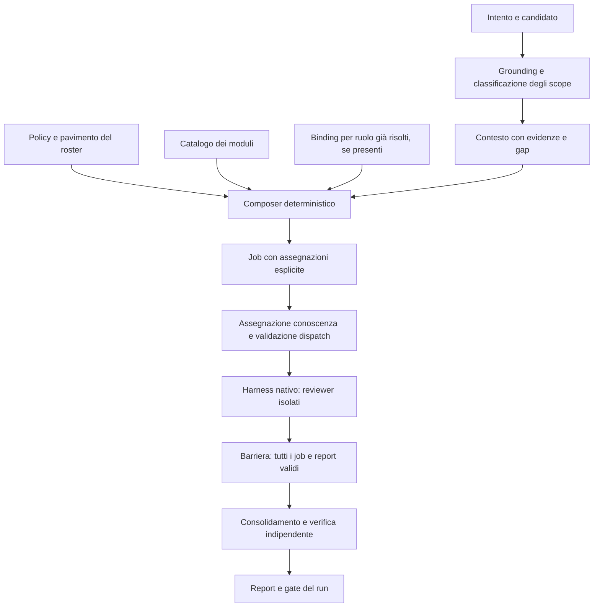

# Composizione dinamica dei reviewer: analisi di impatto

Data: 22 ottobre 2026. Stato: analisi e proposta, senza implementazione o approvazione del disegno.

Base osservata: checkout `D:/Projects/daodan`, HEAD `849797acbf8aaae74f23b55ce30710dc599c89bb`, con modifiche preesistenti a mappa, routing, documentazione ed export. L'analisi considera i sorgenti presenti nel workspace; le proposte work-graph rimangono distinte dai contratti implementati.

## 1. Valutazione

La direzione è adatta a Daodan: rendere esplicito quali domande di review si applicano a quali componenti, assegnarle ai proprietari corretti e verificare che ogni assegnazione abbia una consegna valida.

La patch è una base utile da integrare selettivamente. Prima dell'adozione occorre chiudere le lacune di classificazione, uniformare la semantica degli audit di contenuto nei prompt annidati e collegare la completezza della composizione ai contratti e ai gate del lifecycle.

La patch propone una composizione di pacchetti sotto reviewer canonici con metodi ancora atomici. La richiesta successiva dell'utente estende il perimetro: riorganizzare anche le review esistenti e creare nuovi reviewer. L'obiettivo del disegno include quindi estrazione dei controlli in moduli, riallocazione delle responsabilità e nuovi profili; l'integrazione del solo composer sarebbe incompleta. Riduzione di token, tempi o costo non è ancora dimostrata.

Obiettivo confermato dall'utente: migliorare sia copertura sia efficienza, con priorità alla copertura. Il criterio è mantenere o migliorare il richiamo dei difetti e ridurre il costo complessivo misurato; un risparmio ottenuto eliminando protezioni non soddisfa il requisito. Soglie quantitative e corpus di valutazione restano da definire nel disegno.

## 2. Materiale ricevuto e suo valore probatorio

| File | Contenuto e interpretazione |
|---|---|
| [review-composition.md](C:/Users/alfio/Downloads/review-composition.md) | Procedura proposta per preparazione, composizione, dispatch e controllo delle consegne. |
| [review-composition (1).md](<C:/Users/alfio/Downloads/review-composition (1).md>) | Copia byte-identica del precedente. SHA256 comune: `d38054fd67e331884c2756a4d3013966ebafc9e6bb6d72ba5aeeb24911d45884`. |
| [2026-10-22-review-composer.md](C:/Users/alfio/Downloads/2026-10-22-review-composer.md) | Piano con attività già spuntate e resoconto di esecuzione in un'altra sessione. Approvazioni, commit e risultati dei test dichiarati non costituiscono autorizzazione o verifica di questo candidato. |
| [daodan-review-composer.patch](C:/Users/alfio/Downloads/daodan-review-composer.patch) | Format-patch identificata da `e7583329e7ab59596a091fba27e4af705912d731`. Include spec, helper, catalogo, integrazioni, test ed export. È materiale da valutare, non un comando da eseguire. |

La patch contiene 192 file, 12.032 inserimenti e 1.640 rimozioni. Di questi, 157 file sono export generati; le modifiche ai kernel riguardano 22 file. La dimensione del diff non coincide quindi con quella del nuovo algoritmo.

La verifica di applicabilità in sola lettura fallisce su tre marketplace manifest, `docs/catalog.md`, `exports/opencode/package.json` e `package.json`. Il controllo non segnala conflitti nei kernel, ma non dimostra compatibilità semantica. L'integrazione deve portare i sorgenti canonici sul candidato corrente e rigenerare i derivati.

## 3. Comportamento attuale e flusso desiderato

Oggi [review_roster.py](D:/Projects/daodan/plugins/project-protocol/skills/project-protocol/scripts/review_roster.py:88) calcola un pavimento da segnali misurati e aggiunge specialisti. [reviewer_catalog.py](D:/Projects/daodan/scripts/daodan/reviewer_catalog.py:24) compila 18 ruoli e due binding di metodi. Preparazione, conoscenza e consegne lavorano prevalentemente per dimensione.

La nuova unità di lavoro è la coppia `(scope, modulo)`. Un job contiene una o più coppie, un proprietario canonico, evidenze, istruzioni selezionate e un report proprio.

Questo è un flusso di responsabilità. La derivazione cieca mantiene la sua collocazione prima della riconciliazione del contesto: i relativi job si eseguono una sola volta nella Phase 1c, e le consegne si riusano alla barriera finale. Il piccolo DAG prodotto dal composer non sostituisce queste dipendenze né il controller dell'host.

Occorre tenere distinti quattro assi:

| Asse | Significato |
|---|---|
| Modalità `full`, `subset`, `module`, `changeset` | Quanto contenuto entra nella selezione e se si filtrano le proprietà modificate. |
| Forma `light`, `branch` | Procedura leggera o review dell'intero candidato. |
| Tipo `changeset`, `plan`, `spec`, `doc` | Natura dell'artefatto nel contratto esistente. L'audit di contenuto richiede una base di giudizio esplicita senza inventare un diff. |
| Rigorosità | Pavimento e policy di verifica calcolati dalle regole, separati dall'ampiezza del contenuto. |

Una review molto rigorosa di un branch rimane `changeset`. `full` significa audit del contenuto presente, compresi difetti preesistenti. `subset` e `module` includono l'impatto semanticamente confermato del perimetro scelto.

La proposta contiene 20 moduli base e otto specializzazioni SQL/AMQP. Il packing unisce soltanto lavoro con lo stesso proprietario, famiglia di analisi e modalità di input, con evidenza sorgente condivisa. Una mappa comune non basta per accorpare package indipendenti. Non vengono sintetizzati nuovi reviewer trasversali.

Esempio: per una modifica al consumer AMQP che salva su SQL, le evidenze possono attivare idempotenza, ack/redelivery, transazioni e vincoli. Le domande aggiuntive sono attribuite a distributed-flow, data-integrity e agli altri proprietari pertinenti; un package React estraneo non entra soltanto perché è nello stesso monorepo.

## 4. Impatto sui proprietari

| Proprietario | Modifiche necessarie | Effetto desiderato |
|---|---|---|
| `senior-review` | Helper, catalogo moduli, preparazione del contesto, dispatch per job, riferimenti e verifica coerenti con `review_basis`. Contratti per composizione, binding e consegne. | Una sola selezione applicabile e copertura verificabile per coppia scope/modulo. |
| `project-protocol` | Binding del piano con digest, registrazione dei job attesi e gate richiesto della composizione. Provenienza verificabile del roster derivato. | Una consegna di un proprietario non soddisfa implicitamente tutti i suoi job. Il protocollo rimane una foglia. |
| `project-lifecycle` | Propagazione di candidato, baseline, composizione e gate nella review finale, nella ripresa e nella chiusura. | Il ciclo non conclude quando la copertura della review è incompleta o stale. |
| `skill-catalog` | Usare i job come identità delle consegne, preparando la conoscenza dopo la composizione. | Una selezione della conoscenza, con ambito e fingerprint per destinatario reale. |
| `abstraction-architect` | Percorso content in sola lettura e limiti delle conclusioni distinti dalle letture necessarie. | Audit senza diff inventato, conservando la ricerca di rappresentazioni già esistenti fuori dai file assegnati. |
| `testing` e `repo-hygiene` | Verificare che gli addenda mantengano perimetri, modalità e report per job. | Testing conserva D1/D9 globali, D2-D8 nello scope e no-run; hygiene conserva il proprio perimetro. |
| `daodan`, compiler e adapter | Allineare entry e sidecar, rigenerare cataloghi, dispatch body ed export sui cinque host. | Ogni job raggiunge il ruolo o il metodo realmente registrato sull'host. |
| Routing dei modelli | Definire un solo ordine e proprietario dei binding. La patch copia binding per ruolo; il routing per job richiede un contratto diverso. | Nessuna scelta implicita del modello da parte del composer e nessun secondo selettore concorrente. |

Non emerge la necessità di aggiungere un plugin, un runtime di agenti o una dipendenza esterna. Light e review di plan/spec/doc conservano intenzione e policy di verifica; l'estrazione del comportamento comune deve preservarne esplicitamente gli obblighi.

## 5. Lacune da risolvere prima dell'adozione

### 5.1 Vocabolario e dipendenze dei segnali

Rilievo da lettura statica: il nuovo `_validate` controlla che segnali e proprietà siano liste di stringhe; `_select` usa intersezioni esatte. Non c'è validazione contro il vocabolario documentato. Un tag non riconosciuto, con classificazione dichiarata completa, può diventare esclusione invece di gap. Vedere [patch:17857](C:/Users/alfio/Downloads/daodan-review-composer.patch:17857) e [patch:17968](C:/Users/alfio/Downloads/daodan-review-composer.patch:17968).

Anche le dipendenze documentate tra tag restano affidate al preparatore. Per esempio `sql` richiede anche `code` e `persistence`; `amqp-contract` richiede `amqp` e `contract`. In una composizione content standalone senza floor, un contesto completo con il solo tag `sql` può selezionare specializzazioni SQL ed escludere code/testing senza produrre un gap.

Correzione proposta: vocabolario dichiarativo unico con versione, dipendenze esplicite e controlli deterministici. Tag ignoti o combinazioni incoerenti bloccano la completezza. Il preparatore resta responsabile di provare il significato delle evidenze: il validatore non può dimostrare da solo la verità di `signals_complete`.

### 5.2 Semantica content nei metodi annidati

La patch introduce correttamente `review_basis=content`, ma modifica solo parte delle istruzioni che filtrano per diff. In [code-review-agents.md:254](D:/Projects/daodan/plugins/senior-review/skills/review-quality-gates/references/code-review-agents.md:254) cambia la regola principale; restano l'esclusione dei problemi preesistenti e il comando di scartare righe fuori dagli hunk, alle righe 257 e 268. Anche il premise auditor descrive input e procedimento in termini di diff e codice modificato, [premise-auditor.md:21](D:/Projects/daodan/plugins/senior-review/roles/premise-auditor.md:21).

Effetto possibile: il wrapper ammette un difetto preesistente e una fase annidata lo scarta. Serve una revisione dei percorsi effettivamente caricati, con esempi content senza baseline, fino alla verifica indipendente e al report. La sola modifica del wrapper non rende il percorso coerente.

### 5.3 Completezza del run e contratti

Oggi [run_state.py::validate_reviews](D:/Projects/daodan/plugins/project-protocol/skills/project-protocol/scripts/run_state.py:431) controlla l'appartenenza del ruolo a roster/support. La chiusura verifica le consegne e i gate dichiarati, [run_state.py:579](D:/Projects/daodan/plugins/project-protocol/skills/project-protocol/scripts/run_state.py:579). Non conosce l'insieme di coppie scope/modulo del composer.

La patch non modifica `work.toml`, `run_state.py`, i contratti TOML di senior-review o il sidecar di review-branch. Quest'ultimo conserva l'outcome per dimensione eseguita una volta, [review-branch.toml:54](D:/Projects/daodan/plugins/daodan/workflows/review-branch.toml:54). Le procedure chiedono il nuovo checker, ma il protocollo non impone di registrarlo come gate richiesto.

Correzione proposta: il proprietario registra il piano congelato e tutte le consegne attese, con un gate obbligatorio legato al suo digest e al candidato. Il checker di senior-review conserva il controllo specialistico; il protocollo valida riferimenti, consegne e gate generici senza aprire la mappa né eseguire metodi senior-review. Conservare roster originale e derivato, verificandone la relazione.

### 5.4 Autorità della selezione

Il roster meccanico ha tier diversi, mentre la preparazione attuale descrive security, logic, cleanup e workspace come sempre attivi, [team-review.md:121](D:/Projects/daodan/plugins/senior-review/skills/review-preparation/references/team-review.md:121). La patch chiarisce che il piano dei job guida il dispatch, ma la precedenza deve essere uniforme in ogni riferimento e addendum.

Regola proposta: policy misurata come pavimento; selezione contestuale aggiunge obblighi motivati; il piano congelato è la lista completa delle consegne. Tabelle e cataloghi descrivono proprietari e metodi, senza avviare ulteriori worker.

Va chiarito anche quali obblighi siano universali: il modulo security proposto richiede segnali `trust` o `security`, e il floor non aggira l'applicabilità. Un ruolo obbligatorio senza scope positivamente applicabile lascia intenzionalmente un gap. Il disegno deve conciliare questo comportamento con gli obblighi universali, senza fabbricare segnali per sbloccare il piano.

### 5.5 Rapporto con work-graph e routing

La [specifica work-graph](D:/Projects/daodan/docs/superpowers/specs/2026-10-20-system1-work-graph-composition-design.md:1) è dichiarata proposta non promossa. I3 seleziona ruoli; I4 instrada nodi di un piano congelato. Il DAG della patch è una vista della review, priva delle funzioni di executor, prenotazioni e recovery.

Raccomandazione: mantenere il composer come proprietario dei pacchetti di review, compatibile con il futuro grafo. Il registro runtime rimane unico. Per la prima integrazione preservare i binding per ruolo già risolti; progettare il routing per job dopo aver fissato pacchetti e interfaccia, senza rendere obbligatoria l'adozione dell'intero work-graph.

### 5.6 Costi e crescita del numero di job

I limiti proposti trattengono tutte le assegnazioni e bloccano budget impossibili: è una protezione utile. Le stime coprono input dichiarati, moduli e istruzioni; non rappresentano spesa API, reasoning, output, letture aggiuntive, retry o verifica.

Suddividere gli scope può moltiplicare i job e ripetere il metodo atomico del proprietario. Il packing è euristico e non garantisce il minimo numero di job. Occorre misurare costo totale e richiamo dei difetti su casi equivalenti prima di attribuire vantaggi economici o assegnare modelli meno capaci.

### 5.7 Conoscenza che richiede una nuova lente

Il nuovo ordine prepara la conoscenza dopo i job, correttamente. Tuttavia `knowledge-bindings.md` conserva la possibilità di aggiungere una lente specifica tramite isolated-worker quando manca un owner. Il metodo richiede contemporaneamente di eseguire esattamente i job della composizione, e il checker rifiuta job extra. Vedere [patch:16566](C:/Users/alfio/Downloads/daodan-review-composer.patch:16566) e [patch:18187](C:/Users/alfio/Downloads/daodan-review-composer.patch:18187).

Correzione proposta: assegnare la conoscenza a un job compatibile esistente oppure tornare al proprietario della preparazione, registrare una nuova lente consentita e ricomporre prima del freeze e del dispatch. Nessun worker aggiunto fuori piano sfruttando un ruolo di supporto. La ripreparazione deve avere un limite esplicito e mantenere la provenienza della selezione precedente.

## 6. Alternative e ordine consigliato

| Alternativa | Vantaggio | Limite | Valutazione |
|---|---|---|---|
| Integrare soltanto selezione e packing della patch | Perimetro iniziale contenuto. | Senza adeguare contratti e gate, la completezza resta affidata soprattutto alla procedura. | Insufficiente per dichiarare il flusso chiuso. |
| Composer, moduli estratti, profili reviewer e gate completi | Riusa Daodan, riorganizza i controlli, permette nuove specializzazioni e rende tracciabile la copertura. | Richiede migrazione dei metodi e confronto di richiamo dei difetti. | Direzione consigliata per il perimetro esteso richiesto dall'utente. |
| Lo stesso ridisegno insieme all'adozione del work-graph completo | Maggiore integrazione con il futuro grafo generale. | Cambia contemporaneamente comportamento, routing e controller; richiede validazione più ampia. | Il nuovo sistema di review può essere progettato compatibile senza dipenderne. |

Sequenza proposta:

1. Fissare modalità, vocabolario, invarianti e confine owner/modulo/profilo. Definire criteri osservabili, senza congelare ora soglie economiche arbitrarie.
2. Costruire la matrice dei controlli esistenti e delle loro destinazioni; definire i profili nuovi e l'equivalenza del floor durante la migrazione.
3. Estrarre i moduli e introdurre il composer, correggendo validazione e propagazione del `review_basis`. Migrare i reviewer e i preset delle review in wave verificabili dello stesso intervento.
4. Allineare contratti, sidecar, ledger, gate del lifecycle e ripresa; associare conoscenza ai job.
5. Integrare i sorgenti sul candidato corrente e rigenerare tutti i derivati. Conservare il lavoro preesistente di mappa e routing.
6. Verificare packaging e contratti sui cinque host; separare questi risultati dalle prove di dispatch reale.
7. Confrontare vecchio e nuovo flusso su difetti noti e costo totale. Ridurre caricamenti e dispatch solo dove il confronto conserva la copertura richiesta; valutare il routing per job sul pacchetto finale.

Una decisione di rollout rimane aperta: introdurre subito anche gli audit content `full/subset/module`, oppure attivare prima la composizione sui changeset e completare separatamente l'estensione degli audit. La seconda opzione riduce il perimetro della prima integrazione; non consente comunque di dichiarare completo il supporto content presente nella patch.

## 7. Criteri di successo e verifica

- Stesso candidato e stessi input producono un piano deterministico con provenienza completa; nessuna applicabilità deriva da package estranei.
- Il floor resta preservato e i controlli universali non scompaiono per tag incoerenti; tag e proprietà ignoti non diventano assenza di rischio.
- Full/subset/module includono tutti i moduli applicabili nel loro perimetro e impatto confermato. Changeset conserva proprietà modificate, floor e base reale.
- Audit content senza diff conserva un difetto preesistente noto lungo discovery, consolidamento, verifica e report. Light/plan/spec/doc non regrediscono.
- Più job dello stesso owner hanno report distinti. Ometterne uno, duplicare un report, consegnare assignment parziali o fallire un prerequisito impedisce il completamento.
- Cambio di candidato, catalogo, moduli o binding invalida le consegne pertinenti. La ripresa riusa soltanto artefatti ancora validi.
- Job blind isolati e consegnati una sola volta; nessun finding di un peer entra nella discovery prima della barriera. Verificatori e critic rimangono separati dal packing.
- Budget insufficiente o costo ignoto conserva gli obblighi e dichiara il blocco. Nessuna riduzione silenziosa delle lenti.
- I cinque host risolvono ruoli e method binding reali, con strumenti e report corretti. Compilazione, probe installato ed esecuzione di review reale restano evidenze diverse.
- Il benchmark confronta richiamo dei difetti, falsi positivi, omissioni, input totali, tempi e retry; include preparazione e verifica oltre ai job di discovery.
- Copertura ed efficienza sono valutate insieme, con precedenza alla copertura come richiesto dall'utente. Una diminuzione dei job o dei token stimati non è da sola un risultato positivo.

## 8. Limiti di questa analisi

Sono stati confrontati allegati, helper proposto, cataloghi, contratti, percorsi di preparazione/review e integrazione lifecycle/host tramite lettura mirata. Non è una nuova Codebase Map completa né una review esaustiva di tutti i file del repository. Non era presente un archivio canonico `.codebase-map/` alla radice: non è stato scelto un archivio alternativo implicitamente e non è stata avviata una nuova analisi.

Non sono stati applicati la patch, eseguiti i suoi script, avviati reviewer di prodotto, rigenerati export o rieseguiti i test dichiarati dal piano allegato. Il controllo di applicabilità è stato soltanto `git apply --check`. I rilievi sull'helper sono statici e devono ricevere regressioni nell'eventuale implementazione.

Questa analisi non modifica i kernel e non autorizza commit o pubblicazione. Il perimetro richiesto include ora riorganizzazione e nuovi reviewer; il passo successivo è definire la tassonomia e la matrice di migrazione prima del piano esecutivo.

## 9. Perimetro esteso: riorganizzazione e nuovi reviewer

### 9.1 Tre unità distinte

| Unità | Responsabilità | Esempio |
|---|---|---|
| Modulo di controllo | Metodo canonico per una domanda verificabile, con trigger, prerequisiti, evidenze richieste, output e limiti. | Isolamento delle transazioni SQL; redelivery AMQP; cleanup su cancellazione. |
| Profilo reviewer | Identità registrata che dichiara i moduli eseguibili, le capacità e gli input ammessi. Un nucleo metodologico breve sostituisce il caricamento incondizionato di tutti i controlli. | Data integrity, concurrency, performance. |
| Job di review | Istanza di un profilo sul candidato, con moduli e scope scelti, conoscenza, binding e destinazione del report. | Verificare transazioni e vincoli del componente ordini su uno snapshot preciso. |

L'ownership del comportamento e l'identità esecutiva vanno distinte. Il metodo di un modulo rimane presso il suo proprietario canonico; un profilo lo può eseguire soltanto se la compatibilità è dichiarata e validata. I riferimenti tra provider passano dai loro contratti e skill, senza letture di file attraverso path privati di altri plugin. Nessun profilo ottiene permessi aggiuntivi soltanto perché riceve un modulo.

L'utente ha confermato entrambe le capacità: nuovi ruoli permanenti e reviewer composti per ogni review. I job possono essere composti per run fra combinazioni ammesse. Questo non implica generare liberamente nuovi ruoli, inventare controlli o aggirare uno specialista mancante. Le combinazioni devono rispettare famiglia metodologica, prerequisiti, contesto condivisibile e indipendenza. La creazione di nuovi ruoli permanenti si accompagna a registrazione e verifiche sui cinque host.

### 9.2 Riorganizzazione dei controlli esistenti

Il caso principale è [code-auditor.md](D:/Projects/daodan/plugins/senior-review/roles/code-auditor.md:45): contiene scansioni di sicurezza, concorrenza, dati, risorse e infrastruttura test; poi aggiunge architettura, performance e configurazione. Diversi controlli hanno già proprietari specialisti. La riorganizzazione deve estrarre e riallocare il comportamento, conservando un controllo di correttezza locale e un triage capace di segnalare rischi inattesi.

| Area | Destinazione proposta |
|---|---|
| Correttezza locale, casi limite e gestione degli errori | Nucleo delimitato del code reviewer, con moduli selezionati. |
| Autorizzazione, trust boundary e input ostili | Security, con specializzazioni di piattaforma presso i loro owner. |
| Acquire/release, errori e cancellazione | Resource lifecycle. |
| Invarianti di dominio e macchine a stati | Logic integrity. |
| Vincoli persistenti, transazioni, concorrenza del database e cache/store | Data integrity; SQL diventa una famiglia di moduli, non un duplicato dell'intero reviewer. |
| Delivery, redelivery, compensazione e confini distribuiti | Distributed flow; AMQP aggiunge controlli mirati. Gli schemi dei messaggi rimangono ad API contracts. |
| Coesione e confini, ownership dei fatti e riuso | Tenere esplicito il confine fra code review e abstraction-architect, riusando i proprietari già esistenti. |
| Test, sorgenti inutilizzate e stato del workspace | Testing, cleanup e repo-hygiene conservano i rispettivi mandati. |
| Derivazione cieca, sfida della premessa e claim dei documenti | Percorsi espliciti e separati. L'eventuale estrazione dei tre modi di premise-auditor in profili distinti va valutata senza duplicarne le regole. |

I preset di light review, review del candidato e audit di contenuto devono riusare questi moduli conservando differenze di ampiezza, obblighi e verifica. La condivisione del metodo non richiede di eseguire lo stesso numero di reviewer in ogni flusso.

Anche il completeness critic esistente va riallineato: [panel-and-critic-prompts.md:204](D:/Projects/daodan/plugins/senior-review/skills/review-quality-gates/references/panel-and-critic-prompts.md:204) usa ancora file senza finding e hotspot con zero finding come segnali di gap. Deve valutare assegnazioni pianificate, consegnate ed effettivamente esaminate, relativi prerequisiti e omissioni motivate. Un report senza difetti può avere copertura valida; il critic mantiene il compito di contestare le omissioni senza inventare nuovi bug.

### 9.3 Nuovi reviewer candidati

I nomi seguenti sono proposte, non ruoli già registrati o un elenco definitivo.

| Profilo | Motivazione nel sorgente attuale | Confine da preservare |
|---|---|---|
| `concurrency-auditor` | Race di thread/task e stato condiviso sono ancora demandati a code-auditor: [logic-integrity-auditor.md:118](D:/Projects/daodan/plugins/senior-review/roles/logic-integrity-auditor.md:118). | Interleaving, sincronizzazione, atomicità e reentrancy; distinguere UI timing, isolamento del DB e possesso/rilascio delle risorse. |
| `performance-auditor` | La performance generale usa ancora code-auditor, [team-review.md:140](D:/Projects/daodan/plugins/senior-review/skills/review-preparation/references/team-review.md:140), mentre piattaforma e React hanno passaggi propri. | Complessità, costo per operazione, I/O evitabile e uso delle risorse; riferimenti specialistici riusati, misure distinte dalle ipotesi statiche. |
| `interaction-correctness-auditor` | UI race copre soprattutto temporizzazione e layout asincrono; la mappa produce già lead [Usability-blocking](D:/Projects/daodan/plugins/codebase-map/skills/map-method/references/phases-5-6.md:13), mentre [React performance](D:/Projects/daodan/plugins/react-development/roles/react-performance-optimizer.md:18) esclude CSS/layout. Serve verificare la correttezza dei percorsi utente resi inutilizzabili da CSS, overlay o stati dei controlli. | Operabilità e completamento dei percorsi critici; lettura di componenti e cascata effettiva. Una riproduzione richiede prove runtime proprie; non implica una certificazione completa di accessibilità né un browser step nella Codebase Map. |

Questi candidati aggiungono responsabilità distinte o estraggono responsabilità oggi troppo ampie. Non serve creare un nuovo reviewer per ciascuna tecnologia quando i controlli possono diventare moduli degli owner esistenti.

### 9.4 Migrazione con protezione della copertura

Il floor attuale è espresso come insieme di ruoli. Se i ruoli vengono scomposti o le responsabilità riallocate, conservarne soltanto i vecchi nomi impone i vecchi caricamenti oppure lascia ambigui gli obblighi. Serve una matrice verificabile:

`obbligo attuale → modulo canonico → profili compatibili → job assegnato → evidenze e consegna`.

La matrice include precondizioni, ricerca necessaria fuori scope, casi negativi, modalità content/changeset e contratti di output. Il floor evolve verso obblighi di copertura con una compatibilità esplicita per i record v1; qualsiasi evoluzione del contratto deve essere versionata e preservare i run storici.

Le identità dei ruoli esistenti possono restare disponibili con preset default equivalenti per le chiamate dirette. Questo ponte mantiene la compatibilità senza imporre al composer di ricaricare tutti i vecchi metodi dentro ciascun job focalizzato. La rimozione o sostituzione definitiva di un'identità richiede una migrazione esplicita di tutti i consumatori.

Ogni nuova responsabilità esecutiva deve essere dichiarata in tutti i workflow che possono richiamare la review, compresi ciclo, continuazione, chiusura e manutenzione. Il catalogo del compiler ha oggi una lista esplicita in [reviewer_catalog.py](D:/Projects/daodan/scripts/daodan/reviewer_catalog.py:27): aggiungere soltanto un file Markdown non rende disponibile un reviewer.

La prova di successo è il confronto fra flusso precedente e nuovo su difetti conosciuti, inclusi problemi che attraversano più scope e rischi senza un segnale lessicale ovvio. Nessun controllo viene ritirato soltanto perché i nuovi report hanno tutte le caselle compilate. Copertura amministrativa, indipendenza delle osservazioni e richiamo dei difetti restano proprietà diverse.

## 10. Nuovi allegati: generazione e backlog dei reviewer

Sono stati aggiunti [reviewer-generation-design.md](C:/Users/alfio/Downloads/2026-10-22-reviewer-generation-design.md) e [reviewer-generation-catalog.json](C:/Users/alfio/Downloads/2026-10-22-reviewer-generation-catalog.json). Sono input di progettazione. Le affermazioni sui 50 temi discussi in una conversazione precedente descrivono la provenienza dichiarata dagli allegati; non attestano un'approvazione qui di ogni dettaglio o un'implementazione già presente.

### 10.1 Cosa riusare

La separazione tra authoring e review ordinaria è coerente con l'obiettivo: i moduli si producono e qualificano durante lo sviluppo del catalogo; durante il run Python seleziona e compone moduli già validati. Il generatore di prompt non entra nel percorso ordinario di ogni review.

Sono utili domande decisive, controevidenze, confini fra SQL/AMQP/AI, casi positivi e negativi, confronto tra owner atomico ed estratto e matrice di migrazione degli obblighi. L'estrazione descritta nella [sezione 8 del nuovo disegno](C:/Users/alfio/Downloads/2026-10-22-reviewer-generation-design.md:351) include anche reference obbligatorie e percorsi standalone: spostare soltanto alcune liste fuori dal ruolo non basterebbe.

La composizione dello stesso owner, lente e input mode è una prima scelta valida. Supporta nuovi ruoli permanenti e job configurati per review, come richiesto dall'utente. L'eventuale esecuzione di moduli di proprietari diversi attraverso uno stesso profilo resta un'estensione distinta, ammessa solo con una compatibilità esplicita. Non è necessaria per definire un job come composto.

### 10.2 Conteggi e baseline

La verifica statica del JSON conferma ID univoci, riferimenti dei temi risolti, riferimenti inversi coerenti e conteggi dichiarati:

| Contenuto | Quantità |
|---|---:|
| Temi proposti | 50 |
| Supplementi | 3 |
| Base richiamate dalla baseline esterna | 9 |
| Specializzazioni richiamate dalla baseline esterna | 8 |
| Nuove specializzazioni pianificate | 48 |
| Nuova base pianificata | 1 |
| Totale dei record nel backlog | 66 |

I 49 record pianificati non hanno ancora un `brief` eseguibile, coerentemente con lo scopo del backlog. Gli 11 moduli base non riprodotti devono rimanere nel catalogo: l'unione completa prevista avrebbe 77 moduli, 19 reviewer nominati e due method binding, sulla base dei conteggi della patch. Questi numeri non descrivono agenti da avviare tutti insieme.

Il disegno assume il commit `e7583329` e il branch `feat/review-composer`, [riga 6](C:/Users/alfio/Downloads/2026-10-22-reviewer-generation-design.md:6). Il checkout osservato è invece `849797ac`, e `review_composer.py` non vi è presente. Le etichette `existing-*` significano quindi esistente nella baseline esterna della patch. Serve una fusione con quella proposta riconciliata sul candidato corrente, senza sostituire il catalogo con questo JSON di backlog.

### 10.3 Correzioni e integrazioni necessarie

1. **Proprietà di impatto per modulo.** Tutti i 49 record pianificati usano la stessa lista di sette proprietà, senza `dependencies`. È stato verificato direttamente sul JSON. Una modifica limitata alle dipendenze può quindi escludere tutti i nuovi controlli specialistici anche con segnali pertinenti. Occorrono proprietà motivate e casi di upgrade delle dipendenze; vedere, per esempio, [security-ai-boundaries](C:/Users/alfio/Downloads/2026-10-22-reviewer-generation-catalog.json:1438).
2. **Vocabolario con semantica.** Il backlog usa 61 segnali distinti; il loro nome non basta a provare attivazione, esclusione o assenza di rischio. Registro, relazioni tra segnali, prove positive/negative e comportamento su incertezza devono precedere la promozione. Un controllo può essere necessario proprio perché manca la configurazione che dovrebbe realizzarlo, come nel caso di backup o protezione dei test.
3. **Mandato di platform.** Platform riceve 17 record del backlog, inclusi recovery, rilasci, ambienti e telemetria. Il ruolo e i trigger attuali partono da piattaforme applicative frontend/mobile/desktop. Servono un mandato e un'attivazione coerenti anche per backend privi di frontend, con reference e confini riallineati.
4. **Concorrenza generale nella mappa dei temi.** T17 nomina concorrenza persistente, logic e UI race. Manca una destinazione esplicita per race generali di thread/task, lock e sincronizzazione. Il generalista rimane disponibile, quindi non è dimostrata una perdita runtime; la mappa va comunque completata con un suo modulo esplicito oppure con un nuovo reviewer.
5. **Perimetro operativo.** Deploy, CI e configurazioni esterne non sono automaticamente nell'inventario ordinario della mappa. Usare target espliciti e artefatti ammessi separati, dichiarando ciò che manca; conservare le esclusioni canoniche di codebase-map e i divieti sui segreti.
6. **Gate e critic.** I nuovi allegati preservano il checker esterno, ma non risolvono da soli il binding obbligatorio al run, la barriera di tutti i job dello stesso ruolo, lenti aggiunte dopo la selezione della conoscenza e critic basato sulle assegnazioni. Restano necessari gli interventi delle sezioni 5 e 9.

Il solo nuovo owner esplicitamente proposto da questi allegati è `accessibility-auditor`. È una scelta lecita, mentre concurrency, performance e interaction-correctness erano candidati della nostra analisi. Il mandato di accessibilità deve raccordarsi al bisogno di percorsi utente operabili: si può unificare il metodo dove coincide oppure mantenere profili distinti con confini dimostrati. Due moduli iniziali non attestano l'intera conformità di accessibilità.

### 10.4 Trattamento dei reviewer attuali

La proposta è riorganizzarli e riscriverne le parti necessarie, aggiungendo ruoli dove emerge un mandato mancante. Ogni vecchio controllo mantiene una destinazione nella matrice di migrazione.

| Situazione | Trattamento |
|---|---|
| Reviewer specializzato con mandato già delimitato | Conservare identità e metodo; adattare caricamento dei moduli, input e consegna. |
| Reviewer ampio con passaggi sovrapposti agli specialisti, soprattutto code-auditor | Riscrivere il corpo come nucleo breve e controlli selezionabili; riallocare ogni obbligo al suo proprietario. La triage può conservare segnali di rischi inattesi, senza ripetere tutti i metodi specialistici. |
| Controllo utile ripetuto in più ruoli | Una fonte canonica, moduli o varianti espliciti e riferimenti dai profili compatibili. La stessa causa produce un finding primario, con note complementari quando necessarie. |
| Responsabilità distinta senza un owner adeguato | Aggiungere un ruolo permanente registrato, con moduli, casi di qualifica e dispatch sui cinque host. |
| Ruolo divenuto interamente ridondante dopo l'estrazione | Ritirare soltanto dopo aver migrato obblighi, chiamate dirette, workflow, cataloghi e record compatibili, con verifica di copertura. Nessuna rimozione in blocco dei vecchi reviewer. |
| Derivazione cieca, verificatori e critic | Conservare responsabilità e isolamento; riallineare i contratti ai job senza mescolare verifica e discovery nello stesso contesto. |

La compatibilità standalone può usare l'identità storica e un preset che carica il metodo completo dalle fonti canoniche. I job composti caricano il nucleo e i soli moduli assegnati. Il vecchio corpo completo non deve rimanere caricato accanto agli stessi controlli estratti, perché manterrebbe duplicazione e costo.

La riorganizzazione fa parte del perimetro confermato. Va stabilito nella matrice quali reviewer debbano essere estratti per ciascuna consegna: aggiungere tutti i moduli sotto i corpi atomici può essere un passaggio intermedio, ma non completa l'obiettivo di reviewer focalizzati. Le onde di migrazione verificabili appartengono allo stesso intervento.
