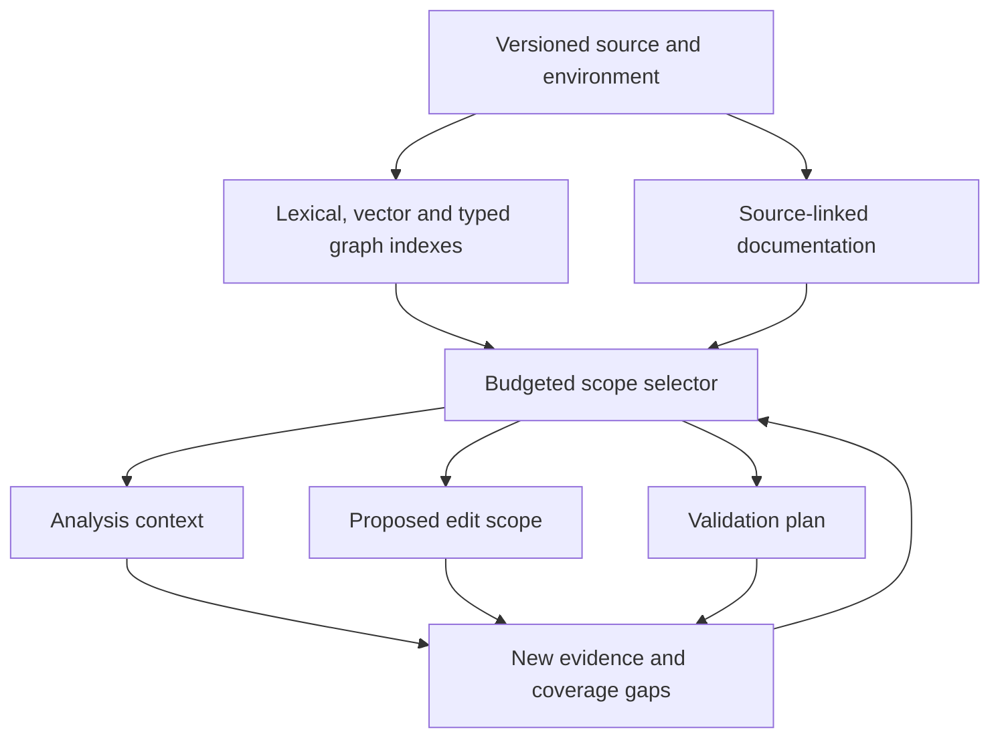

# Research findings and implementation blueprint

**The strongest starting point is a local hybrid retriever with a typed, versioned code graph, source-linked documentation, and an explicit budget controller.** It should return separate scopes for analysis, intervention, potential impact, and validation, together with unresolved coverage gaps.

The literature supports these components individually. It does **not** establish that their combination finds the globally smallest sufficient scope for arbitrary Python programs. A defensible objective is narrower: minimize the cost of satisfying known evidence obligations, measure the remaining failure risk, and expand or abstain when important gaps remain.

This review is current to **23 October 2026**. Results below are author-reported measurements; I did not rerun the papers’ experiments. “NR” means the specified measurement was not reported or could not be verified. Paper versions, experimental populations, and maintenance evidence matter: several apparently comparable results measure different tasks.

## 1. Keep four kinds of evidence separate

| Evidence | Appropriate interpretation | What it cannot establish |
|---|---|---|
| **Retrieval relevance** | A lexical match, embedding match, documentation link, or learned rank suggests useful context. | That one component calls, affects, or depends on another. |
| **Potential dependence or impact** | A static analyzer found a possible call, reference, data flow, control dependence, import, or shared-state relationship under its analysis model. | That the relationship occurs at runtime, or that the graph contains every relevant relationship. |
| **Observed dependence** | A named execution, test, environment, or configuration exercised a call, read, import, or code region. | Coverage of other executions, causal influence, or independence of unobserved code. |
| **Required validation** | A contract, affected consumer, test, configuration, or integration boundary creates an obligation to check behavior. | That passing the chosen checks proves general correctness. |

A **proven fact** needs its proposition and assumptions attached. For example, an IFDS solver can compute the exact result for a supplied finite, distributive abstraction over valid call/return paths. That is different from proving complete behavior for concrete Python executions. [research.cs.wisc.edu](https://research.cs.wisc.edu/wpis/papers/popl95.pdf?utm_source=chatgpt.com)

The service should consequently return:

- **Analysis scope:** source and documentation to inspect.
- **Intervention scope:** locations proposed for modification.
- **Potential-impact scope:** consumers or behaviors that might be affected.
- **Validation scope:** tests, checks, and scenarios required by the proposed change.
- **Coverage gaps:** unresolved dispatch, unavailable dependencies, stale artifacts, truncated searches, and unsupported constructs.

Reading a caller should not automatically add it to the edit scope. Conversely, keeping an edit small should not exclude callers from analysis or validation.

For Python, unknown boundaries are essential. Reflection, monkeypatching, descriptors, metaclasses, decorators, callbacks in containers, plugin discovery, import-time execution, native extensions, shared mutable state, and external services can all defeat a superficially complete graph. PyCG’s measured recall and documented modeling limits provide a concrete warning against treating missing edges as independence. [arxiv.org](https://arxiv.org/html/2103.00587v1?utm_source=chatgpt.com)

---

## 2. What the empirical evidence supports

### Retrieval, localization, and repair

These are **within-study comparisons**, not a cross-paper leaderboard.

| Study and population | Measured result | Cost and interpretation |
|---|---|---|
| **Agentless**, October 2024 revision; 300 SWE-bench Lite issues | File localization: prompting **78.67%**, filtered embeddings **70.33%**, combination **81.67%**. Complete pipeline: **96/300 resolved**. | Reports **78,166 input-plus-output tokens** and **$0.70/issue**. This includes repair and test generation; it is not retrieval-only cost or a complete invoice audit. Supports complementary candidate sources. [arxiv.org](https://arxiv.org/html/2407.01489v2?utm_source=chatgpt.com) |
| **LocAgent**, ACL 2025; 274 Lite issues with existing-function edits | With the same tuned 7B model, function Acc@10: **71.53%** full system, **66.79%** fixed one-hop, **66.42%** containment-only, **60.22%** without BM25. | Acc@k requires **all gold locations**, not one hit. Complete billed tokens, indexing expense, peak memory, and update cost: **NR**. [aclanthology.org](https://aclanthology.org/2025.acl-long.426.pdf?utm_source=chatgpt.com) |
| **RepoGraph**, ICLR 2025; 300 Lite issues | Adding the graph to its Agentless baseline: **82→89 resolved**. One-hop versus two-hop flattened graph context: **29.67%→26.0% resolved**. | Mean inference tokens **42,376→47,323**. One-hop/two-hop graph context **2,311→10,505 tokens**. More graph context increased cost and could reduce success. Summary-generation accounting is incomplete. [arxiv.org](https://arxiv.org/html/2410.14684v2?utm_source=chatgpt.com) |
| **RepoHyper**, FORGE 2025; 12,000 hard Python completion-retrieval queries | Acc@5: **53.54% UniXcoder→61.19% RepoHyper with UniXcoder**. | Completion retrieval, not bug-fix success or semantic dependency recall. Complete token consumption, latency, and incremental expense: **NR**. [arxiv.org](https://arxiv.org/html/2403.06095v4?utm_source=chatgpt.com) |
| **Agent Retrieval Bench**, July 2026 preprint | Across 345 positive cases, file Recall@10: **0.3034 BM25**, **0.3548 lexical**, **0.5428 Qwen3-8B**. On a separate 287-case subset, hybrid RRF achieves **BCY@8k 0.4884**, versus **0.3828 RepoMap** and **0.2282 lexical**. | BCY uses a **regex tokenizer** and measures gold-file exposure. It is neither billed LLM tokens nor dependency coverage. Populations and metrics must not be mixed. [arxiv.org](https://arxiv.org/html/2607.24882v1?utm_source=chatgpt.com) |
| **CQ2-CARE**, *Skip the Compressor*, 15 October 2026 preprint; 300 recent Python issues, one per repository | Single-patch-call results: **131/300 resolved**, versus **87 BM25 chunks**, **68 dense chunks**, **103 BM25 files**, and **129 SweRank**. Gold-file recall **79.0%**; average context **13.8k tokens**. | Baselines match each issue’s **selector-realized** budget, not a universal fixed cap. The difference from SweRank is not significant. Same-candidate LongCodeZip matches the selector, with additional GPU work. Public author code was not identified. [arxiv.org](https://arxiv.org/html/2610.21073?utm_source=chatgpt.com) |

**Full-context comparison remains an evidence gap in this package.** These studies do not jointly establish performance against a genuinely complete repository context under matched model, task, cumulative cost, and validation conditions. A truncated repository prompt must be labeled as truncated, rather than reported as “full context.”

### Runtime, memory, and incremental evidence

**CodeNib** is the closest integrated systems reference. Its September 2026 revision reports the following, across distinct experiments:

| Measurement | Reported result |
|---|---|
| Repair, 200 Verified tasks, Haiku 4.5 | Confirmed solves: on-demand **66**, BM25 eager **63**, compact CodeNib **79**; one unknown outcome each. Compact versus on-demand repository-bootstrap interval: **−3.92 to +17.42 percentage points**. |
| Provider tokens per planned repair task | On-demand input/output **≥714.61k / ≥11.09k**; compact **≥684.23k / ≥9.92k**. Usage complete for **158/200** and **161/200** respectively. These are lower bounds, not complete means or invoices; a savings ratio is unsupported. |
| Separate lifecycle experiment | Median build **116.7 s**, load **7.40 s**, 42-request warm trace **0.727 s**; artifacts **160.3 MiB on disk**. |
| Separate repair candidate workers | Median peak RSS **4.21 GiB**, excluding external GPU allocation. |
| Held-out incremental agreement | Graph updates match rebuilds **13/24**; vectors **27/30**. Passing-case median speedups: graph **4.30×** isolated/**11.62×** shared startup; vectors **40.43×**. Rebuild-audit expense is excluded. |

These GPU-backed results do not establish CPU deployment cost. Rebuild agreement is not semantic soundness. [arxiv.org](https://arxiv.org/html/2607.25431v2?utm_source=chatgpt.com)

Other useful measurements:

- **PyCG, ICSE 2021:** five small applications averaged **99.2% call-edge precision**, **69.9% recall**, **0.77 seconds**, and **61.2 MB** measured with `pmap`. These are historical small-program results, not modern repository-wide or peak-RSS guarantees. Incremental cost is NR. [arxiv.org](https://arxiv.org/html/2103.00587v1?utm_source=chatgpt.com)
- **Repoformer, ICML 2024:** its 1B threshold policy retrieves on **61%** of API-completion requests, reports edit similarity **72.72 versus 72.02**, and **28% serving speedup**. The latency model assumes prior indexing and concurrently starts retrieval-free and retrieval-augmented branches. It does not establish corresponding billed-token or total-compute savings. [arxiv.org](https://arxiv.org/html/2403.10059v2?utm_source=chatgpt.com)

**Across the retrieval studies, semantic dependency recall is generally unmeasured.** Gold edited-file recall, a correct completion, patch application, and passing repair tests are separate endpoints.

---

## 3. Reproducible algorithm families

The pseudocode below normalizes the approaches for implementation. Complexity statements are analytical descriptions, not additional benchmark results.

Let:

- \(S\): source size;
- \(N\): indexed source units;
- \(d\): embedding dimension;
- \(P_q\): postings visited for a lexical query;
- \(V_r,E_r\): graph vertices and edges actually visited;
- \(n\): candidates entering selection;
- \(m\): evidence obligations.

### 3.1 Hybrid lexical/vector retrieval

**Inputs:** issue text, stack traces, identifiers, paths, source units, documentation units, lexical index, embedding index.

**Output:** ranked candidates with source locations and separate score components.

BM25 is a reproducible lexical foundation. Reciprocal Rank Fusion, introduced by Cormack, Clarke, and Büttcher in 2009, combines rank lists without requiring their raw scores to share a scale:

\[
\operatorname{RRF}(x)=\sum_r \frac{w_r}{k_0+\operatorname{rank}_r(x)}.
\]

The familiar \(k_0=60\) is a historical setting, not a universal optimum. [staff.city.ac.uk](https://www.staff.city.ac.uk/~sbrp622/papers/foundations_bm25_review.pdf?utm_source=chatgpt.com)

```text
anchors = extract_paths_symbols_error_strings(query)
exact   = lookup_exact(anchors)
lexical = BM25(query_terms, source_and_documentation_fields)
dense   = nearest_neighbors(embed(query))
ranked  = fuse_ranks(exact, lexical, dense)
return deduplicated_source_units(ranked), score_breakdown
```

**Complexity:** lexical work depends on postings and top-result selection, approximately \(O(P_q\log k)\) for a straightforward heap implementation. Exact dense search is \(O(Nd)\), with \(O(Nd)\) vector storage. ANN improves empirical latency but adds approximation error; it does not improve semantic dependency guarantees.

**Assumptions and failures:** identifiers and error strings favor lexical search; paraphrases favor embeddings. Dense retrieval can confuse similarly named or conceptually related implementations. Chunking can separate a function from decorators, class state, contracts, or imports. Long-input truncation can silently remove the relevant portion.

For Python, neither lexical nor vector retrieval resolves runtime dispatch. Keep them as candidate generators.

### 3.2 Hierarchical localization, iterative retrieval, and learned expansion

| Approach | Inputs → outputs and reproducible procedure | Complexity, assumptions, and failure modes |
|---|---|---|
| **Agentless** | Issue and tree → files → class/function skeletons → exact edit regions. Combine prompted file selection with embedding candidates before narrowing. | Parsing approximately \(O(S)\), dense retrieval \(O(Nd)\), plus all LLM calls. Early file omissions limit downstream recall. Evaluated embeddings were API-based, so the published configuration is not fully local. [arxiv.org](https://arxiv.org/html/2407.01489v2?utm_source=chatgpt.com) |
| **RepoCoder**, EMNLP 2023 | Incomplete code → lexical/Jaccard retrieval → generation → use generated prefix in another retrieval query. | \(R(C_{\text{retrieve}}+C_{\text{generate}})\). Generated identifiers can reinforce an incorrect hypothesis; additional rounds need not improve results. Its evidence concerns completion. [Paper](https://aclanthology.org/2023.emnlp-main.151.pdf), [official implementation](https://github.com/microsoft/CodeT/tree/main/RepoCoder). [aclanthology.org](https://aclanthology.org/2023.emnlp-main.151.pdf?utm_source=chatgpt.com) |
| **LocAgent** | Issue → exact entity/name/BM25 search → direction-, type-, and hop-controlled traversal → exact source → suspicious entities. | Per traversal \(O(V_r+E_r)\), plus repeated agent calls. Its inspected Python builder uses fuzzy terminal-name matching for calls; these are candidate targets, not resolved receiver dispatch. [Pinned implementation](https://github.com/gersteinlab/LocAgent/blob/4935b557326c154bad8e8dcf3747cc8d32d1f387/dependency_graph/build_graph.py). [aclanthology.org](https://aclanthology.org/2025.acl-long.426.pdf?utm_source=chatgpt.com) |
| **RepoHyper** | Completion query → dense anchors → typed path expansion → GraphSAGE link prediction → ranked context. | Exact seeds \(O(Nd)\); expansion \(O(V_r+E_r)\); a conventional \(L\)-layer GNN roughly \(O(L(E_rd+V_rd^2))\). Requires trained patterns/ranker. Its candidate-count cap is not a token or edge-work cap. [arxiv.org](https://arxiv.org/html/2403.06095v4?utm_source=chatgpt.com) |
| **CQ2-CARE** | Issue and path inventory → independent file selections and agreement/fallback → bounded typed searches → verbatim files/evidence → one patch call. | Several LLM calls plus searches; uncached source scans cost \(O(S)\) each. Whole-file selection preserves exact text but can overfill small budgets. Its published selector is not an arbitrary-budget optimizer. [arxiv.org](https://arxiv.org/html/2610.21073?utm_source=chatgpt.com) |

**Fixed \(k\)-hop expansion** is a useful baseline, but a poor budget specification:

```text
frontier = seeds
repeat k times:
    frontier = unvisited_allowed_neighbors(frontier)
    selected += frontier
```

With average branching \(b\), growth can approach \(O(|seeds|b^k)\), bounded by the graph’s actual size. Traversal needs independent caps on visited edges, candidates, wall time, and serialized tokens. RepoGraph’s extra-hop experiment shows why hop count alone is insufficient. Its reference builder also executes extracted imports, so it should not be described as purely non-executing syntax analysis. [Pinned builder](https://github.com/ozyyshr/RepoGraph/blob/6c3977d87845993bf2c0359b4ac752278d7f3c45/repograph/construct_graph.py). [arxiv.org](https://arxiv.org/html/2410.14684v2?utm_source=chatgpt.com)

### 3.3 Call graphs, slicing, and dependence analysis

A call graph represents possible calls. A dependence graph additionally represents the data and control relationships needed for slicing.

**PyCG** propagates abstract assignments to a fixed point, then resolves candidate call targets:

```text
assignment_graph = extract_assignments_imports_definitions(source)
repeat:
    propagate_abstract_values(assignment_graph)
until stable
calls = resolve_call_targets(assignment_graph)
```

Its cost depends on fixed-point iterations and transfer work; naïvely resolving each call through graph search adds \(O(C(V_A+E_A))\). Dynamic features and unavailable implementations limit completeness. **JARVIS**, initially published in 2023, adds per-function flow-sensitive type graphs and application-centered analysis. Its retrieved versions disagree on benchmark details, and its artifact license was not verified; pin the exact version before reproducing numerical claims. [JARVIS paper](https://arxiv.org/abs/2305.05949), [author artifact](https://pythonjarvis.github.io). [arxiv.org](https://arxiv.org/html/2103.00587v1?utm_source=chatgpt.com)

The foundational slicing approaches are:

| Foundation | Inputs → outputs | Algorithm and limits |
|---|---|---|
| **Weiser, 1984; Ferrante–Ottenstein–Warren, 1987** | CFG, definitions/uses, alias/effect model, slicing criterion → possible influences or affected statements | Build data/control dependencies; traverse backward for explanations or forward for potential impact. Query \(O(V_r+E_r)\), additional memory \(O(V_r)\), **after graph construction**. Alias analysis, exceptions, and external effects are separate costs. [faculty.cc.gatech.edu](https://faculty.cc.gatech.edu/~harrold/6340/cs6340_fall2009/Readings/Weiser.Slicing.TSE.pdf?utm_source=chatgpt.com) |
| **Horwitz–Reps–Binkley, 1990** | System dependence graph with parameter and summary edges → interprocedural slice | Two restricted backward traversals avoid unmatched call/return paths. Query \(O(V+E)\) on the completed SDG; summaries and alias handling are not free. [research.cs.wisc.edu](https://research.cs.wisc.edu/wpis/papers/toplas90.pdf?utm_source=chatgpt.com) |
| **Reps–Horwitz–Sagiv IFDS, 1995** | Interprocedural CFG, finite fact domain \(D\), distributive transfers → valid-path data-flow facts | Tabulate facts and procedure summaries while matching calls and returns. General time \(O(ED^3)\); locally separable gen/kill cases \(O(ED)\); standard storage \(O(ED^2)\). Exactness is relative to the abstraction. [research.cs.wisc.edu](https://research.cs.wisc.edu/wpis/papers/popl95.pdf?utm_source=chatgpt.com) |

A reproducible reachability primitive is:

```python
def reach(seeds, adjacency, allowed):
    seen, work = set(seeds), list(seeds)
    while work:
        node = work.pop()
        for edge in adjacency[node]:
            if allowed(edge) and edge.other not in seen:
                seen.add(edge.other)
                work.append(edge.other)
    return seen

# Dependence edges point from potential influencer to consumer.
backward_slice = reach(criterion, incoming, data_or_control)
forward_impact = reach(changed_statements, outgoing, data_or_control)
```

For Python, a useful slice requires a frontend that models heap objects, aliases, dispatch, exceptions, and relevant external effects. Adding a precise graph traversal to an incomplete frontend does not repair its missing semantics.

### 3.4 Directional change impact and test selection

Fix edge conventions explicitly. If `A → B` means “A may call B”:

| Question | Expansion direction |
|---|---|
| Why does A behave this way? | Outgoing callees, plus backward data/control dependencies of the relevant expression. |
| Who might be affected by changing B? | Incoming callers/consumers; then relevant contracts, overrides, registrations, and shared-state readers. |
| Which tests should run? | Reverse test-to-executed-code mappings, supplemented by static contracts, integration boundaries, and new tests. |
| What encloses this snippet? | Containment edges for context reconstruction; containment is not behavioral dependence. |

Three original approaches are particularly relevant:

- **Chianti, OOPSLA 2004:** decompose old/new Java versions into atomic changes, calculate prerequisite relationships, and combine them with per-test call graphs. Output affected tests and changes potentially responsible for each test’s behavior. Its reported reduction statistics are not dependency recall. Python needs different rules for lookup, mutation, and dynamic registration. [Original paper](https://www.franktip.org/pubs/oopsla2004.pdf). [franktip.org](https://www.franktip.org/pubs/oopsla2004.pdf?utm_source=chatgpt.com)
- **STARTS, ASE 2017:** hash classes, find changed types, traverse reverse static type dependencies, and include new/untracked tests. Historical Java results selected **35.2%** of tests and used **81.0%** of retest-all time. Graph traversal is \(O(V+E)\), excluding hashing and extraction. [Paper](https://mir.cs.illinois.edu/~marinov/publications/LegunsenETAL17STARTS.pdf), [official implementation](https://github.com/TestingResearchIllinois/starts). [mir.cs.illinois.edu](https://mir.cs.illinois.edu/~marinov/publications/LegunsenETAL17STARTS.pdf?utm_source=chatgpt.com)
- **Ekstazi, ICSE 2015:** record per-test file dependencies and checksums, including absent-file accesses; rerun new or affected tests and refresh observations. Across 615 Java revisions, total selection/execution/collection time averaged **68%** of retest-all. Cost is hashing and dependency checks plus instrumented execution; short suites can lose time. [Paper](https://mir.cs.illinois.edu/~marinov/publications/GligoricETAL15EkstaziDemo.pdf), [official implementation](https://github.com/gliga/ekstazi). [mir.cs.illinois.edu](https://mir.cs.illinois.edu/~marinov/publications/GligoricETAL15EkstaziDemo.pdf?utm_source=chatgpt.com)

For Python, **coverage.py contexts** and **testmon** are practical sources of observed evidence. Testmon explicitly excludes some dependencies, including static assets and external services. Use these records for prioritization immediately; test deselection requires a declared environment model and fallback policy. [Coverage.py 7.17.0 documentation](https://coverage.readthedocs.io/en/latest/contexts.html?utm_source=chatgpt.com)

### 3.5 Persistent documentation and incremental invalidation

**RepoAgent**, EMNLP 2024 Demo, combines Python AST structure, Jedi references, bottom-up documentation, and Git-triggered updates. It is a relevant implementation reference, but two published shortcuts should not be inherited: ignoring dependency cycles, and declining to refresh a caller’s documentation when referenced implementations change on the grounds of dependency inversion. Neither establishes cache correctness. [arxiv.org](https://arxiv.org/html/2402.16667v1?utm_source=chatgpt.com)

A stronger foundation is *Build Systems à la Carte* and dependency-tracked incremental queries such as Salsa: record the actual inputs read, verify their revisions, recompute when needed, and stop propagation only when the **declared output** is unchanged. [microsoft.com](https://www.microsoft.com/en-us/research/wp-content/uploads/2018/03/build-systems.pdf?utm_source=chatgpt.com)

```text
QUERY(key, revision):
    if memo already verified at revision:
        return memo.value

    if every recorded dependency is unchanged:
        mark memo verified
        return memo.value

    value, dependencies = evaluate_while_recording_reads(key)
    replace recorded dependencies
    if value differs from old value:
        advance output-change revision
    store value and verification revision
    return value
```

**Inputs:** source changes, environment/configuration changes, memoized outputs, dependency records.

**Outputs:** refreshed indexes, graph facts, documentation, and invalidation evidence.

**Complexity:** proportional to inspected/recomputed dependencies in favorable cases; worst case is a full rebuild. A local edit can alter distant name resolution.

Track negative dependencies too: “this export does not exist,” “this plugin directory was empty,” and “this file was absent.” Include parser, resolver, stubs, lockfiles, model, tokenizer, prompts, and configuration in keys or tracked inputs.

An unchanged type signature can justify reusing certain type-analysis outputs. It cannot justify skipping behavioral validation after the body changes. Cyclic documentation should use current source for the component, or an explicitly bounded regeneration strategy; mutually referring summaries must not become each other’s evidence.

### 3.6 Budget optimization: what the guarantees actually mean

For fixed nonnegative evidence scores \(a_{ij}\), a practical objective is:

\[
F(S)=\sum_{j=1}^{m} w_j\max_{i\in S}a_{ij}.
\]

This is a monotone submodular coverage/representation objective: additional evidence has diminishing marginal value. **Its value is a retrieval surrogate, not a probability that a patch is correct.**

| Algorithm | Input/output and pseudocode | Complexity and guarantee |
|---|---|---|
| **Weighted set cover — Chvátal, 1979** | Known obligation universe and candidate coverage sets → minimum-cost covering subset. Repeatedly select `newly_covered / cost`. | Naïve \(O(n^2m)\). \(H(d_{\max})\) approximation for positive costs. It minimizes cover cost; it is not budgeted maximum coverage. [people.stfx.ca](https://people.stfx.ca/tjsmith/lec/W23CSCI435/Chv79.pdf?utm_source=chatgpt.com) |
| **Additive 0/1 knapsack** | Independent item values and integer costs → highest-value subset within \(B\). Update `DP[b] = max(DP[b], DP[b-c]+v)` in descending budget order. | \(O(nB)\) time, \(O(B)\) memory. Pseudopolynomial; additive utility misses redundancy and complementarity. |
| **Cardinality submodular greedy — Nemhauser et al., 1978** | Submodular \(F\), at most \(k\) items → repeatedly add greatest marginal gain. | \(O(nk)\) value evaluations; at least \(1-1/e\). Equal item count is not an unequal-token budget. [Springer Nature Link](https://link.springer.com/article/10.1007/BF01588971?utm_source=chatgpt.com) |
| **Single-knapsack submodular selection — Sviridenko, 2004** | Monotone submodular \(F\), additive costs → enumerate feasible small seeds and greedily complete them. | \(1-1/e\), but original algorithm requires \(O(n^5)\) value-oracle calls. Plain density greedy does not inherit this theorem. [thibaut.horel.org](https://thibaut.horel.org/submodularity/papers/sviridenko2004.pdf?utm_source=chatgpt.com) |
| **Modified density greedy plus best singleton** | Repeatedly consider greatest marginal-gain/cost, skip infeasible items, compare with best feasible singleton. | Quadratic worst-case oracle evaluations. Published generic bounds are weaker than \(1-1/e\); Feldman et al. establish at least **0.427** for the analyzed variant. [arxiv.org](https://arxiv.org/pdf/2007.04937?utm_source=chatgpt.com) |
| **MMR — Carbonell–Goldstein, 1998** | Relevance and similarity → sequentially trade relevance against similarity to already selected material. | \(O(kn)\) similarity evaluations with cached maxima. Useful diversity heuristic, without a generic token-knapsack guarantee. Similar implementations may both be necessary. [doi.org](https://doi.org/10.1145%2F290941.291025?utm_source=chatgpt.com) |

Real context packing adds **mutually exclusive representations, prerequisites, overlapping spans, and complementary evidence**. For example, an interface and implementation may only be useful together. Those constraints invalidate a casual application of the plain-knapsack approximation guarantees.

A bounded CP-SAT model can express them directly. Report solver status, objective bound, and time limit. “Optimal” applies to the encoded objective and costs; retokenizing and repairing a pack does not preserve that optimality claim. [developers.google.com](https://developers.google.com/optimization/cp/cp_solver?utm_source=chatgpt.com)

### 3.7 Uncertainty-aware stopping and selective expansion

Three foundations are useful, with different guarantees:

1. **Learned retrieval gates.** Repoformer predicts whether retrieval improves completion. Its input is local code context; output is a retrieve/skip decision. Runtime adds a model decision and selected generation path. Calibration can drift when the generator, retriever, repository distribution, or task changes. Completion evidence does not validate issue-repair stopping. [arxiv.org](https://arxiv.org/html/2403.10059v2?utm_source=chatgpt.com)
2. **Adaptive submodularity — Golovin–Krause.** Adaptive greedy has a \(1-1/e\) result under adaptive monotonicity, adaptive diminishing returns, and the relevant budget assumptions. Discovering a missing dependency can make another observation *more* valuable, violating those assumptions. The theorem therefore does not automatically cover agent exploration. [arxiv.org](https://arxiv.org/pdf/1003.3967?utm_source=chatgpt.com)
3. **Learn then Test.** Fix complete candidate policies, evaluate them on calibration data, construct valid risk tests, and apply multiple-testing control. This accommodates non-monotone risk and multidimensional policies. The guarantee depends on the sampling assumptions and specified loss. [Paper](https://arxiv.org/pdf/2110.01052), [MIT reference implementation](https://github.com/aangelopoulos/ltt). [arxiv.org](https://arxiv.org/pdf/2110.01052?utm_source=chatgpt.com)

A reproducible calibration outline is:

```text
freeze candidate policies, including all expansion and budget exits
run each policy on independent calibration units
compute valid tests of risk > target
apply family-wise error control
deploy only accepted policies; report acceptance coverage separately
```

Calibration costs include complete policy runs. Correlated tasks from one repository are not automatically independent samples.

For selective error, distinguish:

\[
\Pr(\text{error}\mid\text{accepted})
\quad\text{from}\quad
\mathbb E[\mathbf1_{\text{accepted}}\mathbf1_{\text{error}}].
\]

The latter can look small simply because the system accepts almost nothing.

**TRAQ**, NAACL 2024, is instructive for conformal retrieval and answer sets, but assumes relevant material exists in the candidate pool and a correct semantic answer exists among sampled answers. Its answer-set coverage does not certify a selected patch. [aclanthology.org](https://aclanthology.org/2024.naacl-long.210.pdf?utm_source=chatgpt.com)

Empirically, Agent Retrieval Bench found that top-score abstention thresholds did not improve selective success on its natural external-resolution cases. Easy wrong-repository negatives gave a misleadingly favorable impression. [arxiv.org](https://arxiv.org/html/2607.24882v1?utm_source=chatgpt.com)

---

## 4. Official implementations, licenses, and maintenance evidence

“Recent release” and “latest commit” are evidence of activity, not guarantees of reliability or future support. Library licenses, model-weight licenses, and benchmark-data licenses should be pinned separately.

### Practical local components

| Component | Verified license | Dated evidence and deployment role |
|---|---|---|
| [SQLite / FTS5](https://www.sqlite.org/fts5.html) | Public domain | **3.54.1, 16 Oct 2026**. Durable metadata, transactional lexical updates, BM25. [sqlite.org](https://sqlite.org/changes.html?utm_source=chatgpt.com) |
| [Sentence Transformers](https://github.com/huggingface/sentence-transformers) | Apache-2.0 | **6.2.0, 21 Oct 2026**. Local embedding runtime; CPU, ONNX, and OpenVINO paths documented. [GitHub](https://github.com/huggingface/sentence-transformers/releases/tag/v6.2.0?utm_source=chatgpt.com) |
| [Faiss](https://github.com/facebookresearch/faiss) | MIT | **1.15.1, 16 Sep 2026**. CPU exact vector search and optional ANN. [GitHub](https://github.com/facebookresearch/faiss/releases?utm_source=chatgpt.com) |
| [Python tree-sitter binding](https://github.com/tree-sitter/py-tree-sitter) | MIT | **0.26.0, 30 Jun 2026**. Incremental syntax parsing; not a dependence analyzer. [PyPI](https://pypi.org/project/tree-sitter/?utm_source=chatgpt.com) |
| [Jedi](https://github.com/davidhalter/jedi) / [Pyright](https://github.com/microsoft/pyright) | MIT / MIT | Jedi **0.20.1, 12 Oct 2026**; Pyright **1.1.414, 9 Sep 2026**. Candidate definitions, references, types. Jedi documents that difficult reference searches may stop early. [PyPI](https://pypi.org/project/jedi/?utm_source=chatgpt.com) |
| [mypy](https://github.com/python/mypy) | MIT, with third-party notices | **2.4.0, 1 Oct 2026**. Persistent daemon and fine-grained type dependencies. [PyPI](https://pypi.org/project/mypy/?utm_source=chatgpt.com) |
| [coverage.py](https://github.com/coveragepy/coveragepy) / [testmon](https://github.com/tarpas/pytest-testmon) | Apache-2.0 / MIT | Verified releases **7.16.2, 27 Sep 2026**, and **2.2.0, 1 Dec 2025**. Observed execution and test-selection evidence. [GitHub](https://github.com/coveragepy/coveragepy/releases?utm_source=chatgpt.com) |
| [OR-Tools](https://github.com/google/or-tools) | Apache-2.0 | **9.15, 12 Jan 2026**. CPU constraint solver for small candidate pools and offline comparisons. [GitHub](https://github.com/google/or-tools/releases?utm_source=chatgpt.com) |
| [CodeNib](https://github.com/sysevol-ai/CodeNib) | Apache-2.0 | **0.2.4, 26 Sep 2026**; repository activity observed in October. Maintained beta reference for reusable graph/BM25 views. Current product documentation says **file-level delta repair is not enabled**. [GitHub](https://github.com/sysevol-ai/CodeNib?utm_source=chatgpt.com) |
| [FSoft CodeWiki](https://github.com/FSoft-AI4Code/CodeWiki) | MIT | Substantive code activity observed **22 Oct 2026**. Optional repository-documentation reference; its evolving product should be distinguished from the published paper version. [GitHub](https://github.com/FSoft-AI4Code/CodeWiki?utm_source=chatgpt.com) |

Additional useful components:

- [BM25S](https://github.com/xhluca/bm25s), MIT, has a July 2024 [primary paper](https://arxiv.org/abs/2407.03618) and recent releases. Its eager score representation is useful for snapshot experiments. Exact incremental maintenance must account for changing corpus statistics, not only changed document bytes. [arxiv.org](https://arxiv.org/abs/2407.03618?utm_source=chatgpt.com)
- [submodlib](https://github.com/decile-team/submodlib), MIT, provides CPU objective and marginal-gain implementations. Verified `submodlib-py` release: **0.0.3, 14 May 2025**; documentation and distribution version names differ. It does not automatically implement representation exclusions or prerequisite closure. [GitHub](https://github.com/decile-team/submodlib?utm_source=chatgpt.com)

### Research artifacts requiring additional ownership

| Official artifact | Status observed |
|---|---|
| [LocAgent](https://github.com/gersteinlab/LocAgent), Apache-2.0 | Latest observed commit **12 Aug 2026**, README integration update; not evidence of recent core fixes. |
| [RepoGraph](https://github.com/ozyyshr/RepoGraph), Apache-2.0 | Latest observed commit **1 Apr 2025**, documentation/data links. |
| [Agentless](https://github.com/OpenAutoCoder/Agentless), MIT | Latest observed commit **22 Dec 2024**, repair postprocessing fix. |
| [Repoformer](https://github.com/amazon-science/Repoformer), Apache-2.0 | Latest observed commit **17 Jun 2025**, cleaned evaluation data; dataset version affects reproduction. |
| [RepoHyper](https://github.com/FSoft-AI4Code/RepoHyper), Apache-2.0 | Latest observed commit **3 Sep 2024**, README update. |
| [RepoAgent](https://github.com/OpenBMB/RepoAgent), Apache-2.0 | Latest observed release/activity **23 Dec 2024**. |
| [PyCG](https://github.com/vitsalis/PyCG), Apache-2.0 | **Archived 26 Nov 2023**; explicitly no further development planned. |

For **CoSIL**, substantive 2026 activity was visible, but no explicit license was found. For **JARVIS**, artifact licensing and current maintenance were not established. Publicly readable code is insufficient to classify either as a verified open-source deployment dependency.

---

## 5. Evidence-backed minimal architecture

The following is a **proposed architecture**, not a measured combined system.



### A. Use a single snapshot identity

Every result should identify:

```text
repository + commit + working-tree content identity
environment / lockfile identity
extractor and configuration versions
path + source interval + blob hash
representation and derivation lineage
```

Build updates in a staging snapshot and publish consistently. Do not combine fresh lexical results, stale vectors, and an older graph without exposing their different revisions.

### B. Start with inexpensive local retrieval

Use SQLite FTS5, a symbol/path index, and exact CPU vector search before introducing a vector database or learned graph reranker.

A reasonable small embedding baseline is **E5-small-v2**: 384 dimensions, 512-token input limit, MIT weights, and documented query/passage prefixes. Its original research concerns general text retrieval; strong code-localization performance must be established locally. [arxiv.org](https://arxiv.org/abs/2212.03533?utm_source=chatgpt.com)

For scale intuition, 100,000 float32 vectors of dimension 384 occupy **153.6 MB** before index, metadata, model, and process overhead. This is arithmetic, not a measured deployment footprint.

### C. Build a modest typed graph

Begin with containment, imports, definitions, references, inheritance, candidate calls, and unresolved call sites. Add observed test coverage separately.

Store edge provenance:

```text
relation type
source and destination identities
extractor/version
source revision and environment
static candidate / observed / formally justified status
ambiguity and unsupported-feature flags
```

Do not merge embedding-neighbor edges into the dependency graph. If useful, retain them in a separate relevance relation.

Use selective local dependence analysis when a task needs it. A repository-wide Python SDG is not a prerequisite for a useful first system.

### D. Treat documentation as cached derived evidence

Persist useful summaries and architecture notes, but attach:

- exact source inputs and spans;
- author or generator identity;
- model, prompt, and tokenizer versions where applicable;
- generation input/output usage;
- freshness state;
- claims that remain inference rather than directly supported facts.

Generate summaries on demand or for repeatedly used components. Do not assume summarizing the entire repository is free or beneficial.

For vectors, cache by the **exact encoded input** and embedding configuration. A path or qualified name included in the input makes a rename relevant even if the body is unchanged.

For graph and documentation updates, use dependency tracking and rebuild fallbacks. Audit incremental output against fresh rebuilds, while recognizing that matching an incomplete rebuild does not prove semantic completeness.

### E. Bound every tool response

Each retrieval/expansion response should include a revision, source spans, score components, provenance, gaps, and continuation information.

Apply independent caps to:

- candidate count;
- visited edges;
- elapsed time;
- returned tokens;
- agent rounds;
- cumulative LLM usage.

Return `truncated=true` and a cursor when appropriate. A capped search with no hit must not masquerade as an exhaustive negative result.

---

## 6. An implementable scope-selection algorithm

### Objective and hard constraints

Maintain an explicit set of evidence obligations, such as:

- inspect the exact current edit target;
- inspect the governing interface or contract;
- understand the failing behavior and reproduction;
- inspect relevant consumers or registration mechanisms;
- identify validation requirements.

Separate **hard support predicates** from soft relevance scores. Two weak similarities do not jointly establish a contract.

Candidates can have alternatives such as signature, source-linked summary, exact body, or complete file. Their evidence capabilities differ. An upgrade is a replacement: a body may omit contextual facts previously supplied by a summary.

For fixed candidates, maximize the submodular surrogate \(F(S)\) subject to:

1. context budget;
2. required evidence;
3. representation exclusions;
4. representation-specific prerequisites.

For soft scores in CP-SAT, encode the maximum explicitly, such as `z[j] = max(a[i,j] * x[i])`. A sum constraint is not equivalent.

### Practical packing heuristic

A deterministic CPU implementation can use closure-aware marginal gain:

```text
PACK(candidates, obligations, budget):
    S = feasible mandatory evidence and its prerequisites
    if no such S fits:
        return INFEASIBLE

    repeat:
        proposals = all admissible additions and representation upgrades
        for each proposal:
            P = apply proposal and required prerequisite changes to S
            recompute hard obligations, overlap, cost and utility
            discard P if infeasible
        if no feasible positive-gain proposal remains:
            break

        accept the best gain / incremental-cost proposal
        handle zero-or-negative-cost improvements before ratios

    compare S with mandatory evidence plus each feasible single bundle
    optionally perform a bounded number of feasible swaps
    serialize and retokenize the complete outgoing input
    repair overflow without dropping hard obligations
    return pack, utility, feasibility, provenance
```

Reconsider previously infeasible bundles: shared prerequisites may make them affordable later. Ordinary lazy-greedy ratio bounds are unsafe when incremental costs can decrease.

Deduplicate by repository, revision, file, and source interval—not identical text. Two identical method bodies can represent different implementations.

**Guarantee:** this constrained heuristic has no claimed \(1-1/e\) approximation. It is auditable and bounded.

With \(n\) candidates, \(m\) obligations, closure cost \(T_c\), and cost-evaluation expense \(T_t\), a straightforward implementation uses approximately:

\[
O\!\left(n^2(m+T_c+T_t)\right)
\]

per packing round. The score matrix needs \(O(nm)\) space, in addition to shared indexes. CP-SAT is a useful small-pool alternative with a time limit.

### Adaptive scope selection

```text
SELECT_SCOPE(task, snapshot, proposed_plan, budgets):
    require compatible, revision-matching views
    needs = derive_known_obligations(task, proposed_plan)
    candidates = bounded_exact_lexical_vector_search(task)
    observations = {}
    ledger = initialize_all_phase_accounting()

    for round in 0..MAX_ROUNDS:
        representations = admissible_variants(candidates, snapshot)
        pack = PACK(representations, needs, available_context_budget)

        if pack is infeasible:
            return INCOMPLETE_CONTEXT(needs, ledger, "mandatory evidence")

        gaps = inspect_coverage_gaps(
            pack, needs, unresolved_dispatch,
            stale_or_conflicting_evidence, truncated_searches
        )

        if no known critical gaps and stop_policy_accepts(observations, pack):
            return READY_FOR_ATTEMPT(
                analysis=pack,
                intervention=proposed_plan.edit_sites,
                potential_impact=typed_impact_candidates,
                validation=required_checks,
                gaps=remaining_noncritical_gaps,
                calibration_status,
                ledger
            )

        actions = bounded_gap_targeted_actions(gaps)
        remove previously exhausted equivalent actions

        if actions empty or budget cannot reserve another action:
            return INCOMPLETE_CONTEXT(gaps, ledger, "limits reached")

        action = choose_expected_gap_reduction_per_cost(actions)
        result = execute_with_output_and_time_limits(action)
        ledger.charge_all_work_and_attempts(result)
        update candidates, observations, proposed_plan and needs
```

Useful actions include resolving a definition, upgrading to an exact body, inspecting a caller or registry, reading an applicable test, running a reproduction, or reformulating a lexical query.

Expected gap reduction is a heuristic acquisition value. A low predicted value must not erase a critical unresolved obligation.

### Keep intervention minimization separate

A context selector alone cannot determine the smallest correct patch.

For each plausible edit plan:

1. derive its analysis and validation obligations;
2. determine whether they fit the available budgets;
3. generate and validate the candidate patch;
4. prefer successful plans with fewer unnecessary changed contracts, edit sites, and unrelated changes.

Line count is only a secondary measure. A tiny workaround can be worse than a larger change that repairs the governing abstraction.

After a proposed edit or new test result, recompute obligations and scope. `READY_FOR_ATTEMPT` means the policy has enough known evidence to attempt work; it does not mean “safe to merge.”

### Stopping and budget accounting

Maintain separate limits for:

\[
B_{\text{context}},\quad
B_{\text{cumulative input}},\quad
B_{\text{output}},\quad
B_{\text{latency}},\quad
B_{\text{tool work}}.
\]

Reserve room for instructions, task text, history, provenance, tool wrappers, and output. Retokenize before every invocation.

Charge query rewriting, planning, retrieval reasoning, summary creation, repair attempts, retries, validation interpretation, and discarded speculative work. Persistent summaries have a cold cost and an amortized cost; neither is zero.

If there is no matched calibration dataset, label stopping **uncalibrated**. If the desired claim is patch correctness, calibrate the complete editing and validation policy—not only context selection.

### Unsupported claims and unresolved choices

The evidence does not yet justify:

- claiming that a high relevance score implies dependency coverage;
- treating a missing graph edge or absent test coverage as independence;
- claiming universal graph-expansion gains;
- transferring knapsack guarantees to arbitrary prerequisite/variant constraints;
- equating a smaller context with lower total billing;
- claiming minimum sufficient scope from passing benchmark tests.

A relevant research lead is **RepoShapley** (January 2026), but its accessible artifact was insufficient for deployment verification. Its stated sigmoid surrogate uses singleton likelihood effects; my analysis is that this alone cannot discover previously unmeasured pair-specific synergy. Explicit coalition verification is the component that can supply interaction evidence. [arxiv.org](https://arxiv.org/html/2601.03378v1?utm_source=chatgpt.com)

The main design choices to resolve experimentally are the embedding model, source-unit granularity, documentation refresh policy, dynamic-analysis investment, expansion policy, and acceptable selective failure rate.

---

## 7. Evaluation protocol

### 7.1 Use distinct task and ground-truth layers

Evaluate at least four task classes:

| Task | Outcome and evidence |
|---|---|
| Bug fixing | Reproduced failure, fail-to-pass tests, preservation tests, patch review. |
| Feature development | Explicit acceptance criteria, cross-file integration, compatibility, new tests. |
| Documentation | Source-supported claims, coverage of required behavior, stale or contradictory claims. |
| Testing | Detection of seeded or historical faults, mutation score where appropriate, regression preservation. |

Maintain three separate labels:

1. **Localization targets:** files/functions/spans useful to inspect.
2. **Dependency evidence:** manually established semantic relationships or execution-observed edges, with provenance.
3. **Validation obligations:** checks required for the proposed change.

Gold modified files are an imperfect localization proxy. Necessary context may remain unmodified, and multiple correct patches may touch different files.

Use SWE-bench-style repair tasks alongside retrieval-oriented benchmarks. **SWE-Explore** supplies repository exploration labels, but consulted spans from successful trajectories are not automatically necessary spans. **CORE-Bench** separates understanding, edit localization, and supporting context; audit its data lineage before combining it with SWE-derived training. [arxiv.org](https://arxiv.org/html/2606.11864v2?utm_source=chatgpt.com)

### 7.2 Required experimental arms

Hold model version, task input, sampling policy, environment, and cumulative limits constant.

1. `ripgrep`/exact-symbol search.
2. BM25.
3. Embedding-only retrieval.
4. Hybrid lexical/vector retrieval.
5. Hybrid plus fixed 1-, 2-, and 3-hop expansion.
6. Hybrid plus directional, typed, budgeted expansion.
7. Whole-file versus body/signature/summary representations.
8. Full repository context where it fits; explicitly truncated context otherwise.
9. Oracle context as a diagnostic upper reference, never as a production method.

Ablate documentation, graph information, packing, incremental reuse, and stopping independently. Otherwise, a stronger editor or different candidate pool can be mistaken for a retrieval improvement.

Use several context limits—for example **2k, 4k, 8k, and 16k**—and separate cumulative billing limits. Those values are experimental settings, not recommended universal deployment defaults.

### 7.3 Report the complete measurement surface

| Dimension | Required measurement |
|---|---|
| Localization | File/function/span Recall@budget; all-required-target success; precision and irrelevant-context fraction. |
| Dependency coverage | Recall against known semantic dependencies; separately, recall against observed traces. Report unknown coverage outside both. |
| Impact analysis | Affected-consumer recall, false-positive expansion, unresolved dynamic boundaries, test-selection safety. |
| Task success | Official tests plus task-specific acceptance checks; preserve timeout, OOM, invalid-patch, and abstention outcomes. |
| LLM usage | Input, cached input, output, billed reasoning where exposed, retries, failed calls, summaries, all agents, and repeated history. |
| Latency | Cold build, startup, warm query, agent exploration, patch generation, validation, total elapsed time; p50/p95. |
| Memory | Peak process-tree RSS/PSS, model runtime, language server, graph, vector index, and disk artifacts separately. |
| Incremental cost | Changed bytes/symbols, parsing, re-resolution, embedding refresh, documentation refresh, publication, audit, and fallback. |
| Stopping | Acceptance coverage, error among accepted tasks, missed-evidence rate, calibration size, and distribution-shift performance. |

Provider-reported usage should be the accounting source of truth where available. Missing usage is **unknown**, not zero. Publish lower bounds separately from complete measurements.

For reusable indexes, report both:

\[
C_{\text{cold}}
\quad\text{and}\quad
C_{\text{amortized}}(q)
=
\frac{C_{\text{build}}+C_{\text{updates}}}{q}
+
C_{\text{query}}.
\]

State whether rebuild audits, model loading, and summary generation are included.

### 7.4 Stress Python’s coverage gaps deliberately

Include fixtures and real tasks involving:

- inheritance and overridden methods;
- decorators and descriptors;
- callbacks stored in containers;
- monkeypatching and test fixtures;
- dynamic imports and plugin registration;
- shared mutable state;
- configuration and package-version changes;
- native or unavailable implementations;
- deleted, renamed, and newly added symbols;
- negative lookup dependencies.

For each category, measure extraction failures and fallback frequency. Do not score unsupported constructs as independent components merely because the graph lacks edges.

### 7.5 Prevent and document leakage

Freeze the repository at the task’s base revision. Exclude future commits, gold patches, evaluation-only tests, post-fix documentation, and summaries generated from later states from runtime retrieval.

Keep training, policy tuning, calibration, and test repositories separate where possible. Also use temporal splits, while recognizing that chronological separation does not itself establish exchangeability.

Record:

- model and training-cutoff information where available;
- benchmark version;
- repository and issue dates;
- retriever/reranker training provenance;
- cached-summary provenance;
- any gold-derived offline supervision;
- whether the issue or repository may have appeared in model training.

*The SWE-Bench Illusion* reports issue-only filepath identification up to **76%** on Verified versus **53%** on other repositories. This supports a memorization risk, not a conclusion that every successful repair is contaminated. [arxiv.org](https://arxiv.org/abs/2506.12286?utm_source=chatgpt.com)

Fresh issues reduce one leakage channel but do not eliminate memorized repository structure, duplicated tasks, or benchmark-derived retriever training.

### 7.6 Decide success using paired quality–cost comparisons

Use paired task comparisons and repository-aware confidence intervals. Repeat stochastic runs, report denominators, and retain failed attempts.

Predeclare a quality gate—such as acceptable task-success degradation and required evidence recall—before optimizing cost. Select from the resulting **quality, cost, latency, and memory tradeoff**, rather than announcing one universal token-saving percentage.

The initial acceptance test for this architecture should be concrete: **at matched task success and localization coverage, does it reduce complete cumulative LLM usage and elapsed time, while preserving dependency evidence and making unresolved gaps visible?** That result, followed by measured incremental correctness and fallback behavior, would support deployment.