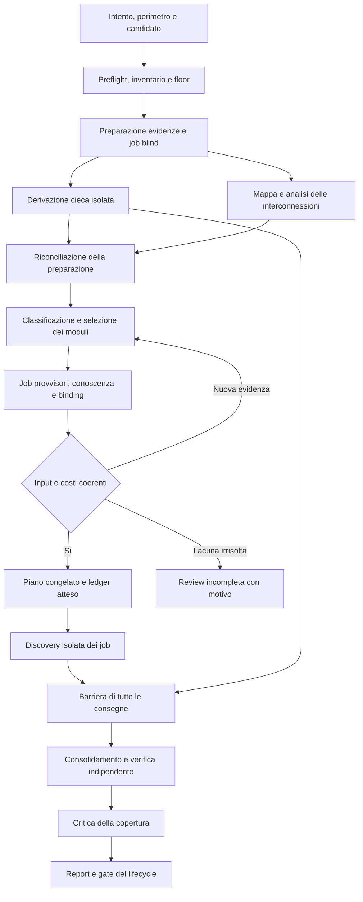

> Stato: proposta storica. Fa fede [Reviewer specializzati e composti](2026-10-22-specialized-reviewers-design.md): prima specialisti canonici, poi reviewer ampi generati dalla loro unione, riusando il registro esistente. Le strutture aggiuntive qui proposte non sono requisiti impliciti.

# Revisione del sistema di review di Daodan

Data: 22 ottobre 2026. Stato: **Proposed**, specifica per revisione. La scrittura di questi documenti non applica la patch allegata, non modifica i reviewer e non costituisce prova di funzionamento del sistema descritto.

## 1. Scopo e lettura della specifica

Il risultato richiesto è un processo che scelga i controlli necessari per il candidato, componga esecuzioni focalizzate, conservi le protezioni esistenti e permetta di sviluppare nuovi reviewer permanenti. La copertura ha precedenza sull'economia. Ridurre contesto, duplicazioni e chiamate è un beneficio da misurare a parità delle protezioni richieste.

Questa specifica stabilisce le decisioni architetturali proposte. I tre documenti collegati ne definiscono le parti specialistiche e sono parte della stessa consegna:

| Documento | Autorità e momento di consultazione |
|---|---|
| Questo documento | Modello del sistema, selezione, composizione, contratti e comportamento del processo. Leggerlo prima di progettare l'implementazione. |
| [Riorganizzazione dei reviewer](2026-10-22-reviewer-reorganization-design.md) | Destinazione dei controlli attuali, mandato di ogni reviewer, nuclei, modalità standalone, indipendenza e migrazione. Consultarlo per ogni riscrittura di ruolo o trasferimento di obblighi. |
| [Authoring e catalogo](2026-10-22-reviewer-authoring-catalog-design.md) | Scrittura e qualifica di moduli e ruoli, inventario dei temi allegati, criteri di promozione. Consultarlo prima di aggiungere o modificare un controllo. |
| [Integrazione e verifica](2026-10-22-review-composition-verification-design.md) | Contratti del run, lifecycle, cinque host, matrice di test, evidenze e criteri di rilascio. Consultarlo per integrare il flusso o dichiarare completata una fase. |

Una stessa regola ha un solo proprietario documentale: questo documento governa la semantica del composer; riorganizzazione governa l'assegnazione dei controlli; authoring governa la promozione del materiale; verifica governa i gate e le prove. Esempi e riepiloghi negli altri documenti devono conformarsi al proprietario. Una contraddizione rilevata durante l'implementazione richiede una correzione coordinata della specifica, non una scelta silenziosa del testo più conveniente.

### 1.1 Requisiti confermati e decisioni proposte

Requisiti confermati dall'utente:

1. Analizzare e riprogettare il flusso di review di Daodan.
2. Ottenere sia maggiore copertura sia migliore efficienza, con priorità alla copertura.
3. Riorganizzare i reviewer e i flussi esistenti.
4. Supportare nuovi ruoli permanenti e composizioni specifiche per ogni review.
5. Scrivere specifiche dettagliate e complete prima dell'implementazione.
6. Scrivere il minimo codice e le minime istruzioni negli agenti, progettando logiche e output che risparmino token senza perdere efficacia e cercando di migliorarla.

Decisioni concrete proposte da questa specifica:

- Conservare le 18 identità di reviewer e i due method binding attuali; modularizzarne il comportamento e i preset necessari.
- Aggiungere `senior-review:accessibility-auditor` come owner permanente per accessibilità e operabilità dei percorsi di interazione assegnati al suo mandato.
- Introdurre esplicitamente `code-concurrency` e `code-general-performance` sotto `senior-review:code-auditor`, e `interaction-critical-paths` sotto accessibility.
- Comporre, nella prima versione, soltanto moduli compatibili dello stesso owner, lente e modalità di input. Ruoli di owner diversi rimangono job distinti.
- Generare e qualificare materiale durante lo sviluppo del catalogo; selezionare materiale già promosso nelle review ordinarie.
- Supportare quattro famiglie di richiesta: `full`, `changeset`, `dir` e `doc/spec/plan`. Le selezioni di uno o più componenti confluiscono in `dir`; il tipo di testo si ricava dall'artefatto richiesto.

Le 50 aree e le specializzazioni degli allegati costituiscono il backlog proposto in dettaglio. La loro presenza in un allegato non è un'autorizzazione pregressa a implementarle e non prova che siano già coperte. Il piano esecutivo successivo dovrà derivare le sue consegne dalla specifica accettata.

### 1.2 Confini

Il sistema riusa i proprietari e l'harness di Daodan. Non richiede nuovi SDK LLM, servizi, scheduler, database o dipendenze del toolchain. Gli helper rimangono Python standard library. Il futuro work graph può consumarne i job; la sua adozione non è un prerequisito di questa specifica.

La review produce analisi, evidenze, lacune e finding. Autorizzazioni a modificare codice, eseguire operazioni esterne, installare strumenti, pubblicare o eliminare artefatti restano quelle del run. L'assegnazione di un modulo non attribuisce permessi aggiuntivi. Il piano di review non è un piano di correzione automatica.

### 1.3 Mantra: minimo codice e contesto, efficacia preservata o migliore

Il criterio guida è **scrivere il minimo codice e le minime istruzioni necessari a conservare o migliorare l'efficacia verificata**, includendo nel disegno output e logiche che risparmino token. Il minimo si valuta rispetto a requisiti, leggibilità, manutenzione e comportamento dimostrato. L'obiettivo di miglioramento rimane esplicito; il risparmio non compensa una regressione di copertura o correttezza.

Regole operative del disegno:

1. Prima di aggiungere un helper, campo, stato, astrazione o istruzione, identificare il requisito che i meccanismi esistenti non soddisfano. Riutilizzare i proprietari e i contratti disponibili; introdurre solo il delta necessario, con un consumer o gate concreto.
2. Conservare una sola fonte del comportamento. Ogni job carica nucleo, moduli e reference effettivamente necessari; i quattro documenti di progetto sono reference per l'implementazione e non un pacchetto da caricare integralmente nei reviewer.
3. Richiedere output compatti nel formato canonico: esito per assegnazione, evidenze, finding, gap e uso della conoscenza. I dettagli restano nell'artefatto proprietario; handoff e riepiloghi usano riferimenti e delta invece di ripetere interi input, report o istruzioni.
4. Un no-findings usa il rendiconto minimo sufficiente a mostrare controlli ed evidenze esaminati. Conserva tutte le assegnazioni e le lacune; non richiede prose ripetute o un numero minimo di osservazioni.
5. Usare selezione mirata, deduplicazione compatibile, riuso con fingerprint, trasformazioni deterministiche e renderer già disponibili quando riducono il costo complessivo. Introdurre nuova logica di ottimizzazione solo se il beneficio supera complessità, manutenzione e costo di esecuzione aggiunti.
6. Misurare l'intero percorso, includendo input, output, tool output, preparazione, letture aggiuntive, retry e verifica. Accettare un'ottimizzazione solo quando conserva le protezioni e supera la qualifica pertinente; cercare miglioramenti misurati di selezione, precisione e richiamo dei difetti. Una riduzione apparente ottenuta spostando costo in un'altra fase non dimostra economia.

Ogni semplificazione deve preservare evidenza, controevidenza, incertezza, indipendenza e gate richiesti. Quando il confronto non dimostra che l'efficacia sia conservata, la variante economica resta non qualificata. I conteggi di righe o token descrivono il costo, ma non autorizzano minificazione, istruzioni criptiche o omissione di protezioni.

## 2. Baseline e provenienza

La baseline osservata nel checkout è `849797acbf8aaae74f23b55ce30710dc599c89bb`. Il workspace contiene modifiche preesistenti a mappa, routing, documentazione ed export. Questi documenti non attribuiscono tali modifiche al presente intervento.

Il commit `e7583329e7ab59596a091fba27e4af705912d731` citato dagli allegati è una baseline esterna della patch. Non era disponibile nella object database locale durante l'analisi. L'helper `review_composer.py` descritto dalla patch non è un componente già integrato nel checkout osservato. Gli stati `existing-*` del backlog significano esistente nella baseline proposta dagli allegati.

Fonti dell'analisi:

- [Analisi di impatto](../reports/2026-10-22-review-composer-impact-analysis.md), comprese le lacune riscontrate staticamente.
- [Catalog compiler attuale](../../../scripts/daodan/reviewer_catalog.py), [roster misurato](../../../plugins/project-protocol/skills/project-protocol/scripts/review_roster.py) e [contratto work attuale](../../../plugins/project-protocol/contracts/work.toml).
- I sei file forniti dall'utente, identificati nella tabella seguente. Sono materiale di proposta; le istruzioni operative, approvazioni e risultati di test che citano appartengono alla loro provenienza, non alla presente sessione.

| File originale in `C:/Users/alfio/Downloads/` | SHA-256 |
|---|---|
| `review-composition.md` | `d38054fd67e331884c2756a4d3013966ebafc9e6bb6d72ba5aeeb24911d45884` |
| `review-composition (1).md` | `d38054fd67e331884c2756a4d3013966ebafc9e6bb6d72ba5aeeb24911d45884` |
| `daodan-review-composer.patch` | `eb8a128ff6eff243a5e09b455aa7b1fc7383b03e27762fedde59661cc4a796d5` |
| `2026-10-22-review-composer.md` | `c88f8ee9f81457682a0e047acd82e691890bf207ffd768ea80f321eb3637b481` |
| `2026-10-22-reviewer-generation-design.md` | `f72939cdf64eab4b0b6ebda90843b2b7a0f9e220fa519ce1c11f7abf5f835cdf` |
| `2026-10-22-reviewer-generation-catalog.json` | `36e7ea80dbd77e0b088bc7e934984e09212a7625439611276b00618c39842621` |

Il backlog contiene 66 record: nove basi richiamate, otto specializzazioni già nella patch, una nuova base e 48 specializzazioni pianificate. Le altre 11 basi della patch devono essere conservate. L'unione iniziale sarebbe quindi 77 moduli; con le tre aggiunte esplicite di riorganizzazione sarebbe 80 prima di eventuali estrazioni ulteriori. Questi conteggi descrivono l'inventario, non misurano la copertura e non impongono un numero finale di moduli.

## 3. Requisiti invarianti

| ID | Invariante | Prova richiesta |
|---|---|---|
| R01 | Ogni obbligo preesistente conservato ha una destinazione canonica e una verifica di migrazione. | Matrice senza obblighi orfani; confronto dei casi positivi e negativi. |
| R02 | Ogni controllo applicabile al perimetro ha un'assegnazione o una lacuna esplicita. | Tabella di decisione completa; nessuna esclusione per costo. |
| R03 | Il floor misurato non può essere ridotto dal modello o dal packing. | Roster originale, provenienza del derivato e verifica della relazione. |
| R04 | Segnali ignoti, evidenze mancanti e classificazione incompleta non equivalgono a non applicabilità. | Fixture negative e stati distinti. |
| R05 | I job sono riproducibili da input congelati e identificano materiale, candidato e destinazione. | Determinismo, digest e invalidazione. |
| R06 | Discovery, derivazione cieca, verifica e critica della completezza conservano indipendenza e input ammessi. | Tracce del dispatch e prove dei contesti, anche con un solo worker. |
| R07 | La consegna di un ruolo non soddisfa implicitamente gli altri job dello stesso ruolo. | Verifica dell'insieme esatto dei job e delle assegnazioni. |
| R08 | La review content può segnalare difetti preesistenti e funziona senza baseline Git inventata. | Caso seguito da discovery fino al report finale. |
| R09 | Un limite insufficiente conserva gli obblighi e impedisce la dichiarazione di completezza. | Piano bloccato con assegnazioni intatte. |
| R10 | I cinque host caricano e invocano componenti reali con le stesse responsabilità. | Distinzione fra compilazione, probe installato ed esecuzione reale. |
| R11 | La review ordinaria usa soltanto materiale promosso e disponibile nel binding attivo. | Rifiuto di draft, riferimenti mancanti e profili non registrati. |
| R12 | Copertura pianificata, letta, consegnata, verificata ed esercitata sono fatti distinti. | Report e ledger espongono le differenze. |
| R13 | Nessun beneficio economico o equivalente richiamo dei difetti è dedotto dalla brevità delle istruzioni. | Benchmark completo e limiti dichiarati. |
| R14 | La riorganizzazione è una consegna obbligatoria del programma. | Tutti i profili discovery composti hanno nuclei, moduli e preset qualificati; l'unica conservazione atomica prevista è il preset light compatibile della sezione 5.2. |
| R15 | Codice, istruzioni e output sono il minimo necessario per un'efficacia verificata almeno pari, con miglioramento perseguito. | Ogni aggiunta ha un requisito e consumer/gate; il confronto completo misura costo e qualità, senza perdita delle protezioni richieste. |

## 4. Modello del dominio e ownership

| Entità | Significato | Proprietario |
|---|---|---|
| Tema | Bisogno espresso nel backlog; può richiedere più controlli e owner. | Progettazione del catalogo. |
| Obbligo | Comportamento che deve essere conservato o introdotto, identificato stabilmente. | Owner del metodo. |
| Controllo | Domanda verificabile con evidenze, condizioni e controevidenze. | Owner del modulo. |
| Modulo | Unità versionata di metodo selezionabile, con metadati dichiarativi e corpo Markdown. | Plugin del reviewer responsabile. |
| Profilo | Identità permanente registrata, nucleo metodologico, moduli ammessi, capacità e preset. | Plugin del ruolo; compiler per il binding host. |
| Scope | Unità del candidato su cui concludere; può essere un componente, una relazione o un contesto globale dichiarato. | Preparazione della review. |
| Assegnazione | Coppia `(scope_id, module_id)` con motivo, evidenze e obblighi. | Composer. |
| Job | Esecuzione isolata di un profilo su un insieme di assegnazioni compatibili. | Composer per il piano; harness per l'esecuzione. |
| Delivery | Risultato e stato di un job, associati a candidato, report ed evidenze. | Worker, verificato dal coordinatore. |
| Gate | Controllo richiesto per procedere o concludere. | Metodo per il contenuto; protocollo per la registrazione e obbligatorietà. |

Il reviewer permanente non coincide con ogni sua invocazione. Per esempio data-integrity resta un'identità registrata, mentre i suoi job possono coprire transazioni e vincoli del componente ordini, oppure una migrazione di schema di un altro componente.

Il proprietario del metodo e l'esecutore sono campi distinti. In questa versione il profilo esecutore deve appartenere allo stesso owner del modulo; il campo esplicito impedisce di confondere questa restrizione con un'autorizzazione generale al mixing. Il riuso di una reference condivisa è possibile attraverso provider dichiarati, senza trasferire implicitamente responsabilità o permessi.

### 4.1 Ripartizione tra plugin

- `senior-review` possiede preparazione, vocabolario di selezione, composer, contratti della review, consolidamento e controllo specialistico della composizione.
- Ogni plugin specialista possiede nuclei e moduli del proprio metodo; senior-review non mantiene copie di quei prompt.
- `project-protocol` possiede record, snapshot, agenda, ledger e gate generici. Non importa senior-review e non apre la mappa per interpretare una composizione.
- `project-lifecycle` richiede la review corretta per record, piano, wave e candidato, propaga i binding e impedisce la chiusura con gate mancanti o stale.
- `skill-catalog` associa conoscenza disponibile ai destinatari reali della review, registrandone selezione e uso.
- Il compiler produce registri e risorse installabili; gli adapter traducono gli strumenti e i meccanismi di host. Gli export rimangono generati.
- L'harness esegue, attende e raccoglie i worker; il composer descrive il lavoro, senza avviare processi agentici.

## 5. Quattro famiglie di review

La richiesta si risolve in una sola modalità. Perimetro, trattamento dei difetti e metodo si ricavano da quella scelta:

| Richiesta | Che cosa viene esaminato | Regola di review |
|---|---|---|
| `full` | Tutto il progetto nel perimetro ammesso, con i componenti e le relazioni rilevanti. | Tutti i controlli applicabili al contenuto presente, compresi i difetti preesistenti. |
| `changeset` | Le modifiche rispetto a una baseline reale e il loro impatto confermato, incluse aggiunte, cancellazioni e rinomine. | Controlli pertinenti al cambiamento e floor richiesto; distinguere difetti introdotti, esposti e preesistenti. |
| `dir` | Una o più directory indicate, oppure file o componenti nominati, con le dipendenze necessarie a valutarli. | Tutti i controlli applicabili al contenuto selezionato, compresi i difetti preesistenti; impatto e letture ulteriori rimangono espliciti. |
| `doc/spec/plan` | I documenti, le specifiche o i piani indicati, confrontati con requisiti e fonti pertinenti. | Metodo nativo del testo: coerenza, correttezza delle affermazioni, completezza e fattibilità secondo il tipo. |

Le selezioni di un solo componente o di più percorsi usano entrambe `dir`: cambia `targets`, non il metodo. `full` ha `targets` vuoto e comprende l'intero inventario ammesso, senza estendersi all'intero filesystem. Una richiesta di review rigorosa delle modifiche rimane `changeset`.

Il campo canonico `mode` ammette soltanto `full`, `changeset`, `dir`, `doc`. L'etichetta pubblica `doc/spec/plan` rappresenta un unico percorso documentale: `artifact_kind` viene risolto a `doc`, `spec` o `plan` dal testo richiesto; per le altre modalità vale `source`. L'utente non deve scegliere separatamente modalità, basis e tipo di artefatto.

`review_basis` è un valore interno derivato: `content` per full/dir, `changeset` per changeset e `document` per doc. Non è un'opzione o un campo di input indipendente. Quando è materializzato in job, risultati o viste, il validatore ne verifica la corrispondenza con mode. La policy deriva dalla stessa regola: snapshot del contenuto per full/dir, baseline reale per changeset, contratto nativo del tipo di testo per doc.

La forma `light` o `branch` resta una decisione del metodo chiamante e della policy misurata; non moltiplica le modalità della richiesta. La composizione dei controlli sorgente si applica a full/dir/changeset di forma branch. Light e doc/spec/plan conservano i propri percorsi e gate, senza fan-out specialistico automatico. Leggere il codice citato da una specifica serve a verificarne le affermazioni; non avvia una review completa del progetto.

I valori precedentemente proposti `subset` e `module` non sono modalità del nuovo contratto. Durante la riconciliazione di una proposta o record storico si convertono esplicitamente in `dir`, preservando targets, scope e impatto. Un nuovo contesto che li usa viene rifiutato; non occorrono alias runtime da mantenere.

### 5.1 Confine delle conclusioni e letture necessarie

`conclusion_paths` delimita dove il job può formulare conclusioni assegnate. `read_scope` specifica quali sorgenti e dipendenze può consultare per stabilirle. I due insiemi possono differire: abstraction deve cercare owner già esistenti fuori dal diff; testing conserva il contesto globale previsto dal proprio metodo; un contratto richiede producer e consumer.

Una relazione trasversale è rappresentata come scope esplicito con endpoint ed evidenze, non come un token generico che autorizza a leggere tutto. La lettura necessaria di un file esterno alle conclusioni non amplia da sola il mandato dei finding.

La mappa conserva il suo perimetro canonico. CI sotto `.github/`, configurazioni ignorate o altri artefatti operativi necessari entrano mediante target aggiuntivi espliciti, con snapshot e provenienza. Un riferimento indisponibile rimane una lacuna. I risultati della mappa sono evidenze statiche e piste da confermare nel sorgente; il campo runtime della mappa rimane assente o nessuno.

### 5.2 Review light e chiamata standalone completa

La review light conserva un solo reviewer nativo: code-auditor per codice e premise-auditor per testi secondo il roster esistente. Il preset light del code owner conserva i controlli generalisti e il triage necessari al proprio mandato precedente. Non riusa automaticamente il preset standalone completo, che può richiedere più owner, e non avvia fan-out specialistico per effetto della riscrittura del ruolo.

Il preset light compatto deve essere qualificato contro le protezioni del percorso precedente, comprese le condizioni avverse dei controlli trasferiti. Fino a tale qualifica si conserva un preset di compatibilità atomico light, con corpo e fingerprint espliciti, input misurato e qualifica propria. Questo preset è un'eccezione ammessa anche al completamento del programma se la compact qualification non conserva le protezioni: mantiene la review leggera effettivamente funzionante senza dichiarare un risparmio non provato.

L'eccezione riguarda solo il percorso light e deve risultare nel report di completamento con motivazione e costi. Non autorizza a mantenere atomici i profili di discovery composti. Core compatto e corpo atomico non vengono mai caricati insieme. Un triage light che richiede approfondimento specialistico produce l'escalation prevista dal lifecycle e un nuovo piano, senza fingere che il singolo reviewer abbia già svolto l'audit specialistico.

## 6. Contratti e versionamento

I contratti seguenti sono requisiti per l'implementazione. La versione 2 distingue il disegno integrato dalla versione 1 proposta nella patch; non significa che una versione 1 del composer sia già distribuita. I descrittori TOML dei contratti mantengono il loro schema di descrizione del compilatore; `record_schema` identifica la versione dei dati runtime.

| Record | Schema proposto | Contenuto e compatibilità |
|---|---|---|
| Contesto | `daodan/review-context/v2` | Evidenze e classificazioni esplicite, provenienza, modalità e disponibilità. |
| Vocabolario | `daodan/review-vocabulary/v1` | Segnali, proprietà, implicazioni ed esclusioni ammesse. |
| Moduli | `daodan/review-modules/v2` | Proiezione runtime dei soli moduli promossi, con reference e digest. |
| Profili | `daodan/review-profiles/v1` | Core, moduli compatibili, preset e binding registrati. |
| Composizione | `daodan/review-composition/v2` | Decisioni, assegnazioni, job, identità, costi e blocchi. |
| Binding, selezione e risultato review | Record versionati v2 dei contratti del loro owner | Job espliciti, base di giudizio e copertura oltre alla dimensione storica. |
| Roster changeset | `daodan/review-roster/v1` con provenienza controllata nel record composto | Originale immutabile e derivato che conserva il floor. |
| Policy content | `daodan/review-content-policy/v1` | Base senza diff, obblighi universali, supporti e verifica espliciti; prodotta dal percorso content del helper canonico. |
| Run composto e risultato del progetto | `daodan/work/v2`, `daodan/project-result/v2` | Obbligatorietà dei nuovi binding e gate; lettura storica v1. |

Un lettore che non supporta lo schema deve rifiutare operazioni di dispatch o completamento. Un reader aggiornato può mostrare record storici v1; non li promuove retroattivamente a review composte. Un run attivo da migrare richiede nuova preparazione e un collegamento al predecessore. I record vecchi non vengono riscritti per simulare consegne nuove.

### 6.1 Contesto della review

Campi obbligatori del contesto:

| Campo | Regola |
|---|---|
| `schema`, `context_id`, `revision` | Schema supportato, identità del record e revisione intera monotona. |
| `project`, `run_id`, `review_id` | Binding al progetto reale, run e review proprietaria. |
| `snapshot` | Identità del candidato del protocollo, inclusi gli input non committati ammessi. Un commit Git da solo non basta se il candidato è dirty. |
| `baseline` | Obbligatoria per changeset; assente o esplicitamente nulla per full/dir. Un eventuale confronto documentale segue il contratto del testo. |
| `mode` | Uno tra `full`, `changeset`, `dir`, `doc`; determina il percorso della richiesta. |
| `shape`, `artifact_kind` | Risolti dal metodo e dal tipo di testo secondo la sezione 5. `review_basis` si deriva e non viene richiesto come input autonomo. |
| `scope_policy`, `targets` | Perimetro ammesso, esclusioni dichiarate e scope scelti. |
| `inventory_complete`, `impact_complete` | Affermazioni motivate da riferimenti di preparazione; mai true per omissione del campo. |
| `evidence` | Identità, percorso o riferimento ammesso, digest del contenuto, kind, locator e costo stimato. |
| `scopes` | Scope con evidenze, classificazione dei segnali e delle proprietà, limiti e motivazioni. |
| `impact_edges` | Relazioni confermate tra scope con proprietà interessate ed evidenze. |
| `availability` | Catalogo host, componenti, provider e capacità verificati nel preflight, con fingerprint. |
| `cost_inputs` | Stime di core, reference e overhead; stato unknown quando non misurabili. |
| `gaps` | Lacune identificate, effetto, owner della risoluzione e dipendenze bloccate. |

Una evidence entry distingue `source`, `configuration`, `contract`, `shared-context`, `runtime-supplied` e altre categorie ammesse dal contratto. I risultati di test o browser forniti o prodotti da un metodo autorizzato non diventano prove statiche della mappa. Per fonti esterne usare un identificatore ammesso e un digest di una copia acquisita; il composer non deve scaricare URL arbitrari.

Uno scope contiene almeno `id`, `kind`, `conclusion_paths`, `read_scope`, `evidence_ids`, `signal_decisions`, `signals_complete`, `changes`, `changes_complete` e `limitations`. Una decisione di segnale ha `signal`, `state`, `evidence_ids`, `reason` e, quando derivata, `derived_from`.

`state` è `present`, `absent` oppure `unknown`. L'assenza deve essere motivata rispetto al perimetro esaminato. Non è necessario produrre una narrazione distinta per ogni tag del catalogo: è ammessa una decisione di esclusione di famiglia che identifichi tutti i tag esclusi e la medesima prova. Un segnale non deciso in una famiglia rilevante resta unknown.

Le classificazioni sono prodotte dalla preparazione usando evidenze meccaniche e lettura semantica. Il composer controlla coerenza e applica le regole; non certifica da solo la verità della classificazione. Il report di preparazione conserva chi o quale helper ha prodotto la decisione.

### 6.2 Vocabolario chiuso

Ogni segnale registrato ha ID, significato positivo, criteri di assenza, esempi di evidenza, famiglia, implicazioni e conflitti. Ogni proprietà di impatto ha ID e significato operativo. Il primo insieme di proprietà comprende `body`, `interface`, `effects`, `schema`, `configuration`, `dependencies`, `structure`, `instructions`.

Una nuova proprietà o un nuovo segnale richiede modifica del registro e fixture. Typo e valori non registrati sono errori di input; non diventano semplicemente `not_applicable`. Le combinazioni incompatibili sono rifiutate. Un tag completo senza prerequisiti deve essere normalizzato mediante implicazioni registrate o respinto se contraddetto da una decisione esplicita.

Esempio: il registro può stabilire `sql -> persistence, code`. Il normalizzatore conserva l'evidenza del segnale SQL e la provenienza della derivazione. Se `persistence=absent` è dichiarato contemporaneamente, la preparazione deve risolvere il conflitto; non si sceglie automaticamente una delle due affermazioni. `amqp-contract` deve rendere disponibili le premesse AMQP e contratto previste dal registro.

L'attivazione può derivare da una responsabilità richiesta anche quando manca il file che dovrebbe implementarla. Un dato persistente non ricostruibile può giustificare la verifica di recovery anche in assenza di una configurazione backup. La classificazione registra il requisito e l'assenza; non inventa una configurazione presente.

Tutti i 49 record pianificati del backlog allegato omettono `dependencies` nel proprio `impact_any`. La promozione richiede una revisione per famiglia: dichiarare quando un cambiamento di dipendenze può influire sul controllo e quando l'esclusione è dimostrata. Aggiungere tutte le proprietà indiscriminatamente non sostituisce questo lavoro.

Lo stesso riesame riguarda tutte le basi e le otto specializzazioni importate dalla patch, incluse SQL e AMQP. Un'origine `existing-*` non esenta dai casi di upgrade di driver, ORM, engine, client o runtime pertinenti.

### 6.3 Modulo runtime

Un modulo promosso dichiara almeno:

| Gruppo | Campi e vincoli |
|---|---|
| Identità | `id`, `version`, `owner`, `obligation_ids`; ID stabile, mai riutilizzato per un'altra domanda. |
| Esecuzione | `profile_id`, `lens`, `input_mode`, `phase`, `base`, `independent`; profilo registrato e compatibile. |
| Applicabilità | `when_any`, eventuale `when_all`, `unless`, `impact_any`, `activation_scope`; selettori su vocabolario registrato. |
| Dipendenze | `requires_modules`, capacità e provider richiesti, reference obbligatorie e condizioni di input. |
| Materiale | `body_ref`, reference selezionabili e rispettivi digest; il comportamento è nei file Markdown. |
| Consegna | Contratto nativo del risultato, esiti per assegnazione ed evidenze minime. |
| Qualifica | Riferimento alla qualifica del metodo e ai suoi limiti; stato promoted nella proiezione runtime. |
| Costo | Stima del corpo e delle reference, metodo della stima e input ai limiti di ampiezza. |

Semantica dei selettori: `when_all` richiede tutti i segnali elencati; `when_any` almeno uno, se non vuoto; `unless` esclude soltanto con un'esclusione dimostrata. Quando entrambi i primi due insiemi sono presenti, entrambi i predicati devono essere soddisfatti. Un modulo base universale deve dichiarare la famiglia cui è universale, per esempio codice, senza dipendere da un segnale specialistico assente.

La lista vuota `impact_any` non è un sinonimo implicito di sempre: i metadati devono distinguere esplicitamente `impact_policy=always` da `impact_policy=intersects`. Il secondo richiede una lista non vuota. Il convertitore dalla patch deve tradurre intenzionalmente il vecchio uso della lista vuota.

Un riferimento a un modulo disabilitato, draft, mancante o di un profilo incompatibile blocca la promozione del catalogo. Le dipendenze tra moduli devono essere acicliche. I prerequisiti cross-owner producono job separati con provenienza, non fanno caricare il metodo estraneo nel job corrente.

Ogni elemento di `requires_modules` è un record con `module_id` e `scope_binding`. Il valore `same_scope` deve essere esplicito, anche quando è il caso ordinario. `relation_endpoint` nomina relazione ed endpoint registrati; `declared_global` nomina uno scope globale già presente nel contesto. Il composer non deduce il destinatario dal nome del modulo. Un binding malformato è errore strutturale; un endpoint previsto ma indisponibile è una lacuna di evidenza. L'aggiunta di scope necessari passa dalla preparazione e dalla chiusura dell'impatto.

### 6.4 Profilo permanente

Un profilo contiene `id`, `owner`, `registered_role` oppure `method_binding`, `core_ref`, `core_digest`, `allowed_module_ids`, `allowed_lenses`, `allowed_input_modes`, `required_capabilities`, `provider_dependencies`, `standalone_preset`, `output_contract` e `default_model=inherit`.

Il profilo Python e quello dependency restano method binding attraverso il worker isolato e la skill canonica. Non si inventa un nuovo agente perché il nome logico del roster contiene un suffisso. Il compiler deve risolvere identità logica, metodo e meccanismo host senza perdere nessuno dei tre.

Il preset standalone preserva il metodo completo promesso dall'identità storica. Quando un obbligo è stato trasferito a un altro owner, il coordinatore del preset deve assegnare un job al nuovo owner attraverso un percorso dichiarato. Il vecchio core non deve conservare una copia integrale del metodo specialistico né fingere di delegare senza un dispatcher disponibile. Le review light seguono invece il preset distinto della sezione 5.2.

### 6.5 Piano, decisioni e job

La composizione contiene:

- Identità, schema, revisione, snapshot, baseline e base di giudizio.
- Digest del contesto, vocabolario, moduli, profili, catalogo host, policy, roster e binding eventualmente applicati.
- `decisions`, una decisione per coppia scope/modulo dell'universo valutato.
- `assignments`, insieme esatto delle coppie da eseguire, con motivo e riferimenti agli obblighi.
- `jobs`, partizione compatibile delle assegnazioni, compresi quelli bloccati.
- Floor originale e record derivato con provenienza.
- Knowledge binding, costi, limiti, gap, blocchi e stato di preparazione.
- Dipendenze delle fasi, riusi ammessi e riferimento alla composizione precedente, se presente.

La decisione è una fra `selected`, `required_floor`, `required_prerequisite`, `not_applicable`, `unaffected`, `out_of_scope`, `unresolved`. I motivi sono dati verificabili, non soltanto frasi: selector coinvolto, segnali, proprietà, evidenze e origine del floor. Un job bloccato resta selezionato; `blocked` è lo stato di esecuzione, non una ragione per sottrarre l'assegnazione.

Ogni job ha `id`, `profile_id`, `canonical_owner`, `phase`, `lens`, `input_mode`, `assignments`, `conclusion_paths`, `read_scope`, `evidence_ids`, `instruction_closure`, `knowledge_binding`, `model_binding`, `host_binding`, `estimated_cost`, `report_path`, `job_fingerprint` e prerequisiti.

`instruction_closure` è l'insieme chiuso e deduplicato di core, moduli, reference obbligatorie, contratti di risultato e istruzioni host necessari al job. Non comprende tutto il catalogo o le istruzioni di altri job. I riferimenti devono risolversi nella distribuzione installata, non soltanto nel repository sorgente.

### 6.6 Fingerprint e stabilità

I digest devono essere SHA-256 di contenuti canonici: JSON UTF-8 con chiavi ordinate, campi assenti distinti da null quando semanticamente diversi, liste ordinate solo se rappresentano insiemi. File Markdown e altre risorse hanno digest dei byte effettivamente distribuiti. Timestamp, stato di avanzamento e posizione assoluta del checkout non entrano nel digest semantico; il binding al progetto e i percorsi relativi confinati sì.

`job_fingerprint` include snapshot, baseline pertinente, scope, assegnazioni e versioni, core e reference, policy, knowledge, modello risolto e binding host. Include i limiti di lettura e le condizioni di indipendenza. Esclude il digest aggregato della composizione per evitare una dipendenza circolare e consentire riusi espliciti di job invariati.

`composition_fingerprint` include tutti i job e le decisioni congelate, la provenienza e i limiti applicati. Qualunque modifica semantica produce una nuova revisione. Un ID leggibile può derivare da un digest abbreviato, ma ogni confronto di integrità usa il digest completo e il generatore controlla collisioni dei nomi.

Nella prima implementazione il cambiamento dello snapshot invalida conservativamente tutti i job. Non è previsto riuso chirurgico fra candidati differenti. A snapshot uguale un job può essere riusato solo con fingerprint identico, report originale verificato e `reuse_record` esplicito nel nuovo piano. Il report conserva la composizione di origine; non viene riscritto come se fosse stato prodotto nel nuovo run.

## 7. Algoritmo di selezione

### 7.1 Validazione iniziale

Il composer rifiuta input con schema non supportato, ID duplicati, riferimenti inesistenti, path non confinati, digest incoerenti, costi negativi, valori fuori vocabolario o modalità incompatibili. Distingue errore strutturale da lacuna semantica dichiarata. Entrambi impediscono una review completa, ma soltanto il secondo può conservare un piano valido parziale.

La disponibilità dell'owner è una condizione di dispatch. L'assenza del provider non rende il controllo non applicabile. Un profilo diverso o un worker generico non può sostituire tacitamente un owner mancante.

### 7.2 Universo degli scope e impatto

1. Validare le radici selezionate e l'inventario ammesso.
2. Per content selezionare le radici e la chiusura dell'impatto confermato; per full usare tutti gli scope ammessi.
3. Per changeset partire dagli scope del cambiamento e dalle proprietà realmente interessate.
4. Propagare solo proprietà indicate da un `impact_edge` motivato. Un import statico è una pista, non prova sufficiente di impatto.
5. Attraversare relazioni cicliche fino a un punto fisso, senza duplicare coppie scope/proprietà.
6. Tenere endpoint mancanti, cancellazioni prive di consumer noto o inventario incompleto come lacune rilevanti.

Una rinomina o cancellazione non sparisce perché il path non esiste più nel candidato. L'evidenza può riferire la baseline per spiegare il cambiamento e il candidato per verificarne gli effetti sui consumer. Per un audit content non si usa una baseline vuota per ottenere lo stesso effetto.

### 7.3 Applicabilità a tre stati

Per ogni coppia scope/modulo si valuta prima l'applicabilità: `yes`, `no` oppure `unknown`. Un risultato no richiede condizioni di esclusione dimostrate; unknown conserva la lacuna. Se il modulo è applicabile, content lo seleziona; changeset applica anche il predicato di impatto.

In changeset una proprietà sconosciuta che può cambiare l'esito produce `unresolved`, non `unaffected`. Una specializzazione pertinente a un upgrade deve essere selezionabile con il solo impatto `dependencies`, se il suo metodo può subire quell'upgrade. Una specializzazione non pertinente può essere esclusa con il suo caso negativo qualificato.

Le decisioni vengono prodotte per l'intero universo del catalogo promosso. Il risultato può essere memorizzato per famiglie equivalenti per contenere la dimensione, purché l'espansione deterministica ricostruisca ogni coppia e non nasconda le esclusioni.

### 7.4 Floor e dipendenze

Il roster misurato rimane il pavimento delle review di branch del ciclo. La selezione contestuale può aggiungere obblighi pertinenti; non può cancellare quelli del roster. Le vecchie tabelle che dichiarano owner sempre attivi devono essere riallineate a questa autorità unica.

Un owner richiesto dal floor deve avere almeno un'assegnazione che soddisfi il suo mandato. Il floor può superare il filtro delle proprietà modificate; non inventa applicabilità. Quando non esiste uno scope positivamente applicabile, si registra `floor_unresolved` e si riconciliano input e policy. Non si fabbrica un segnale security né si sopprime il ruolo per far passare il piano.

Un modulo specialistico può soddisfare il floor del suo owner solo se il catalogo dichiara quali obblighi del floor copre. La coincidenza del nome del reviewer non basta. Se occorre il modulo base per gli altri obblighi, esso resta assegnato.

La chiusura di `requires_modules` aggiunge gli obblighi necessari con il motivo `required_prerequisite`. Le specializzazioni non possono disattivare il core o i controlli comuni indispensabili. I moduli universali operano sull'intera famiglia di scope dichiarata; il fatto che un owner sia presente su uno scope non soddisfa un obbligo universale su tutti gli altri.

### 7.5 Policy di full e dir senza diff

Il helper canonico del roster riceve un percorso content esplicito che legge contesto validato, inventario, segnali e policy, senza richiedere o fabbricare un diff. Produce `daodan/review-content-policy/v1` con snapshot, mode, targets, catalog/vocabulary digest, obblighi universali, support executions, `verification`, motivi e lacune. Il tipo non è un roster changeset v1 camuffato.

Per content standalone `original_changeset_roster` è nullo; restano obbligatori tutti i moduli applicabili, inclusi i base universali per famiglia. La verifica usa `all-above-floor`, con confidence floor canonico del metodo, senza il cost guard che tronca i finding obbligatori. Il completeness critic è richiesto. Preparazione statica della mappa e contesto interconnect sono richiesti dalle medesime condizioni dei metodi selezionati. La derivazione blind è richiesta quando sono presenti scope sorgente ai quali si applica il mandato del premise auditor; su un perimetro non sorgente la policy registra l'esclusione motivata. Supporto indisponibile produce un blocco e non una policy più debole.

Per content richiesto dentro un run lifecycle con floor changeset già registrato, si conserva anche quel floor e si uniscono gli obblighi di verifica più rigorosi dei due record. Il composer emette una policy effettiva con provenienza di entrambi. Il contenuto non eredita un tier calcolato da un diff vuoto e non può diminuire il rigore già richiesto.

## 8. Composizione dei job e costi

### 8.1 Regole di compatibilità

Due assegnazioni possono condividere un job soltanto quando coincidono profilo/owner, lente, modalità di input, fase, base di giudizio e binding di esecuzione compatibili. Le condizioni di isolamento e i permessi di lettura devono essere congiuntamente soddisfacibili. Blind, discovery informata, verifica e critic non si mescolano.

Il packing richiede evidenza sorgente o di configurazione realmente condivisa, oppure una relazione di analisi esplicitamente prevista dal metodo. Una mappa globale o lo stesso README non sono da soli una ragione per accorpare package indipendenti. Un modulo dichiarato indivisibile resta intero.

L'ordinamento deterministico proposto è: chiave di compatibilità, scope ID, modulo ID; allocazione nel primo job compatibile che condivide evidenza utile e rispetta tutti i limiti. In caso di più candidati equivalenti usare l'ordine stabile dei job. Non si promette ottimalità del numero di job. L'algoritmo e i suoi tie-break devono essere versionati per rendere spiegabile una variazione di packing.

### 8.2 Costi e limiti

Il costo stimato di un job comprende overhead host, core, corpi dei moduli, reference obbligatorie, conoscenza, evidenze supplied e contratto di output incluso nel prompt. Contare una risorsa condivisa una volta dentro il job, e nuovamente in un altro job che la riceve. Un cache hit eventuale può essere riportato nei costi reali, senza ridurre per ipotesi il costo di contesto pianificato.

I limiti sono distinti: numero di assegnazioni, token stimati di evidenza, input totale per job, input totale della discovery, numero di job. I valori 18.000 token di evidenza e 12 assegnazioni della patch sono candidati iniziali da qualificare, non soglie di efficacia già dimostrate. Il catalogo può imporre limiti più stretti dove i benchmark lo richiedono.

La stima portabile byte UTF-8 diviso quattro, arrotondata in alto, è ammissibile se etichettata come stima. Un contatore specifico del provider può sostituirla quando disponibile e verificato, senza introdurre una dipendenza necessaria del toolchain. Campi non misurati restano unknown e bloccano un piano che richiede quel limite.

Se una singola assegnazione eccede il limite, il preparatore deve restringere o partizionare lo scope con conservazione dell'obbligo, modificare il limite autorizzato oppure dichiarare il blocco. Se il solo core eccede il limite serve una decomposizione del metodo o un binding adatto; suddividere i file non risolve il problema.

Se il totale o il numero di job supera il limite, il composer restituisce tutte le assegnazioni e il motivo del blocco. Non elimina moduli, non riduce l'indipendenza e non aumenta il budget automaticamente. La priorità di copertura determina l'ordine delle scelte, non concede spesa illimitata.

Il limite dell'input di discovery non è un tetto di spesa API: preparazione, letture successive, output, ragionamento contabilizzato dal provider, tentativi, verifica e report appartengono al costo reale del percorso. Le metriche di verifica devono separarli e sommarli dove misurabili.

### 8.3 Modello e conoscenza

Il default resta `inherit`. Il composer copia binding già risolti e validi; non sceglie nomi di modelli, effort o fallback. Una capability richiesta ma assente produce un blocco esplicito. Il routing per ruolo esistente può essere mantenuto. Un'eventuale integrazione del routing per job consuma il pacchetto semantico congelato senza il binding da decidere e i limiti qualificati della famiglia; soltanto dopo la risoluzione si congela l'impronta completa del job e del piano. Questo ordine evita dipendenze circolari.

Prima del freeze finale, skill-catalog associa conoscenza ai job provvisori attraverso ID e fingerprint. Il worker riceve solo la selezione pertinente, con provenance e limiti. Il costo della conoscenza entra nella ricomposizione e il suo impiego viene rendicontato nella delivery.

Se la conoscenza rivela una domanda senza owner o modulo compatibile, si apre una revisione della preparazione: si cerca un controllo promosso che la copra, si ricompone oppure si registra la lacuna. La review ordinaria non genera un modulo permanente non qualificato. Un eventuale approfondimento ad hoc rimane esplicitamente diagnostico e non soddisfa una copertura catalogata mancante.

Sono ammessi un passaggio iniziale e al massimo due ricomposizioni automatiche per nuove informazioni nella stessa fase di preparazione. Ogni passaggio deve cambiare input identificati e registrare la causa. Ripetere gli stessi input è un errore; dopo il limite si espone l'incompatibilità concreta al coordinatore. Una decisione umana può avviare una nuova revisione con nuovi vincoli, senza cancellare la traccia precedente.

## 9. Processo completo della review



Il diagramma descrive responsabilità e precedenze, non un executor. L'ordine interno della preparazione della mappa conserva le sue fasi canoniche: l'interconnect che richiede la riconciliazione attende i suoi input. La derivazione cieca legge esclusivamente gli input raw ammessi, anche se il coordinatore possiede già altra conoscenza.

### 9.1 Fase A: intenzione, preflight e candidato

Il coordinatore risolve la richiesta in testo libero, la forma, la modalità, il perimetro e la base di giudizio. Chiede soltanto decisioni essenziali che non siano ricavabili dalla richiesta e dalle autorizzazioni già registrate. Un richiamo a una PR o branch identifica il confronto; una richiesta sul contenuto presente identifica content.

Il preflight verifica progetto, run home, snapshot, baseline pertinente, accesso alle evidenze, provider, isolamento dei worker, capacità host e binding disponibili. Registra lo stato iniziale del workspace. Il helper canonico produce il roster changeset o la policy content della sezione 7.5, senza scegliere la rigorosità in base a un'impressione del modello.

Criterio di uscita: candidato e policy identificati, prerequisiti disponibili o lacune esplicite, nessuna ambiguità irrisolta che cambi il perimetro del lavoro dipendente.

### 9.2 Fase B: evidenze indipendenti e grounding

La preparazione scopre i bisogni di evidenza prima di farli coincidere con le conclusioni della mappa. La derivazione cieca mantiene la funzione di produrre premesse indipendenti, non diventa una seconda ricerca di bug.

Quando è richiesta, i suoi job vengono composti e congelati in un piano preliminare della stessa famiglia v2, registrato prima del dispatch. Ricevono solo candidato raw, scope, contratto di derivazione e istruzioni ammesse. Non ricevono mappa, finding, riconciliazione, risultati di peer o moduli con input informato.

Il coordinatore riunisce le delivery blind nell'artefatto canonico delle premesse conservandone gli ID. Riconcilia poi con le evidenze della mappa secondo il metodo nativo. Il piano finale può riutilizzare i job blind tramite i record di riuso della sezione 6.6; essi non vengono eseguiti nuovamente in discovery.

Se la riconciliazione aggiunge scope o evidenze raw che cambiano il mandato blind, il vecchio job non è equivalente: si pianifica il lavoro mancante in un nuovo contesto ancora cieco. I report già prodotti rimangono storici e i finding o le premesse informate non entrano nel nuovo worker.

Criterio di uscita: evidenze e premesse hanno provenienza separata, classificazione degli scope motivata, input mancanti registrati. Il solo completamento della mappa non significa che tutti i sorgenti siano stati letti dai reviewer.

### 9.3 Fase C: selezione, conoscenza e freeze

Si applicano selezione, floor e chiusura dei prerequisiti. Si compongono i job provvisori, si risolvono conoscenza e binding e si ricalcolano i costi. Il controllo di disponibilità usa il catalogo realmente installato e il dispatch ammesso dal workflow chiamante.

Il freeze produce una composizione immutabile, il roster derivato con relazione al floor, tutte le delivery attese e i gate richiesti. Il piano diventa operativo soltanto dopo la registrazione nel run. Una lista scritta nel prompt del coordinatore non sostituisce tale registrazione.

Criterio di uscita: il piano è strutturalmente valido, i job destinati al dispatch sono eseguibili, i limiti richiesti sono rispettati e tutte le lacune bloccanti sono risolte. È possibile conservare un piano diagnostico parziale; esso non possiede lo stato di review completa e non soddisfa i gate del candidato.

### 9.4 Fase D: esecuzione isolata

L'harness riceve il piano e avvia ogni job con il meccanismo host appropriato. Un worker legge core, moduli e reference previsti, conferma gli input sul candidato e applica i controlli. Ogni finding dichiara premessa, evidenza, causa, conseguenza e controevidenza esaminata secondo il formato nativo.

La discovery rimane indipendente: nessun job legge i finding di un peer prima della propria consegna. Lo stesso profilo su due scope può usare due worker; uno dei due completato non rappresenta il lavoro dell'altro. Le limitazioni di parallelismo dell'host incidono sul calendario, non sull'insieme delle consegne.

Una lettura aggiuntiva ammessa da `read_scope` e dal medesimo snapshot viene registrata nell'evidenza effettiva e nei costi. Se la lettura cambia scope delle conclusioni, moduli necessari, autorizzazione o budget vincolante, il worker segnala l'espansione al coordinatore. Il coordinatore crea una nuova revisione, conserva le consegne già valide e non aggiunge worker fuori dal piano.

Un errore di tool viene diagnosticato e corretto entro autorizzazione. Un turno terminato, un evento idle o un messaggio vuoto non sono una consegna. L'harness verifica artefatti e stato, riprende il job quando possibile oppure registra il fallimento concreto.

Criterio di uscita per job: report nativo, identità corretta, esiti di tutte le assegnazioni e riferimenti alle evidenze effettivamente lette; oppure fallimento/partial esplicito che lascia incompleta la copertura.

### 9.5 Fase E: barriera delle consegne

La barriera confronta l'insieme esatto dei job attesi con quelli consegnati o riusati validamente. Controlla report distinti, snapshot, impronte, assegnazioni e stato. Il risultato strutturale confluisce nel gate obbligatorio della composizione.

Non è sufficiente che tutti i job abbiano uno stato terminale. Un fallimento consente di descrivere ciò che è successo, ma non soddisfa la copertura. Un report senza finding può soddisfarla se documenta l'esame richiesto e non presenta gap sull'obbligo.

Il controllo specialistico della composizione non sostituisce la validazione del formato nativo o la verifica della verità dei finding. La barriera abilita consolidamento e verifica quando le consegne richieste sono presenti e utilizzabili.

### 9.6 Fase F: consolidamento e verifica

Il coordinatore conserva provenienza e indipendenza dei finding, raggruppa soltanto quelli con la stessa causa e conserva i casi complementari. Due segnalazioni dello stesso difetto non sono due prove indipendenti se derivano dalla stessa premessa o fonte.

I verificatori ricevono gli input previsti dalle proprie lenti in nuovi contesti. La derivazione cieca, il premise check dei finding e il claim check di plan/spec/doc sono modalità distinte, anche quando appartengono allo stesso ruolo permanente.

Per content, l'età del codice o la sua assenza da un hunk non è motivo di rigetto. Per changeset, la relazione causale con il cambiamento deve essere stabilita secondo la policy; un difetto osservato fuori dal diff può essere conseguenza del cambiamento. Le istruzioni annidate devono esprimere la stessa semantica.

La policy del roster determina quali finding richiedono verifica e con quale rigore. Il composer non riduce tali obblighi per limitare token o numero di worker. Un finding non verificato mantiene la sua incertezza, senza acquisire l'etichetta di verificato per presenza nel report finale.

### 9.7 Fase G: critica della copertura e chiusura

Il completeness critic valuta assegnazioni, evidenze lette, risultati per controllo e lacune. Un file senza finding o un hotspot con zero finding non costituisce da solo una lacuna. Il critic può chiedere un esame mancante quando individua un obbligo non assegnato, non letto, incompleto o sostenuto da premesse insufficienti.

L'eventuale integrazione della copertura passa da una revisione del piano e da consegne registrate. Il critic non avvia una discovery parallela non rendicontata e non diventa un percorso per aggirare la selezione.

Il report finale è del coordinatore. Espone perimetro, base di giudizio, policy, esito, finding, copertura, gap e limiti delle prove. Il gate del lifecycle può passare solo con candidato corrente, consegne valide e tutte le verifiche richieste. Un report parziale è un risultato utile, ma non soddisfa una richiesta di review completa.

## 10. Delivery, prove e contabilizzazione della copertura

### 10.1 Identità e risultato del job

Ogni job scrive un report distinto sotto il `review_workspace` assegnato. Il contratto prevede un header di identità e il corpo nativo del metodo. Esempio illustrativo di campi, non artefatto già prodotto:

```text
<!-- daodan-review-job {"schema":"daodan/reviewer-result/v2","snapshot":"candidate-id","origin_composition":"sha256:plan-digest","job_id":"job-id","job_fingerprint":"sha256:job-digest","assignments":[{"scope":"orders","module":"sql-transactions"}]} -->
```

Il risultato strutturato associa a ogni assegnazione uno stato `examined`, `partial` o `blocked`, evidenze esaminate, controlli svolti, finding riferiti e limiti. `examined` significa completamento del metodo assegnato, non dimostrazione dell'assenza di ogni possibile difetto. Eventuali controlli dichiarati non pertinenti dentro un modulo richiedono motivazione e non possono nascondere la mancata applicazione dell'intero modulo.

La delivery del protocollo conserva i propri stati generici. Una delivery ricevuta può essere amministrativamente `delivered` mentre il gate di copertura fallisce perché il suo contenuto è partial. `delivered` da solo non equivale quindi a `coverage_complete`.

Il checker verifica parsing, campi, corrispondenza con il piano, path confined, header, body non vuoto e impronte. Il validatore del risultato controlla il formato nativo e gli esiti per assegnazione. La verifica semantica indipendente rimane distinta da entrambi.

### 10.2 Riutilizzo

Un `reuse_record` dichiara job destinatario, fingerprint, composizione e job di origine, percorso/digest del report, snapshot e ragione del riuso. Il checker deve poter verificare la catena fino al report originale. Una catena ciclica, un'origine assente o un digest diverso blocca il riuso.

Il riuso blind dopo la riconciliazione è ammesso se gli input blind e il candidato sono identici, senza introdurre a posteriori contesto informato nel suo mandato. Il riuso di un job ordinario dopo ricomposizione è ammesso solo se resta identica l'intera impronta semantica. Non si riusano soltanto il titolo del report o il fatto che il ruolo sia lo stesso.

### 10.3 Quadro della copertura

Il report deve separare almeno:

| Fatto | Cosa dimostra | Cosa non dimostra |
|---|---|---|
| File inventariati | Inclusione nel perimetro statico dichiarato. | Lettura approfondita o esercizio runtime. |
| Scope classificati | Decisioni di applicabilità motivate. | Esame di tutti i controlli selezionati. |
| Assegnazioni pianificate | Domande affidate a job espliciti. | Esecuzione o delivery. |
| File/evidenze letti | Letture dichiarate dal worker con locator e snapshot. | Correttezza delle conclusioni. |
| Assegnazioni esaminate | Metodo dichiarato completato con evidenze e limiti. | Assenza assoluta di difetti. |
| Finding verificati | Controllo indipendente secondo la policy. | Verifica di ogni possibile comportamento del prodotto. |
| Percorsi esercitati | Prove runtime realmente disponibili con ambiente e risultato. | Copertura runtime delle parti non esercitate. |

Il denominatore delle assegnazioni richieste deve essere stabile per ogni revisione del piano. Se cambia per nuova evidenza, il report mostra il nuovo denominatore e la provenienza della variazione. Conteggi di moduli, file e finding non sono intercambiabili.

Un rapporto di completamento sulle assegnazioni note può essere mostrato come informazione amministrativa. Se esistono classificazioni unknown o inventario incompleto, non va presentato come percentuale complessiva di copertura del progetto. Le lacune fuori dall'universo conosciuto restano visibili.

## 11. Stato, persistenza e recupero

Il run home si risolve attraverso la Git common directory nel main checkout, secondo project-protocol. Fuori Git il progetto è la propria home. Il percorso proposto per i nuovi artefatti è `.daodan/runs/<run_id>/reviews/<review_id>/`, con binding esplicito `review_workspace`.

Dentro quel workspace si conservano contesto, piani per revisione, selezione della conoscenza, report dei job, ledger, risultati dei gate e report finale. I nomi degli artefatti nativi possono rimanere quelli del metodo, purché helper, contratti, writer e reader condividano la stessa radice. I record storici sotto `.team-review/` restano leggibili attraverso il binding storico; questa specifica non autorizza spostamenti o cancellazioni automatiche.

Gli stati logici della preparazione sono `draft`, `blocked`, `ready`, `frozen`, `superseded`. Le esecuzioni conservano stati separati per job e tentativo. Le revisioni congelate sono immutabili; un cambiamento crea una revisione nuova e indica quella superata. I tentativi falliti e i report già validi rimangono tracciabili.

| Evento | Risposta obbligatoria |
|---|---|
| Candidato cambiato | Nuovo snapshot e piano; tutti i job precedenti risultano stale per il nuovo candidato. |
| Modulo/core/reference modificato | Nuova composizione; ricalcolo delle impronte e invalidazione dei job dipendenti. |
| Provider o host cambiato | Nuovo preflight e binding; riuso soltanto se l'impronta realmente coincide. |
| Worker fallito o risultato vuoto | Diagnosi, eventuale nuovo tentativo nello stesso mandato, oppure fallimento esplicito. |
| Scope o controllo mancante scoperto in corso | Nuova revisione del piano e ledger; nessuna aggiunta informale. |
| Budget esaurito | Stato bloccato/incompleto con lavoro residuo; nessuna riduzione silenziosa degli obblighi. |
| Ripresa della sessione | Rilettura del run canonico, controllo di snapshot, piano attivo, delivery, gate e autorizzazioni. |
| Interruzione o richiesta di stop | Conservazione degli artefatti e stato esplicito; nessuna dichiarazione di completamento. |

La deduplicazione della registrazione usa l'identità del piano: riprendere la stessa composizione non crea nuove delivery identiche. La ripresa di un job fallito usa tentativi distinti con lo stesso mandato; un mandato cambiato richiede nuovo job/piano. I gate superati su un candidato vecchio non vengono copiati come verifiche del candidato corrente.

### 11.1 Obblighi stabili, tentativi e supersession

Nel record work v2 `required_gates` rappresenta requisiti stabili e append-only, non una lista di tutti i tentativi storici da mantenere simultaneamente verdi. Ogni requisito identifica review/stage, tipo di gate e obblighi protetti. Le prove del gate sono tentativi separati, riferiti a composizione, snapshot e revisione del ledger. Un binding attivo indica quale tentativo è candidato a soddisfare il requisito corrente.

Una nuova composizione registra una relazione di supersession che mappa gli obblighi precedenti in conservati, sostituiti da equivalenti o ricalcolati per una nuova classificazione motivata, oltre ai nuovi obblighi. Deve preservare il floor e lo scope autorizzato. La sola presenza di un piano più recente non permette di escludere un obbligo fallito. Un cambio dello scope autorizzato richiede il percorso del protocollo per un nuovo run collegato.

La completion valuta tutti i requisiti attivi contro il manifest corrente, le delivery accettate e le prove valide per il candidato. Conserva i fallimenti, le delivery e i gate delle composizioni superate come storia; non li cancella, non li marca passed e non pretende di rendere corrente lo snapshot storico. Una supersession senza mappa degli obblighi verificabile impedisce la chiusura. La stessa distinzione permette retry riusciti dopo un tentativo fallito senza eliminare la prova del fallimento.

## 12. Interfacce degli helper proposti

Questa sezione descrive responsabilità e comportamento da implementare, non comandi già disponibili. Il nome `review_composer.py` riusa quello della patch; i dettagli di integrazione sono nella specifica di verifica.

| Operazione | Input | Output | Effetti consentiti |
|---|---|---|---|
| `compose` | Contesto, cataloghi, floor, binding, conoscenza e limiti | Piano v2 con decisioni, assegnazioni, job, costi e gap | Scrive solo l'output dichiarato dentro il run ammesso; non avvia worker e non legge arbitrariamente il progetto. |
| `check` | Piano, delivery, snapshot corrente, cataloghi e report root | Esito specialistico della composizione con evidenze | Legge e valida report confinati e risorse dichiarate; non riscrive risultati. |
| `explain` | Piano già prodotto e filtri di ID | Vista deterministica del perché una coppia è selezionata/esclusa/bloccata | Sola lettura; nessuna nuova decisione del modello. |
| Authoring `prepare/check` | Obblighi, fonti, profilo e draft | Pacchetto di lavoro e diagnostica strutturale | Lavora sugli artefatti dell'authoring; non promuove o pubblica da solo. |

`compose` e `check` distinguono almeno: exit 0 per risultato valido e soddisfatto, exit 1 per piano valido con blocchi/gap o verifica fallita, exit 2 per input strutturalmente invalido, versione non supportata o errore di I/O. L'output strutturato deve contenere codici di motivo; la sola exit code non basta alla diagnosi.

Le scritture usano file temporanei e sostituzione atomica dove supportata, confinamento rispetto alla radice autorizzata e controllo dei path risolti. I path in input non possono traversare fuori dal workspace tramite `..`, link o junction. I limiti di dimensione degli input devono dare un errore esplicito invece di troncare un piano o report. La verifica dell'integrità non deve eseguire istruzioni presenti nelle evidenze o nei report.

Il materiale operativo resta sotto `skills/<metodo>/` del proprio kernel. I cataloghi aggregati sono prodotti dal compiler da fonti canoniche locali. Una reference cross-plugin usa provider e skill dichiarati, non percorsi privati nel checkout di un altro plugin.

## 13. Esempi di comportamento atteso

### 13.1 Consumer AMQP che persiste su SQL

Il cambiamento interessa ack/redelivery e una scrittura persistente. Gli scope dichiarano producer, consumer, contratto e store con endpoint disponibili. La preparazione attiva AMQP, distributed, persistence e SQL con prove separate.

Il composer assegna le domande di consegna al distributed owner e quelle di transazione/vincolo al data owner. Eventuali controlli di contratto, risorse e resilienza si attivano secondo evidenza e floor. Le specializzazioni dello stesso data owner possono condividere un job quando hanno evidenze e input compatibili; data e distributed restano distinti.

Se manca il producer, il controllo del consumer può produrre osservazioni valide ma il contratto end-to-end rimane incompleto. Il report non dichiara verificato il percorso solo perché tutti i worker disponibili sono terminati.

### 13.2 Audit del contenuto con difetto preesistente

L'utente chiede di esaminare il componente ordini presente nel repository. Si usa `mode=dir` con il suo percorso in targets; `review_basis=content` viene derivato, senza baseline inventata. Lo stesso metodo gestisce due directory o un singolo file. Un difetto presente da mesi entra nei finding quando l'evidenza lo sostiene e il suo scope è ammesso. Consolidamento e verifier non lo eliminano perché fuori da un diff.

### 13.3 Solo aggiornamento di dipendenza

La modifica aggiorna una libreria usata in autorizzazione o serializzazione. La proprietà `dependencies` si propaga ai consumer confermati. I moduli pertinenti non scompaiono perché il corpo delle funzioni non cambia. Le specializzazioni non interessate mantengono esclusioni motivate; unknown sulla semantica dell'upgrade richiede approfondimento o una lacuna.

### 13.4 Overlay che rende irraggiungibile il consenso

Una regola CSS globale può impedire l'interazione con un percorso necessario anche senza race temporale. La preparazione include markup, stili effettivi e percorso utente. `interaction-critical-paths` ha un owner esplicito, accessibility. UI-race si aggiunge soltanto se esiste una domanda temporale pertinente.

La mappa può fornire piste sul cascade, ma il reviewer legge i sorgenti. Una prova browser, se richiesta dal metodo e disponibile nel run, è registrata come prova runtime distinta. L'esame statico o il superamento di due moduli di accessibilità non attesta conformità completa a uno standard.

### 13.5 Due job dello stesso reviewer

Data-integrity riceve un job su ordini e uno su fatturazione perché i pacchetti non condividono evidenza utile o superano i limiti. Arriva soltanto il report ordini. L'appartenenza di data-integrity al roster è soddisfatta come identità, ma la copertura di fatturazione manca e il gate fallisce. Duplicare il report ordini sotto un secondo nome non soddisfa il fingerprint e le assegnazioni del job mancante.

### 13.6 Budget incompatibile con il mandato

Il contesto minimo di un modulo supera il budget per job. Il piano conserva la sua assegnazione e indica il vincolo che impedisce il dispatch. Il coordinatore può proporre una partizione qualificata, un binding disponibile più adatto o una modifica del budget, secondo autorizzazione. La riduzione silenziosa dei controlli non è un esito ammesso.

## 14. Consegne e criterio di completamento del programma

Le consegne sono progressive, ma appartengono a un unico ridisegno:

1. **Fondazioni:** contratti, vocaboli, matrice degli obblighi e fixture che distinguono selezione corretta, esclusione e unknown.
2. **Percorso composto changeset:** composer, identità, ledger, gate e integrazione lifecycle su un insieme qualificato di reviewer; equivalenza del floor e della review light.
3. **Audit di contenuto:** full/dir verificati fino al report e ai verificatori, con perimetro e impatto espliciti; doc/spec/plan conserva il percorso nativo del testo.
4. **Riorganizzazione dei reviewer:** core, moduli e preset di tutte le identità previste, compresi i metodi trasversali e gli adattamenti dei consumer.
5. **Espansione del catalogo:** famiglie qualificate secondo il backlog e nuove responsabilità esplicite; stato per modulo e nessuna promozione implicita dell'intero file JSON.
6. **Distribuzione e valutazione:** cinque host, verifiche operative richieste, benchmark di copertura ed economia, documentazione delle limitazioni.

L'ordine delle famiglie può essere ottimizzato nel piano esecutivo in base alle dipendenze e alle evidenze. L'estrazione dei reviewer più ampi deve accompagnare le prime famiglie pertinenti; rinviare tutti i core compatti all'ultimo momento lascerebbe intatto il problema delle istruzioni duplicate.

La consegna finale richiede R01-R15 soddisfatti, tutte le voci accettate del backlog tracciate con stato e risultato, nessun obbligo attivo orfano, nessuna dipendenza necessaria indisponibile nascosta e tutti i gate previsti dalla specifica di verifica superati. Un modulo non qualificato rimane fuori dal runtime e la relativa parte del programma resta aperta, oppure viene esclusa con una modifica esplicita della specifica.

Il report di implementazione dovrà distinguere funzionalità implementata, check strutturali, qualifica semantica, probe host e prove di review reale. Non potrà attribuire alla futura implementazione i test dichiarati dagli allegati o una copertura dedotta dai soli conteggi.

Questa consegna documentale è completa quando i quattro documenti sono coerenti, i riferimenti sono risolvibili e le decisioni permettono di costruire un piano esecutivo senza reinvenire il modello. Il passo successivo è la revisione del disegno e la sua traduzione in un piano di implementazione separato; nessuna modifica del runtime viene compiuta dalla presente specifica.
