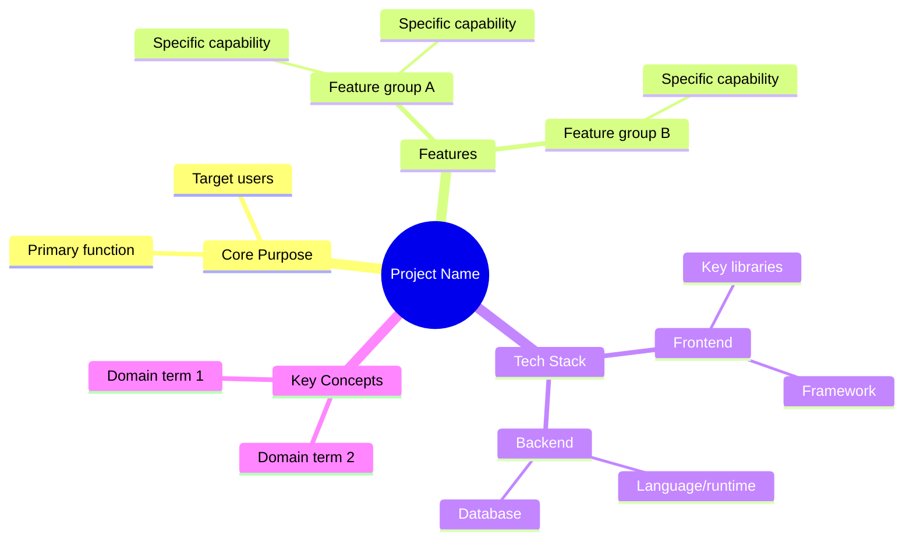
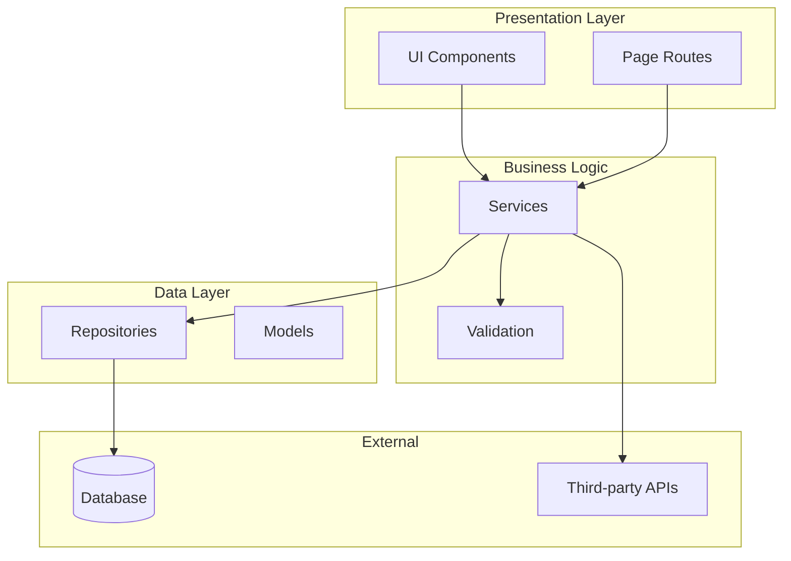
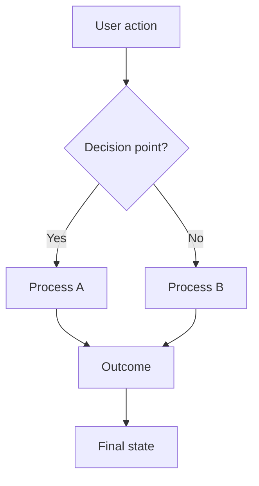
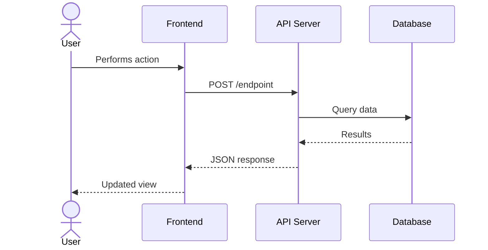
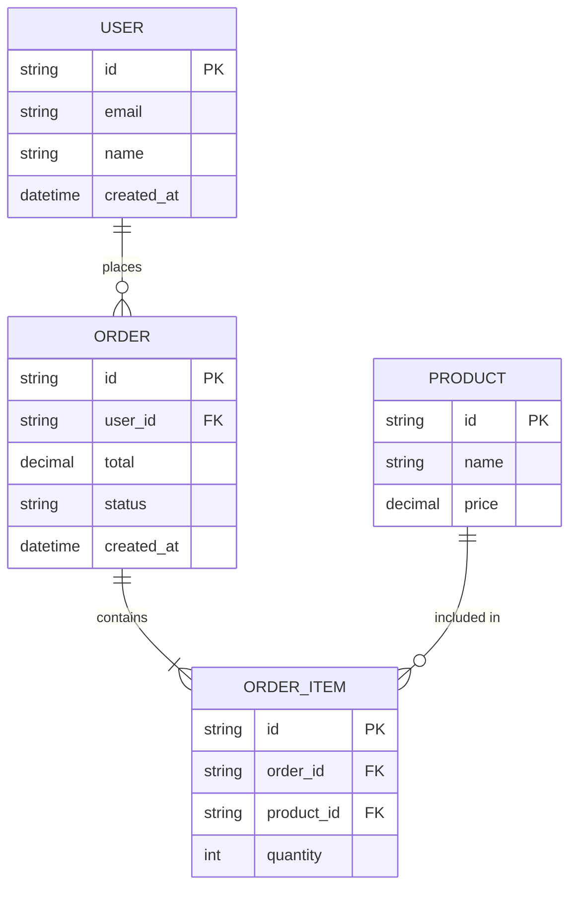

<daodan_host_binding host="opencode">
This binding governs execution of this package and its loaded references. It takes
precedence over executable examples written for another host. Use only registered
tools and their actual input schema; an example never creates a tool, argument,
permission, model alias or nested worker capability. Preserve the generated worker
allowlist, dependency closure, scope and delivery contracts.

OpenCode V2 binding: repository reads use read/glob/grep, writes use write/edit/patch,
shell execution uses shell, network tools are webfetch/websearch, and clarification
uses the registered question tool. shell takes command, optional workdir, timeout
in milliseconds and background. It does not provide interactive stdin. Persistent
capture uses background: true and an explicit noninteractive stop signal.
Load skills with skill using id: "<plugin>:<skill>". Dispatch registered roles with
subagent using agent: "<owner>:<role>", description and prompt; optional sessionID
continues that child, and background: true requests asynchronous completion.
Use only roles allowed by the current harness and permissions. A child cannot
dispatch nested workers when its permissions or the configured depth deny it.
Workflow entries are /<plugin>:<workflow>, registered by the package loader.
Inherit the session model; an override requires its authorized, actually available
provider/model identity, not another host's short model alias.
The loader includes required local providers and registers plugin-declared MCP
servers. Qualified foreign providers need a compatible V2 plugin/skill provisioned
through this host, never a Claude marketplace command. Check the active registry:
registration metadata alone does not prove a connected server or usable tool.
Inherit the active session's model and default variant. A source model alias such
as sonnet is not a portable override; request a different model only through an
explicit adapter mapping to a valid host identity and user authorization.

The executing agent and its coordinator own continuation, recovery, verification
and delivery. Skills supply knowledge and method instructions; they are not
executors or a runtime persistence mechanism.

Resolve each component by kind and exact installed identity. A role is dispatched
as a worker, a skill loads instructions, and a workflow starts its declared method.
Kernel owner-qualified skill references are logical provider identities: resolve
them to the actual host registry name and verified installed provider path. Do not
invent a registry string by adding an owner's prefix when the host does not use it.
Do not load an agent identity as a skill or execute a workflow name as a shell
command. Named foreign providers remain mandatory. If an installed provider, MCP
server or required isolation mechanism is unavailable, stop its dependent phase
and report the missing capability. Do not install a different host's plugin or
substitute unrelated skills to claim coverage.

Shell execution alone does not establish interactive stdin. Before a capture or
checkpoint, use an available session-control mechanism. When stdin is unavailable,
keep user-driven capture in a supported background process with bounded output and
an explicit stop signal controlled by the coordinator after the user's completion
message. Close owned browser/process resources on completion or cancellation.

Continue working within the current authorization while the requested result is
achievable. After a tool error, inspect its cause, correct the relevant input or
implementation, retry when justified and verify the outcome; never repeat a
failing action blindly. Do not close the turn with a promise or a partial result
when an authorized next step can still produce or verify the requested result.
Stop only for a documented real impediment, a missing required capability, an
unresolved human decision or the caller's stop request. At that boundary, report
completed results, remaining work and the concrete prerequisite for continuation;
continue any independent work that the blocker does not prevent.

A tool's successful exit, a worker stop or an idle session is not the deliverable.
Return final text naming observed findings, artifact paths, executed checks and
blockers. An empty worker result is missing delivery: inspect or resume that worker
when permitted, or record failure. Verify required artifacts and candidate gates
before marking the requested outcome complete.

This is an execution binding, not a rewrite of source examples. Preserve programming
language fences, domain code and host APIs that are the subject of marketplace-ops
or agent-sdk-builder. A host-as-subject API is not a tool provided to this session.
Compiled binding and static checks do not prove an installed host executed a run.
</daodan_host_binding>

# Mermaid Diagram Patterns

Reference templates for diagrams used in project-knowledge output documents.

## 1. Mindmap (01-overview.md)

Project concept map showing high-level structure and relationships.

### Guidelines
- Root node: project name in double parentheses `(( ))`
- Max 3 levels deep
- Group by functional areas, not file structure
- Use plain language, not technical identifiers

## 2. Component/Layer Diagram (04-architecture.md)

Shows how the codebase is organized into layers or modules.

### Guidelines
- Use subgraphs for layers/boundaries
- Label subgraphs with human-readable names
- Show data flow direction with arrows
- Use shape conventions: `[Rectangle]` for components, `[(Cylinder)]` for databases, `([Stadium])` for external services
- Include file path annotations as comments where helpful

## 3. Flowchart (05-workflows.md)

User or system workflows showing decision points and outcomes.

### Guidelines
- Start with the trigger (user action or system event)
- Use `{ }` for decision diamonds
- Label all edges, especially from decision nodes
- Keep linear: avoid complex crossing lines
- One workflow per diagram: split complex flows into multiple diagrams

## 4. Sequence Diagram (05-workflows.md)

Interactions between components over time for key operations.

### Guidelines
- Name participants with readable aliases: `participant API as API Server`
- Use `actor` for human users
- Solid arrows `->>`  for requests, dashed `-->>` for responses
- Add `Note over` for important context
- Keep to 5-8 interactions per diagram: split if longer
- Show the happy path first, mention error paths in text

## 5. ER Diagram (06-data-model.md)

Entity relationships showing data structures and their connections.

### Guidelines
- Include PK/FK annotations
- Use standard cardinality notation: `||--o{` (one-to-many), `||--||` (one-to-one), `}o--o{` (many-to-many)
- Label relationships with verbs
- Include key fields only: not every column
- Group related entities visually

## General Rules

- Keep diagrams under 15-20 nodes
- Use consistent naming across all diagrams in a guide
- Test that syntax renders correctly in standard Mermaid renderers
- Prefer clarity over completeness: a readable subset beats a cluttered whole
- Add a brief text introduction before each diagram explaining what it shows
