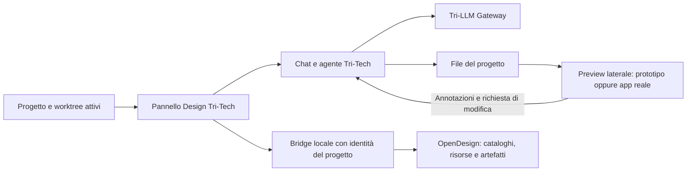

# OpenDesign in Tri-Tech Code: prima verifica di fattibilità

Verifica del 10 ottobre 2026. Obiettivo: collegare OpenDesign al progetto e alla chat di Tri-Tech Code, con preview nel pannello laterale. Si assume il progetto ufficiale [nexu-io/open-design](https://github.com/nexu-io/open-design).

La verifica riguarda sorgenti e documentazione. Non sono stati installati pacchetti, avviati servizi, modificati i prodotti o eseguiti test di integrazione.

## Esito

**L'integrazione è tecnicamente plausibile e dispone di punti di aggancio concreti.** Tri-Tech ha già un browser laterale, una preview HTML isolata, il contesto del progetto e un SDK per pannelli. OpenDesign ha un daemon HTTP, MCP, importazione di cartelle senza copia e notifiche delle modifiche ai file. Mancano i raccordi che rendono questi elementi una sola esperienza.

La raccomandazione è un **pannello Design posseduto da Tri-Tech**, con accesso selettivo alle risorse di OpenDesign e generazione affidata alla sessione Tri-Tech esistente. La preview usa il browser nativo di Tri-Tech. Un secondo percorso, più impegnativo, incorpora lo Studio completo di OpenDesign e adatta il suo controllo delle sessioni.

Questa è una proposta derivata dal codice letto, non una compatibilità già dimostrata. MCP da solo rende disponibili strumenti all'agente; non crea il pannello né associa automaticamente il progetto OpenDesign alla chat Tri-Tech.

## Sorgenti verificate

| Componente | Riferimento |
|---|---|
| Tri-Tech Code | Checkout `D:/Projects/tri-opencode-desktop`, HEAD `ed7748415398a67c3970950caacaee4b94e8e988`, ramo `main`; letture dei sorgenti locali e dei sorgenti OpenChamber preparati |
| Frontend effettivo | `openchamber.json`: OpenChamber `v2.1.1`, commit `e302062e3be0686986594fddabdafd8a97c129e5` |
| Motore effettivo | `upstream.json`: OpenCode `v2.0.24`, commit `e7a34f09bfd9134dfade5a8ddb843f7030bc9a69` |
| OpenDesign | `main` al commit `17e255959703a3fad7c8eb7f7b70dcafccc5629a`, del 10 ottobre 2026; non è una verifica di una release installata |

Le evidenze upstream più dettagliate sono in [OpenDesign: API e limiti](2026-10-10-opendesign-upstream.md). Le citazioni OpenDesign usano il commit letto; quelle locali descrivono il checkout, comprese le personalizzazioni presenti. Lo stato delle modifiche Git di Tri-Tech non è stato accertato: i tentativi di lettura dello stato hanno incontrato errori di worktree/permessi. Il checkout non viene quindi descritto come pulito.

## Che cosa esiste già

| Esigenza | Evidenza | Conseguenza |
|---|---|---|
| Pannello laterale nativo | OpenChamber SDK: `connectHost`, contesto directory/sessione, eventi e capacità per file, messaggi e servizi | Il pannello può seguire il progetto aperto e preparare richieste nella chat |
| Preview dell'app reale | `BrowserPane`, `useUIStore.openContextPreview(directory, url)`, rilevamento dei dev server | Si possono riusare browser, aggiornamento a caldo, viewport, DevTools e annotazioni |
| Preview di un artefatto HTML | Preview file di OpenChamber con concessione sul progetto e origine isolata | Un primo prototipo non richiede lo Studio completo di OpenDesign |
| Cartella condivisa | OpenDesign `POST /api/import/folder` risolve e conserva `metadata.baseDir` | Può leggere e modificare lo stesso worktree scelto in Tri-Tech, senza esportazione e reimportazione |
| Aggiornamenti da un agente esterno | Chokidar sul percorso effettivo e `GET /api/projects/:id/events` | Anche le modifiche fatte dall'agente Tri-Tech possono aggiornare la vista OpenDesign |
| Strumenti per l'agente | MCP: cataloghi, risorse di skill/design system, lettura e scrittura di artefatti | È possibile riusare parti di OpenDesign senza usare la sua chat |
| Composizione del prompt | `composeSystemPrompt` nei contracts TypeScript di OpenDesign | La logica può essere adattata dai sorgenti; non è un endpoint pubblico né un SDK npm stabile |

Fonti Tri-Tech: [SDK](</D:/Projects/tri-opencode-desktop/.cache/openchamber/v2.1.1/source/packages/sdk/README.md>), [API SDK](</D:/Projects/tri-opencode-desktop/.cache/openchamber/v2.1.1/source/packages/sdk/API.md>), [preview nativa](</D:/Projects/tri-opencode-desktop/.cache/openchamber/v2.1.1/source/packages/ui/src/stores/useUIStore.ts:1753>), [preview HTML](</D:/Projects/tri-opencode-desktop/.cache/openchamber/v2.1.1/source/packages/web/server/lib/fs/routes.js:1194>).

Fonti OpenDesign: [architettura](https://github.com/nexu-io/open-design/blob/17e255959703a3fad7c8eb7f7b70dcafccc5629a/docs/architecture.md), [importazione](https://github.com/nexu-io/open-design/blob/17e255959703a3fad7c8eb7f7b70dcafccc5629a/apps/daemon/src/import-export-routes.ts#L343), [watcher](https://github.com/nexu-io/open-design/blob/17e255959703a3fad7c8eb7f7b70dcafccc5629a/apps/daemon/src/project-watchers.ts#L181), [MCP](https://github.com/nexu-io/open-design/blob/17e255959703a3fad7c8eb7f7b70dcafccc5629a/apps/daemon/src/mcp.ts#L449).

## Architettura proposta

Il bridge mantiene un'associazione esplicita tra directory canonica del worktree, progetto Tri-Tech, sessione Tri-Tech e progetto OpenDesign. Le richieste e le risposte devono conservare questa identità anche se l'utente cambia chat. I tool MCP ricevono un progetto esplicito: il generico progetto attivo di OpenDesign non basta per più chat o worktree concorrenti.

Il pannello seleziona skill, template, design system e file da visualizzare. Prepara il brief e lo passa al normale composer o al percorso di invio autorizzato. L'agente Tri-Tech conserva modello, permessi, contesto e contabilità. Il bridge può essere un servizio locale dedicato o una parte del backend Tri-Tech; la scelta dipende da quali funzioni OpenDesign si vogliono conservare.

Per un primo esperimento si possono riusare skill selezionate e preview esistenti, aggiungendo il daemon soltanto per le capacità che lo richiedono. Questo esperimento validerebbe un sottoinsieme di OpenDesign. Non dimostrerebbe la parità con l'intero Studio, i suoi editor, export o media.

## Raccordi necessari e limiti verificati

1. **Sessione e Gateway.** L'adapter OpenCode di OpenDesign esegue `opencode run --format json`, conserva la sessione che esso genera e la riprende in turni successivi. Il tool MCP `start_run` dichiara esplicitamente che avvia un proprio agente. Non emerge un collegamento automatico alla sessione già aperta nel desktop Tri-Tech. La generazione predefinita va quindi mantenuta nel motore Tri-Tech o richiede un nuovo adapter che provi il riuso del servizio, delle sessioni e del Gateway. [Adapter](https://github.com/nexu-io/open-design/blob/17e255959703a3fad7c8eb7f7b70dcafccc5629a/apps/daemon/src/runtimes/defs/opencode.ts#L138), [start_run](https://github.com/nexu-io/open-design/blob/17e255959703a3fad7c8eb7f7b70dcafccc5629a/apps/daemon/src/mcp.ts#L759), [vincolo Gateway Tri-Tech](</D:/Projects/tri-opencode-desktop/plugin/gateway-boundary.ts:38>).

2. **Apertura della preview.** L'SDK guest offre `openSurface('browser')` senza URL; `openUrl` apre il browser esterno. L'apertura nativa con directory e URL esiste internamente. Serve un collegamento posseduto da Tri-Tech o una piccola estensione del contratto SDK. [PluginPane](</D:/Projects/tri-opencode-desktop/.cache/openchamber/v2.1.1/source/packages/ui/src/components/layout/PluginPane.tsx:594>), [openContextPreview](</D:/Projects/tri-opencode-desktop/.cache/openchamber/v2.1.1/source/packages/ui/src/stores/useUIStore.ts:1753>).

3. **Studio completo e isolamento.** Il pannello guest è un iframe con origine opaca. La sua CSP ammette frame del pacchetto, `data:` e `blob:`, non uno Studio annidato su `http://localhost`. Il browser Electron nativo costituisce un altro percorso. Non occorre allentare globalmente la CSP per dimostrare la preview. Le funzioni OpenDesign di inspect, palette, tweak ed editing usano bridge specifici: aprire il solo URL dell'artefatto non trasferisce tutti quei controlli a Tri-Tech. [CSP](</D:/Projects/tri-opencode-desktop/.cache/openchamber/v2.1.1/source/packages/sdk/src/frame-policy.ts:24>), [render mode OpenDesign](https://github.com/nexu-io/open-design/blob/17e255959703a3fad7c8eb7f7b70dcafccc5629a/apps/web/src/components/file-viewer-render-mode.ts).

4. **Servizi guest e policy del desktop.** Tri-Tech forza la modalità enterprise. Le capacità guest `service`, `network` e `origins` richiedono una provenienza ammessa dalla policy. Un'installazione locale non è automaticamente sufficiente; anche un guest distribuito come built-in viene rivalutato dalla policy e non riceve un'esenzione. Un'integrazione distribuita deve avere un binding esplicito, oppure usare un pannello e un backend nativi Tri-Tech. [Ambiente desktop](</D:/Projects/tri-opencode-desktop/packages/openchamber/desktop/tritech-environment.mjs:20>), [policy guest](</D:/Projects/tri-opencode-desktop/.cache/openchamber/v2.1.1/source/packages/web/server/lib/guests/enterprise.js:61>).

5. **Identità e streaming del servizio.** Il servizio guest parte nella cartella del pacchetto, non nel progetto; eredita un ambiente limitato e non le credenziali del motore. `serviceRequest` restituisce una risposta finita, non gli eventi SSE in streaming. La facciata deve ottenere l'identità del progetto dal backend e validarla; per gli aggiornamenti può mantenere una sottoscrizione backend o usare polling limitato nel primo esperimento. La dichiarazione dei permessi di un servizio non confina il processo, che resta eseguito con i diritti dell'utente. [Contratto servizi](</D:/Projects/tri-opencode-desktop/.cache/openchamber/v2.1.1/source/packages/sdk/GUEST_SERVICES.md:27>), [spawn](</D:/Projects/tri-opencode-desktop/.cache/openchamber/v2.1.1/source/packages/web/server/lib/guests/service.js:420>), [risposta del proxy](</D:/Projects/tri-opencode-desktop/.cache/openchamber/v2.1.1/source/packages/web/server/lib/guests/service.js:700>).

6. **Importazione autorizzata.** Riutilizzare un daemon OpenDesign collegato al suo desktop richiede il token di importazione emesso dal suo host. Un sidecar standalone ha un percorso differente. La directory condivisa è una capacità da legare al progetto scelto, non un'autorizzazione dedotta dall'URL o dalla porta del daemon. [Importazione](https://github.com/nexu-io/open-design/blob/17e255959703a3fad7c8eb7f7b70dcafccc5629a/apps/daemon/src/import-export-routes.ts#L368).

7. **Prototipo e sorgenti del prodotto.** Le preview di HTML e asset sono supportate. Modificare visivamente quel prototipo non dimostra un aggiornamento equivalente di componenti React, Vue o Next, né una sincronizzazione bidirezionale generale. L'agente può applicare il design ai sorgenti reali; l'app deve poi essere visualizzata attraverso il suo dev server e verificata nei suoi flussi. OpenDesign distingue anche workspace esterni e politica di writeback: i metadati di provenienza non applicano da soli il risultato al repository. [Confine dell'orchestratore](https://github.com/nexu-io/open-design/blob/17e255959703a3fad7c8eb7f7b70dcafccc5629a/docs/orchestrator-workspaces.md).

8. **Confezionamento Windows.** OpenDesign usa Node 24 e dipendenze native. Il sorgente dichiara il percorso Windows nativo best effort e descrive possibili esigenze di node-gyp. La nota documentale su `better-sqlite3` cita una versione diversa dal manifest letto: non prova l'assenza di binari precompilati per la versione attuale. Il fatto che Tri-Tech distribuisca un runtime Node non dimostra ancora la compatibilità ABI o il funzionamento del sidecar OpenDesign nel pacchetto finale. [Baseline upstream](https://github.com/nexu-io/open-design/blob/17e255959703a3fad7c8eb7f7b70dcafccc5629a/AGENTS.md#environment-baseline), [dipendenza effettiva](https://github.com/nexu-io/open-design/blob/17e255959703a3fad7c8eb7f7b70dcafccc5629a/apps/daemon/package.json#L60).

Le eventuali modifiche permanenti del frontend devono usare overlay `packages/openchamber/` e patch `patches/openchamber/`; il backend usa i moduli posseduti in `plugin/`. La sola copia preparata sotto `.cache/` non conserva un'integrazione al successivo riallineamento. [Preparazione Tri-Tech](</D:/Projects/tri-opencode-desktop/bundle/openchamber.ts:43>). Il riuso di contenuti OpenDesign richiede inoltre inventario e provenienza delle risorse selezionate: il progetto dichiara Apache-2.0, ma i bundle con una propria `LICENSE` conservano quella licenza. [Licenze upstream](https://github.com/nexu-io/open-design/blob/17e255959703a3fad7c8eb7f7b70dcafccc5629a/README.md#license).

## Primo esperimento utile

Una prova verticale circoscritta dovrebbe dimostrare:

- Apertura del pannello Design dal progetto corrente e associazione alla directory reale del worktree.
- Lettura del `DESIGN.md` esistente, scelta di una risorsa OpenDesign e preparazione del brief nella chat Tri-Tech.
- Generazione o modifica con l'agente e il Gateway già usati da quella chat, senza un secondo login per il modello.
- Preview di un artefatto HTML nel pannello; una modifica esterna deve produrre un aggiornamento visibile.
- Annotazione della preview e ritorno della richiesta alla sessione corretta.
- Applicazione di una modifica a una piccola app React esistente e verifica della preview dal suo dev server.
- Cambio tra due progetti/worktree durante una risposta lenta: nessuna preview o scrittura deve finire sul progetto sbagliato.
- Gestione di file modificati contemporaneamente, arresto/riavvio del bridge, porte occupate e chiusura del pannello.
- Esecuzione nel pacchetto Windows distribuito e controllo dei consumi a pannello aperto, nascosto e chiuso.

Le prime cinque verifiche dimostrano il collegamento fra chat, progetto e artefatto; quella sull'app reale dimostra il passaggio dai prototipi al prodotto. Le altre coprono i principali confini emersi dalla lettura.

## Decisione proposta

Procedere con un prototipo del pannello Design nativo, lasciando a Tri-Tech l'autorità su progetto, chat, modelli e scritture. Valutare il riuso dello Studio completo solo se servono i suoi controlli visuali ed export: comporta un'integrazione più ampia del semplice accesso MCP.

Non sono stati rilevati impedimenti strutturali nella lettura effettuata. Restano da dimostrare compatibilità Windows, binding della directory, aggiornamento della preview e continuità della sessione nel runtime effettivo. Nessuno di questi punti è stato dichiarato verificato dal solo esame statico.
